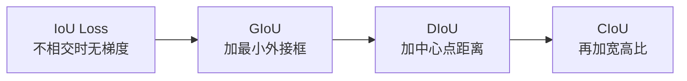

---
Title | ML Tasks Image Detection Loss
-- | --
Created @ | `2026-11-26T01:29:21Z`
Updated @| `2026-11-26T01:29:21Z`
Labels | ``
Edit @| [here](https://github.com/junxnone/aiwiki/issues/805)

---
# Loss

目标检测的框回归损失：从 $L_1/L_2$ 到 IoU 系列 (IoU、GIoU、DIoU、CIoU)，为什么要用 IoU 类损失，以及各自解决的问题。

## 为什么不直接用 L1/L2

框回归的评价指标是 IoU，而早期的损失 (如 [Fast R-CNN](/0058_ML_Tasks_Image_Detection_FastRCNN) 里的 Smooth $L_1$) 是对 $(x,y,w,h)$ 四个值分别回归，存在两个问题：

- 四个坐标被当作相互独立的变量，而 IoU 把它们联系在一起：同样的 $L_2$ 误差，对大框和小框、对不同位置对应的 IoU 差别很大
- 即使 $L_1/L_2$ 相同的两个预测框，IoU 也可能差别很大，损失不能反映评价指标

因此直接优化 IoU 更合理，但原始 IoU 损失在两框不相交时为常数 $0$，没有梯度。后续方法依次修补这个缺陷：

图中：箭头表示每一个新损失解决上一个的缺陷：GIoU 让不相交的框也有梯度，DIoU 让重叠的框收敛更快，CIoU 再考虑长宽比一致。

## 公式

$$
\mathcal L_{IoU}=1-\mathrm{IoU},\qquad
\mathrm{IoU}=\frac{|A\cap B|}{|A\cup B|}
$$

$$
\mathcal L_{GIoU}=1-\mathrm{IoU}+\frac{|C\setminus(A\cup B)|}{|C|}
$$

$$
\mathcal L_{DIoU}=1-\mathrm{IoU}+\frac{\rho^2(\mathbf b,\mathbf b^{gt})}{c^2}
$$

$$
\mathcal L_{CIoU}=1-\mathrm{IoU}+\frac{\rho^2(\mathbf b,\mathbf b^{gt})}{c^2}+\alpha v,\quad
v=\frac4{\pi^2}\Bigl(\arctan\frac{w^{gt}}{h^{gt}}-\arctan\frac wh\Bigr)^2,\quad
\alpha=\frac v{(1-\mathrm{IoU})+v}
$$

其中：

- $A$：预测框，$B$：真实框，$|\cdot|$ 表示面积；$\mathrm{IoU}$ 的取值范围 $[0,1]$
- $C$：同时包含 $A$ 和 $B$ 的最小外接矩形；$|C\setminus(A\cup B)|$：外接矩形中不属于两个框的并集的空白部分的面积
- GIoU 的第二项：两框离得越远，空白部分占外接框的比例越大，惩罚越大；两框不相交时仍有梯度，会促使它们靠近；两框完全重合时第二项为 $0$
- $\mathbf b,\mathbf b^{gt}$：预测框与真实框的中心点；$\rho(\cdot)$：欧氏距离；$c$：外接矩形的对角线长度。DIoU 直接最小化中心距离，比 GIoU 收敛更快，尤其是一个框包含另一个框的情形 (GIoU 退化为 IoU)
- $v$：宽高比的一致性度量，$w,h$ 为预测框宽高，$w^{gt},h^{gt}$ 为真实框宽高；$\alpha$：权重，IoU 越大 (框已较重合) 越重视宽高比。CIoU 同时考虑重叠面积、中心距离、宽高比，是 [YOLO V5](/0379_ML_Tasks_Image_Detection_YOLO_V5) 等使用的默认框回归损失

## 对比

损失 | 不相交时有梯度 | 考虑中心距离 | 考虑宽高比 | 收敛
-- | -- | -- | -- | --
$L_1/L_2/\mathrm{Smooth}\ L_1$ | 是 | 隐含 | 隐含 | 与 IoU 不一致
IoU Loss | 否 | 否 | 否 | -
GIoU | 是 | 间接 | 否 | 包含关系时退化
DIoU | 是 | 是 | 否 | 较快
CIoU | 是 | 是 | 是 | 快、稳定

表中：每一列表示损失是否具备某个性质；`收敛` 指回归过程的速度和稳定性。选择上，没有特别理由时用 CIoU (YOLO 系列) 或 GIoU (DETR 类检测器的框损失之一)。

## 使用方式

- 通常把 IoU 类损失与分类损失、置信度损失相加得到总损失：$L=\lambda_{box}\mathcal L_{CIoU}+\lambda_{obj}L_{obj}+\lambda_{cls}L_{cls}$，见 [YOLO V5](/0379_ML_Tasks_Image_Detection_YOLO_V5)
- 也有方法把 IoU 或分布式的定位质量用作后处理的排序依据 (如 DIoU-NMS)
- 分割领域的对应指标和损失见 [Segmentation](/0159_ML_Tasks_Image_Segmentation) 中的 Dice 损失

## Reference
- [Generalized Intersection over Union](https://arxiv.org/abs/1902.09630)
- [Distance-IoU Loss: Faster and Better Learning for Bounding Box Regression](https://arxiv.org/abs/1911.08287)
- [UnitBox: An Advanced Object Detection Network](https://arxiv.org/abs/1608.01471)

