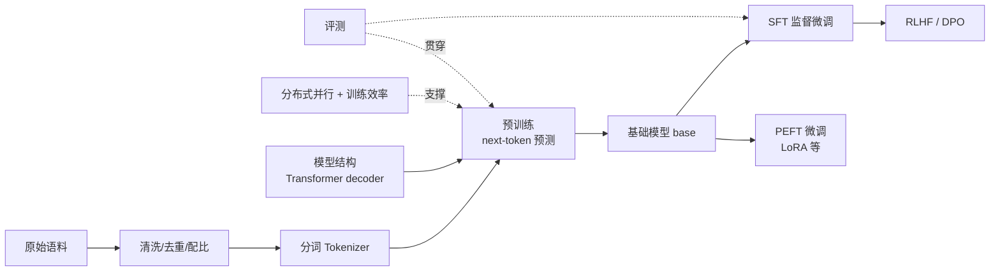

---
Title | LM Train
-- | --
Created @ | `2026-11-26T15:33:10Z`
Updated @| `2026-11-26T15:41:49Z`
Labels | ``
Edit @| [here](https://github.com/junxnone/aiwiki/issues/818)

---
# Train

大模型训练阶段的总览：数据、分词、结构、预训练、分布式并行、训练效率和评测，以及它们与已有的微调、对齐文章如何衔接。

## 训练流程

下图展示一个基础模型是如何被训练出来的，以及后续对齐和微调在什么位置：

图中：

- 上面一条主线是预训练：语料经清洗和分词变成 token 序列，在 Transformer 结构上以预测下一个 token 为目标训练，得到基础模型
- 右边是基础模型之后的两条路：对话模型走 SFT → RLHF/DPO，见 [对齐](/0568_LM_FT_Alignment)；领域适配走参数高效微调，见 [微调](/0410_LM_FT)
- 虚线是支撑条件：分布式并行和训练效率决定「能不能训得起来、要训多久」，评测贯穿各阶段，决定「训得好不好」

## 本系列文章

文章 | 回答的问题
-- | --
[Data](/0821_LM_Train_Data) | 训练数据从哪来，怎样清洗、去重、配比
[Tokenizer](/0822_LM_Train_Tokenizer) | 文本怎样变成 token，词表大小如何选择
[Architecture](/0823_LM_Train_Architecture) | 现代 decoder-only 模型的结构，参数量与计算量如何计算
[Pretrain](/0824_LM_Train_Pretrain) | 预训练的目标、优化器、学习率、Scaling Law
[Distributed](/0825_LM_Train_Distributed) | 单卡放不下怎么办：DP、ZeRO、张量并行、流水线并行
[Efficiency](/0826_LM_Train_Efficiency) | 混合精度、激活重计算、FlashAttention、MFU
[Eval](/0827_LM_Train_Eval) | 怎样评价模型训得好不好
[MoE](/0828_LM_Train_MoE) | 混合专家：路由、负载均衡、细粒度与共享专家
[LongContext](/0829_LM_Train_LongContext) | 把上下文扩到 128K：RoPE 外推、继续训练、评测
[Optimizer](/0830_LM_Train_Optimizer) | AdamW、Lion、Muon，学习率与 batch，μP 超参迁移
[Stability](/0831_LM_Train_Stability) | loss spike、z-loss、QK-Norm、checkpoint 与故障恢复
[Cluster](/0832_LM_Train_Cluster) | GPU、互联、通信库、存储与可靠性
[Reasoning](/0833_LM_FT_Reasoning) | GRPO 与可验证奖励的推理强化学习、推理时计算
[微调](/0410_LM_FT) / [对齐](/0568_LM_FT_Alignment) | 已有：PEFT、SFT、RLHF、DPO

表中：左列是文章，右列是它回答的核心问题。前七篇是主线，建议按顺序阅读：先理解数据与结构，再看预训练目标和规模规律，最后看怎样把它高效、分布式地跑起来；MoE 到 Reasoning 是专题，按需阅读。

## 训练成本一览

$$
\text{GPU 小时}\approx\frac{6\,N\,D}{\text{FLOPs}_{peak}\times\text{MFU}\times3600}
$$

其中：

- $N$：参数量；$D$：训练 token 数；$6ND$：总计算量 (FLOPs)
- $\text{FLOPs}_{peak}$：单卡峰值算力 (如 A100 的 BF16 为 $312\times10^{12}$)；$\text{MFU}$ (Model FLOPs Utilization)：实际达到的算力占峰值的比例，大规模训练通常在 $30\%\sim55\%$ `[经验]`
- 结果是单卡等效的 GPU 小时数，除以卡数得到墙钟时间
- 例：$N=7\times10^9$，$D=2\times10^{12}$，A100，MFU $40\%$：$\approx1.9\times10^5$ GPU 小时，与 Llama 2 7B 公开的约 $1.84\times10^5$ GPU 小时量级一致，推导见 [Pretrain](/0824_LM_Train_Pretrain)

## 与其他系列的关系

- 训练好的模型要变小、变快：[量化](/0312_MO_Quantization)、[蒸馏](/0207_MO_KD)
- 训练完要运行起来：[Infer](/0819_LM_Infer)、[Deploy](/0820_LM_Deploy)
- 全流程见 [Lifecycle](/0817_LM_Lifecycle)

## Reference
- [Training Compute-Optimal Large Language Models](https://arxiv.org/abs/2203.15556)
- [Llama 2: Open Foundation and Fine-Tuned Chat Models](https://arxiv.org/abs/2307.09288)
- [The Llama 3 Herd of Models](https://arxiv.org/abs/2407.21783)

