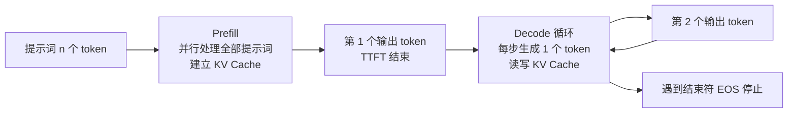

---
Title | LM Infer
-- | --
Created @ | `2026-11-26T15:33:22Z`
Updated @| `2026-11-26T15:33:22Z`
Labels | ``
Edit @| [here](https://github.com/junxnone/aiwiki/issues/819)

---
# Infer

大模型推理的总览：为什么生成一个 token 很快、生成一长段却很慢，瓶颈在算力还是显存带宽，以及各类优化技术分别解决什么问题。

## 推理的两个阶段

下图展示一次请求的处理过程，prefill 一次处理整段提示词，decode 则一个 token 一个 token 地生成：

图中：

- Prefill：提示词里的所有 token 可以并行计算，这一步算力密集 (compute-bound)，耗时决定首 token 延迟 TTFT
- Decode：每步只生成一个 token，必须依赖上一步的结果，无法并行；每一步都要把全部权重和 KV Cache 从显存读一遍，因此受显存带宽限制 (memory-bound)，耗时决定每 token 延迟 TPOT
- KV Cache 避免了每一步重复计算已处理 token 的 K、V，但占用随序列长度线性增长的显存

## 本系列文章

文章 | 回答的问题
-- | --
[Basics](@@IBAS@@) | prefill/decode 的性能特征、KV Cache 大小公式、延迟与吞吐指标
[Optimization](@@IOPT@@) | continuous batching、PagedAttention、投机解码等优化技术
[Parallel](@@IPAR@@) | 多卡/多机推理的并行方式，PD 分离
[Speculative](@@ISPEC@@) | 投机解码的无损性推导、加速比估算、各类猜测方法
[KVCache](@@IKV@@) | KV Cache 的分页、抢占、offload、跨实例共享与淘汰
[Attention](@@IATT@@) | prefill/decode 注意力的差别，FlashDecoding，GQA/MLA 的推理影响
[StructuredOutput](@@ISTR@@) | 约束解码的原理、开销与工具
[CPU](@@ICPU@@) | CPU 推理：带宽、AMX、NUMA 与线程调优

表中：Basics 讲「为什么慢」，Optimization 讲「怎么变快」，Parallel 讲「一张卡放不下或不够快怎么办」；后面五篇是对其中关键技术和特定硬件的深入展开。

## 瓶颈与对策

瓶颈 | 表现 | 主要对策 | 文章
-- | -- | -- | --
权重读取带宽 (decode) | 单请求 token 速度低 | 量化、增大 batch、投机解码 | [量化](/0312_MO_Quantization)、[Optimization](@@IOPT@@)
KV Cache 显存 | 并发数上不去、长上下文 OOM | PagedAttention、GQA、KV 量化 | [Optimization](@@IOPT@@)、[KVCache](/0708_MO_Quantization_KVCache)
Prefill 算力 | 长提示词 TTFT 高 | chunked prefill、前缀缓存、更强算力 | [Optimization](@@IOPT@@)
单卡放不下 | 模型过大 | 张量并行、流水线并行 | [Parallel](@@IPAR@@)
调度效率 | GPU 利用率低 | continuous batching | [Optimization](@@IOPT@@)

表中：这是排查推理性能问题的清单：先判断瓶颈在哪一类，再选择对应手段；多数情况下 decode 阶段的显存带宽是第一瓶颈。

## 与相关主题

- 采样参数 (top-p、temperature)：[LLM Parameters](/0502_LM_LLMs_Parameters)；指标：[LLM Metrics](/0503_LM_LLMs_Metrics)
- 模型压缩：[量化](/0312_MO_Quantization)、[蒸馏](/0207_MO_KD)
- 怎样把推理引擎变成服务：[Deploy](@@DEPLOY@@)；全流程见 [Lifecycle](@@LIFE@@)

## Reference
- [Efficient Memory Management for Large Language Model Serving with PagedAttention](https://arxiv.org/abs/2309.06180)
- [Orca: A Distributed Serving System for Transformer-Based Generative Models](https://www.usenix.org/conference/osdi22/presentation/yu)
- [LLM Inference Performance Engineering: Best Practices - Databricks](https://www.databricks.com/blog/llm-inference-performance-engineering-best-practices)

