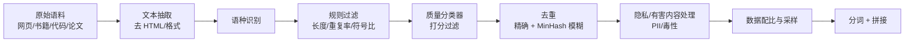

---
Title | LM Train Data
-- | --
Created @ | `2026-11-26T15:33:47Z`
Updated @| `2026-11-26T15:41:55Z`
Labels | ``
Edit @| [here](https://github.com/junxnone/aiwiki/issues/821)

---
# Data

大模型的训练数据：语料从哪里来，怎样清洗、去重和过滤，各类数据怎样配比，以及合成数据、数据污染和序列拼接等实际问题。

## 数据处理流程

下图是预训练数据的典型处理流水线，每一步都会丢掉一部分数据，最终留下高质量、不重复的语料：

图中：

- 从左到右每一步都在过滤：规则过滤去掉明显的垃圾 (过短、符号过多、高度重复)，质量分类器用高质量参考文本训练打分，去重避免模型记忆重复内容
- 隐私与有害内容处理去掉个人信息 (PII，如邮箱、电话) 和毒性文本
- 最后按配比采样，再分词、拼接成训练序列，分词见 [Tokenizer](/0822_LM_Train_Tokenizer)
- 过滤力度越大，质量越高但数据量越少，需要在质量与规模之间折中

## 数据来源与配比

类型 | 例子 | 作用 | 占比的一般规律 `[经验]`
-- | -- | -- | --
网页 | Common Crawl 清洗后 | 主体，覆盖面广 | 最大
书籍/论文 | Books、arXiv | 长文本、结构化知识 | 较小但权重高
代码 | GitHub | 提升推理和代码能力，对逻辑也有帮助 | 5%~20%
百科/问答 | Wikipedia、StackExchange | 事实性知识 | 小，常多次重复使用
多语言 | 各语种语料 | 多语言能力 | 按目标语言配比
合成数据 | 模型生成的教科书式文本、数学题 | 补足稀缺能力 | 逐步增多

表中：占比因模型而异，表中只是常见趋势。高质量小数据通常会被上采样 (重复 $2\sim4$ 个 epoch)，而低质量大数据只用不到一遍。例如 Llama 3 的预训练语料约 $15\text{T}$ token，其中代码和数学的比例相比前代有明显提升 `[待核实]`。

## 去重

重复数据会让模型记忆原文、降低泛化，并加重评测污染。精确去重可以用哈希，近似重复用 MinHash + LSH：

$$
\Pr[\text{sig}_A=\text{sig}_B]=J(A,B)=\frac{|A\cap B|}{|A\cup B|},\qquad
P_{match}=1-\bigl(1-J^{\,r}\bigr)^{b}
$$

其中：

- $A,B$：两个文档的 shingle (如 5-gram) 集合；$J(A,B)$：Jaccard 相似度，衡量两个集合的重叠程度，范围 $[0,1]$
- MinHash 的性质：两个文档的单个 MinHash 值相同的概率恰好等于 $J(A,B)$
- LSH 把签名分成 $b$ 个带 (band)，每带 $r$ 行；只要有一个带的所有行都相同就判为候选重复对，其概率为 $P_{match}$
- 调整 $(b,r)$ 可以改变阈值：$J$ 超过某个值时 $P_{match}$ 迅速接近 $1$，低于该值时接近 $0$，形成一个 S 形的筛选曲线，实现近似重复的高效检索

S 曲线最陡处的相似度阈值近似为：

$$
t\approx\left(\frac1b\right)^{1/r}
$$

其中：

- $b$：带数；$r$：每带的行数；签名总长度为 $b\times r$
- $t$：$P_{match}$ 从接近 $0$ 跃升到接近 $1$ 的那个相似度，$b$ 越大阈值越低，$r$ 越大阈值越高

$(b,r)$ | 签名长度 | 阈值 $t$ | $J=0.5$ 时 $P_{match}$ | $J=0.8$ 时 $P_{match}$
-- | -- | -- | -- | --
$(20,5)$ | $100$ | $\approx0.55$ | $\approx0.47$ | $\approx1.00$
$(9,13)$ | $117$ | $\approx0.84$ | $\approx0.001$ | $\approx0.40$
$(14,9)$ | $126$ | $\approx0.75$ | $\approx0.03$ | $\approx0.87$

表中：$P_{match}$ 按 $1-(1-J^r)^b$ 计算；$(20,5)$ 阈值偏低，会把一半相似度为 $0.5$ 的文档对也当成候选，召回高但后续精确验证的开销大；$(9,13)$ 阈值很高，只抓几乎相同的文档。常见的预训练去重把阈值设在 $0.7\sim0.8$ 左右 `[经验]`，候选对还要再精确计算一次 Jaccard 相似度确认。

## 每一步会过滤掉多少

公开数据集的处理报告给出了一个量级概念：以 RefinedWeb 为例，从 Common Crawl 原始网页出发，经过 URL 过滤、文本抽取、语种识别、规则过滤和去重后，最终只保留了约 $10\%$ 左右的文档 `[待核实]`，其中去重 (精确 + 模糊) 单独就会去掉约一半的剩余数据。FineWeb 等后续工作也报告了类似的规律：

- 网页数据里重复和近似重复非常多，去重是缩减最多的一步
- 质量过滤的阈值直接决定最终规模：阈值越严，数据越少但每 token 的价值越高
- 所以「原始语料 $X$ TB」与「可用训练 token 数」之间常差一个数量级，规划数据量时要以处理后的 token 数为准

## 其他实际问题

- 数据格式：预训练用纯文本流；SFT 用对话格式 (多轮 messages)，见 [对齐](/0568_LM_FT_Alignment) 中的指令数据；分词时要用与模型一致的 chat template
- 序列拼接 (packing)：把多个文档用 EOS 分隔拼成固定长度 (如 $4096$) 的序列，避免补零浪费；为避免跨文档注意力，常使用文档级的注意力掩码
- 合成数据：用强模型生成教科书式文本、数学推理链、代码，对提升推理能力有效，风险是模型坍缩和偏差放大，需要过滤和多样化
- 数据污染：评测集内容混入训练语料会使评测分数虚高，常用 $n$-gram 重叠检测并从训练集中剔除，见 [Eval](/0827_LM_Train_Eval)
- 版权与许可：不同来源的数据有不同的使用许可，企业训练需要记录数据来源，见 [Safety](/0847_LM_Deploy_Safety)

## 微调数据

- 数据量远小于预训练，但质量要求更高；指令数据的来源与构造见 [对齐](/0568_LM_FT_Alignment)
- 参数高效微调所需的数据量更小，见 [微调](/0410_LM_FT)

## Reference
- [The RefinedWeb Dataset for Falcon LLM](https://arxiv.org/abs/2306.01116)
- [The Pile: An 800GB Dataset of Diverse Text for Language Modeling](https://arxiv.org/abs/2101.00027)
- [Deduplicating Training Data Makes Language Models Better](https://arxiv.org/abs/2107.06499)
- [Textbooks Are All You Need](https://arxiv.org/abs/2306.11644)
- [The Llama 3 Herd of Models](https://arxiv.org/abs/2407.21783)

