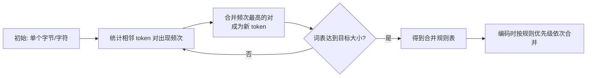

---
Title | LM Train Tokenizer
-- | --
Created @ | `2026-11-26T15:33:59Z`
Updated @| `2026-11-26T15:42:01Z`
Labels | ``
Edit @| [here](https://github.com/junxnone/aiwiki/issues/822)

---
# Tokenizer

分词器：文本怎样被切成 token，BPE、WordPiece、SentencePiece 的原理，词表大小如何影响模型，以及 chat template 与特殊 token。

## 为什么需要分词

- 模型只能处理整数序列：分词器把字符串映射为 token ID 序列，输出时再映射回字符串
- 按字符切太细，序列太长；按词切词表又太大、无法处理新词 (OOV)；子词 (subword) 是折中：常见词保持完整，罕见词拆成片段
- 分词器与模型必须配套：换一个分词器等于换了一套输入语言，模型无法使用

## BPE 原理

BPE (Byte Pair Encoding) 从字符或字节出发，反复合并最常出现的相邻对，直到词表达到目标大小：



图中：

- 训练 (左半部分) 在语料上统计并反复合并，得到一张有序的合并规则表，规则越靠前出现越频繁
- 编码 (右下) 时对新文本从单字符开始，按规则表的优先级依次合并，得到 token 序列
- 现代大模型 (GPT、Llama 3) 使用字节级 BPE：初始词表是 $256$ 个字节，因此任何字符 (含表情、罕见文字) 都能表示，不会出现 OOV

方法 | 合并/选择依据 | 代表
-- | -- | --
BPE | 相邻对出现频次 | GPT 系列、Llama 3 (tiktoken 风格)
WordPiece | 使语言模型似然提升最大 | BERT
Unigram | 从大词表开始，按似然逐步删除 | SentencePiece 的一种模式，T5
SentencePiece | 直接在原始文本 (含空格) 上训练，语言无关 | Llama 2、T5

表中：BPE 和 Unigram 都可以通过 SentencePiece 库训练。SentencePiece 的关键点是把空格当作普通字符 (用 `▁` 表示)，因此不依赖预先的分词，对中日文等没有空格的语言也适用。

## 词表大小

词表大小 $V$ 影响两处：

$$
\text{Params}_{emb}=V\,d\ \ (\text{输入})\ +\ V\,d\ \ (\text{输出，若不共享}),\qquad
\text{压缩率}=\frac{\text{字节数}}{\text{token 数}}
$$

其中：

- $V$：词表大小；$d$：隐藏维度；输入嵌入矩阵和输出 (LM head) 矩阵各 $V\times d$，权重共享时只算一份
- 压缩率：平均每个 token 对应多少字节，越高说明序列越短；序列越短，同样的上下文窗口能装更多内容，推理更快
- 例：Llama 2 的 $V=32{,}000$、$d=4096$，嵌入共约 $262\text{M}$；Llama 3 的 $V=128{,}256$，嵌入约 $1.05\text{B}$ (占 8B 模型的约 $13\%$)
- 词表越大，序列越短但嵌入矩阵越大，罕见 token 训练不足；多语言模型常用更大的词表，以降低非英语文本的序列长度

模型 | 词表大小 | 说明 `[待核实]`
-- | -- | --
Llama 2 | 32,000 | SentencePiece BPE
Llama 3 | 128,256 | 字节级 BPE，中文等多语言压缩率更好
GPT-4 (cl100k) | 约 100,000 | 字节级 BPE

表中：同一段中文，在英文为主的小词表分词器上可能需要 $2\sim3$ 倍的 token `[待核实]`，直接增加推理成本和费用；具体倍数要用自己的语料测一下，方法见下一节。

## 动手：训练与测量

用 Hugging Face `tokenizers` 训练一个字节级 BPE：

```python
from tokenizers import Tokenizer, models, pre_tokenizers, decoders, trainers
tok = Tokenizer(models.BPE())
tok.pre_tokenizer = pre_tokenizers.ByteLevel(add_prefix_space=False)   # 字节级，不会有 OOV
tok.decoder = decoders.ByteLevel()
trainer = trainers.BpeTrainer(
    vocab_size=32000,                                   # 目标词表大小
    min_frequency=2,                                    # 出现少于 2 次的组合不合并
    special_tokens=["<|endoftext|>", "<|im_start|>", "<|im_end|>"],
    initial_alphabet=pre_tokenizers.ByteLevel.alphabet())
tok.train(["corpus_zh.txt", "corpus_en.txt"], trainer)
tok.save("my_tokenizer.json")
```

- 训练语料要与目标使用场景的语言配比一致：中文占比低，中文词就合并得少，压缩率差
- `special_tokens` 会被整体保留、不参与合并，chat template 里用到的角色标记必须在这里登记

比较不同分词器在同一份语料上的压缩率：

```python
from transformers import AutoTokenizer
text = open("sample_zh.txt", encoding="utf-8").read()
for name in ["meta-llama/Llama-2-7b-hf", "meta-llama/Llama-3.1-8B", "Qwen/Qwen2.5-7B"]:
    t = AutoTokenizer.from_pretrained(name)
    n = len(t.encode(text, add_special_tokens=False))
    print(name, n, "tokens", round(len(text.encode("utf-8")) / n, 2), "bytes/token")
```

- 输出的 bytes/token 就是上文定义的压缩率，越大越好；中文每个汉字在 UTF-8 中占 $3$ 字节，所以 bytes/token 接近 $3$ 表示平均一个 token 约一个汉字
- 同一个模型的推理费用、上下文容量都与 token 数直接相关，选型时值得先测一下

## 特殊 token 与 chat template

- 特殊 token：`<bos>`/`<eos>` (序列起止)、`<pad>` (补齐)、`<unk>`，以及对话角色标记，如 `<|im_start|>`、`<|im_end|>`
- chat template：把多轮对话 (system / user / assistant 消息) 渲染成模型训练时见过的格式化字符串；格式不一致会使效果明显下降
- 使用 Hugging Face 时调用同一个模板：`tokenizer.apply_chat_template(messages, tokenize=False, add_generation_prompt=True)`
- 微调和部署必须使用相同的模板，这是常见的出错点，见 [Format](/0843_LM_Deploy_Format)

## 常见陷阱

- 前后空格、换行的处理不同会改变 token 切分，影响提示词和评测结果
- 数字被切成多段 (如 `12345` → `123`, `45`) 会影响算术能力，一些模型按单个数字切分
- 扩充词表 (增加专业词汇) 需要同时扩展嵌入矩阵，并继续训练新增行，见 [微调](/0410_LM_FT)
- 不同框架实现可能有细微差异，部署时用同一份 `tokenizer.json`

## Reference
- [Neural Machine Translation of Rare Words with Subword Units (BPE)](https://arxiv.org/abs/1508.07909)
- [SentencePiece: A simple and language independent subword tokenizer](https://arxiv.org/abs/1808.06226)
- [Language Models are Unsupervised Multitask Learners (byte-level BPE)](https://cdn.openai.com/better-language-models/language_models_are_unsupervised_multitask_learners.pdf)
- [Hugging Face: Chat templates](https://huggingface.co/docs/transformers/chat_templating)

