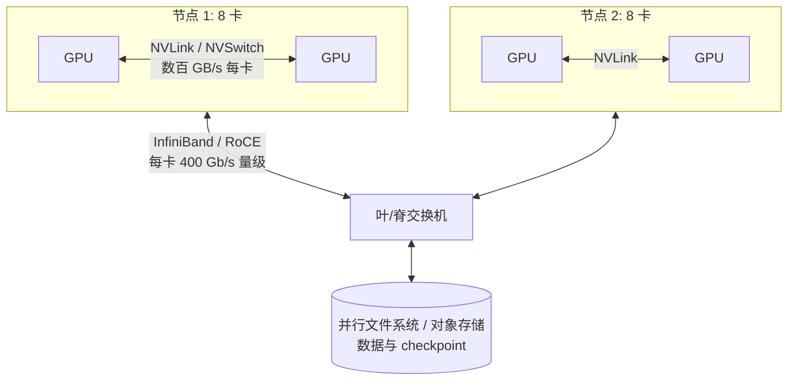

---
Title | LM Train Cluster
-- | --
Created @ | `2026-11-26T15:36:10Z`
Updated @| `2026-11-26T15:36:10Z`
Labels | ``
Edit @| [here](https://github.com/junxnone/aiwiki/issues/832)

---
# Cluster

大模型训练集群：GPU 与加速器的关键指标，节点内与节点间的互联，通信库与拓扑，存储，以及怎样估算通信是否会成为瓶颈。并行策略见 [Distributed](@@TDIST@@)。

## 集群结构

下图是一个典型训练集群的层次结构，带宽从内到外逐级下降：

图中：

- 节点内的 GPU 通过 NVLink/NVSwitch 互联，带宽最高，适合通信最频繁的张量并行
- 节点之间通过网卡 (通常每张 GPU 配一张网卡) 接入交换网络，带宽比节点内低一个数量级，适合数据并行和流水线并行
- 存储网络负责读取训练数据和写入 checkpoint，写 checkpoint 时会出现瞬时的大流量

## 加速器的关键指标

指标 | 影响 | 例 (数量级) `[待核实]`
-- | -- | --
BF16/FP8 稠密算力 | 训练与 prefill 速度 | A100：$312$ TFLOPs BF16；H100 SXM：约 $989$ TFLOPs BF16
显存容量 | 能放多大的模型分片和多大的 batch | $80$ GB 量级，新一代更大
显存带宽 | decode 速度、带宽受限算子 | A100 $\approx2$ TB/s，H100 $\approx3.35$ TB/s
卡间互联带宽 | 张量并行效率 | NVLink 每卡数百 GB/s
功耗 | 机房供电与散热 | 每卡 $400\sim1000$ W 级

表中：训练看算力和互联，推理 decode 看显存带宽和容量，见 [Infer Basics](@@IBAS@@)；Intel Gaudi 等加速器在同样的维度上比较。具体数值以厂商规格为准。

## 通信库与原语

原语 | 作用 | 用在
-- | -- | --
all-reduce | 所有卡的数据求和后每卡都得到结果 | 数据并行的梯度同步、张量并行
all-gather | 收集所有卡的分片 | ZeRO-3/FSDP 取参数、序列并行
reduce-scatter | 求和后每卡只保留自己的那一份 | ZeRO 的梯度分片
all-to-all | 每卡给每卡发不同的数据 | MoE 的专家并行
send/recv | 点对点 | 流水线并行传激活

表中：NCCL (NVIDIA)、RCCL (AMD)、oneCCL (Intel) 实现这些原语，并根据拓扑选择环形 (ring) 或树形 (tree) 算法。

环形 all-reduce 的时间估算：

$$
t_{allreduce}\approx2\,\frac{n-1}{n}\cdot\frac{S}{\text{BW}}+2(n-1)\,\alpha
$$

其中：

- $S$：要同步的数据大小 (字节)；$n$：参与的卡数；$\text{BW}$：每卡的有效链路带宽
- 第一项是带宽项：数据量大时主导，几乎与 $n$ 无关；第二项是延迟项，$\alpha$ 为每一跳的启动延迟 (微秒级)，卡数多、数据量小时主导
- 例：$S=1$ GB 的梯度桶，$n=64$，$\text{BW}=50$ GB/s：带宽项约 $2\times\frac{63}{64}\times\frac{1}{50}\approx39$ ms；推理时的小消息 all-reduce 则主要受延迟项影响，见 [Infer Parallel](@@IPAR@@)

## 网络与拓扑

- 训练集群一般采用无阻塞的 fat-tree (叶-脊) 拓扑，保证任意两卡之间都有满带宽路径；超大规模会按「轨道」(rail) 组网：各节点的第 $i$ 张卡连到同一组交换机，使同号卡之间的通信只经过一跳
- InfiniBand 与 RoCE (基于以太网的 RDMA) 是两种主流方案；RoCE 需要仔细配置拥塞控制和无损以太网
- GPU Direct RDMA：网卡直接读写 GPU 显存，不经过 CPU 内存，降低延迟和 CPU 开销
- 拓扑感知的放置：调度系统应把同一个张量并行组放在同一节点，把流水线相邻阶段放在网络距离近的节点

## 存储

- 训练数据：预先分词并打包成大文件，顺序读取；读取吞吐要能喂饱所有 GPU，否则 MFU 下降，见 [Efficiency](@@TEFF@@)
- checkpoint：大模型完整状态可达 TB 级，需要高带宽的并行文件系统 (如 Lustre、GPFS) 或分层写入 (先写本地 NVMe，再异步上传)，见 [Stability](@@TSTAB@@)

## 可靠性

- 规模越大，故障越频繁：整个集群的平均无故障时间约等于单卡 MTBF 除以卡数
- 健康检查：训练前跑通信和计算的压力测试，排除慢卡和坏链路；训练中监控 ECC 错误、温度、NVLink 错误
- 慢节点 (straggler)：同步训练中最慢的一张卡决定全局速度，要能自动发现并替换
- 弹性训练：故障后自动剔除坏节点、从最近的 checkpoint 恢复，尽量减少人工介入

## Reference
- [NCCL Documentation](https://docs.nvidia.com/deeplearning/nccl/)
- [oneCCL](https://github.com/uxlfoundation/oneCCL)
- [The Llama 3 Herd of Models (基础设施章节)](https://arxiv.org/abs/2407.21783)
- [Bandwidth Optimal All-reduce Algorithms for Clusters of Workstations](https://doi.org/10.1016/j.jpdc.2008.09.002)
- [NVIDIA H100 Tensor Core GPU Datasheet](https://www.nvidia.com/en-us/data-center/h100/)

