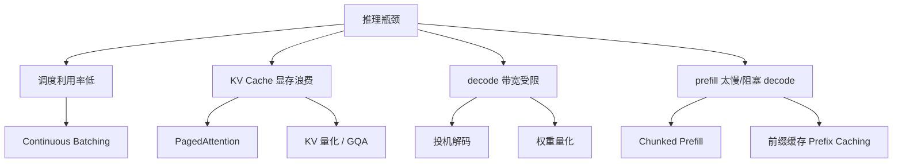

---
Title | LM Infer Optimization
-- | --
Created @ | `2026-11-26T15:36:47Z`
Updated @| `2026-11-26T15:36:47Z`
Labels | ``
Edit @| [here](https://github.com/junxnone/aiwiki/issues/835)

---
# Optimization

大模型推理的优化技术：continuous batching、PagedAttention、前缀缓存、chunked prefill、投机解码、FlashDecoding 和 KV 压缩，各自解决什么问题。

## 技术地图

下图把各技术放到推理的两个阶段和显存、调度上，说明它们的作用位置：

图中：左边是问题，右边是对应的解决方案；每项技术只解决其中一类问题，通常组合使用 (如 vLLM 同时用 continuous batching、PagedAttention、前缀缓存和 chunked prefill)。

## Continuous Batching

- 静态 batching：一批请求要等最长的那个生成结束才能整体换下一批，短请求结束后 GPU 空转
- Continuous (iteration-level) batching：每一步 decode 之后都检查，结束的请求立即移出，等待中的新请求立即加入，GPU 始终接近满载，吞吐可以提高数倍 `[经验]`
- 调度代价：新请求的 prefill 会占用一步，影响其他请求的 TPOT，见 chunked prefill

## PagedAttention

传统做法为每个请求预留最大长度的连续 KV 显存，造成内部和外部碎片，浪费可达 $60\%\sim80\%$。PagedAttention 借鉴操作系统分页：

$$
\text{块数}=\left\lceil\frac{S}{b}\right\rceil,\qquad
\text{浪费}\le b-1\ \text{个 token/序列}
$$

其中：

- $S$：序列当前长度；$b$：块大小 (vLLM 默认 $16$ 个 token)；序列的 KV 被切成固定大小的块，用块表映射到不连续的物理显存
- 按需分配，只有最后一块可能有未用空间，所以浪费最多 $b-1$ 个 token，几乎没有碎片；论文报告浪费降到约 $4\%$ 以下，同样显存下并发数提高 $2\sim4$ 倍 `[待核实]`
- 还能让多个序列共享相同的前缀块 (写时复制)，是前缀缓存和并行采样 (n 个候选) 的基础

## 前缀缓存与 Chunked Prefill

- 前缀缓存 (Prefix Caching)：多个请求共享相同的开头 (系统提示词、few-shot 例子、多轮对话历史) 时，复用已算好的 KV，跳过重复的 prefill，显著降低 TTFT；SGLang 的 RadixAttention 用基数树管理，vLLM 用块哈希
- Chunked Prefill：把长提示词分成若干块 (如 $512$ token)，与 decode 请求混合在同一个 batch 里，避免一个长 prefill 阻塞所有 decode，使 TPOT 更平稳

## 投机解码

Decode 受带宽限制，一次前向只出一个 token，其实算力有富余。投机解码 (speculative decoding) 用一个小的 draft 模型先猜 $\gamma$ 个 token，再用大模型一次并行验证：

$$
\mathbb E[\text{每轮接受 token 数}]=\frac{1-\alpha^{\gamma+1}}{1-\alpha}
$$

其中：

- $\alpha$：单个 draft token 被大模型接受的概率 (取决于 draft 与目标模型的一致程度)；$\gamma$：每轮草稿 token 数
- 每轮至少得到 $1$ 个 token (验证时大模型自己的输出)，最多 $\gamma+1$ 个；例：$\alpha=0.8,\gamma=4$：$\frac{1-0.8^5}{0.2}\approx3.36$ 个 token/轮
- 因为验证只是并行计算 (比逐个生成便宜得多)，并且采用拒绝采样保证输出分布与大模型完全一致，所以是无损加速；典型加速 $2\sim3\times$ `[经验]`
- 变体：Medusa/EAGLE 在大模型上加额外的预测头代替独立的 draft 模型；Lookahead/n-gram 用提示词中的片段猜测，不需要额外模型
- 适用条件：batch 较小时收益大 (带宽受限)，batch 很大时算力已满，收益下降

## FlashDecoding 与 KV 压缩

- FlashDecoding：decode 阶段 query 只有一个 token，并行度低；它沿 KV 的长度方向切分并行，再合并结果，对长上下文加速明显
- GQA/MQA：模型结构上减少 $n_{kv}$，见 [Architecture](@@TARCH@@)
- KV 量化：把 KV Cache 量化到 INT8/INT4/FP8，显存减半或更多，见 [KVCache](/0708_MO_Quantization_KVCache)
- KV 淘汰/稀疏：只保留重要 token (如 H2O、StreamingLLM 的注意力 sink)，在极长上下文下使用，有精度风险
- KV 的分页、offload 和跨实例共享等系统层面的管理见 [KVCache 管理](@@IKV@@)；attention kernel 的细节见 [Attention](@@IATT@@)

## CUDA Graph 与 kernel 启动开销

Decode 每一步只处理很少的 token，单个算子的计算量很小，CPU 发射 kernel 的开销 (每个 kernel 约 $5\sim10\ \mu\text{s}$ `[经验]`) 会变得显著：

$$
t_{step}\approx\max\bigl(t_{gpu},\ n_{kernel}\cdot t_{launch}\bigr)
$$

其中：

- $t_{step}$：一个 decode 步的时间；$t_{gpu}$：GPU 实际执行所有 kernel 的时间
- $n_{kernel}$：一步中发射的 kernel 数，一个 32 层模型每层十几个算子，一步可达数百个；$t_{launch}$：CPU 发射单个 kernel 的开销
- 例：$500$ 个 kernel × $8\ \mu\text{s}$ $=4$ ms；若小模型 GPU 实际计算只需 $3$ ms，这一步就变成受 CPU 发射限制

应对：

- CUDA Graph：把一步 decode 的整串 kernel 录制成一张图，之后一次提交、整体回放，几乎消除发射开销；因为图的形状固定，框架会按若干个 batch 大小分别录制 (vLLM 默认开启，`--enforce-eager` 可关闭以便调试)
- 算子融合：把 RMSNorm、RoPE、激活函数等小算子融合进相邻的矩阵乘法或注意力 kernel，减少 kernel 数和访存
- 对 CPU 推理而言，对应的是减少框架调度开销、绑定线程，见 [CPU](@@ICPU@@)

## 量化 kernel

权重量化要真正变快，需要专门的混合精度 kernel：一边从显存读低比特权重，一边在寄存器里反量化成 FP16/BF16 再做乘法。

kernel 类型 | 权重 × 激活 | 代表实现 | 适用
-- | -- | -- | --
仅权重量化 (W4A16) | INT4 × FP16 | Marlin、ExLlama、AWQ kernel | decode (带宽受限)，小 batch 时接近 $4\times$ 带宽收益
权重 + 激活 (W8A8) | INT8 × INT8 | cuBLAS INT8、SmoothQuant 类 | prefill 与大 batch (算力受限)
FP8 (W8A8) | FP8 × FP8 | Hopper 及以后的 Tensor Core | 训练和推理，精度损失小

表中：仅权重量化减少的是读取字节数，适合 decode；当 batch 增大到接近 compute-bound 时，反量化本身的开销会抵消收益，此时 W8A8 或 FP8 这类让矩阵乘法本身用低精度计算的方式更合适。量化方法本身见 [LLM Weight](/0706_MO_Quantization_LLM_Weight) 和 [LLM WA](/0707_MO_Quantization_LLM_WA)。

## 结构化输出的开销

约束解码 (只允许生成符合 JSON schema 或语法的 token) 在每一步要计算一个「允许 token」的掩码：

- 朴素做法每步遍历整个词表 ($10^5$ 量级) 检查每个 token 是否合法，开销可以与模型前向相当
- 优化：把语法编译成自动机，预先计算与上下文无关的 token 掩码并缓存，只对少数依赖上下文的 token 做运行时检查 (xgrammar 等)，并与 GPU 计算重叠，使额外开销降到很小
- 原理、工具与对吞吐的影响见 [StructuredOutput](@@ISTR@@)

## 技术对比

技术 | 主要收益 | 是否改变输出 | 典型代价
-- | -- | -- | --
Continuous batching | 吞吐 | 否 | 调度复杂度
PagedAttention | 并发数、显存利用 | 否 | 少量访存开销
前缀缓存 | TTFT (重复前缀) | 否 | 需要额外缓存显存
Chunked prefill | TPOT 稳定 | 否 | 首 token 略慢
投机解码 | 单请求 TPOT | 否 (无损) | draft 模型占显存，大 batch 收益低
CUDA Graph / 算子融合 | 小 batch 的 TPOT | 否 | 显存略增，形状需固定
结构化输出 | 输出格式可靠 | 是 (约束为合法输出) | 掩码计算开销
权重量化 | decode 速度、显存 | 略有精度损失 | 见 [量化](/0312_MO_Quantization)
KV 量化/淘汰 | 并发数、长上下文 | 略有损失 | 精度风险

表中：前六项是不改变输出的系统优化，应优先使用；结构化输出改变的是「允许生成什么」，用于格式要求严格的场景；最后两项有精度代价，需要用评测回归确认，见 [Eval](@@TEVAL@@)。投机解码的细节见 [Speculative](@@ISPEC@@)。

## 使用

- 这些优化大多已内置于推理框架，开启即可，见 [Frameworks](@@DFW@@)
- 基础概念见 [Basics](@@IBAS@@)；多卡并行见 [Parallel](@@IPAR@@)

## Reference
- [Efficient Memory Management for Large Language Model Serving with PagedAttention](https://arxiv.org/abs/2309.06180)
- [Orca: A Distributed Serving System for Transformer-Based Generative Models](https://www.usenix.org/conference/osdi22/presentation/yu)
- [Fast Inference from Transformers via Speculative Decoding](https://arxiv.org/abs/2211.17192)
- [SGLang: Efficient Execution of Structured Language Model Programs (RadixAttention)](https://arxiv.org/abs/2312.07104)
- [Sarathi-Serve: Taming Throughput-Latency Tradeoff in LLM Inference (chunked prefill)](https://arxiv.org/abs/2403.02310)
- [Efficient Streaming Language Models with Attention Sinks](https://arxiv.org/abs/2309.17453)
- [MARLIN: Mixed-Precision Auto-Regressive Parallel Inference on Large Language Models](https://arxiv.org/abs/2408.11743)
- [XGrammar: Flexible and Efficient Structured Generation Engine for Large Language Models](https://arxiv.org/abs/2411.15100)
- [Flash-Decoding for long-context inference](https://pytorch.org/blog/flash-decoding/)

