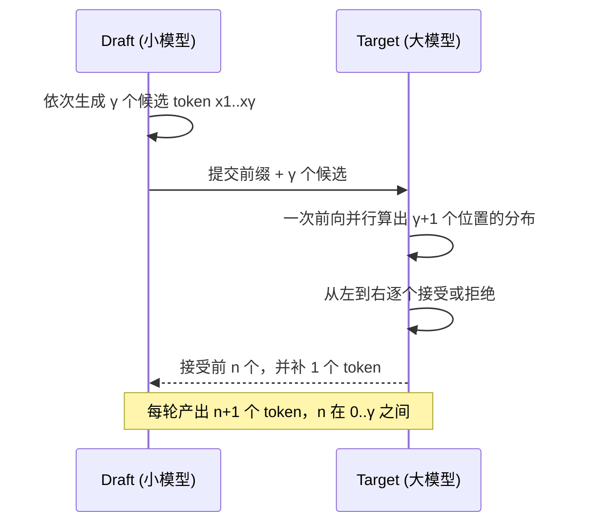

---
Title | LM Infer Speculative
-- | --
Created @ | `2026-11-26T15:37:12Z`
Updated @| `2026-11-26T15:42:33Z`
Labels | ``
Edit @| [here](https://github.com/junxnone/aiwiki/issues/837)

---
# Speculative

投机解码 (speculative decoding)：先用便宜的方法猜出多个 token，再用大模型一次前向并行验证，在不改变输出分布的前提下加速 decode。本文推导为什么它是无损的，比较 draft 模型、Medusa、EAGLE、n-gram 等猜测方法，并给出加速比的估算。概览见 [Optimization](/0835_LM_Infer_Optimization)。

## 为什么能加速

decode 每一步受显存带宽限制：读一遍权重只算一个 token，算力大量闲置，见 [Basics](/0834_LM_Infer_Basics)。大模型一次前向验证 $\gamma+1$ 个位置，读的权重和只算一个 token 几乎一样，所以只要猜得够准，一次前向就能产出多个 token。

图中：

- draft 模型串行生成 $\gamma$ 个候选，开销小；大模型对前缀加候选做一次前向，得到每个位置的概率分布
- 从第一个候选开始逐个检查，遇到第一个被拒绝的位置就停下，并在该位置按修正后的分布重新采样一个 token；如果全部接受，还能多得到大模型在最后一个位置的一个 token
- 所以每轮至少产出 $1$ 个 token (与普通 decode 一样)，最多 $\gamma+1$ 个

## 无损性：拒绝采样

设大模型的分布为 $p(x)$，draft 的分布为 $q(x)$。对 draft 给出的候选 $x$：

$$
\Pr[\text{接受 }x]=\min\Bigl(1,\ \frac{p(x)}{q(x)}\Bigr),\qquad
\text{被拒绝时从}\ p'(x)=\frac{\max\bigl(0,\,p(x)-q(x)\bigr)}{\sum_{x'}\max\bigl(0,\,p(x')-q(x')\bigr)}\ \text{重新采样}
$$

其中：

- $p(x)$：大模型在该位置对 token $x$ 的概率；$q(x)$：draft 对 $x$ 的概率
- 如果 draft 低估了 $x$ ($q\le p$)，一定接受；如果高估了，按 $p/q$ 的概率接受
- 被拒绝时，从「$p$ 比 $q$ 多出来的那部分」归一化后的分布 $p'$ 中重新采样
- 可以证明最终每个 token 的分布恰好是 $p(x)$，与只用大模型采样完全一致；贪心解码时退化为「draft 的 token 等于大模型的 argmax 就接受」

## 加速比估算

单个候选的期望接受率为 $\alpha=\mathbb E_x\bigl[\min(1,p(x)/q(x))\bigr]=1-\frac12\sum_x|p(x)-q(x)|$，即 $1$ 减去两个分布的总变差距离。假设各位置独立：

$$
\mathbb E[\text{每轮 token 数}]=\frac{1-\alpha^{\gamma+1}}{1-\alpha},\qquad
\text{加速比}\approx\frac{1-\alpha^{\gamma+1}}{(1-\alpha)(\gamma c+1)}
$$

其中：

- $\gamma$：每轮的候选数；$\alpha$：接受率，draft 与大模型越像越高
- $c$：draft 一次前向的耗时与大模型一次前向耗时之比 (如 1B 草稿 vs 8B 大模型，$c\approx0.1\sim0.2$)
- 分母 $\gamma c+1$ 是一轮的耗时 (draft 跑 $\gamma$ 次 + 大模型验证 $1$ 次，单位是大模型一次前向)
- 例：$\alpha=0.8$，$\gamma=4$，$c=0.1$：每轮约 $3.36$ 个 token，一轮耗时 $1.4$，加速约 $2.4\times$；若 $\alpha$ 降到 $0.6$：每轮约 $2.31$ 个 token，加速约 $1.65\times$

$\gamma$ | $\alpha=0.6$ | $\alpha=0.8$ | $\alpha=0.9$
-- | -- | -- | --
2 | $1.63\times$ | $2.03\times$ | $2.26\times$
4 | $1.65\times$ | $2.40\times$ | $2.92\times$
8 | $1.37\times$ | $2.41\times$ | $3.40\times$

表中：按上式、$c=0.1$ 计算；接受率越高，最优的 $\gamma$ 越大 ($\alpha=0.9$ 时 $\gamma=8$ 仍在提升，$\alpha=0.8$ 时 $\gamma=4$ 与 $8$ 已基本持平)；接受率不高时猜太多反而变慢 ($\alpha=0.6$ 时 $\gamma=8$ 比 $\gamma=4$ 慢)，因为后面的候选大多被拒绝，draft 的开销白白浪费。实际中还要扣掉验证时多算 $\gamma$ 个位置的额外开销，加速比会略低。

## 猜测方法

方法 | 怎样猜 | 是否需要训练 | 特点
-- | -- | -- | --
独立 draft 模型 | 同系列小模型 (如 1B 为 8B 猜) | 否 (直接用现成小模型) | 简单，但要求分词器相同，draft 也占显存
Medusa | 在大模型最后一层上加多个预测头，第 $k$ 个头预测第 $k$ 个未来 token；用树形注意力一次验证多个候选组合 | 需要训练预测头 | 不需要独立模型
EAGLE 系列 | 一个小的自回归头，在特征层面 (而不是 token 层面) 预测下一步特征 | 需要训练 | 接受率高，报告的加速比是这几种里较高的 `[待核实]`
n-gram / prompt lookup | 从提示词或已生成的文本里找匹配的片段作为候选 | 否 | 零成本，对复述、改写、代码编辑类任务效果好
Lookahead | 用雅可比迭代并行生成 n-gram 再验证 | 否 | 不需要额外模型

表中：选择时看三点：是否有同分词器的小模型、能否接受额外训练、任务输出与输入的重合程度。主流框架 (vLLM、SGLang、TensorRT-LLM、llama.cpp、OpenVINO GenAI) 都支持其中若干种，见 [Frameworks](/0842_LM_Deploy_Frameworks)。

## 适用范围

- batch 小时收益大：带宽受限，算力有富余；batch 大到接近 compute-bound 时，验证多个位置不再「免费」，收益下降甚至变慢
- 输出越长、越可预测 (代码、格式化文本、长思维链) 收益越大，见 [Reasoning](/0833_LM_FT_Reasoning)
- 采样温度高时，$p$ 分布更平坦、接受率下降
- 显存：draft 模型和它的 KV Cache 都要占显存，会减少可服务的并发数，见 [Sizing](/0844_LM_Deploy_Sizing)
- 在 Intel 平台上的用法见 [OpenVINO](/0848_LM_Deploy_OpenVINO)

## Reference
- [Fast Inference from Transformers via Speculative Decoding](https://arxiv.org/abs/2211.17192)
- [Accelerating Large Language Model Decoding with Speculative Sampling](https://arxiv.org/abs/2302.01318)
- [Medusa: Simple LLM Inference Acceleration Framework with Multiple Decoding Heads](https://arxiv.org/abs/2401.10774)
- [EAGLE: Speculative Sampling Requires Rethinking Feature Uncertainty](https://arxiv.org/abs/2401.15077)
- [Break the Sequential Dependency of LLM Inference Using Lookahead Decoding](https://arxiv.org/abs/2402.02057)

