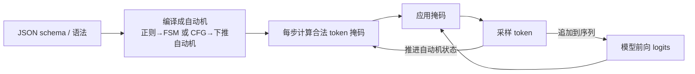

---
Title | LM Infer StructuredOutput
-- | --
Created @ | `2026-11-26T15:37:59Z`
Updated @| `2026-11-26T15:37:59Z`
Labels | ``
Edit @| [here](https://github.com/junxnone/aiwiki/issues/840)

---
# StructuredOutput

结构化输出 (约束解码)：怎样保证模型的输出一定是合法的 JSON、符合给定的 schema 或语法，原理是什么，开销有多大，以及常用工具。

## 为什么需要

- 程序要解析模型的输出：调用工具的参数、信息抽取的结果、分类标签、API 返回
- 只靠提示词要求「请输出 JSON」，模型仍可能多一句解释、少一个括号、字段名拼错，解析失败需要重试
- 约束解码在生成时直接屏蔽不合法的 token，从机制上保证输出合法

## 原理

每一步生成时，先算出当前位置哪些 token 在语法上合法，把其余 token 的 logits 设为 $-\infty$，再采样：

$$
p'(x_t\mid x_{<t})=\frac{p(x_t\mid x_{<t})\cdot\mathbb 1\bigl[x_t\in\mathcal V_{ok}(x_{<t})\bigr]}{\sum_{x\in\mathcal V_{ok}(x_{<t})}p(x\mid x_{<t})}
$$

其中：

- $p(x_t\mid x_{<t})$：模型原本的下一个 token 分布；$\mathcal V_{ok}(x_{<t})$：在已生成的前缀之后，语法上允许的 token 集合
- $\mathbb 1[\cdot]$：合法为 $1$，否则为 $0$；分母重新归一化，使合法 token 的概率之和为 $1$
- 这样每一步都只会选到合法的 token，最终输出一定能被语法接受

下图是一次请求中约束解码与模型计算的配合：

图中：

- schema 先被编译成自动机：只用正则表达式能描述的格式编译成有限状态机 (FSM)，嵌套的 JSON 和一般语法需要下推自动机 (处理括号的嵌套)
- 每一步用自动机的当前状态算出合法 token 的掩码，与模型的 logits 相乘后采样；采到的 token 同时推进自动机的状态和模型的序列
- 掩码计算可以与模型前向在 CPU 和 GPU 上并行，隐藏开销

## 难点：token 与字符不对齐

- 语法是按字符定义的，而词表里的 token 是若干字符的组合 (如 `"name":` 可能是一个 token)；判断一个 token 是否合法，要检查它的每个字符依次输入自动机后是否都被接受
- 朴素实现每步要对全部词表 ($10^5$ 量级) 做这样的检查，开销可以与模型前向相当
- 优化 (以 xgrammar 为代表)：
  - 把 token 分成「与上下文无关」和「依赖上下文」两类，前者 (绝大多数) 的合法性只取决于自动机状态，可以预先算好并缓存
  - 运行时只检查少量依赖上下文的 token
  - 掩码用位图表示，在 GPU 上高效应用
- 论文报告这些优化使额外开销降到接近零的水平 `[待核实]`

## 对质量的影响

- 强制格式会改变分布：当模型「想」输出的内容被屏蔽，它只能在合法 token 里选，可能选到语义上较差的路径
- 实践建议：
  - 在提示词里也描述所需格式并给出示例，让模型本来的分布就接近目标格式，约束只起保底作用
  - schema 中的字段顺序很重要：先输出推理或依据，再输出结论字段，避免模型被迫在没有思考的情况下先给出答案
  - 需要思维链的任务，可以先自由生成思考，再约束输出最终的结构化部分

## 使用方式

接口 | 写法
-- | --
OpenAI 兼容 API | `response_format: {"type": "json_schema", "json_schema": {...}}`
vLLM | 上面的接口，或 `guided_json`、`guided_regex`、`guided_grammar` 等参数 `[待核实]`
llama.cpp | GBNF 语法文件或 JSON schema
工具库 | outlines、xgrammar、lm-format-enforcer、guidance

表中：主流推理框架都内置了约束解码后端，只需在请求中传 schema；工具调用的参数生成通常也基于同一机制，见 [Service](@@DSVC@@) 和 [ToolCalling](@@DTOOL@@)。

## Reference
- [XGrammar: Flexible and Efficient Structured Generation Engine for Large Language Models](https://arxiv.org/abs/2411.15100)
- [Efficient Guided Generation for Large Language Models (outlines)](https://arxiv.org/abs/2307.09702)
- [vLLM: Structured Outputs](https://docs.vllm.ai/en/latest/features/structured_outputs.html)
- [llama.cpp: GBNF Guide](https://github.com/ggml-org/llama.cpp/blob/master/grammars/README.md)
- [OpenAI: Structured Outputs](https://platform.openai.com/docs/guides/structured-outputs)

