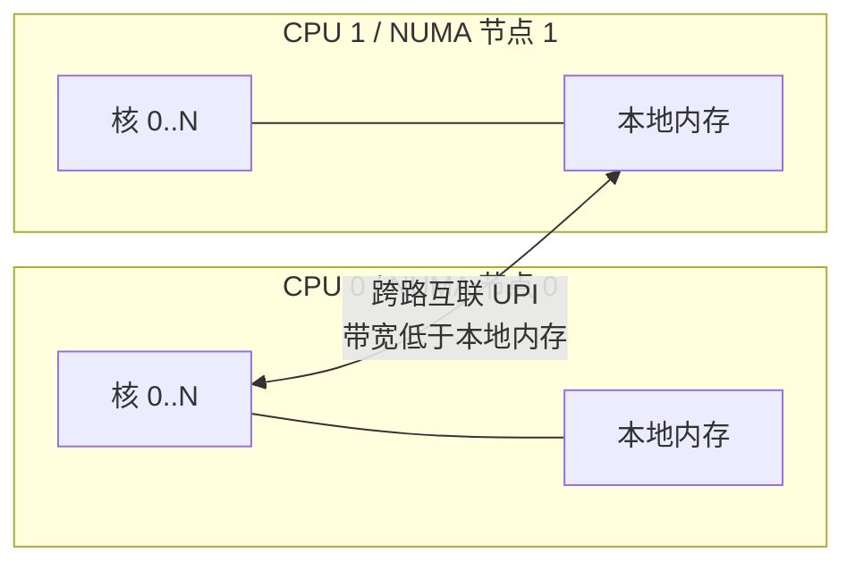

---
Title | LM Infer CPU
-- | --
Created @ | `2026-11-26T15:38:12Z`
Updated @| `2026-11-26T15:38:12Z`
Labels | ``
Edit @| [here](https://github.com/junxnone/aiwiki/issues/841)

---
# CPU

在 CPU 上运行大模型：速度由什么决定，AMX 等矩阵指令的作用，NUMA 与线程绑定，以及 llama.cpp 和 OpenVINO 在 CPU 上的调优。资源估算见 [Sizing](@@DSIZ@@)，Intel 平台的完整部署见 [OpenVINO](@@DOV@@)。

## 速度由什么决定

和 GPU 一样，CPU 推理分两个阶段，瓶颈不同：

阶段 | 瓶颈 | 关键硬件特性
-- | -- | --
prefill | 算力 | 矩阵乘法指令 (AVX-512、AMX)、核数、频率
decode | 内存带宽 | 内存通道数、内存频率、NUMA 布局

表中：CPU 的内存带宽 (单路约 $0.3\sim0.6$ TB/s 理论值) 比 HBM 显卡低数倍，decode 的单请求速度上限按 $\eta\,\text{BW}/\text{权重字节数}$ 估算，计算示例见 [Sizing](@@DSIZ@@)；prefill 比 GPU 慢得更多，所以长提示词场景的 TTFT 是 CPU 部署的主要短板。

## 矩阵加速指令

- AVX-512 (含 VNNI)：512 位向量指令，VNNI 加速 INT8 点积
- AMX (Advanced Matrix Extensions，第四代至强起)：每个核心有专门的矩阵单元 (tile)，直接做 BF16 和 INT8 的矩阵乘法，吞吐比 AVX-512 高一个数量级 `[待核实]`
- 对推理的意义：AMX 主要提升 prefill (以及大 batch 的 decode) 的算力；单请求 decode 仍受带宽限制，AMX 帮助有限，此时更有效的是用权重量化减少读取量
- 检查是否支持：Linux 下 `lscpu | grep amx` 查看 `amx_bf16`、`amx_int8` 等标志

## NUMA 与线程



图中：

- 两路服务器中，每个 CPU 都有自己直连的内存；访问另一路的内存要经过跨路互联，带宽更低、延迟更高
- 如果一个推理进程的线程散布在两路上，而权重只在一路的内存中，另一路的线程就要远程读取，decode 速度明显下降
- 做法：一个进程绑定一个 NUMA 节点 (线程和内存都在同一节点)，两路各跑一个实例；或使用对 NUMA 感知的框架选项

常用命令：

```
numactl --cpunodebind=0 --membind=0 ./llama-server -m model-Q4_K_M.gguf -t 32
```

- `--cpunodebind=0 --membind=0`：线程和内存都限定在 NUMA 节点 0
- `-t`：线程数，一般设为该节点的物理核数 (不算超线程)；decode 受带宽限制，线程过多反而因争用变慢，可以从物理核数往下试

## 框架与调优

框架 | 适用 | 调优要点
-- | -- | --
llama.cpp | 通用，GGUF 量化格式丰富 | 选合适的量化 (Q4_K_M 等)，`-t` 线程数，NUMA 绑定，`--mlock` 防止权重被换出，见 [Format](@@DFMT@@)
OpenVINO GenAI | Intel CPU，利用 AMX | INT4/INT8 权重压缩，`INFERENCE_NUM_THREADS`、性能模式 (延迟 vs 吞吐)，见 [OpenVINO](@@DOV@@)
vLLM CPU 后端 | 需要 OpenAI 兼容服务和连续批处理 | 设置 KV Cache 空间大小与线程绑定 `[待核实]`
PyTorch + IPEX | 研究与定制 | IPEX 的大部分优化已合入 PyTorch 主线 `[待核实]`

表中：同一模型在不同框架上的速度可能差别很大，选型时用自己的模型和硬件测一下，方法见 [Benchmark](@@DBEN@@)。

## 什么时候选 CPU

- 适合：并发低 (内部工具、离线批处理)、模型较小 (约 $14$B 以下的量化模型)、需要大内存放下大模型或长上下文、数据不能出机房、已有 CPU 服务器的闲置算力
- 不适合：高并发在线服务、长提示词且对 TTFT 敏感的场景
- 混合：GPU 放不下的 MoE 专家或冷门 KV 可以 offload 到 CPU 内存，见 [KVCache 管理](@@IKV@@)

## Reference
- [Intel AMX Overview](https://www.intel.com/content/www/us/en/products/docs/accelerator-engines/advanced-matrix-extensions/overview.html)
- [llama.cpp](https://github.com/ggml-org/llama.cpp)
- [OpenVINO GenAI](https://github.com/openvinotoolkit/openvino.genai)
- [vLLM: CPU installation](https://docs.vllm.ai/en/latest/getting_started/installation/cpu.html)
- [numactl(8) - Linux manual page](https://man7.org/linux/man-pages/man8/numactl.8.html)

