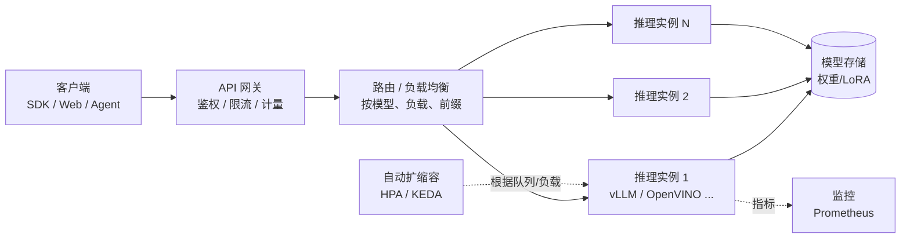

---
Title | LM Deploy Service
-- | --
Created @ | `2026-11-26T15:39:02Z`
Updated @| `2026-11-26T15:39:02Z`
Labels | ``
Edit @| [here](https://github.com/junxnone/aiwiki/issues/845)

---
# Service

把大模型推理引擎变成可对外提供的服务：OpenAI 兼容 API、流式输出、网关与路由、限流、自动扩缩容和 Kubernetes 部署。

## 服务架构

下图是一个典型的大模型在线服务架构，请求从客户端经网关到达推理实例：



图中：

- 网关负责鉴权、限流和按 token 计费；路由把请求分发到合适的推理实例，可以按模型名、当前负载，也可以按提示词前缀亲和 (使前缀缓存命中)
- 多个实例共用同一份模型存储；每个实例暴露指标给监控系统，自动扩缩容根据指标增减实例数
- 推理实例内部的调度 (continuous batching 等) 见 [Optimization](@@IOPT@@)

## OpenAI 兼容 API

主流框架 (vLLM、SGLang、llama.cpp server、OVMS 等) 都提供与 OpenAI 一致的接口，客户端代码可以直接复用：

```
curl http://localhost:8000/v1/chat/completions \
  -H "Content-Type: application/json" \
  -d '{"model": "llama-3.1-8b", "messages": [{"role": "user", "content": "你好"}],
       "max_tokens": 128, "temperature": 0.7, "stream": true}'
```

端点 | 作用
-- | --
`/v1/chat/completions` | 对话补全 (最常用)，参数含义见 [LLM Parameters](/0502_LM_LLMs_Parameters)
`/v1/completions` | 文本补全
`/v1/embeddings` | 向量嵌入 (用于 [RAG](/0461_LM_RAG))
`/v1/models` | 列出可用模型

表中：兼容接口使得更换后端 (如 vLLM 换成 OpenVINO) 时，业务代码基本不用改，只需改 `base_url`。注意路径前缀不一定是 `/v1`：OpenVINO Model Server 的 API 文档以 `/v3/chat/completions` 为主路径，快速入门里也使用 `/v1/chat/completions`，接入时以所用版本的文档为准，见 [OpenVINO](@@DOV@@)。

## 工具调用与结构化输出

Agent 类应用依赖两项服务端能力：

```
{"model": "llama-3.1-8b",
 "messages": [{"role": "user", "content": "北京今天天气怎么样?"}],
 "tools": [{"type": "function", "function": {
     "name": "get_weather",
     "parameters": {"type": "object", "properties": {"city": {"type": "string"}}, "required": ["city"]}}}],
 "tool_choice": "auto"}
```

- 工具调用 (function calling)：请求里用 `tools` 声明可调用的函数及其 JSON schema；模型在回复中返回 `tool_calls` (函数名 + 参数)，由业务代码真正执行，再把结果作为 `role: tool` 的消息传回，模型据此生成最终回答
- 服务端要做的：用模型对应的 chat template 把工具描述渲染进提示词，并用解析器从输出中提取工具调用；vLLM 启动时要同时加 `--enable-auto-tool-choice` 和 `--tool-call-parser <parser>` (如 Llama 3.1 用 `llama3_json`，不同模型系列的解析器不同)
- 结构化输出：`response_format` 指定 `json_schema` 时，服务端用约束解码保证输出一定符合 schema，原理和开销见 [StructuredOutput](@@ISTR@@)
- 安全：工具调用把模型的输出变成真实操作，必须做参数校验和权限控制，见 [Safety](@@DSAF@@)；更多见 [ToolCalling](@@DTOOL@@)

## 流式输出

- `stream: true` 时，服务器用 SSE (Server-Sent Events) 按 token 增量返回，客户端边收边显示，感知延迟 $\approx$ TTFT 而不是整个响应的时间
- 注意：网关和代理要关闭缓冲 (如 nginx 的 `proxy_buffering off`)，否则流式输出会被攒成一次性返回
- 超时设置要考虑长输出：连接超时应远大于单请求的最长生成时间

## 限流与计量

- 按 token 而不是按请求限流：一个长请求的成本远高于短请求；常见维度有每分钟请求数 (RPM) 和每分钟 token 数 (TPM)
- 令牌桶算法：以固定速率往桶里放令牌，每个请求消耗令牌，桶空则拒绝或排队，允许一定的突发：

$$
T(t)=\min\bigl(C,\ T(t_0)+r\,(t-t_0)\bigr),\qquad
\text{放行条件}:\ T(t)\ge n_{in}+n_{out}^{max}
$$

其中：

- $T(t)$：时刻 $t$ 桶里的令牌数；$t_0$：上次更新的时刻
- $r$：每秒补充的令牌数，即长期的平均速率上限 (如 TPM 配额 $/60$)
- $C$：桶容量，决定允许的最大突发量
- $n_{in}$：请求的输入 token 数；$n_{out}^{max}$：请求的 `max_tokens`；先按上限预扣，请求结束后按实际输出数退还差额
- 队列与准入控制：当队列过长 (等待时间超过 SLO) 时直接返回 429 或降级到较小的模型，比让所有请求都超时更好
- 多租户：按租户隔离配额，并统计输入/输出 token 数用于计费，见 [Ops](@@DOPS@@)

## 自动扩缩容

大模型服务的扩缩容有别于普通 Web 服务：

- 冷启动慢：加载几十 GB 权重需要数十秒到数分钟，所以不能等流量上来再扩容，应基于预测或设置最小副本数
- 指标：CPU 利用率不适用；用队列长度、正在运行的请求数、KV Cache 使用率、TTFT/TPOT 的 p95 作为扩缩容指标
- Kubernetes：用 Deployment/StatefulSet 部署，GPU 通过 `nvidia.com/gpu` 资源申请 (Intel GPU 类似)；KEDA 或 HPA 基于自定义指标扩缩容
- 模型加载加速：把权重放在节点本地缓存或共享的高速存储 (而不是每次从对象存储下载)

## 多模型与多 LoRA

- 一个基础模型加载多个 LoRA 适配器，按请求选择，节省显存，见 [Multi-LoRA Serving](/0572_LM_FT_MultiLoRAServing)
- 多个不同的模型：由网关按 `model` 字段路由到对应的实例池；小模型兜底、大模型处理复杂请求的级联路由可以降低成本
- RAG：检索与生成分成独立的服务，见 [RAG](/0461_LM_RAG) 与 [OPEA](/0501_LM_Tools_OPEA)

## 可靠性

- 健康检查：区分存活 (进程在) 与就绪 (模型已加载完)，就绪后才接入流量
- 优雅下线：缩容或升级时先停止接收新请求，等待进行中的流式请求完成
- 重试与幂等：客户端在连接断开时重试要注意不能重复计费；流式响应中途失败需要告知客户端
- 灰度发布：新模型/新量化版本先小流量，对比指标无退化再放量，见 [Ops](@@DOPS@@)

## Reference
- [OpenAI API Reference](https://platform.openai.com/docs/api-reference)
- [vLLM: OpenAI-Compatible Server](https://docs.vllm.ai/en/latest/serving/openai_compatible_server.html)
- [vLLM: Tool Calling](https://docs.vllm.ai/en/latest/features/tool_calling.html)
- [OpenVINO Model Server: chat/completions API](https://github.com/openvinotoolkit/model_server/blob/main/docs/model_server_rest_api_chat.md)
- [KEDA: Kubernetes Event-driven Autoscaling](https://keda.sh/)
- [Kubernetes: Schedule GPUs](https://kubernetes.io/docs/tasks/manage-gpus/scheduling-gpus/)

