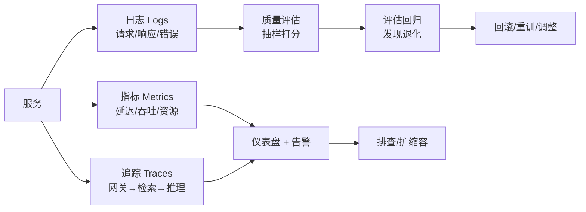

---
Title | LM Deploy Ops
-- | --
Created @ | `2026-11-26T15:39:15Z`
Updated @| `2026-11-26T15:43:11Z`
Labels | ``
Edit @| [here](https://github.com/junxnone/aiwiki/issues/846)

---
# Ops

大模型服务的运维：监控哪些指标，日志与追踪，评估回归，灰度与 A/B，版本管理和成本监控。

## 观测体系

下图说明三类观测数据 (指标、日志、追踪) 与大模型特有的质量评估怎样组成闭环：



图中：

- 指标和追踪主要回答「服务是否健康」(性能、可用性)；日志加质量评估回答「回答是否正确、有用」(质量)
- 传统服务只需要前者，大模型服务因为「返回 200 但内容很差」也算故障，所以必须加上质量评估

## 关键指标

类别 | 指标 | 含义与用途
-- | -- | --
延迟 | TTFT、TPOT 的 p50/p95/p99 | 用户感知的响应速度，见 [Basics](/0834_LM_Infer_Basics)
吞吐 | tokens/s、req/s | 系统容量
排队 | 等待队列长度、排队时间 | 过载的早期信号，扩缩容依据
资源 | GPU 利用率、显存使用、KV Cache 使用率 | KV 使用率接近 $100\%$ 时会触发请求抢占或排队
前缀缓存 | 命中率 | 命中率下降说明流量分布变化或路由不佳
错误 | 超时率、5xx、OOM、被拒绝 (429) 比例 | 可用性
成本 | 每百万 token 的成本、GPU 小时 | 见 [Sizing](/0844_LM_Deploy_Sizing)
质量 | 评测集得分、用户反馈 (点赞/重新生成率)、拒答率、幻觉率 | 回答质量

表中：vLLM 等框架在 `/metrics` 端点以 Prometheus 格式暴露延迟、队列、KV Cache 使用率等指标，可直接接入 Prometheus + Grafana。SLO 示例：TTFT p95 $<1$ s，TPOT p95 $<50$ ms，可用性 $\ge99.9\%$。

vLLM 暴露的主要指标名 (指标会随版本增减，以 `/metrics` 实际输出为准)：

指标 | 类型 | 对应上表
-- | -- | --
`vllm:time_to_first_token_seconds` | histogram | TTFT
`vllm:inter_token_latency_seconds` / `vllm:request_time_per_output_token_seconds` | histogram | TPOT
`vllm:e2e_request_latency_seconds` | histogram | 端到端延迟
`vllm:request_queue_time_seconds` | histogram | 排队时间
`vllm:num_requests_running` | gauge | 正在处理的请求数
`vllm:kv_cache_usage_perc` | gauge | KV Cache 使用率
`vllm:prefix_cache_hits` / `vllm:prefix_cache_queries` | counter | 前缀缓存命中率 = 二者之比
`vllm:prompt_tokens_total` / `vllm:generation_tokens_total` | counter | 输入/输出 token 吞吐 (对时间求 `rate`)

表中：histogram 类型可以在 Prometheus 里用 `histogram_quantile` 计算分位数，例如 TTFT 的 p95：

```
histogram_quantile(0.95, sum by (le) (rate(vllm:time_to_first_token_seconds_bucket[5m])))
```

一份 Grafana 面板通常包含：TTFT/TPOT 的 p50/p95 曲线、tokens/s 吞吐、运行中与排队的请求数、KV Cache 使用率、前缀缓存命中率、错误率和每租户 token 用量。

## 日志与追踪

- 记录每个请求的：请求 ID、租户、模型版本、输入/输出 token 数、TTFT/TPOT、停止原因 (stop/length/error)、采样参数
- 提示词和回答可能含隐私，需要脱敏、设置保留期限和访问权限，见 [Safety](/0847_LM_Deploy_Safety)
- 分布式追踪 (OpenTelemetry)：把网关 → 检索 ([RAG](/0461_LM_RAG)) → 重排 → 推理 → 工具调用串成一条链，定位慢在哪一步

## 评估回归

任何会改变模型行为的变更都要先回归：

- 变更来源：换基础模型、LoRA 版本、量化方式、推理框架升级、采样参数、系统提示词、chat template 修改
- 做法：维护一份固定的业务测试集 (见 [Eval](/0827_LM_Train_Eval) 的业务评估)，每次变更都跑，对比关键指标，设置不退化的阈值；用于量化的最小检查还包括困惑度，见 [量化](/0312_MO_Quantization)
- 线上抽样评估：按比例抽取真实请求，由规则、LLM-as-judge 或人工打分，绘成趋势图，发现悄悄退化

## 灰度与 A/B

流程 | 说明
-- | --
灰度发布 | 新版本先接 $1\%\sim5\%$ 流量，观察指标无退化再逐步扩大
A/B 测试 | 同时运行两个版本，随机分流，比较业务指标 (转化、满意度) 和性能指标
影子流量 | 新版本只接收复制的流量，不返回给用户，用于对比输出和压测
回滚 | 保留上一版本的镜像、权重和配置，指标越界自动或一键回滚

表中：灰度控制风险，A/B 测试判断新版本是否更好，影子流量用于上线前验证；三者可以依次组合。

## 版本管理

- 要被版本化的对象：模型权重 (含量化版本)、LoRA、分词器与 chat template、推理框架版本、系统提示词、采样参数、评测集
- 每次上线记录这些的版本组合，出问题时能精确复现；模型文件用内容哈希标识，部署清单用 Git 管理
- 命名：模型版本与量化信息写入名称，如 `llama-3.1-8b-instruct-int4-v2`，避免混淆

## 容量与成本

- 监控 GPU 利用率和闲置时间，使用率长期偏低说明副本过多，可缩容或合并小模型
- 按租户或业务线统计 token 用量与成本，设置预算告警；成本公式见 [Sizing](/0844_LM_Deploy_Sizing)
- 容量预警：KV Cache 使用率、队列长度持续升高时提前扩容，扩缩容策略见 [Service](/0845_LM_Deploy_Service)

## 常见故障

现象 | 可能原因 | 排查
-- | -- | --
TTFT 突然升高 | 排队、长提示词涌入、前缀缓存命中率下降 | 看队列长度、输入长度分布、缓存命中率
TPOT 变大 | batch 过大、KV 读取增加 (上下文变长)、节点争用 | 看并发数、平均序列长度、GPU 利用率
OOM | KV 池耗尽、长上下文请求、并发过高 | 限制最大长度和并发，调整显存利用率参数
输出变差 | 变更了 chat template、量化精度不足、采样参数不当 | 评估回归，对比版本
频繁超时 | 过载或实例异常 | 扩容、检查健康状态

表中：按「现象 → 可能原因 → 排查指标」的顺序定位问题，大部分与第一节的指标对应。

## Reference
- [vLLM: Metrics](https://docs.vllm.ai/en/latest/design/metrics.html)
- [OpenTelemetry](https://opentelemetry.io/)
- [Google SRE Book: Service Level Objectives](https://sre.google/sre-book/service-level-objectives/)
- [Prometheus](https://prometheus.io/)

