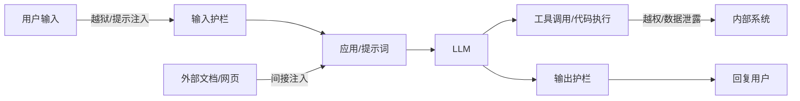

---
Title | LM Deploy Safety
-- | --
Created @ | `2026-11-26T15:39:27Z`
Updated @| `2026-11-26T15:39:27Z`
Labels | ``
Edit @| [here](https://github.com/junxnone/aiwiki/issues/847)

---
# Safety

大模型服务的安全与合规：prompt injection、护栏 (guardrails)、内容过滤、数据隐私、模型与数据的许可证。

## 威胁面

下图标出一个带检索和工具调用的大模型应用里，各环节面临的主要风险：

图中：

- 直接攻击来自用户输入 (越狱、提示注入)；间接攻击藏在被检索的文档、网页或邮件里，被模型当作指令执行
- 工具调用是最危险的出口：模型被劫持后可能越权调用接口或泄露数据
- 输入护栏过滤恶意提示，输出护栏过滤不合规内容和敏感信息；二者都不是绝对的，需要和权限控制一起使用 (纵深防御)

## 主要风险

风险 | 说明 | 典型缓解措施
-- | -- | --
Prompt injection | 用户或外部内容诱使模型忽略原指令 | 输入过滤、分隔符与指令层级、最小权限、人工确认敏感操作
越狱 (Jailbreak) | 绕过安全对齐，生成有害内容 | 对齐训练、输入输出护栏、红队测试，对齐见 [对齐](/0568_LM_FT_Alignment)
数据泄露 | 模型输出训练数据或系统提示词、其他用户数据 | 不把密钥放进提示词、输出脱敏、租户隔离
幻觉 | 编造事实 | 检索增强 ([RAG](/0461_LM_RAG))、引用来源、事实核查
过度代理 | 工具权限过大，模型执行了不该做的事 | 工具白名单、参数校验、权限最小化
资源滥用 | 超长输入、大量请求耗尽资源 | 输入长度限制、按 token 限流，见 [Service](@@DSVC@@)
供应链 | 恶意模型文件或依赖 | 只用 safetensors、校验哈希，见 [Format](@@DFMT@@)

表中：OWASP 的 LLM 应用 Top 10 把 Prompt Injection 列为首位；缓解措施要分层组合：靠单一的提示词约束或护栏模型无法防住所有攻击。

## 护栏

- 规则/正则：检测明显的违规词、格式、PII 模式，快但容易绕过
- 分类模型：专门的安全模型 (如 Llama Guard) 对输入和输出做安全分类，按定义的风险类别判断
- 结构化约束：用 JSON schema 或语法约束解码，防止输出越界
- 护栏的代价：增加延迟 (多一次模型调用)、误杀正常请求，需要用评测集度量误杀率和漏检率，见 [Eval](@@TEVAL@@)

## 数据隐私

- 最小化：不向模型发送不必要的个人信息；发送前做 PII 识别和脱敏 (邮箱、电话、证件号)
- 日志：提示词和回答日志按敏感数据管理，设置保留期、加密存储、限制访问，见 [Ops](@@DOPS@@)
- 租户隔离：多租户场景下 KV Cache/前缀缓存的共享可能导致侧信道泄露，按租户隔离缓存或关闭跨租户共享
- 数据出境与合规：使用第三方 API 时数据会离开本地，需符合所在地区的法规 (如 GDPR、个人信息保护法)；对敏感数据优先本地部署

## 许可证与合规

类型 | 例子 | 注意事项
-- | -- | --
宽松开源 | Apache-2.0、MIT | 可商用，保留版权声明
社区许可证 | Llama Community License | 允许商用但有限制 (如月活用户超过阈值需另行授权、衍生模型命名要求) `[待核实]` 请阅读最新条款
非商用 | CC-BY-NC、研究许可 | 不能用于商业场景
数据集许可 | 各数据集自带条款 | 训练和微调数据的来源与许可需要记录，见 [Data](@@TDATA@@)

表中：不同模型的许可证差异很大，上线前要核对商用、再分发、衍生模型的约束；使用量化后的模型或 LoRA 同样要遵循基础模型的许可证。

## 红队与持续测试

- 上线前做红队测试：由专人或自动化工具构造越狱、注入、泄露类攻击，评估防护效果
- 把攻击样例加入评估回归集，每次变更都重跑，见 [Ops](@@DOPS@@)
- 线上监控拒答率、护栏触发率的异常，新型攻击出现时快速更新规则

## Reference
- [OWASP Top 10 for LLM Applications](https://owasp.org/www-project-top-10-for-large-language-model-applications/)
- [Llama Guard: LLM-based Input-Output Safeguard for Human-AI Conversations](https://arxiv.org/abs/2312.06674)
- [Not what you've signed up for: Compromising Real-World LLM-Integrated Applications with Indirect Prompt Injection](https://arxiv.org/abs/2302.12173)
- [NeMo Guardrails](https://github.com/NVIDIA/NeMo-Guardrails)

