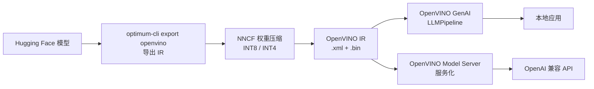

---
Title | LM Deploy OpenVINO
-- | --
Created @ | `2026-11-26T15:39:40Z`
Updated @| `2026-11-26T15:39:40Z`
Labels | ``
Edit @| [here](https://github.com/junxnone/aiwiki/issues/848)

---
# OpenVINO

在 Intel 平台 (CPU、集成/独立 GPU、NPU) 上部署大模型的完整流程：用 optimum-intel 导出模型，用 NNCF 压缩权重，用 OpenVINO GenAI 推理，再通过 OpenVINO Model Server 服务化。

## 整体流程

下图是从 Hugging Face 模型到 Intel 平台上线的流水线：



图中：

- 导出时可以直接指定权重压缩格式，一步完成转换与压缩；也可以先导出 FP16 再用 NNCF 单独压缩，以便调参
- 得到的 IR 既可以在应用里用 GenAI 库直接推理，也可以交给 Model Server 以服务形式暴露
- 目标设备 (CPU/GPU/NPU) 在加载模型时指定，同一份 IR 可在不同设备上运行 (NPU 通常对模型和压缩格式有额外要求)

## 导出与压缩

```
pip install optimum[openvino]

# 导出并压缩为 INT4 权重
optimum-cli export openvino \
  --model meta-llama/Llama-3.1-8B-Instruct \
  --weight-format int4 --trust-remote-code ov_llama3_int4/
```

选项 | 含义
-- | --
`--weight-format fp16` | 不压缩，保留 FP16 权重
`--weight-format int8` | INT8 权重压缩，精度损失小，体积约减半
`--weight-format int4` | INT4 权重压缩，体积约为 FP16 的四分之一，精度损失较大，可配合下面的参数调整

表中：权重压缩只量化权重，激活仍用高精度，所以主要节省显存/内存和 decode 阶段的带宽，原理见 [量化](/0312_MO_Quantization) 与 [LLM Weight](/0706_MO_Quantization_LLM_Weight)。`--weight-format` 还支持 `mxfp4`、`nf4`、`int3`、`int2` 等更低位宽的格式。

INT4 压缩的常用调节参数：

参数 | 作用
-- | --
`--group-size` | 分组量化的组大小，每组共享一个缩放因子；越小精度越高、元数据越多
`--ratio` | INT4 层与 INT8 层的比例，如 `0.8` 表示 $80\%$ 的层用 INT4、其余保留 INT8
`--sym` | 使用对称量化 (无零点)
`--dataset` | 提供校准数据集，启用数据感知 (data-aware) 压缩
`--awq` | 应用 AWQ 算法，改善 INT4 的生成质量，需要配合 `--dataset`
`--scale-estimation` | 用数据估计缩放因子，最小化压缩前后的 $L_2$ 误差，需要配合 `--dataset`

表中：不带 `--dataset` 的是数据无关压缩，速度快；带数据集的 AWQ 和 scale estimation 更慢，但 INT4 的精度通常更好。例：

```
optimum-cli export openvino --model meta-llama/Llama-3.1-8B-Instruct \
  --weight-format int4 --group-size 128 --ratio 0.8 --sym \
  --dataset wikitext2 --awq --scale-estimation ov_llama3_int4_awq/
```

用 NNCF 在 Python 中压缩：

```python
import nncf, openvino as ov
model = ov.Core().read_model("ov_llama3_fp16/openvino_model.xml")
compressed = nncf.compress_weights(
    model,
    mode=nncf.CompressWeightsMode.INT4_SYM,   # 对称 INT4
    group_size=128,                            # 分组量化，每 128 个权重共享一个缩放因子
    ratio=0.8)                                 # 80% 的层用 INT4，其余保持 INT8
ov.save_model(compressed, "ov_llama3_int4/openvino_model.xml")
```

- `group_size`：越小精度越高但元数据越多，$128$ 是常用折中；`ratio` 控制 INT4 层占比，敏感层保留 INT8 以保护精度
- `INT4_SYM` 对称量化无零点，计算更简单；`INT4_ASYM` 精度可能更高但开销略大，见 [Basics](/0699_MO_Quantization_Basics)
- 工具对比见 [Tools](/0709_MO_Quantization_Tools)

## 推理

```python
import openvino_genai as ov_genai
pipe = ov_genai.LLMPipeline("ov_llama3_int4", "CPU")      # 也可以是 "GPU" 或 "NPU"
print(pipe.generate("介绍一下 OpenVINO", max_new_tokens=200))
```

- `LLMPipeline` 内部处理分词、chat template、KV Cache 和采样，接口比手写 `optimum-intel` 的 `OVModelForCausalLM` 更简洁
- 流式输出：给 `generate` 传入 `streamer` 回调，边生成边处理，对应 [Service](@@DSVC@@) 中的流式输出
- 采样参数 (temperature、top-p) 通过 `GenerationConfig` 设置，含义见 [LLM Parameters](/0502_LM_LLMs_Parameters)

投机解码：用一个小模型做 draft，大模型验证，原理见 [Speculative](@@ISPEC@@)：

```python
import openvino_genai as ov_genai
draft = ov_genai.draft_model("ov_llama3_1b_int4", "CPU")          # draft 模型，可以和主模型放在不同设备
pipe = ov_genai.LLMPipeline("ov_llama3_8b_int4", "CPU", draft_model=draft)
config = ov_genai.GenerationConfig()
config.max_new_tokens = 100
config.num_assistant_tokens = 4                                     # 每轮 draft 生成的候选数
print(pipe.generate("介绍一下 OpenVINO", config))
```

- `num_assistant_tokens` 对应 [Speculative](@@ISPEC@@) 中的 $\gamma$；也可以改用 `assistant_confidence_threshold` (二者互斥)，只在 draft 置信度高于阈值时继续猜
- draft 模型必须与主模型使用同一个分词器，一般选同系列的小模型
- 在 NPU 上使用时，官方示例建议主模型和 draft 模型都放在 NPU

## 服务化

OpenVINO Model Server (OVMS) 把模型作为服务运行，提供 OpenAI 兼容的 `chat/completions`、`completions`、`embeddings` 等端点，内部使用连续批处理。可以直接从 Hugging Face 拉取已转换好的 OpenVINO 模型启动：

```
docker run -d --rm -p 8000:8000 -v ${HOME}/models:/models:rw \
  openvino/model_server:latest-gpu \
  --source_model OpenVINO/Qwen3-8B-int4-ov --model_repository_path /models --rest_port 8000

curl -s http://localhost:8000/v1/chat/completions -H "Content-Type: application/json" \
  -d '{"model": "OpenVINO/Qwen3-8B-int4-ov", "max_tokens": 30,
       "messages": [{"role": "user", "content": "你好"}]}'
```

- `--source_model`：Hugging Face 上的 OpenVINO 格式模型 (`OpenVINO/` 组织下有大量已压缩好的模型)，也可以指向本地导出的目录；`--model_repository_path`：模型缓存目录
- 用 GPU 时选 `latest-gpu` 镜像并把 `/dev/dri` 设备挂进容器；Windows 下可直接运行 `ovms.exe`，参数相同
- 路径：快速入门使用 `/v1/chat/completions`，API 文档以 `/v3/chat/completions` 为主路径，两者都可用；客户端用 OpenAI SDK 时把 `base_url` 指向对应前缀即可
- 以容器方式部署，与 [Service](@@DSVC@@) 中的网关、限流、扩缩容、监控方案一致

## 压测

`llm_bench` (位于 openvino.genai 仓库的 `tools/llm_bench`) 用来测首 token 延迟、后续 token 延迟和内存占用：

```
python benchmark.py -m ov_llama3_int4 -d CPU -p "What is openvino?" -n 2 --model-type text -ic 128
```

参数 | 含义
-- | --
`-m` | 模型目录
`-d` | 设备：`CPU`、`GPU`、`NPU`
`-p` / `-pf` | 提示词，或 JSONL 格式的提示词文件
`-n` | 重复次数 (第一次通常含编译开销，看后面几次)
`-ic` | 最大输出 token 数，默认 $512$

表中：`llm_bench` 测的是单请求延迟；服务化后的并发吞吐要对 OVMS 做压测，方法见 [Benchmark](@@DBEN@@)。

## 性能与调优

- 带宽决定 decode：内存带宽越高，tokens/s 越高，所以 INT4 权重压缩通常能显著提速，见 [Basics](@@IBAS@@)
- CPU：确认使用多通道内存并绑定 NUMA 节点，线程数设为物理核数；批量并发时利用连续批处理
- GPU：优先使用独立 GPU 或有足够显存带宽的集成显卡；注意核显与 CPU 共享内存
- 精度回归：压缩前后用固定评测集对比困惑度和任务指标，见 [Eval](@@TEVAL@@)，量化精度问题排查见 [量化](/0312_MO_Quantization)
- 资源估算方法见 [Sizing](@@DSIZ@@)，框架对比见 [Frameworks](@@DFW@@)

## 常见问题

现象 | 可能原因 | 处理
-- | -- | --
输出乱码或不停止 | chat template 或 EOS 设置不一致 | 检查分词器和 `generation_config.json`，见 [Format](@@DFMT@@)
INT4 后明显变差 | 压缩过激 | 提高 `ratio` 中 INT8 占比、减小 `group_size`、使用 AWQ 或数据感知压缩
首次加载很慢 | 模型编译/加载开销 | 使用模型缓存 (`CACHE_DIR`)
NPU 无法运行 | 格式或算子不支持 | 使用 NPU 支持的压缩配置和静态形状

表中：这些是实际部署中常见的问题；NPU 的约束较多，建议先在 CPU/GPU 上验证精度，再迁移到 NPU。

## Reference
- [OpenVINO GenAI](https://github.com/openvinotoolkit/openvino.genai)
- [optimum-intel](https://github.com/huggingface/optimum-intel)
- [NNCF: Neural Network Compression Framework](https://github.com/openvinotoolkit/nncf)
- [OpenVINO Model Server](https://github.com/openvinotoolkit/model_server)
- [OVMS: LLM quickstart](https://github.com/openvinotoolkit/model_server/blob/main/docs/llm/quickstart.md)
- [OpenVINO GenAI: speculative decoding sample](https://github.com/openvinotoolkit/openvino.genai/tree/master/samples/python/text_generation)
- [OpenVINO GenAI: llm_bench](https://github.com/openvinotoolkit/openvino.genai/tree/master/tools/llm_bench)
- [optimum-intel: export to OpenVINO](https://huggingface.co/docs/optimum/intel/openvino/export)
- [OpenVINO Documentation: LLM Weight Compression](https://docs.openvino.ai/)

