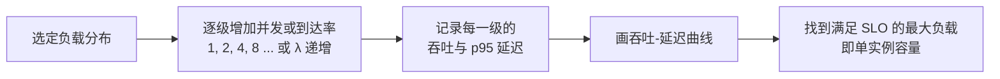

---
Title | LM Deploy Benchmark
-- | --
Created @ | `2026-11-26T15:39:53Z`
Updated @| `2026-11-26T15:43:20Z`
Labels | ``
Edit @| [here](https://github.com/junxnone/aiwiki/issues/849)

---
# Benchmark

大模型推理服务的压测：测什么指标，怎样构造负载，怎样做并发扫描并读出容量，常用工具，以及常见的测量陷阱。指标定义见 [Basics](/0834_LM_Infer_Basics)。

## 测什么

指标 | 定义 | 关注
-- | -- | --
TTFT | 请求发出到收到第一个 token | p50/p95/p99
TPOT / ITL | 相邻输出 token 的间隔 | p50/p95；ITL (inter-token latency) 是逐个间隔，TPOT 常指一个请求的平均间隔
端到端延迟 | 请求发出到最后一个 token | p95
输出吞吐 | 所有请求的输出 token 数 / 测试时长 | tokens/s
请求吞吐 | 完成的请求数 / 测试时长 | req/s
goodput | 满足 SLO (如 TTFT $<1$ s 且 TPOT $<50$ ms) 的请求吞吐 | 最贴近业务的容量指标

表中：只看平均值会掩盖尾部延迟，线上体验通常由 p95/p99 决定；吞吐和延迟必须一起报告，单独一个数没有意义。

## 负载模型

压测结果强烈依赖负载的形状，要尽量贴近真实流量：

- 输入/输出长度分布：从线上日志统计，或使用 ShareGPT 等对话数据集；固定长度 (如输入 $1024$、输出 $128$) 便于对比，但不代表真实情况
- 到达方式：
  - 固定并发 (closed-loop)：始终保持 $C$ 个请求在途，一个结束立刻补一个，测「这个并发下的延迟和吞吐」
  - 固定到达率 (open-loop)：按速率 $\lambda$ 发请求 (常用泊松分布)，不管前面的是否完成，更接近真实用户，能测出过载时的排队
- 前缀重复度：真实业务里系统提示词、多轮历史大量重复，会影响前缀缓存命中率；用随机内容压测会低估缓存的收益
- 预热：第一次请求包含编译、缓存分配等开销，正式计时前先跑一段预热

## 并发扫描

图中：

- 从低负载开始逐级增加，每级运行足够长的时间 (至少几百个请求) 再记录
- 低负载时吞吐随负载近似线性增长、延迟几乎不变；接近饱和时吞吐趋于平稳、延迟急剧上升 (排队)
- 曲线上「延迟刚好不超过 SLO」的那个点，就是单实例在该 SLO 下的容量，用于 [Sizing](/0844_LM_Deploy_Sizing) 中的副本数估算

容量与副本数：

$$
n_{replica}=\left\lceil\frac{\lambda_{peak}}{\lambda_{max}^{SLO}}\cdot(1+m)\right\rceil
$$

其中：

- $\lambda_{peak}$：业务的峰值请求到达率；$\lambda_{max}^{SLO}$：单实例在满足 SLO 前提下能承受的最大到达率 (来自扫描曲线)
- $m$：冗余系数，如 $0.2\sim0.3$，应对突发和实例故障
- 例：峰值 $20$ req/s，单实例在 SLO 下最多 $6$ req/s，冗余 $25\%$：$\lceil20/6\times1.25\rceil=5$ 个副本

## 工具

工具 | 适用 | 说明
-- | -- | --
`vllm bench serve` | 任何 OpenAI 兼容服务 | vLLM 自带，支持数据集与到达率设置，输出 TTFT/TPOT/ITL 分位数，命令见 [Frameworks](/0842_LM_Deploy_Frameworks)
GuideLLM | 生产压测 | vLLM 官方推荐，支持扫描、报告生成
genai-perf | Triton/OpenAI 兼容服务 | NVIDIA 的压测工具
`llm_bench` | OpenVINO | 测单请求延迟和内存，命令见 [OpenVINO](/0848_LM_Deploy_OpenVINO)
llama-bench | llama.cpp | 测 prefill (pp) 和 decode (tg) 的 tokens/s
Locust、k6 等 | 通用 | 自定义复杂流量，需要自己解析流式响应

表中：同一份对比中要固定工具、模型、精度、硬件、负载和框架版本，否则数字不可比。

## 常见陷阱

- 客户端成为瓶颈：压测机的 CPU 或连接数不足，测出的是客户端的极限；观察压测机资源，必要时分布式发压
- 输出长度不受控：模型自己决定何时停止，不同框架或参数下输出长度不同，吞吐不可比；压测时设置 `ignore_eos` 或固定 `max_tokens` (只用于性能测试)
- 忽略分词差异：tokens/s 依赖分词器，跨模型比较时换算成字符数或请求数
- 只测空载：单请求的延迟很好不代表并发时也好，必须做并发扫描
- 缓存效应：重复相同的提示词会命中前缀缓存，TTFT 偏低；根据真实的重复度决定是否打乱
- 只看平均：一定要看 p95/p99

## Reference
- [vLLM: Benchmark CLI](https://docs.vllm.ai/en/latest/benchmarking/cli.html)
- [GuideLLM](https://github.com/vllm-project/guidellm)
- [NVIDIA GenAI-Perf](https://docs.nvidia.com/deeplearning/triton-inference-server/user-guide/docs/perf_analyzer/genai-perf/README.html)
- [OpenVINO GenAI: llm_bench](https://github.com/openvinotoolkit/openvino.genai/tree/master/tools/llm_bench)
- [DistServe: Disaggregating Prefill and Decoding for Goodput-optimized LLM Serving](https://arxiv.org/abs/2401.09670)

