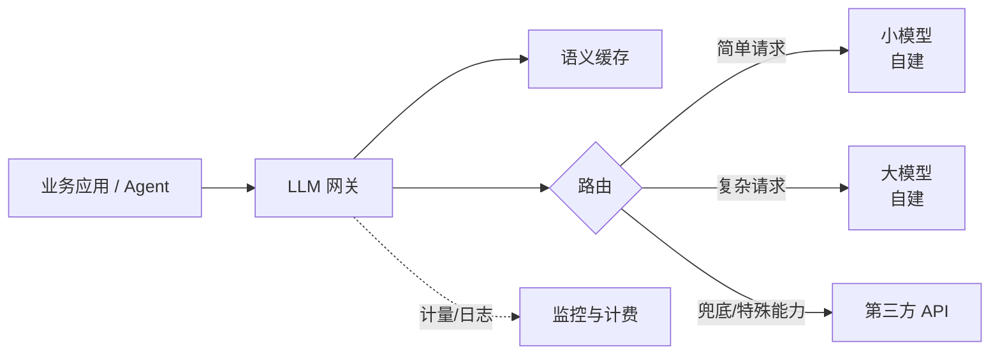

---
Title | LM Deploy Gateway
-- | --
Created @ | `2026-11-26T15:40:17Z`
Updated @| `2026-11-26T15:43:25Z`
Labels | ``
Edit @| [here](https://github.com/junxnone/aiwiki/issues/851)

---
# Gateway

大模型网关：在业务与多个模型/供应商之间加一层统一入口，负责统一接口、路由与级联、缓存、限流计量和容灾。

## 网关的位置

图中：

- 业务只对接网关一个 OpenAI 兼容接口，不关心后面是哪个模型、在哪里运行
- 网关先查缓存，未命中再按规则或分类器路由到不同的模型；自建模型不可用时可以切到第三方 API
- 所有请求的 token 用量、延迟和错误都在网关统一记录

## 主要功能

功能 | 说明
-- | --
统一接口 | 把不同供应商和框架的接口统一成 OpenAI 格式，换模型不改业务代码
路由 | 按模型名、租户、请求特征或负载分发
级联 / 降级 | 先用便宜的模型，不满足要求再升级到更强的模型；过载时降级到小模型
缓存 | 精确缓存 (完全相同的请求) 和语义缓存 (意思相近的请求)
限流与配额 | 按租户的 RPM/TPM，见 [Service](/0845_LM_Deploy_Service)
重试与容灾 | 某个后端失败或超时时切换到备用后端
安全 | 统一做输入输出护栏和敏感信息脱敏，见 [Safety](/0847_LM_Deploy_Safety)

表中：这些功能大多与模型无关，放在网关里统一实现，避免每个业务重复开发。代表工具有 LiteLLM、各类 API 网关的 AI 插件等。

## 级联路由的成本

设便宜模型的单价为 $c_s$，强模型为 $c_l$，有比例 $r$ 的请求需要升级到强模型：

$$
\bar c=c_s+r\cdot c_l\quad(\text{先试小模型}),\qquad
\bar c=(1-r)\,c_s+r\,c_l\quad(\text{先用分类器直接分流})
$$

其中：

- $\bar c$：每个请求的平均成本；$r$：需要强模型的请求比例
- 第一种 (先试再升级) 中，升级的请求付了两次钱，但不需要事先判断；第二种用一个路由分类器提前决定，代价是分类器本身的成本和误判
- 例：$c_s=1$，$c_l=10$，$r=0.2$：先试再升级 $\bar c=3$，直接分流 $\bar c=2.8$；全部用强模型是 $10$，两种方式都节省约 $70\%$
- 关键是判断「小模型的回答是否足够好」：用置信度、规则校验 (如结构化输出是否合法) 或一个评审模型

## 语义缓存

- 做法：把请求转成向量 (嵌入)，在向量库里查找相似度超过阈值的历史请求，命中则直接返回缓存的回答
- 适合：FAQ、客服等重复度高的场景
- 风险：两个问题措辞相近但含义不同 (如「怎么开通」和「怎么取消」) 时会返回错误答案；阈值要用真实数据调，并对时效性强的问题设置过期
- 与前缀缓存的区别：前缀缓存在推理引擎内部复用 KV，结果与不缓存完全一致；语义缓存跳过整个推理，返回的是另一个请求的答案

## 部署建议

- 网关本身要高可用 (多副本)，并尽量轻量，避免成为延迟瓶颈；流式响应要透传，不能缓冲
- 自建推理集群内部的负载均衡 (按 KV 使用率、前缀亲和) 由推理侧的路由层负责，见 [Kubernetes](/0850_LM_Deploy_Kubernetes)；网关负责的是跨模型、跨供应商这一层
- 计量数据接入成本监控，见 [Ops](/0846_LM_Deploy_Ops)

## Reference
- [LiteLLM](https://github.com/BerriAI/litellm)
- [FrugalGPT: How to Use Large Language Models While Reducing Cost and Improving Performance](https://arxiv.org/abs/2305.05176)
- [RouteLLM: Learning to Route LLMs with Preference Data](https://arxiv.org/abs/2406.18665)
- [GPTCache](https://github.com/zilliztech/GPTCache)

