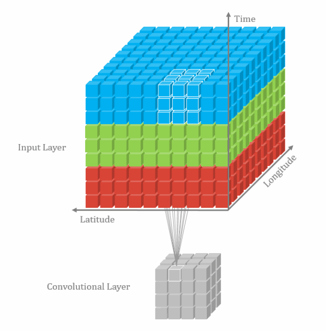
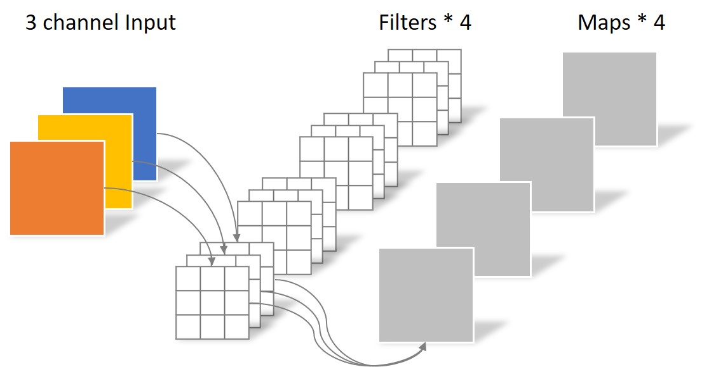
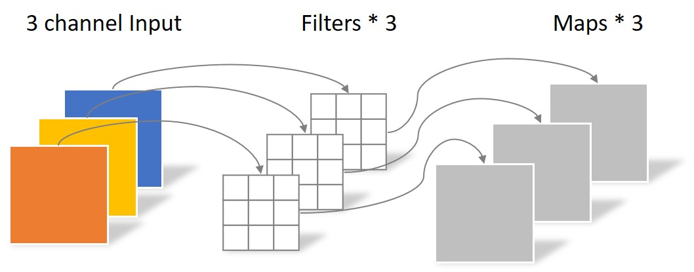
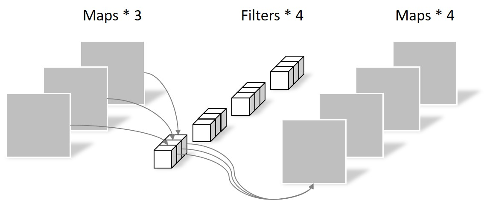
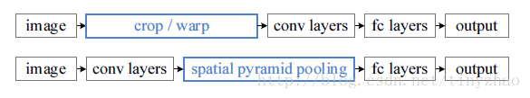

-----

| Title     | ML Op Convolution DL                                 |
| --------- | ---------------------------------------------------- |
| Created @ | `2018-11-21T03:03:53Z`                               |
| Updated @ | `2026-11-11T01:07:14Z`                               |
| Labels    | `ML`                                                 |
| Edit @    | [here](https://github.com/junxnone/aiwiki/issues/11) |

-----

# 卷积在 DL 中的应用

深度学习领域的卷积本质上是 `互相关 Cross-correlation`，过滤器不反转，逐元素乘法和加法（数学定义见 [Conv
Math](0010_ML_Op_Convolution_Math)，参数与实现见
[Convolution](0009_ML_Op_Convolution)，计算量见
[ConvFlops](0396_ML_Op_Convolution_ConvFlops)）。

  - 卷积类型
      - 2D/3D 卷积
      - 转置卷积 - Transposed convolution
      - 扩张卷积 - Dilated Convolutions
      - 可分卷积（空间可分 / 深度可分）
      - 分组卷积
  - 卷积核
  - 卷积的用途
      - 提取图像 feature
      - UpSample/DownSample

## 卷积的输出尺寸

设输入尺寸 $i$，核 $k$，padding $p$，stride $s$，dilation $d$：

$$ o=\\left\\lfloor\\frac{i+2p-d(k-1)-1}{s}\\right\\rfloor+1 $$

感受野：第 $l$ 层 $r\_l=r\_{l-1}+(k\_l-1)\\prod\_{m\<l}s\_m$（dilation 时 $k$ 换为
$d(k-1)+1$）。

## 2D 卷积

<table style="width:100%; table-layout:fixed;">
  <tr>
    <td></td>
    <td></td>
    <td></td>
    <td></td>
  </tr>
  <tr>
    <td>No padding, no strides</td>
    <td>Arbitrary padding, no strides</td>
    <td>Half padding, no strides</td>
    <td>Full padding, no strides</td>
  </tr>
  <tr>
    <td></td>
    <td></td>
    <td></td>
    <td></td>
  </tr>
  <tr>
    <td>No padding, strides</td>
    <td>Padding, strides</td>
    <td>Padding, strides (odd)</td>
    <td></td>
  </tr>
</table>

## 3D 卷积



## 转置卷积 - Transposed convolution

  - 又名 `去卷积`/`反卷积`
  - **用途**
      - Sementation 中 UpSampling 上采样恢复原图大小

<table style="width:100%; table-layout:fixed;">
  <tr>
    <td></td>
    <td></td>
    <td></td>
    <td></td>
  </tr>
  <tr>
    <td>No padding, no strides, transposed</td>
    <td>Arbitrary padding, no strides, transposed</td>
    <td>Half padding, no strides, transposed</td>
    <td>Full padding, no strides, transposed</td>
  </tr>
  <tr>
    <td></td>
    <td></td>
    <td></td>
    <td></td>
  </tr>
  <tr>
    <td>No padding, strides, transposed</td>
    <td>Padding, strides, transposed</td>
    <td>Padding, strides, transposed (odd)</td>
    <td></td>
  </tr>
</table>

转置卷积是卷积前向的转置（等价于卷积反向传播中对输入求梯度），输出尺寸（无 output\_padding、dilation=1）：

$$ o=(i-1)s-2p+k+\\text{output\_padding} $$

``` python
up = torch.nn.ConvTranspose2d(64, 32, kernel_size=2, stride=2)   # [N,64,H,W] -> [N,32,2H,2W]
```

  - 注意：kernel\_size 不能被 stride 整除时易出现棋盘格伪影，可改用 Resize + Conv（见
    [Resize](0619_ML_Op_Resize)）

## 扩张卷积 - Dilated Convolutions

  - 又名 `膨胀卷积/空洞卷积/Atrous Convolutions(DeepLab)`
  - 在标准的卷积核中注入空洞来增加感受野(使核膨胀)
  - 多一个参数 `dilation rate`：卷积核的点的间隔数量(扩张率表示我们希望将核加宽的程度)
  - 用于解决反卷积中丢失部分空间信息的问题

<table style="width:25%"; table-layout:fixed;>
  <tr>
    <td></td>
  </tr>
  <tr>
    <td>No padding, no stride, dilation</td>
  </tr>
</table>

  - 有效核尺寸 $k\_{eff}=d(k-1)+1$；例如 3x3、dilation=2 的有效感受野为 5x5，参数量仍为 9
  - 连续堆叠相同 dilation 会出现 gridding 问题（采样点稀疏不连续），常用 1,2,5 等混合扩张率

<!-- end list -->

``` python
conv = torch.nn.Conv2d(64, 64, 3, padding=2, dilation=2)   # padding = dilation 保持尺寸
```

## 可分卷积

  - 空间可分卷积：把 $K \\times K$ 核拆成 $K\\times1$ 与 $1\\times K$ 两个核（要求核矩阵秩为
    1，如 Sobel），参数/计算从 $K^2$ 降到 $2K$
  - 深度可分卷积：Depthwise + Pointwise，见下节

## depthwise convolution & pointwise convolution

> 使用典型例子见 MobileNet

  - standard convolution

> 

  - depthwise separable convolution

> 

  - pointwise convolution

> 

> > depthwise convolution 和 pointwise convolution 拼接起来，就是一个 depthwise
> > separable convolution

``` python
dw = torch.nn.Conv2d(32, 32, 3, padding=1, groups=32)   # depthwise
pw = torch.nn.Conv2d(32, 64, 1)                         # pointwise
```

计算量约为标准卷积的 $\\frac{1}{C\_{out}}+\\frac{1}{K^2}$，详见
[ConvFlops](0396_ML_Op_Convolution_ConvFlops)。

## 分组卷积

  - 把输入/输出通道分成 $g$ 组，每组内独立做标准卷积，再按通道拼接；权重 shape 为 `C_out x (C_in/g) x K
    x K`
  - 参数量与计算量均为标准卷积的 $1/g$；`groups=C_in` 即 Depthwise，`groups=1` 即标准卷积
  - 典型应用：AlexNet（双 GPU 分组）、ResNeXt；组间无信息交流，可用 channel
    shuffle（ShuffleNet）补充

<!-- end list -->

``` python
gc = torch.nn.Conv2d(64, 128, 3, padding=1, groups=4)
```

## 不同的卷积核的意义

### 为什么大部分基于卷积的深层网络都在用小卷积核？

ImageNet ILSVRC 2014 上，VGGNet paper 中提出：

> This (stack of three 3 × 3 conv layers) can be seen as imposing a
> regularisation on the 7 × 7 conv. filters, forcing them to have a
> decomposition through the 3 × 3 filters (with non-linearity injected
> in between).
> 
> > 7 x 7 的卷积层的正则等效于 3 个 3 x 3 的卷积层的叠加

这样的设计的优点：

  - 大幅度的减少参数
  - 引入更多非线性，提高决策函数判决力

### 为什么CNN需要固定输入大小？

  - 卷积层和池化层的输出尺寸都是和输入尺寸相关的，它们的输入是不需要固定图片尺寸的，真正需要固定尺寸的是最后的全连接层。
  - 由于FC层的存在，普通的CNN通过固定输入图片的大小来使得全连接层输入固定。



-----

**解决方案**

  - 1.  resize/crop 到固定大小

  - 2.  spatial pyramid pooling layer

## 其他变体

  - 1x1 卷积（Pointwise）：只混合通道，用于升降维、替代全连接，见 [Linear](0612_ML_Op_Linear)
  - Deformable 卷积：采样位置带可学习偏移，适应几何形变
  - 常与 [BatchNorm](0614_ML_Op_Norm_BatchNorm)、[ReLU
    系](0616_ML_Op_AF_ReLU) 组成 Conv-BN-ReLU 块，推理时 BN 可折叠进卷积

## Reference

  - 2016 A guide to convolution arithmetic for deep learning
    \[[paper](https://arxiv.org/abs/1603.07285)\]
    \[[Code](https://github.com/vdumoulin/conv_arithmetic)\]
  - [直观理解深度学习卷积部分](https://www.leiphone.com/news/201807/RQ4sBWYqLkGV4ZAW.html)
  - [如何理解深度学习中的卷积？](https://blog.csdn.net/jzrita/article/details/79242004)
  - [理解图像卷积操作的意义](https://blog.csdn.net/chaipp0607/article/details/72236892?locationNum=9&fps=1)
  - [paper - Multi-scale context aggregation by dilated
    convolutions](https://arxiv.org/pdf/1511.07122.pdf)
  - [Multi-Scale Context Aggregation by Dilation
    Convolutions](https://blog.csdn.net/qq_21167623/article/details/80923537)
  - [对深度可分离卷积、分组卷积、扩张卷积、转置卷积（反卷积）的理解](https://www.cnblogs.com/marsggbo/p/9737991.html)
  - [卷积感受野计算](https://www.cnblogs.com/makefile/p/receptive-field.html)
  - [关于感受野的理解与计算](https://www.jianshu.com/p/9997c6f5c01e)
  - [Convolution -
    PyTorch](https://pytorch.org/docs/stable/generated/torch.nn.Conv2d.html)
