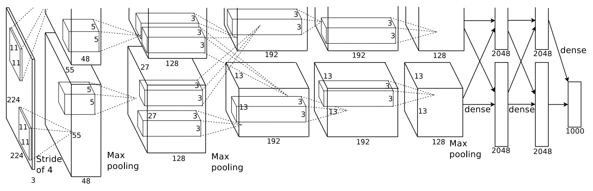

-----

| Title     | ML Tasks Image Classification AlexNet                |
| --------- | ---------------------------------------------------- |
| Created @ | `2019-06-20T02:42:36Z`                               |
| Updated @ | `2026-11-25T16:50:45Z`                               |
| Labels    | \`\`                                                 |
| Edit @    | [here](https://github.com/junxnone/aiwiki/issues/27) |

-----

## Reference

  - 2012 **AlexNet** ImageNet Classification with Deep Convolutional
    Neural Networks
    \[[paper](http://www.cs.toronto.edu/~fritz/absps/imagenet.pdf)\]
  - [5.6. 深度卷积神经网络AlexNet -
    动手学深度学习](https://zh.d2l.ai/chapter_convolutional-neural-networks/alexnet.html)
  - [深入理解AlexNet网络](https://blog.csdn.net/luoluonuoyasuolong/article/details/81750190)
  - [卷积神经网络之AlexNet](https://www.cnblogs.com/wangguchangqing/p/10333370.html)

## Brief

  - 2012 ImageNet 图像识别挑战赛冠军，以一作 `Alex Krizhevsky` 命名 `AlexNet`
  - `Conv Layer` x 8 + `FC Layer` x 2
  - \+`Max Pooling`
  - \+`Dropout` 减少复杂度
  - \+`ReLU` 计算量小，更易训练
  - \+`Image Aug` 减少过拟合

## Input Image preprocess

  - **Training:** Resize + Center Crop + Random Crop

<!-- end list -->

    1 取最小边 resize 到 256(保持长宽比)
    2 取中心 crop 256x256
    3 random crop 224x224

  - **Testing:** 10 张 224x224 的图片取测试均值(`4个角+中心` 224x224 + `水平翻转`)

<!-- end list -->

    1 取最小边 resize 到 256(保持长宽比)
    2 分别从4个角和中心点取 224x224 图片
    3 对5张图片水平翻转，获取 10 张测试图
    4 对测试结果的 softmax layer 输出取均值

## Layers

> AlexNet包含8层变换，其中有5层卷积和2层全连接隐藏层，以及1个全连接输出层。

## LRN - Local Response Normalized

对同一位置、相邻通道的激活做归一化，让强响应抑制邻近通道的响应 (一种「侧抑制」)：

$$
b^{i}*{x,y}=\\frac{a^{i}*{x,y}}{\\left(k+\\alpha\\sum\_{j=\\max(0,,i-n/2)}^{\\min(N-1,,i+n/2)}\\left(a^{j}\_{x,y}\\right)^2\\right)^{\\beta}}
$$

其中：

  - $a^{i}*{x,y}$：第 $i$ 个通道在位置 $(x,y)$ 的激活 (ReLU
    之后)；$b^{i}*{x,y}$：归一化后的输出
  - $N$：该层的通道总数；$n$：参与归一化的相邻通道数
  - $k,\\alpha,\\beta$：超参数，论文取 $k=2,\\ n=5,\\ \\alpha=10^{-4},\\
    \\beta=0.75$
  - 分母随邻近通道能量增大而变大，使某个通道很强时压低周围通道
  - 后来的 BatchNorm 效果更好，LRN
    已很少使用，[VGGNet](/0146_ML_Tasks_Image_Classification_VGGNet)
    实验也表明 LRN 并未带来提升

## 网络结构与参数量

下面按论文的双 GPU 分组 (groups=2) 结构统计，输入按 $224\\times224$ (实际有效尺寸
$227\\times227$)：

| 层     | 卷积核/操作                      | 输出尺寸                    | 参数量计算                            | 参数量           |
| ----- | --------------------------- | ----------------------- | -------------------------------- | ------------- |
| conv1 | $96@11\\times11$，$S=4$      | $55\\times55\\times96$  | $(11\\cdot11\\cdot3+1)\\cdot96$  | 34,944        |
| pool1 | $3\\times3$，$S=2$ (重叠池化)    | $27\\times27\\times96$  | \-                               | 0             |
| conv2 | $256@5\\times5$，$P=2$，分 2 组 | $27\\times27\\times256$ | $(5\\cdot5\\cdot48+1)\\cdot256$  | 307,456       |
| pool2 | $3\\times3$，$S=2$           | $13\\times13\\times256$ | \-                               | 0             |
| conv3 | $384@3\\times3$，$P=1$       | $13\\times13\\times384$ | $(3\\cdot3\\cdot256+1)\\cdot384$ | 885,120       |
| conv4 | $384@3\\times3$，$P=1$，分 2 组 | $13\\times13\\times384$ | $(3\\cdot3\\cdot192+1)\\cdot384$ | 663,936       |
| conv5 | $256@3\\times3$，$P=1$，分 2 组 | $13\\times13\\times256$ | $(3\\cdot3\\cdot192+1)\\cdot256$ | 442,624       |
| pool5 | $3\\times3$，$S=2$           | $6\\times6\\times256$   | \-                               | 0             |
| fc6   | $9216\\to4096$              | 4096                    | $(9216+1)\\cdot4096$             | 37,752,832    |
| fc7   | $4096\\to4096$              | 4096                    | $(4096+1)\\cdot4096$             | 16,781,312    |
| fc8   | $4096\\to1000$              | 1000                    | $(4096+1)\\cdot1000$             | 4,097,000     |
| 合计    |                             |                         |                                  | **约 60.97 M** |

表中：分组卷积 (groups=2) 使每个卷积核只连接一半输入通道，所以 conv2、conv4、conv5 的 $C\_{in}$ 取一半
(48、192、192)；`参数量计算` 用
[LeNet](/0024_ML_Tasks_Image_Classification_LeNet) 中的卷积参数公式。三个全连接层合计约
$58.6\\text{M}$，占总参数的 96%，这也是后来网络（如
[ResNet](/0051_ML_Tasks_Image_Classification_ResNet)）用全局平均池化替代大全连接层的原因。

## 关键创新

  - ReLU：$f(x)=\\max(0,x)$，没有饱和区，梯度不会随深度消失，训练速度比 tanh 快数倍
  - Dropout：训练时随机丢弃 fc6、fc7 的一半神经元 (概率 $0.5$)，抑制过拟合；测试时使用全部神经元并把输出乘
    $0.5$
  - 数据增强：随机裁剪、水平翻转，以及对 RGB 通道做 PCA 的颜色扰动，相当于把训练集放大约 2048 倍
  - 重叠池化：池化窗口 $3\\times3$、步长 $2$，窗口之间有重叠，相比不重叠略微降低了错误率
  - 双 GPU 训练：受当时单卡显存 (3 GB) 限制，把网络拆到两张 GPU 上，这是分组卷积的由来
  - 成绩：ILSVRC-2012 top-5 错误率约 $15.3%$，第二名为约 $26.2%$ `[待核实]`

## 与 LeNet 的对比

| 维度   | [LeNet](/0024_ML_Tasks_Image_Classification_LeNet) | AlexNet               |
| ---- | -------------------------------------------------- | --------------------- |
| 年份   | 1998                                               | 2012                  |
| 输入   | $32\\times32$ 灰度                                   | $224\\times224$ 彩色    |
| 层数   | 5 层带权重                                             | 8 层带权重 (5 卷积 + 3 全连接) |
| 参数量  | 约 6.2 万                                            | 约 6100 万              |
| 激活函数 | tanh/sigmoid                                       | ReLU                  |
| 正则化  | 无                                                  | Dropout、数据增强          |

表中：两者结构思路相同 (卷积 + 池化 + 全连接)，AlexNet 靠更大的数据 (ImageNet)、GPU 算力和
ReLU/Dropout 把深度学习带入主流视野。
