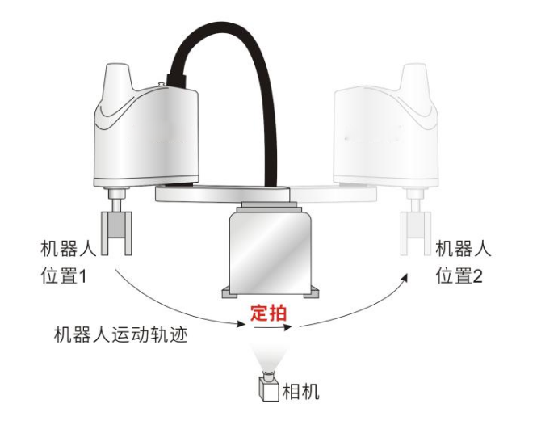
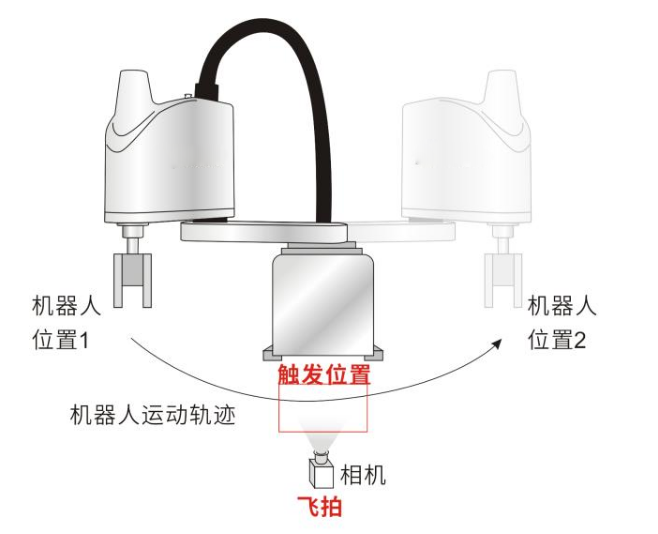
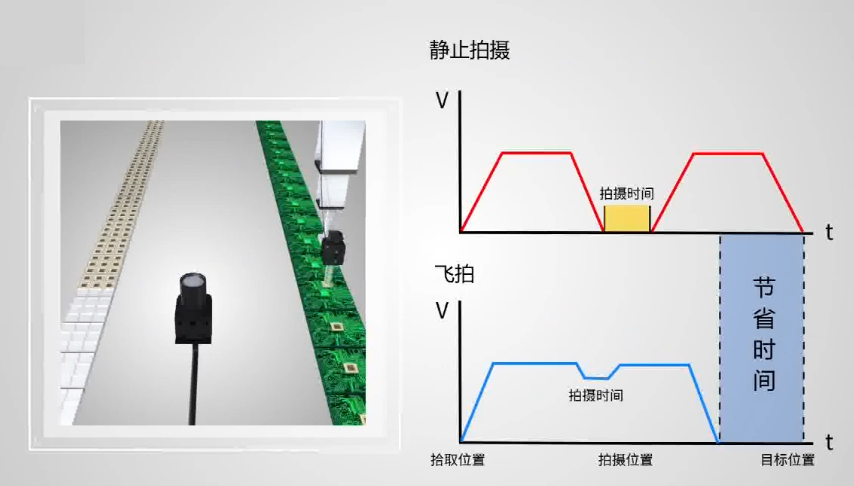
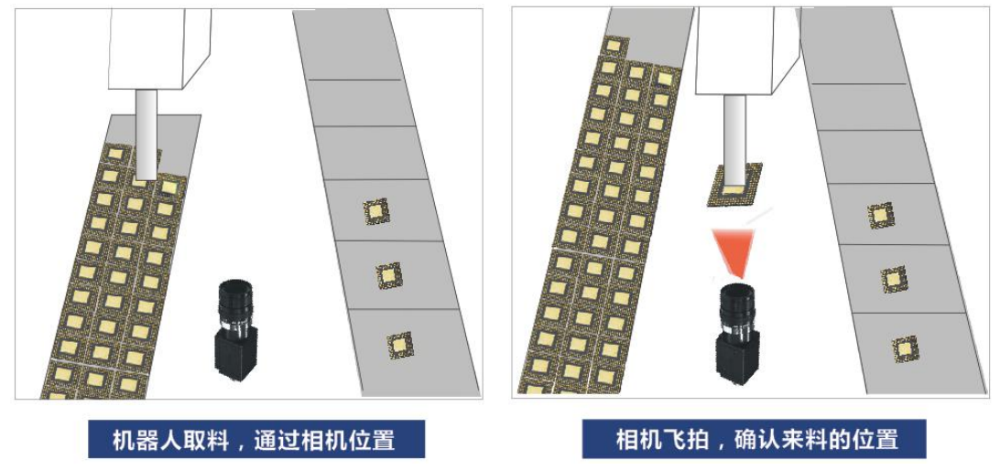
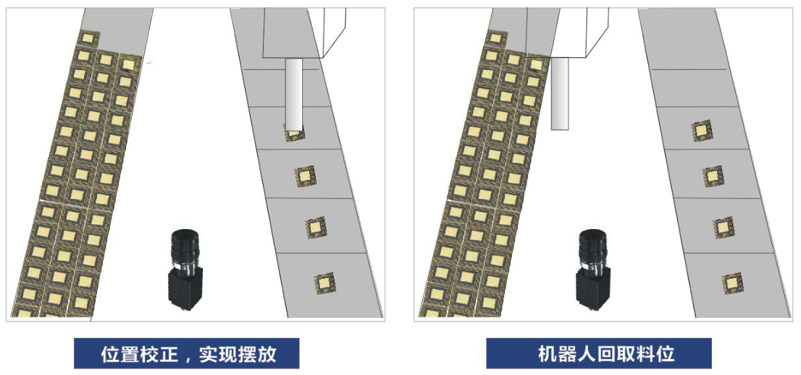

-----

| Title     | Media Image Camera 定拍飞拍                              |
| --------- | ---------------------------------------------------- |
| Created @ | `2021-04-26T08:23:35Z`                               |
| Updated @ | `2026-11-26T10:24:11Z`                               |
| Labels    | \`\`                                                 |
| Edit @    | [here](https://github.com/junxnone/aiwiki/issues/38) |

-----

# 定拍 vs 飞拍

视觉检测中，相机拍照时运动轴是**停下**还是**不停**，对应两种模式：定拍和飞拍。两者在节拍和精度之间取舍。

| 模式     | Description                   | 优缺点                           |
| ------ | ----------------------------- | ----------------------------- |
| **定拍** | 轴运动到拍照位停下来相机拍照处理，然后把结果反馈给执行机构 | 有延时, 某些环境对延时要求高，不适合该模式 精度高 |
| **飞拍** | 轴运动到拍照位时运动不停完成拍照处理以及结果反馈      | 不需要停滞 精度比 定拍稍低             |

|       |       |
| ----------------------------------------------------------------- | ----------------------------------------------------------------- |
|  |  |

## 应用场景

  - 位置校正
  - 丝印检测
  - 缺陷检测
  - 错/漏检测
  - 堵孔检测
  - 尺寸检测
  - 标签检测

### 1 位置校正

## 节拍对比

$$ T\_{\\text{定拍}}=T\_{move}+T\_{stop}+T\_{capture}+T\_{process},\\qquad
T\_{\\text{飞拍}}=T\_{move}+T\_{process}' $$

其中：

  - $T\_{move}$：轴运动到拍照位的时间；$T\_{stop}$：停稳等待的时间；$T\_{capture}$：拍照曝光时间
  - $T\_{process}$：图像处理和结果反馈的时间；$T\_{process}'$：飞拍中与运动重叠的处理时间（部分被运动掩盖）
  - 飞拍省去停稳（$T\_{stop}$）和部分拍照时间，节拍更短；代价是运动中拍照有拖影风险，需要短曝光和闪光灯，因此精度略低

| 对比项   | 定拍 | 飞拍        |
| ----- | -- | --------- |
| 是否停止  | 停  | 不停        |
| 节拍    | 较慢 | 较快        |
| 精度    | 高  | 略低        |
| 对光源要求 | 一般 | 高（短曝光、频闪） |

表中：对比结论：精度优先选定拍，效率优先选飞拍；延迟概念见
[低延迟](https://github.com/junxnone/aiwiki/issues/37)。

## Reference

  - [CCD视觉飞拍技术](http://www.julivision.com/news/436.html)
