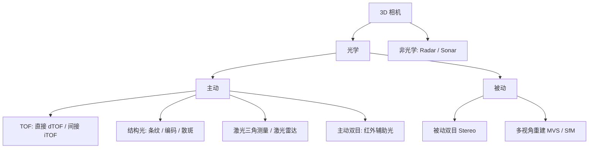
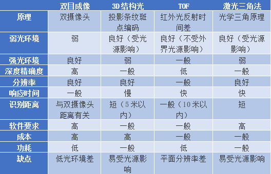
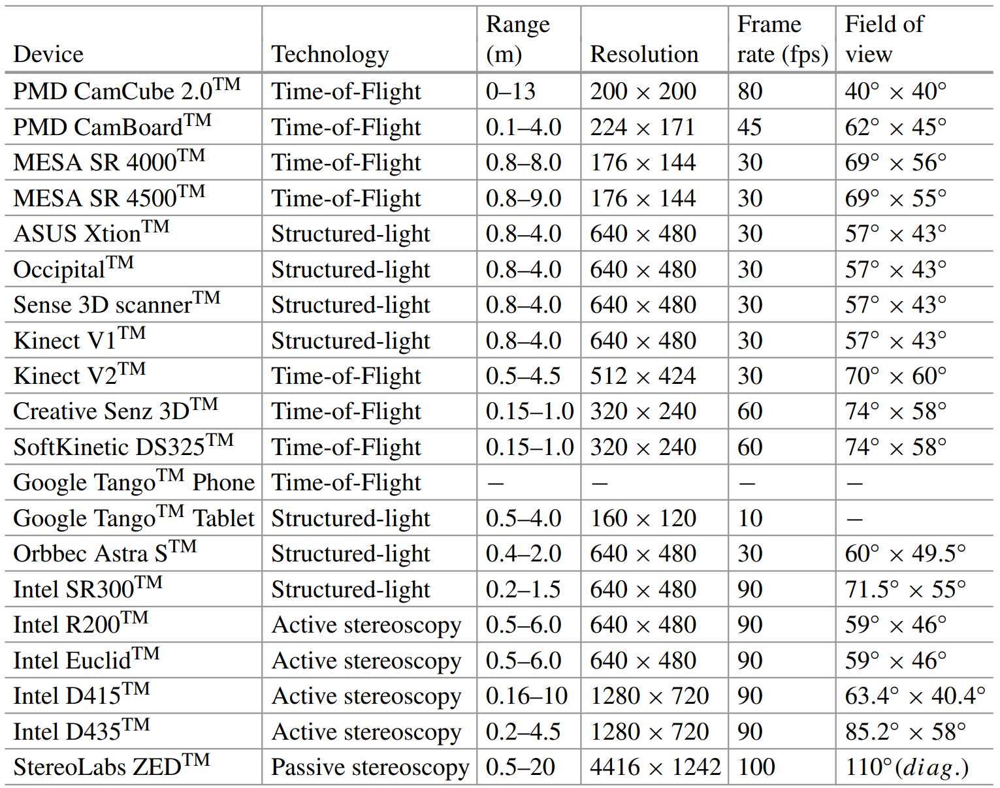

-----

| Title     | 3D Camera                                            |
| --------- | ---------------------------------------------------- |
| Created @ | `2021-07-27T03:09:10Z`                               |
| Updated @ | `2026-11-11T09:39:56Z`                               |
| Labels    | `index`                                              |
| Edit @    | [here](https://github.com/junxnone/aiwiki/issues/40) |

-----

# 3D Camera

3D 相机（深度相机）获取的是场景的**距离信息**，输出深度图或点云，而不是普通相机的二维亮度图像。本文是 3D
相机的总览：按测量原理分类，说明各类的原理、公式、优缺点和典型设备，并链接到本站各原理专文。点云处理见
[3D](0076_3D)，三维重建见 [三维重建](0305_3D_Algos_Reconstruction)，深度图像见 [3D
Image](0039_Media_Image_3DImage)，常用数据集见 [Datasets
3D](0087_Datasets_Image3D)。

## 分类

从不同角度可以对 3D 相机做如下划分：

  - **按传感器形态**：线阵相机（每次采集一个截面，多次采集拼接成完整图像）/ 面阵相机（一次得到整幅深度图）。
  - **按测量原理**：
      - 光学：TOF / 结构光 / 双目（立体视觉）/ 激光三角测量 / 光学多视角重建
      - 非光学：Radar（毫米波雷达）/ Sonar（声呐）/ 超声等
  - **按是否主动发光**：
      - 主动：自带光源，如 TOF、结构光、主动双目、激光雷达
      - 被动：只依赖环境光，如被动双目、多视角重建

<!-- end list -->

## 原理对比

| 原理     | 测量方式                | 典型精度与距离               | 优点               | 缺点                             |
| ------ | ------------------- | --------------------- | ---------------- | ------------------------------ |
| TOF    | 测光的飞行时间             | 毫米到厘米级，中近距离；激光雷达可达数百米 | 帧率高，结构简单，算法计算量小  | 多径干扰、飞点（边缘）、受反光/黑色物体影响，分辨率通常较低 |
| 结构光    | 投射已知图案，由图案畸变算深度     | 近距离可达亚毫米\~毫米级         | 近距离精度高，纹理少的表面也能测 | 受强环境光（尤其户外）影响，有效距离短，投射器标定      |
| 双目（被动） | 两个相机的视差             | 取决于基线与分辨率，误差随距离平方增大   | 无需主动光源，户外可用，成本低  | 弱纹理/重复纹理难匹配，计算量大，暗光差           |
| 主动双目   | 双目 + 红外纹理投射         | 同上，弱纹理场景改善            | 在无纹理表面也能匹配，可户外使用 | 红外投射在强光下作用减弱                   |
| 激光三角测量 | 激光线/点 + 相机，三角几何     | 高精度，短距离               | 精度高，常用于工业在线检测    | 需要扫描运动，遮挡盲区                    |
| 多视角重建  | 多张图像 + 位姿，SfM / MVS | 取决于图像质量与基线            | 只需普通相机，覆盖大场景     | 计算量大，无尺度（单目），弱纹理困难             |

> 精度与距离只给量级，具体数值随设备型号、标定和环境差异很大，请以厂商规格和实测为准。

## TOF（Time of Flight）

  - **光源：** IR 红外 / 激光。
  - 通过测量光从发射到被物体反射回传感器的时间，换算为距离：

$$d=\\frac{c,\\Delta t}{2}$$

其中 $c$ 为光速，$\\Delta t$ 为往返时间。

按调制方式分两类：

| 类型                 | 做法                                     | 特点                                                                                      |
| ------------------ | -------------------------------------- | --------------------------------------------------------------------------------------- |
| **脉冲调制（dTOF，直接）**  | 直接测量发射脉冲到回波的时间差                        | 需要高精度时钟/高速探测器（如 SPAD）；抗干扰、量程大，激光雷达常用                                                    |
| **连续波调制（iTOF，间接）** | 发射正弦等连续调制光，测接收信号的相位差 $\\Delta\\varphi$ | 用相位换算距离：$d=\\dfrac{c,\\Delta\\varphi}{4\\pi f}$；存在相位卷绕，无模糊距离为 $\\dfrac{c}{2f}$，常用多频率解卷绕 |

典型设备：

  - Kinect 2（Microsoft）：面阵 TOF。
  - Sick 线阵 3D Camera：线阵，每次一个截面，多次采集拼接成一幅图像。

| Name | 原理                                                                                                                           |
| ---- | ---------------------------------------------------------------------------------------------------------------------------- |
| TOF  |  |

TOF
的常见问题：**多径干扰**（光经多次反射才回到传感器，距离偏大）、**飞点**（物体边缘处混合前景和背景）、**运动模糊**、对镜面/深色物体的不稳定回波。

## 激光相机 / 雷达

  - 原理之一也是 TOF（激光雷达 LiDAR：脉冲或连续波测距，加扫描机构得到点云）。
  - 另一类是**三角测量法**：光源、被测点、相机构成三角形，由几何关系算深度，详见 [激光测量](0354_3D_Camera_激光测量)
    与 [三角测量](0399_3D_Algos_triangulation)。

| Name | 原理                                                                                                                           |
| ---- | ---------------------------------------------------------------------------------------------------------------------------- |
| 激光   |  |

按平台划分的激光雷达：

| 分类     | 精度   | 距离    | 应用        | Image                                                                                                                        |
| ------ | ---- | ----- | --------- | ---------------------------------------------------------------------------------------------------------------------------- |
| 星载激光雷达 |      |       |           |                                                                                                                              |
| 机载激光雷达 | 10cm | 大尺度   | 大尺度测绘     |  |
| 地面激光雷达 | mm   | 400+m | 地形测量/物体扫描 |  |
| 移动激光雷达 | cm   | 200+m | 无人车/机器人   |  |

相关数据（车载 LiDAR 点云）见 [Datasets 3D](0087_Datasets_Image3D) 的自动驾驶、室外城市点云部分。

## 结构光

  - 向场景投射已知的光图案，由相机观察图案在物体表面的畸变，计算编码畸变得到深度信息。
  - 图案类型：条纹结构光 / 编码结构光；常见编码有激光条纹、格雷码、正弦条纹（相移法）。
  - **散斑结构光**：激光照射到粗糙物体后随机形成的衍射斑点。
      - 这些散斑具有高度的随机性，而且距离不同，图案不同。
      - 标定时记录标定平面的光斑分布，测量时用匹配确定深度。
      - 应用：iPhone X（面部识别）。

| 方法        | 说明                  | 特点                                              |
| --------- | ------------------- | ----------------------------------------------- |
| 格雷码/二值码   | 时间编码，多幅图像投影后解码得到对应点 | 鲁棒，图像数多，适合静态场景                                  |
| 相移法（正弦条纹） | 投射相位依次移动的正弦条纹，解相位   | 精度高，需要解相位卷绕，见 [相移法重建](0309_3D_Camera_结构光_相移法重建) |
| 散斑        | 单帧随机图案，与参考平面匹配      | 单帧即可，适合动态，精度低于相移法                               |

详细原理见 [结构光 3D Camera](0308_3D_Camera_结构光)。

| Name | 原理                                                                                                                           |
| ---- | ---------------------------------------------------------------------------------------------------------------------------- |
| 结构光  |  |

## 双目相机

  - **主动双目：** 带红外激光光源，投射纹理辅助匹配。
  - **被动双目：** 无光源，可见光成像。
  - 使用**视差**原理：左右图中同一点的位置差（视差 $d$）反映深度：

$$Z=\\frac{f,B}{d}$$

其中 $f$ 为焦距（像素），$B$ 为基线（两相机光心距离），$d$ 为视差。

  - 深度误差随距离增大而急剧变大：$\\Delta Z\\approx\\dfrac{Z^2}{f,B}\\Delta
    d$；增大基线或焦距可提高精度，但会带来遮挡与匹配困难。
  - 基本流程：标定（内外参）→ 极线校正 → 立体匹配（得视差）→ 视差转深度/点云。

详细原理见 [双目 3D Camera](0307_3D_Camera_双目)（含对极几何与 UV-Disparity）。

| Name                | 原理                                                                                                                           |
| ------------------- | ---------------------------------------------------------------------------------------------------------------------------- |
| 双目视机(Stereo Camera) |  |

## 光学多视角重建

  - 用普通相机在多个位置拍摄的图像，通过 SfM（Structure from Motion）恢复相机位姿，再用
    MVS（Multi-View Stereo）稠密重建。
  - 单目重建无绝对尺度，需要额外参照或传感器。
  - 与 3D 相机的区别：它是**离线算法重建**，不是传感器直接输出深度；见
    [三维重建](0305_3D_Algos_Reconstruction)。

## 输出数据与相机参数

3D 相机通常输出：

| 数据    | 说明                        |
| ----- | ------------------------- |
| 深度图   | 每个像素对应距离 $Z$ 的单通道图像       |
| 点云    | 3D 点集合 $(X,Y,Z)$，可附带颜色/强度 |
| RGB-D | 彩色图 + 对齐的深度图              |

由深度图得到点云，需要相机**内参**（焦距 $f\_x,f\_y$、主点 $c\_x,c\_y$）：

$$X=\\frac{(u-c\_x)Z}{f\_x},\\quad Y=\\frac{(v-c\_y)Z}{f\_y}$$

  - 内参、外参、畸变参数需要标定；多传感器（深度 + RGB）还要做**外参标定**和对齐。
  - 使用时要注意坐标系约定、深度单位（毫米/米）和无效值（0 或 NaN）。

## 选型要点

| 需求               | 倾向              |
| ---------------- | --------------- |
| 工业高精度在线检测        | 激光三角测量、结构光（相移法） |
| 室内机器人 / 抓取（中近距离） | 结构光、主动双目、iTOF   |
| 户外 / 强光          | 被动/主动双目、激光雷达    |
| 大场景测绘、无人车        | 激光雷达（机载/移动/地面）  |
| 低成本、大视场          | 被动双目或多视角重建      |
| 需要高帧率            | TOF、散斑结构光       |

选型还要看：测量范围、精度与重复精度、帧率、分辨率、视场角、环境光适应性、物体材质（反光、透明、黑色）、功耗与成本。

## Summary

## Reference

  - [三维扫描系列
    点云绪论](https://blog.csdn.net/qq_32171789/article/details/114818081)
  - [ROS 3D Camera Survey](https://rosindustrial.org/3d-camera-survey)
  - [A Survey on 3D Cameras: Metrological Comparison of Time-of-Flight,
    Structured-Light and Active Stereoscopy
    Technologies](https://www.researchgate.net/publication/325866790_State-of-the-Art_Devices_Comparison)
  - [内参、外参、畸变参数三种参数与相机的标定方法与相机坐标系的理解](https://blog.csdn.net/tap880507/article/details/79670210)
