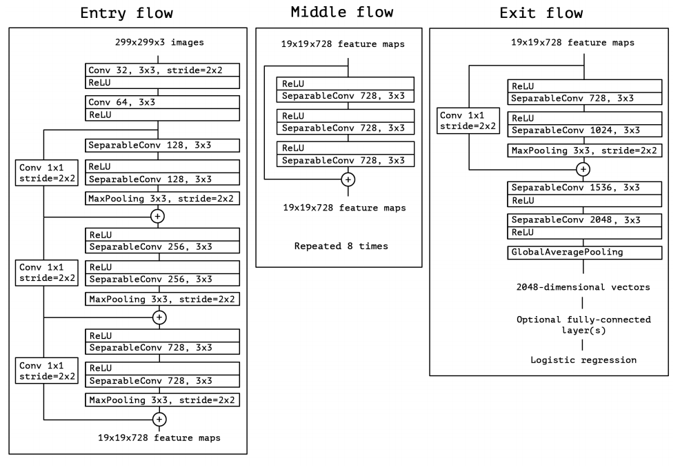
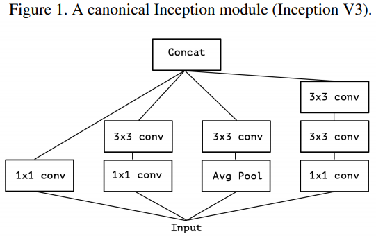
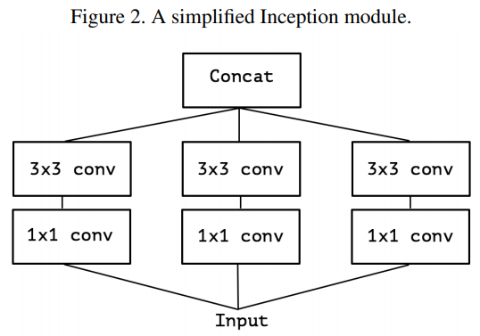
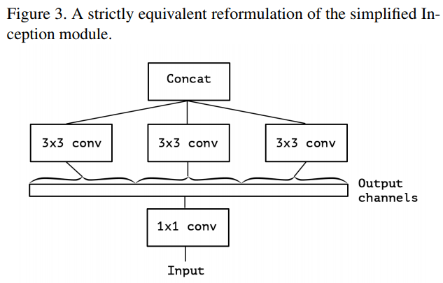
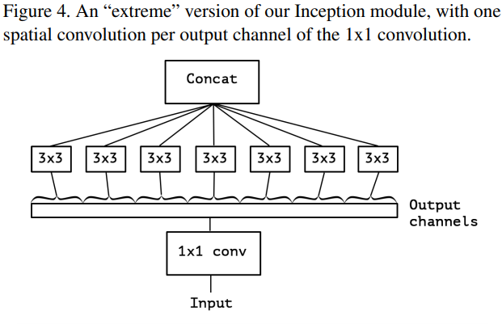
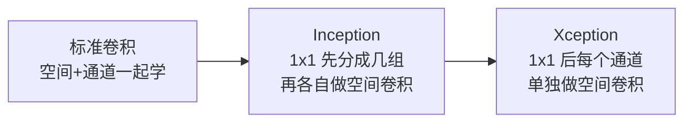

-----

| Title     | ML Tasks Image Classification Xception               |
| --------- | ---------------------------------------------------- |
| Created @ | `2019-12-04T05:29:11Z`                               |
| Updated @ | `2026-11-25T16:51:00Z`                               |
| Labels    | \`\`                                                 |
| Edit @    | [here](https://github.com/junxnone/aiwiki/issues/50) |

-----

# Xception

## Reference

  - 2016 **Xception** Xception: Deep Learning with Depthwise Separable
    Convolutions \[[paper](https://arxiv.org/abs/1610.02357)\]
  - [Xception 分析](https://blog.csdn.net/lk3030/article/details/84847879)

## Brief

Xception 网络是 Inception v3 的改进, 由 `François Chollet` 于 2016
年发表，后用于MobileNet

  - 提出深度可分离卷积 - depthwise separable convolutions

## 网络结构

## Module Improve

| Name                         | Module                                                       |
| ---------------------------- | ------------------------------------------------------------ |
| 经典 Inception V3              |  |
| 简化 Inception                 |  |
| 提取 1x1 Conv                  |  |
| Xception - extreme Inception |  |

-----

**Diff with Depthwise Separable Conv**

  - Depthwise Separable Conv
      - 先对通道进行卷积再 1x1 卷积
      - 两个卷积间不带激活函数
  - Xception
      - 先1x1卷积，再对通道卷积
      - ReLU 激活

## 深度可分离卷积的计算量

$$ \\text{Params}*{std}=K^2C*{in}C\_{out},\\qquad
\\text{Params}*{sep}=K^2C*{in}+C\_{in}C\_{out} $$

$$
\\frac{\\text{Params}*{sep}}{\\text{Params}*{std}}=\\frac{1}{C\_{out}}+\\frac{1}{K^2}
$$

其中：

  - $K$：卷积核边长；$C\_{in},C\_{out}$：输入、输出通道数
  - 标准卷积同时在空间和通道两个维度上混合信息
  - 深度可分离卷积把它拆成两步：逐通道的 depthwise 卷积 ($K^2C\_{in}$，只做空间滤波，每个通道独立) 和逐点的
    pointwise $1\\times1$ 卷积 ($C\_{in}C\_{out}$，只做通道混合)
  - 例：$K=3$，$C\_{in}=C\_{out}=256$：标准卷积 $589{,}824$，可分离
    $2{,}304+65{,}536=67{,}840$，约为标准卷积的 $11.5%$

下图对比标准卷积、Inception 与 Xception 的思路，说明「Inception 假设」的极端形式：

图中：

  - 从左到右，通道与空间的相关性被越来越彻底地分开处理
  - Inception 把通道分成少数几组再做空间卷积；Xception 的极端做法是分成与通道数相同的组数，即每个通道一个空间卷积，也就是
    depthwise 卷积

## 与 Depthwise Separable Conv 的区别

| 项目      | 标准的深度可分离卷积 (如 MobileNet)            | Xception 中的做法                       |
| ------- | ----------------------------------- | ----------------------------------- |
| 顺序      | 先 depthwise，再 pointwise $1\\times1$ | 先 pointwise $1\\times1$，再 depthwise |
| 两层之间的激活 | 有 (BN + ReLU)                       | 无                                   |
| 论文观察    | \-                                  | 不加中间激活收敛更快、精度更高                     |

表中：顺序的差异在多层堆叠时影响很小，关键差异是中间是否有 ReLU；Xception 的实验表明，对这种浅 (单通道)
的特征空间，非线性反而有害。

## 网络结构要点

  - 36 个卷积层，组成 14 个模块，除首尾模块外，每个模块都带残差连接 (见
    [ResNet](/0051_ML_Tasks_Image_Classification_ResNet))
  - 参数量约 $22.9\\text{M}$，与 [Inception
    V3](/0046_ML_Tasks_Image_Classification_Inception_V2V3) 相当，ImageNet
    精度略高于 V3
  - 深度可分离卷积后来成为轻量化网络的基础，见
    [MobileNet](/0045_ML_Tasks_Image_Classification_MobileNet)
