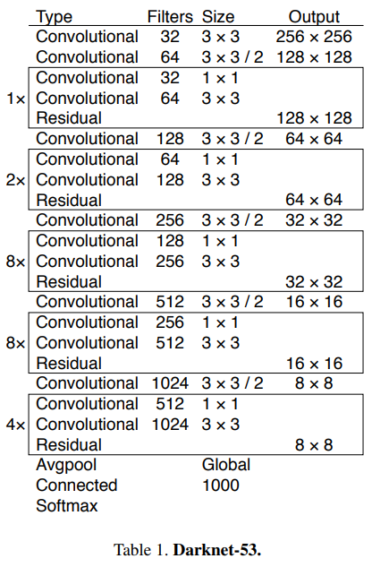
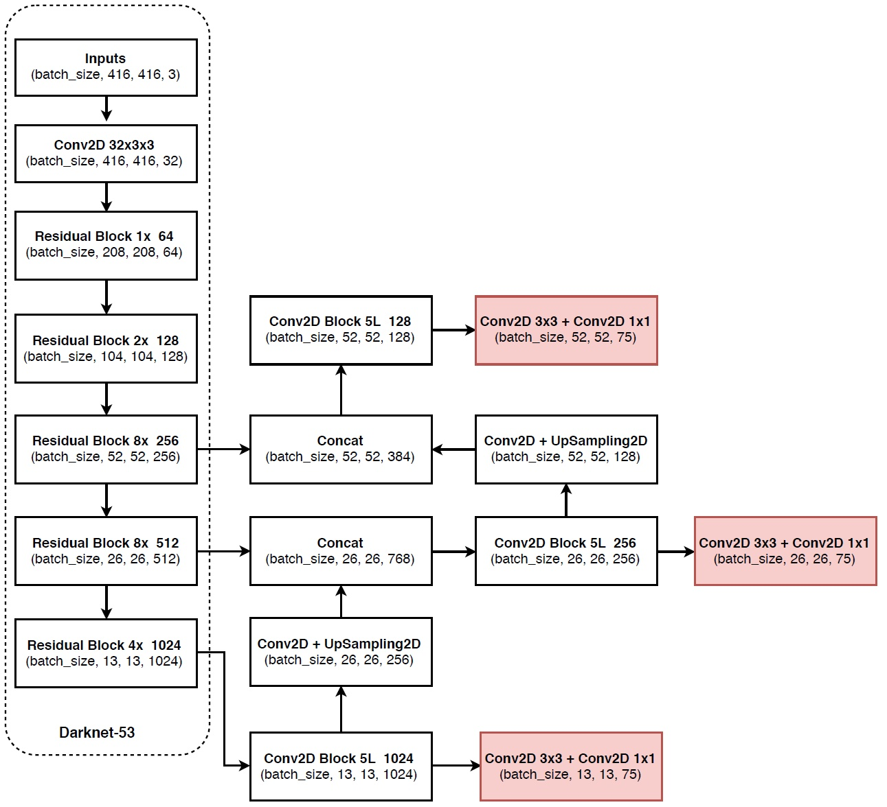
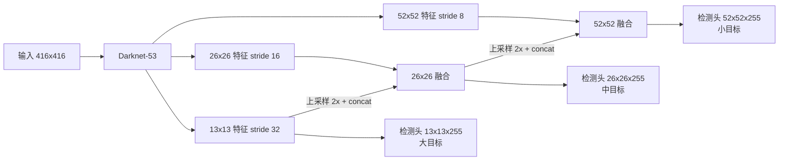

-----

| Title     | ML Tasks Image Detection YOLO V3                     |
| --------- | ---------------------------------------------------- |
| Created @ | `2020-01-16T05:08:20Z`                               |
| Updated @ | `2026-11-25T16:51:35Z`                               |
| Labels    | \`\`                                                 |
| Edit @    | [here](https://github.com/junxnone/aiwiki/issues/56) |

-----

# YOLO V3

  - darknet53
      - 引入残差结构
  - 引入 FPN - 多尺度检测
      - 52x52
      - 26x26
      - 13x13
  - multilabel classification : independent logistic 替换 softmax -\>
    binary cross-entropy loss

-----

**其他无效tricks**

  - Anchor box x, y offset predictions
  - Linear x, y predictions instead of logistic
  - Focal Loss
  - Dual IOU thresholds and truth assignment

## darknet53

## 

FPN 

## COCO dataset 9 clusters

  - (10×13)
  - (16×30)
  - (33×23)
  - (30×61)
  - (62×45)
  - (59×119)
  - (116 × 90)
  - (156 × 198)
  - (373 × 326)

## Reference

  - 2015 **YOLO V1** You Only Look Once: Unified, Real-Time Object
    Detection \[[paper](https://arxiv.org/pdf/1506.02640.pdf)\]
    \[[netscope](http://ethereon.github.io/netscope/#/gist/96209c6940e02b17c34009f6c3fee75e)\]
    \[[Code](https://pjreddie.com/darknet/yolo/)\] \[[Code2 -
    AlexeyAB](https://github.com/AlexeyAB/darknet)\]
  - 2016 **YOLO V2** YOLO9000: Better, Faster, Stronger
    \[[paper](https://arxiv.org/pdf/1612.08242.pdf)\]
    \[[netscope](http://ethereon.github.io/netscope/#/gist/8826fef24ed0b5086affdb6e65db26b7)\]
    \[[Code](https://pjreddie.com/darknet/yolo/)\]
  - 2018 **YOLOv3** An Incremental Improvement
    \[[paper](https://pjreddie.com/media/files/papers/YOLOv3.pdf)\]
    **\[[YOLOv3
    netscope](http://ethereon.github.io/netscope/#/gist/a9badc1fd4eefb7463c99e33d046af9e)\]**
    \[[Code](https://pjreddie.com/darknet/yolo/)\]
  - implements
      - [官方实现 - darknet yolo](https://pjreddie.com/darknet/yolo/)
      - [fork 后 update 较多的code -
        AlexeyAB](https://github.com/AlexeyAB/darknet)
      - [Minimal PyTorch implementation of
        YOLOv3](https://github.com/eriklindernoren/PyTorch-YOLOv3)
      - [keras-YOLOv3-mobilenet](https://github.com/Adamdad/keras-YOLOv3-mobilenet)
      - [keras-yolo3](https://github.com/qqwweee/keras-yolo3)
      - [kmeans-anchor-boxes](https://github.com/lars76/kmeans-anchor-boxes)
      - [keras-yolo3-detection](https://github.com/SpikeKing/keras-yolo3-detection)
  - [目标检测（九）--YOLO
    v1,v2,v3](https://blog.csdn.net/App_12062011/article/details/77554288)
  - [YOLO lite](https://reu2018dl.github.io/#myPage)
  - [YOLO-LITE项目实现(比SSD和MobileNet更快的算法)](https://blog.csdn.net/ghw15221836342/article/details/84427923)
  - [pjreddie Publications](https://pjreddie.com/publications/)
  - [YOLO-v3模型参数anchor设置](https://blog.csdn.net/m_buddy/article/details/82926024)
  - [YOLOv2 YOLOv3 如何选择先验框（priors
    anchor）（自用）](https://blog.csdn.net/Pattorio/article/details/80095511)
  - [YOLO
    v3网络结构分析](https://blog.csdn.net/qq_37541097/article/details/81214953)
  - [YOLOV3 基于OpenCV DNN 的目标检测实现](https://www.aiuai.cn/aifarm962.html)
  - [目标检测之YOLO V2
    V3](http://www.cnblogs.com/wangguchangqing/p/10480995.html)
  - [从yolov1到yolov3](https://shartoo.github.io/2019/03/12/yolo-v123/)
  - [YOLO V3](https://pjreddie.com/darknet/yolo/)
  - [Tiny Darknet](https://pjreddie.com/darknet/tiny-darknet/)

## 多尺度预测

下图展示 YOLOv3 如何用类似 FPN 的方式在三个尺度上预测：

图中：

  - Darknet-53 提取 $13\\times13$、$26\\times26$、$52\\times52$
    三个分辨率的特征，对应下采样 $32$、$16$、$8$ 倍
  - 深层 (小分辨率、语义强) 特征经 $2\\times$ 上采样后与浅层 (大分辨率、细节多)
    特征在通道维拼接，让浅层也带有深层语义，这是 FPN
    的思路
  - 三个检测头分别负责大、中、小目标：感受野大的 $13\\times13$ 检测大物体，$52\\times52$ 对小物体更敏感
  - 输入为 $416\\times416$ 时，三个头共预测 $3\\times(13^2+26^2+52^2)=10{,}647$
    个框，之后阈值过滤和 NMS

每个尺度的输出：

$$ S\\times S\\times\\bigl\[3,(4+1+C)\\bigr\]=S\\times
S\\times255\\quad(C=80) $$

其中：每个尺度每个格子使用 $3$ 个 anchor，每个 anchor 预测 $4$ 个框参数、$1$ 个 objectness、$C=80$
个类别 (COCO)；$9$ 个 anchor (见下面的聚类结果) 按尺寸从小到大分给三个尺度，每个尺度 $3$ 个，大 anchor
给小分辨率的特征图。框参数的解码方式与
[YOLOv2](/0055_ML_Tasks_Image_Detection_YOLO_V2) 相同。

## 损失与标签分配

  - objectness：与真实框 IoU 最大的那个 anchor 的目标为 $1$，其他与任意真实框 IoU 超过 $0.5$
    但不是最优的 anchor 被忽略 (不计入损失)，其余目标为 $0$
  - 分类：每个类别用独立的 logistic (sigmoid) 并用二元交叉熵，而不是 softmax：

$$
L\_{cls}=-\\sum\_{c=1}^{C}\\left\[y\_c\\log\\sigma(z\_c)+(1-y\_c)\\log\\bigl(1-\\sigma(z\_c)\\bigr)\\right\]
$$

其中：$z\_c$ 为第 $c$ 类的 logit，$y\_c\\in{0,1}$ 为标签；各类别相互独立，所以一个框可以同时属于多个类别 (如
Open Images 里的 `Woman` 和 `Person`)，softmax 要求类别互斥，不适合这种标签。

  - 框坐标：仍使用平方误差

## Darknet-53

  - 53 个卷积层 (52 个特征提取卷积 + 最后分类的全连接/卷积)，由 $\[1,2,8,8,4\]$
    个残差块依次堆叠，每组之间用步长 $2$ 的卷积下采样，而不是池化
  - 残差块的结构是 $1\\times1$ 卷积压缩通道再 $3\\times3$ 卷积，类似
    [ResNet](/0051_ML_Tasks_Image_Classification_ResNet) 的
    bottleneck；ImageNet 上精度接近 ResNet-152，但速度约快一倍 `[待核实]`
  - 对比 YOLOv2 的 Darknet-19：更深并加入残差连接，所以小目标和整体精度都明显提升

## 速度与精度

| 模型         | 输入              | COCO AP | AP50 | 推理时间  |
| ---------- | --------------- | ------- | ---- | ----- |
| YOLOv3-320 | $320\\times320$ | 28.2    | 51.5 | 22 ms |
| YOLOv3-416 | $416\\times416$ | 31.0    | 55.3 | 29 ms |
| YOLOv3-608 | $608\\times608$ | 33.0    | 57.9 | 51 ms |

表中：数据来自论文 (Titan X)，`AP` 为 IoU $0.5\\sim0.95$ 的平均，`AP50` 为 IoU 阈值 $0.5$
的精度；$\\text{AP}\_{50}$ 上 YOLOv3 与 RetinaNet 相当而快约 $3.8$ 倍，但 AP 在更严格的
IoU 阈值下稍落后，说明其定位框不如 RetinaNet 精细 `[待核实]`。

## 聚类得到的 9 个 anchor

上面列出的 9 个 $(w,h)$ (单位为像素，针对 $416\\times416$ 的输入) 是用
[YOLOv2](/0055_ML_Tasks_Image_Detection_YOLO_V2) 的 $1-\\mathrm{IoU}$ 距离在
COCO 上做 k-means 的结果：

| 尺度                        | Anchor ($w\\times h$)                            | 负责目标 |
| ------------------------- | ------------------------------------------------ | ---- |
| $52\\times52$ (stride 8)  | $(10\\times13),(16\\times30),(33\\times23)$      | 小    |
| $26\\times26$ (stride 16) | $(30\\times61),(62\\times45),(59\\times119)$     | 中    |
| $13\\times13$ (stride 32) | $(116\\times90),(156\\times198),(373\\times326)$ | 大    |

表中：每行是一个检测头及其使用的三个 anchor；框的尺寸越大，用的特征图越深 (分辨率越低)。
