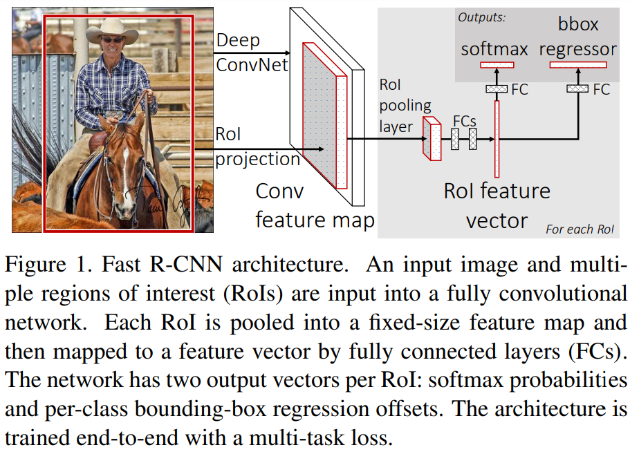
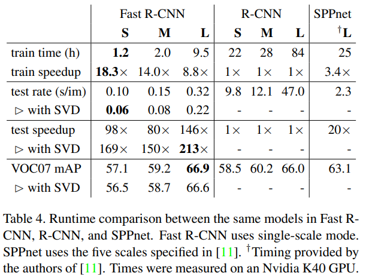

-----

| Title     | ML Tasks Image Detection FastRCNN                    |
| --------- | ---------------------------------------------------- |
| Created @ | `2019-12-11T05:18:12Z`                               |
| Updated @ | `2026-11-25T16:51:43Z`                               |
| Labels    | \`\`                                                 |
| Edit @    | [here](https://github.com/junxnone/aiwiki/issues/58) |

-----

## Reference

  - 2014 **R-CNN** Rich feature hierarchies for accurate object
    detection and semantic segmentation
    \[[paper](https://arxiv.org/pdf/1311.2524.pdf)\]
    \[[Code](https://github.com/rbgirshick/rcnn)\]
  - 2015 **Fast RCNN** \[[paper](https://arxiv.org/pdf/1504.08083.pdf)\]

## Brief

  - 共享卷积层
      - 提取候选框 --\> CNN --\> 每个候选框的特征 --\> 分类+回归
      - 输入图片 --\> CNN --\> 每张候选框的特征 --\> 分类+回归
  - SVM --\> Softmax

**Steps** 　　

  - 1.在图像中确定约1000-2000个候选框 (Selective search)
  - 2.对整张图片输进CNN，得到feature map
  - 3.找到每个候选框在feature map上的映射patch，将此patch作为每个候选框的卷积特征输入到SPP layer和之后的层
  - 4.对候选框中提取出的特征，使用分类器判别是否属于一个特定类
  - 5.对于属于某一特征的候选框，用回归器进一步调整其位置

## Fast R-CNN architecture

## ROI Pooling

根据region proposals的位置坐标在特征图中将相应区域池化为固定尺寸的特征图，以便进行后续的分类和输出回归框操作

  - Input
      - CNN 输出特征图
      - Selective search ROI
  - Output
      - region\_nums x channels x W x H的向量

> **ROI Align**
> 
>   - ROI Pooling 在池化的时会对浮点数边界取整, 精度损失映射到原始图片上有可能存在很大的像素点差别。
>   - ROI Align 使用双线性内插的方法替换取整, 获得坐标浮点数的像素点上的图像数值。

## Test Result

## RoI Pooling 公式

对一个 RoI (在特征图上的宽 $w$、高 $h$)，划分成 $H\\times W$ 个小格 (如
$7\\times7$)，对每个格子做最大池化：

$$ y\_{ij}=\\max\_{(p,q)\\in\\text{bin}(i,j)}x\_{pq},\\qquad
\\text{bin}(i,j)\\ \\text{大小}\\approx\\frac{h}{H}\\times\\frac{w}{W} $$

其中：

  - $x\_{pq}$：特征图上位置 $(p,q)$ 的值 (对每个通道分别池化)；$y\_{ij}$：输出的 $H\\times W$
    特征图第 $(i,j)$ 个值
  - $\\text{bin}(i,j)$：第 $(i,j)$ 个格子覆盖的特征图区域，大小随 RoI 大小变化，所以无论 RoI
    多大，输出都是固定的 $H\\times W$，可以接全连接层
  - RoI 的坐标要从原图映射到特征图 (除以步长 $16$) 并取整，这个取整造成的错位就是 RoI Align 要解决的问题

RoI Align (Mask R-CNN 提出) 不取整，而是在每个格子里取固定几个采样点，用双线性插值得到值：

$$ x(p,q)=\\sum\_{(i,j)\\in\\text{4
邻点}}x\_{ij},\\max(0,1-|p-i|),\\max(0,1-|q-j|) $$

其中 $(p,q)$ 是浮点坐标，$(i,j)$ 是周围 $4$
个整数点，权重由距离线性决定；再对每个格子内的采样点取平均或最大。对分割这种需要像素级对齐的任务提升明显，见
[Mask R-CNN](/0163_ML_Tasks_Image_Segmentation_MaskRCNN)。

## 多任务损失

$$ L(p,u,t^u,v)=L\_{cls}(p,u)+\\lambda,\[u\\ge1\],L\_{loc}(t^u,v) $$

$$ L\_{cls}=-\\log p\_u,\\qquad
L\_{loc}=\\sum\_{i\\in{x,y,w,h}}\\mathrm{smooth}*{L\_1}(t^u\_i-v\_i),\\qquad
\\mathrm{smooth}*{L\_1}(x)=\\begin{cases}0.5x^2&|x|\<1\\|x|-0.5&\\text{otherwise}\\end{cases}
$$

其中：

  - $p=(p\_0,\\dots,p\_K)$：RoI 属于 $K+1$ 个类别 (含背景 $0$) 的 softmax
    概率；$u$：真实类别；$p\_u$：真实类别的预测概率
  - $t^u$：网络为真实类别 $u$ 预测的框偏移；$v$：真实的回归目标 (编码方式见
    [Detection](/0152_ML_Tasks_Image_Detection))
  - $\[u\\ge1\]$：只有前景 RoI ($u\\ge1$) 才计算框回归损失，背景不计
  - $\\lambda$：平衡系数，论文取 $1$；smooth $L\_1$ 在误差小时是平方
    (平滑)，误差大时是线性，对离群点不敏感，比
    $L\_2$ 更稳健
  - 分类和回归在同一个网络里联合训练，因此去掉了 R-CNN 里单独训练的 SVM 和回归器

## 训练与速度

  - 每个 mini-batch 取 $2$ 张图，每张图采样 $64$ 个 RoI (共 $128$ 个)；其中 $25%$ 为正样本
    ($\\mathrm{IoU}\\ge0.5$)，负样本取 $\\mathrm{IoU}\\in\[0.1,0.5)$
  - 同一张图的所有 RoI 共享卷积计算，所以每个 batch 的卷积开销只相当于 $2$ 张图，而不是 R-CNN 的 $128$ 张图块
  - 论文结论：用 VGG16 时，训练比 [R-CNN](/0057_ML_Tasks_Image_Detection_RCNN) 快约
    $9$ 倍，测试快约 $213$ 倍，VOC 2012 mAP 更高 `[待核实]`
  - 剩下的瓶颈是 Selective Search：它在 CPU 上每张图要约 $2$ 秒，占了测试时间的大头，因此有了 [Faster
    R-CNN](/0059_ML_Tasks_Image_Detection_FasterRCNN) 的 RPN

## 与 R-CNN 的区别

| 维度   | [R-CNN](/0057_ML_Tasks_Image_Detection_RCNN) | Fast R-CNN        |
| ---- | -------------------------------------------- | ----------------- |
| 卷积计算 | 每个候选框单独一次 (约 2000 次)                         | 整图一次，所有候选框共享      |
| 特征对齐 | resize 到 $227\\times227$                     | RoI Pooling 到固定大小 |
| 分类器  | 线性 SVM                                       | softmax (与回归一起训练) |
| 训练   | 多阶段                                          | 单阶段，端到端 (候选框除外)   |
| 特征存盘 | 需要                                           | 不需要               |

表中：Fast R-CNN 的关键改进是「共享卷积」与「RoI Pooling」，使整个检测网络可以一次前向、一次训练。

> 修正：上面步骤中提到的 `SPP layer`，在 Fast R-CNN 里实际使用的是单层金字塔的 RoI Pooling，可以看作
> SPP-net 只用一级金字塔的特例。
