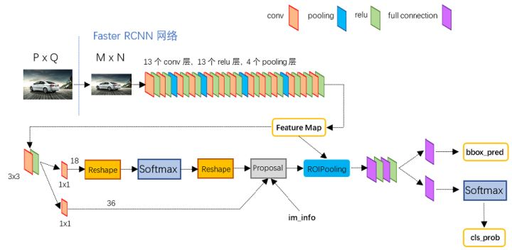
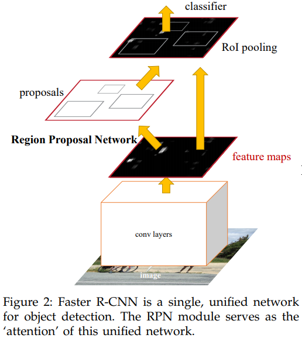
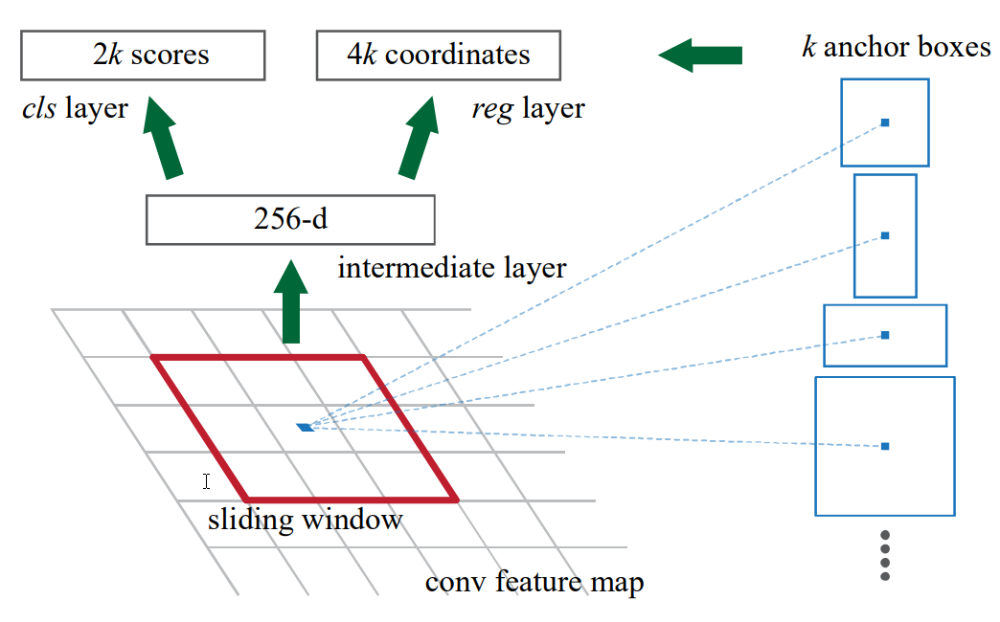
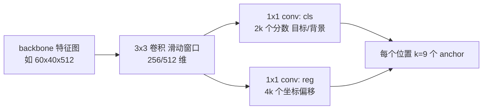

-----

| Title     | ML Tasks Image Detection FasterRCNN                  |
| --------- | ---------------------------------------------------- |
| Created @ | `2019-06-22T08:56:17Z`                               |
| Updated @ | `2026-11-25T16:51:45Z`                               |
| Labels    | \`\`                                                 |
| Edit @    | [here](https://github.com/junxnone/aiwiki/issues/59) |

-----

## Reference

  - 2014 **R-CNN** Rich feature hierarchies for accurate object
    detection and semantic segmentation
    \[[paper](https://arxiv.org/pdf/1311.2524.pdf)\]
    \[[Code](https://github.com/rbgirshick/rcnn)\]
  - 2015 **Fast RCNN** \[[paper](https://arxiv.org/pdf/1504.08083.pdf)\]
  - 2016 **Faster R-CNN** Towards Real-Time Object Detection with Region
    Proposal Networks \[[paper](https://arxiv.org/pdf/1506.01497.pdf)\]
  - [Faster-rcnn实现目标检测](https://www.cnblogs.com/ywheunji/p/10375890.html)
  - [Fast
    R-CNN中的边框回归](https://www.cnblogs.com/wangguchangqing/p/10393934.html)

## Brief

  - faster-rcnn把获取feature map，候选区域选取，回归和分类等操作全部融合在一个深层网络当中，效率较前两种提升了很多。
  - **Pipeline**
      - 对整张图片输进CNN，得到feature map
      - 卷积特征输入到RPN，得到候选框的特征信息
      - 对候选框中提取出的特征，使用分类器判别是否属于一个特定类
      - 对于属于某一特征的候选框，用回归器进一步调整其位置
  - [RCNN VS Fast RCNN VS Faster
    RCNN](/RCNN_VS_Fast_RCNN_VS_Faster_RCNN)

## Arch

## RPN - Region Proposal Networks

## 

  - 3X3 卷积滑动窗口，映射到低维特征
      - ZF model - 256-d
      - VGG model - 512-d
  - ReLU
  - box-regression layer
      - 4k coordinates \[default k = 9\]
  - box-classification layer
      - 2k scores \[是否为目标\]

-----

## Output

## RPN 的 Anchor

下图说明 RPN 如何在特征图的每个位置上预测候选框：

图中：

  - 在特征图的每个位置上用 $3\\times3$ 卷积滑窗，得到一个低维 (ZF 为 $256$、VGG 为 $512$)
    特征，再分成两个 $1\\times1$ 卷积的兄弟分支
  - `cls` 分支输出 $2k$ 个值，即每个 anchor 是「目标/背景」的得分；`reg` 分支输出 $4k$ 个值，即每个
    anchor 的框偏移 $(t\_x,t\_y,t\_w,t\_h)$
  - $k=9$：每个位置 $9$ 个 anchor，由 $3$ 种面积 ($128^2,256^2,512^2$) 与 $3$ 种长宽比
    ($1:2,1:1,2:1$) 组合而成；这是「平移不变」的设计，所有位置共享同一组卷积参数
  - 特征图步长为 $16$ 时，一张约 $1000\\times600$ 的图有
    $60\\times40\\times9\\approx20{,}000$ 个 anchor

## RPN 的损失

$$
L({p\_i},{t\_i})=\\frac1{N\_{cls}}\\sum\_iL\_{cls}(p\_i,p\_i^\*)+\\lambda\\frac1{N\_{reg}}\\sum\_ip\_i^*L\_{reg}(t\_i,t\_i^*)
$$

其中：

  - $i$：anchor 的编号；$p\_i$：该 anchor 是目标的预测概率；$p\_i^\*$：真实标签 (正样本为
    $1$，负样本为 $0$)
  - $t\_i$：预测的框偏移；$t\_i^\*$：相对于对应真实框的偏移目标，编码方式见
    [Detection](/0152_ML_Tasks_Image_Detection)
  - $L\_{cls}$：二分类的对数损失；$L\_{reg}$：smooth $L\_1$，且乘
    $p\_i^\*$，所以只有正样本参与回归
  - $N\_{cls}$：mini-batch 大小 ($256$)，$N\_{reg}$：anchor 位置数 (约
    $2400$)，用来归一化；$\\lambda=10$ 使两项权重大致平衡
  - 标签定义：与某个真实框 $\\mathrm{IoU}$ 最大的 anchor，或与任意真实框 $\\mathrm{IoU}\>0.7$
    的 anchor 为正；$\\mathrm{IoU}\<0.3$ 的为负；其余不参与训练。每张图随机采样 $256$ 个
    anchor，正负比例最多 $1:1$

## 完整流程

图中：

  - RPN 与检测网络共享同一个 backbone 的特征，候选框几乎不增加额外的卷积开销，这是 Faster R-CNN 比 [Fast
    R-CNN](/0058_ML_Tasks_Image_Detection_FastRCNN) 快的原因，Selective
    Search 被 RPN 取代
  - RPN 输出的约 $20{,}000$ 个框经过 NMS (阈值 $0.7$) 去重，取得分最高的 $300$ 个作为候选送入后面的
    RoI Pooling 和分类回归头 (Fast R-CNN 的检测头)

## 训练

  - 论文中的 4 步交替训练：先训练 RPN → 用其候选训练 Fast R-CNN (两者各有独立的 backbone) →
    用检测网络初始化 RPN 并固定共享层，只训练 RPN 独有的层 → 固定共享层，微调 Fast R-CNN
    独有的层
  - 后来的实现多用近似联合训练：RPN 和检测头一起反向传播，一步完成，效果相近，实现更简单

## 速度与精度

| 模型                                                            | 候选框方法            | VOC07 mAP                     | 速度 `[待核实]`        |
| ------------------------------------------------------------- | ---------------- | ----------------------------- | ----------------- |
| [R-CNN](/0057_ML_Tasks_Image_Detection_RCNN) (VGG16)          | Selective Search | 66.0                          | 约 47 s/张          |
| [Fast R-CNN](/0058_ML_Tasks_Image_Detection_FastRCNN) (VGG16) | Selective Search | 66.9                          | 约 2.3 s/张         |
| Faster R-CNN (VGG16)                                          | RPN (300 个)      | 69.9 (仅 07 训练) / 73.2 (07+12) | 约 0.2 s/张 (5 fps) |

表中：数据来自三篇论文，运行环境不完全相同；Faster R-CNN 把候选框生成也放到 GPU 上，使检测首次接近实时 (约 5
fps)。三者逐项对比见 [RCNNs](/0060_ML_Tasks_Image_Detection_RCNNs)。
