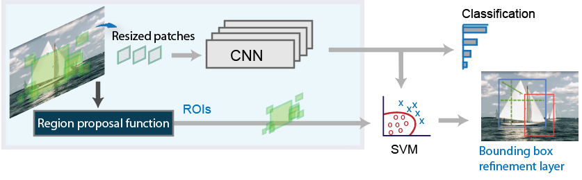
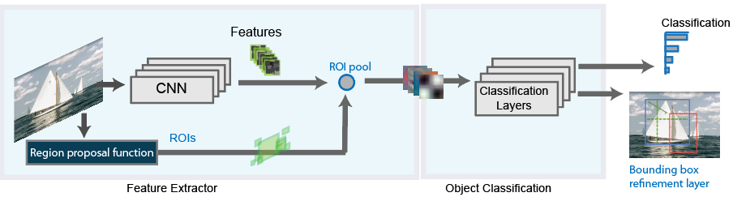
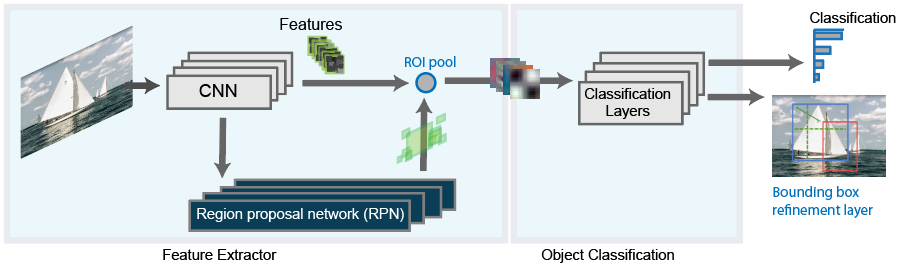
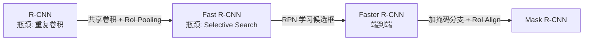

-----

| Title     | ML Tasks Image Detection RCNNs                       |
| --------- | ---------------------------------------------------- |
| Created @ | `2019-01-28T05:36:24Z`                               |
| Updated @ | `2026-11-26T01:27:04Z`                               |
| Labels    | \`\`                                                 |
| Edit @    | [here](https://github.com/junxnone/aiwiki/issues/60) |

-----

# RCNN VS Fast RCNN VS Faster RCNN

## Diff

| Pipeline                                                     |
| ------------------------------------------------------------ |
| R-CNN                                                        |
|  |
| Fast R-CNN                                                   |
|  |
| Faster R-CNN                                                 |
|  |

## RCNN

1.在图像中确定约1000-2000个候选框 (使用选择性搜索)  
2\. 每个候选框内图像块缩放至相同大小，并输入到CNN内进行特征提取  
3.对候选框中提取出的特征，使用分类器判别是否属于一个特定类  
4.对于属于某一特征的候选框，用回归器进一步调整其位置

## Fast RCNN

1.在图像中确定约1000-2000个候选框 (使用选择性搜索)  
2.对整张图片输进CNN，得到feature map  
3.找到每个候选框在feature map上的映射patch，将此patch作为每个候选框的卷积特征输入到SPP layer和之后的层  
4.对候选框中提取出的特征，使用分类器判别是否属于一个特定类  
5.对于属于某一特征的候选框，用回归器进一步调整其位置

## Faster RCNN

1.对整张图片输进CNN，得到feature map  
2.卷积特征输入到RPN，得到候选框的特征信息  
3.对候选框中提取出的特征，使用分类器判别是否属于一个特定类  
4.对于属于某一特征的候选框，用回归器进一步调整其位置

## 逐项对比

| 维度           | [R-CNN](/0057_ML_Tasks_Image_Detection_RCNN) | [Fast R-CNN](/0058_ML_Tasks_Image_Detection_FastRCNN) | [Faster R-CNN](/0059_ML_Tasks_Image_Detection_FasterRCNN) |
| ------------ | -------------------------------------------- | ----------------------------------------------------- | --------------------------------------------------------- |
| 年份           | 2014                                         | 2015                                                  | 2015/2016                                                 |
| 候选框          | Selective Search                             | Selective Search                                      | RPN (网络内生成)                                               |
| 卷积计算         | 每个候选框一次                                      | 整图共享一次                                                | 整图共享一次                                                    |
| 特征对齐         | resize 到 $227\\times227$                     | RoI Pooling                                           | RoI Pooling                                               |
| 分类           | 线性 SVM                                       | softmax                                               | softmax                                                   |
| 框回归          | 单独的岭回归                                       | 与分类联合训练                                               | 与分类联合训练，RPN 也有回归                                          |
| 训练           | 多阶段                                          | 单阶段                                                   | 近似端到端                                                     |
| 测试速度 (VGG16) | 约 47 s/张                                     | 约 2.3 s/张                                             | 约 0.2 s/张                                                 |
| VOC07 mAP    | 66.0                                         | 66.9                                                  | 69.9\~73.2                                                |

表中：前三行说明三代的主要变化，下面几行说明由此带来的训练流程和性能差别；速度和 mAP 的出处与说明见各自的文章 `[待核实]`。

## 演进主线

图中：箭头上标出的是每一步解决的问题——先把「每个候选框一次卷积」改成「整图一次卷积」，再把外部的 Selective Search
换成网络内部的 RPN；Faster R-CNN 又被扩展为实例分割的 [Mask
R-CNN](/0163_ML_Tasks_Image_Segmentation_MaskRCNN)。

## 四个共同的概念

  - IoU、NMS、mAP：见 [Detection](/0152_ML_Tasks_Image_Detection)
  - 框回归的编码 $t\_x,t\_y,t\_w,t\_h$：三代都用同一种 (相对 proposal/anchor 的偏移，宽高取对数)
  - 两阶段：先候选再精分类，与 [YOLO](/0053_ML_Tasks_Image_Detection_YOLO) 的单阶段形成对比
  - 候选框数：R-CNN/Fast 约 $2000$，Faster 的 RPN 取 $300$，数量越少，后续分类的开销越小

## Reference

  - [基于深度学习的目标检测技术演进：R-CNN、Fast R-CNN、Faster
    R-CNN](https://www.cnblogs.com/skyfsm/p/6806246.html)
  - [CVPR 2019 |
    天秤座R-CNN：全面平衡的目标检测器](https://www.jiqizhixin.com/articles/2019-04-26-12)
  - [Getting Started with R-CNN, Fast R-CNN, and Faster
    R-CNN](https://in.mathworks.com/help/vision/ug/getting-started-with-r-cnn-fast-r-cnn-and-faster-r-cnn.html)
  - [Object Detection for Dummies Part 3: R-CNN
    Family](https://lilianweng.github.io/lil-log/2017/12/31/object-recognition-for-dummies-part-3.html)
