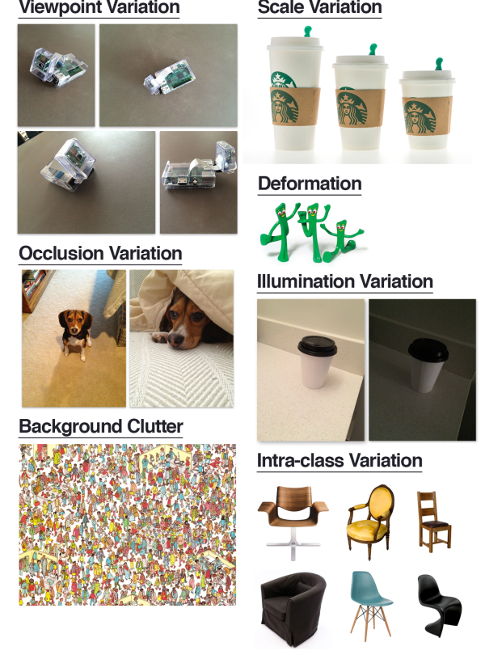
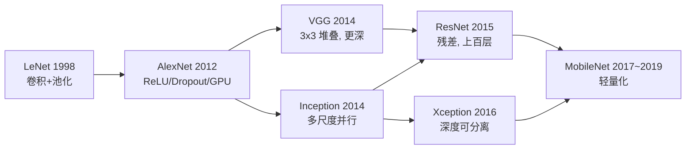

-----

| Title     | ML Tasks Image Classification                        |
| --------- | ---------------------------------------------------- |
| Created @ | `2019-05-12T14:38:40Z`                               |
| Updated @ | `2026-11-25T16:51:22Z`                               |
| Labels    | \`\`                                                 |
| Edit @    | [here](https://github.com/junxnone/aiwiki/issues/61) |

-----

## Reference

  - [Multitask-Learning](https://github.com/mbs0221/Multitask-Learning)

## Brief

  - 图像分类任务
      - **二分类**
      - **多分类**
      - **多标签分类**: 一张图像多个标签(标签为二分类)
      - **Multi-Ouput\&Multi-Task**: 一张图片多个标签(标签为多分类)
  - [经典分类方法](#经典分类方法)
  - [Image Classification History](/Image_Classification_History)

| Labels per Image / Label Value | K = 2               | K \> 2              |
| ------------------------------ | ------------------- | ------------------- |
| Labels = 1                     | Binary/sigmoid      | Multi-Class/softmax |
| Labels \> 1                    | Multi-Label/sigmoid | Multi-Output/task   |

## 常见的挑战

  - viewpoint variation 图一个物体,只是拍摄的角度不同,对不同图片,要能够正确识别.
  - scale variation 同一个物品,只是形状不同,对不同图片,要能够正确识别.
  - deformation 姿态不同
  - occlusion 有遮挡
  - illumination 光线明暗差别
  - background clutter 背景有很多噪音图片
  - intra-class variration 属于同一种类,类内差别 比如图片中6个物体均应该分类为椅子

## 任务与损失函数

不同标签设置对应不同的输出层和损失函数。上面的表格给出了任务类型，下面是各自的数学形式。

多分类 (单标签，$K\>2$)：用 softmax 与交叉熵：

$$ p\_k=\\frac{e^{z\_k}}{\\sum\_{j=1}^{K}e^{z\_j}},\\qquad
L=-\\sum\_{k=1}^{K}y\_k\\log p\_k=-\\log p\_{c} $$

其中：

  - $z\_k$：网络对第 $k$ 类输出的原始得分 (logit)；$K$：类别数
  - $p\_k\\in(0,1)$：softmax 后的类别概率，各类之和为 $1$，即类别之间互斥
  - $y\_k$：one-hot 真实标签，真实类别 $c$ 处为 $1$，其余为 $0$，所以损失就是真实类别概率的负对数

二分类和多标签：每个类别各自用 sigmoid 与二元交叉熵：

$$ p\_k=\\sigma(z\_k)=\\frac{1}{1+e^{-z\_k}},\\qquad
L=-\\sum\_{k=1}^{K}\\bigl\[y\_k\\log p\_k+(1-y\_k)\\log(1-p\_k)\\bigr\]
$$

其中：

  - $\\sigma$：sigmoid 函数；$p\_k$：图像含有第 $k$ 个标签的概率，各类相互独立，之和不要求为 $1$
  - $y\_k\\in{0,1}$：第 $k$ 个标签是否存在
  - $K=1$ 时就是二分类；$K\>1$ 且一张图可以有多个标签时是多标签分类

Multi-Output/Multi-Task：每个任务各有一个 softmax 头，总损失为各任务损失的加权和
$L=\\sum\_t\\lambda\_tL\_t$，$\\lambda\_t$ 是任务权重。

## 评价指标

$$ \\text{Top-}k\\ \\text{Acc}=\\frac{1}{N}\\sum\_{i=1}^{N}\\mathbb
1\\bigl\[y\_i\\in\\text{Top-}k(\\hat p\_i)\\bigr\],\\qquad
P=\\frac{TP}{TP+FP},\\quad R=\\frac{TP}{TP+FN},\\quad
F\_1=\\frac{2PR}{P+R} $$

其中：

  - $N$：样本数；$\\hat p\_i$：第 $i$ 张图的预测概率向量；$\\mathbb 1\[\\cdot\]$：条件成立为
    $1$，否则为 $0$
  - Top-$k$ 准确率：真实类别落在得分最高的 $k$ 个类别中即算对，ImageNet 常报告 Top-1 和 Top-5
  - $TP,FP,FN$：真阳性、假阳性、假阴性个数；$P$ 精确率，$R$ 召回率，$F\_1$ 是二者的调和平均
  - 多标签任务常用 mAP 或各类 $F\_1$ 的宏平均 (macro) / 微平均 (micro)；类别不平衡时只看准确率会失真

## 经典网络演进

下图按时间顺序展示分类网络的主线，每一步解决上一步的瓶颈：

图中：

  - 箭头表示技术上的承接或影响；VGG 和 Inception 是 AlexNet 之后两条并行的路线 (更深 vs 更宽)，ResNet
    吸收了二者的经验并解决了深度带来的训练困难
  - Xception 把 Inception 的假设推到极端，得到深度可分离卷积，成为 MobileNet 等轻量化网络的基础

| 模型                                                         | 年份         | 核心贡献                      | 参数量 (约)         |
| ---------------------------------------------------------- | ---------- | ------------------------- | --------------- |
| [LeNet](/0024_ML_Tasks_Image_Classification_LeNet)         | 1998       | 卷积、权值共享、池化                | 0.06 M          |
| [AlexNet](/0027_ML_Tasks_Image_Classification_AlexNet)     | 2012       | ReLU、Dropout、GPU 训练       | 61 M            |
| [VGGNet](/0146_ML_Tasks_Image_Classification_VGGNet)       | 2014       | $3\\times3$ 小卷积堆叠         | 138 M           |
| [Inception](/0049_ML_Tasks_Image_Classification_Inception) | 2014\~2016 | 多尺度并行、$1\\times1$ 降维、分解卷积 | 7\~56 M `[待核实]` |
| [ResNet](/0051_ML_Tasks_Image_Classification_ResNet)       | 2015       | 残差连接                      | 11.7\~60 M      |
| [Xception](/0050_ML_Tasks_Image_Classification_Xception)   | 2016       | 深度可分离卷积                   | 22.9 M          |
| [MobileNet](/0045_ML_Tasks_Image_Classification_MobileNet) | 2017\~2019 | 轻量化、倒残差、NAS               | 2.9\~5.4 M      |

表中：`核心贡献` 是该模型相对前代最重要的新技术；`参数量` 为 ImageNet 1000
类版本的大致值。整体趋势是精度提升的同时，参数和计算量从「堆大」转向「精打细算」。年代、条目更完整的列表见
[History](/0166_ML_Tasks_Image_Classification_History)。

## 常见挑战的应对

| 挑战          | 常用方法                                               |
| ----------- | -------------------------------------------------- |
| 视角、尺度、形变    | 数据增强 (随机裁剪、翻转、缩放)、多尺度训练、更深更大的感受野                   |
| 遮挡          | Dropout、Cutout/Random Erasing、更强的数据增强              |
| 光照变化        | 颜色扰动、归一化 (BatchNorm)                               |
| 背景杂乱        | 注意力机制、更大数据量、预训练                                    |
| 类内差异大、类间差异小 | 度量学习，见 [Retrieval](/0278_ML_Tasks_Image_Retrieval) |

表中：`方法` 是缓解对应挑战的常用手段，不是唯一解；实际上最有效的通常是更多更干净的数据和预训练模型。

## 相关

  - 检测见 [Detection](/0152_ML_Tasks_Image_Detection)，分割见
    [Segmentation](/0159_ML_Tasks_Image_Segmentation)
  - 轻量化与部署：[Quantization](/0312_MO_Quantization)、[KD](/0207_MO_KD)
