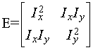
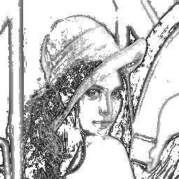
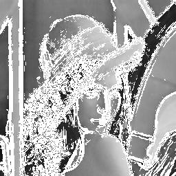
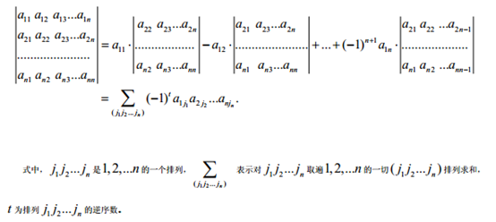
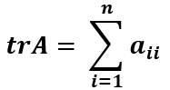

-----

| Title     | CV StructureTensor                                   |
| --------- | ---------------------------------------------------- |
| Created @ | `2020-11-08T06:53:20Z`                               |
| Updated @ | `2026-10-19T07:40:32Z`                               |
| Labels    | \`\`                                                 |
| Edit @    | [here](https://github.com/junxnone/aiwiki/issues/70) |

-----

# Structure Tensor 结构张量

  - 区分图像的`平坦区域/边缘区域/角点区域`
  - 矩阵

|  | Ix - x 方向的梯度 Iy - y 方向的梯度              |
| ------------------------------------------------------------ | ----------------------------------------- |
| 矩阵 E 的 迹 H = trace(E)                                     | `H =0` 为平坦区域                              |
| 矩阵 E 的 行列式 K = det(E)                                     | `K=0 & H > 0` 为边缘区域  `H>0 & K>0` 为角点区域 |

| 原图                                                           | 平坦区域                                                         | 边缘区域                                                         | 角点                                                           |
| ------------------------------------------------------------ | ------------------------------------------------------------ | ------------------------------------------------------------ | ------------------------------------------------------------ |
|  |  |  |  |

## 矩阵 E 具体是什么

结构张量是一个 2×2 矩阵，由局部窗口内 x/y 方向梯度（`Ix`、`Iy`，计算方式就是 [边缘](0065_CV_Edge) 里介绍的
Sobel 等梯度算子）构造出来：

    E = | Σ Ix²    Σ IxIy |
        | Σ IxIy   Σ Iy²  |

求和（或更常见做法：高斯加权求和）的范围是以当前像素为中心的一个局部窗口——这也是为什么结构张量能区分"平坦/边缘/角点"：单看某一个像素的梯度只能知道"这一点有没有变化"，而把一个窗口内所有像素的梯度信息汇总进这个矩阵，才能知道这片区域的灰度变化是**只沿一个方向**（边缘）、**各个方向都在变化**（角点），还是**几乎不变化**（平坦）。

**为什么叫"张量"而不是直接用梯度向量**：梯度本身是有方向歧义的——一条边缘两侧，左边的梯度指向右、右边的梯度指向左，如果直接对窗口内的梯度向量求平均，方向相反的梯度会互相抵消，结果看起来像"没有梯度"。结构张量通过梯度的**平方项**（`Ix²`、`Iy²`、`IxIy`）来构造矩阵，而平方运算天然消除了方向正负号的歧义（`Ix²`
和 `(-Ix)²` 相等），所以能正确累积"这个方向上存在变化"这个信息，而不会被方向相反的梯度互相抵消掉。

## 两种等价的判断方式：迹/行列式 vs 特征值

前面表格里用矩阵的迹 `H` 和行列式 `K` 来判断区域类型，这和教科书里更常见的**特征值**判断方式是完全等价的——`E`
是实对称矩阵，一定有两个非负实特征值 `λ1 ≥ λ2 ≥ 0`，并且：

  - `trace(E) = λ1 + λ2`
  - `det(E) = λ1 × λ2`

用特征值看会更直观：

| 场景   | 特征值             | 几何含义                         |
| ---- | --------------- | ---------------------------- |
| 平坦区域 | `λ1 ≈ λ2 ≈ 0`   | 各个方向灰度都几乎不变化                 |
| 边缘区域 | `λ1` 大，`λ2 ≈ 0` | 只有一个主方向（垂直于边缘）变化剧烈，沿边缘方向几乎不变 |
| 角点区域 | `λ1` 和 `λ2` 都大  | 任意方向都有明显变化——这正是"角点"直觉上的定义    |

## 和 Harris Corner 的关系

[Harris Corner](0067_CV_Feature_Harris) 检测器本质上就是结构张量的一个直接应用——Harris 响应函数
`R = det(E) - k × trace(E)²`（`k` 是一个经验常数，常取
0.04\~0.06）就是用行列式和迹的组合给每个像素打一个"角点得分"，`R`
远大于 0 判定为角点，`R` 远小于 0 判定为边缘，`|R|` 很小判定为平坦区域——和本文表格里"K、H
符号组合判断区域类型"是同一套逻辑，只是 Harris
把它量化成了一个连续分数，而不是简单的三分类，这样就能进一步按分数排序、取 Top-N
个最强的角点。按本页在学习路线里的位置，结构张量正是衔接"边缘检测"和"角点检测"之间的数学桥梁。

## 其他应用

  - **光流估计（Optical Flow）**：Lucas-Kanade
    光流法假设局部小窗口内所有像素的运动向量相同，通过最小二乘求解光流方程时，中间推导出来的正规方程系数矩阵正好就是结构张量
    `E`——要让这个最小二乘问题有稳定解（而不是病态/欠定），要求 `E`
    的两个特征值都足够大，这恰好对应本文前面"角点区域"的判定条件，这也是为什么
    Lucas-Kanade 光流通常只在角点/强纹理区域（比如先用 Harris 或 Shi-Tomasi
    选出的关键点）上跟踪效果好，在平坦或单一边缘区域容易跟丢或产生“孔径问题”（Aperture
    Problem）。
  - **各向异性扩散滤波（Anisotropic
    Diffusion）**：传统各向同性滤波（如高斯模糊）不区分方向、一视同仁地平滑，会把边缘也模糊掉；各向异性扩散通过结构张量的特征值和特征向量得到局部的"主方向"和"变化强度"——沿着边缘方向（变化小的特征向量方向）允许更多扩散（平滑），垂直于边缘方向（变化大的特征向量方向）则抑制扩散，从而实现"保边去噪"：既平滑了同质区域和边缘内部的噪声，又不会把边缘本身模糊掉，常用于图像去噪、医学影像增强等需要保留结构细节的预处理场景。

## Others

| 矩阵的行列式          |               |
| --------------- | ------------------------------------------------------------------------- |
| **矩阵的迹(trace)** | 对角线元素的总和   |

## Reference

  - [Structure tensor -
    wikipedia](https://en.wikipedia.org/wiki/Structure_tensor)
  - [结构张量structure
    tensor](https://blog.csdn.net/u011596455/article/details/71809311)
  - [Harris, C. & Stephens, M. (1988). A Combined Corner and Edge
    Detector.](http://www.bmva.org/bmvc/1988/avc-88-023.pdf)
  - [图像特征](0064_CV_Feature)、[Harris Corner](0067_CV_Feature_Harris)
