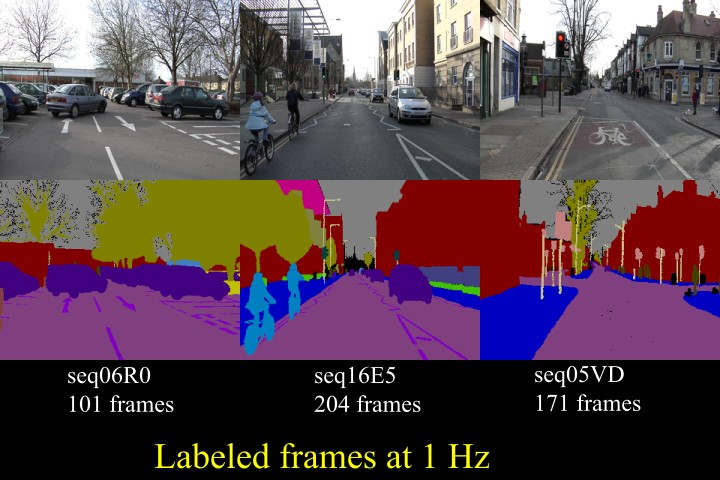
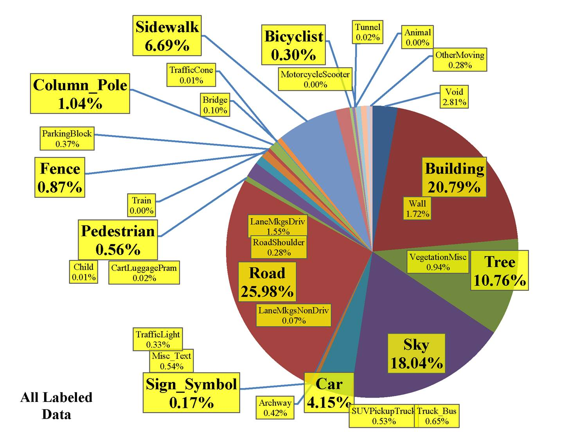

-----

| Title     | Datasets Image2D Segmentation CamVid                 |
| --------- | ---------------------------------------------------- |
| Created @ | `2020-03-03T03:42:09Z`                               |
| Updated @ | `2026-11-11T09:36:35Z`                               |
| Labels    | \`\`                                                 |
| Edit @    | [here](https://github.com/junxnone/aiwiki/issues/88) |

-----

# CamVid

CamVid（Cambridge-driving Labeled Video Database）由剑桥大学 Brostow
等人发布，是最早的驾驶场景逐像素语义标注数据集之一，来自车载摄像机拍摄的视频，至今仍是自动驾驶语义分割（SegNet、ENet、BiSeNet
等）常用的小型基准。



## 来源

  - 机构：University of Cambridge，Motion-based Segmentation and Recognition
    Dataset 项目。
  - 论文：Brostow et al., *Segmentation and Recognition Using Structure
    from Motion Point Clouds*（ECCV 2008）；*Semantic Object Classes in
    Video: A High-Definition Ground Truth Database*（Pattern Recognition
    Letters 2009）。

## 任务与标注

  - 语义分割：每个像素一个语义类，原始定义 32 类，另有 Void。
  - 来自视频序列，标注帧以 1 fps 间隔给出（待核实）。

## 规模统计

| 项目          | 数值                                                                             |
| ----------- | ------------------------------------------------------------------------------ |
| 标注图像        | 701 帧（来自 4 段视频，待核实）                                                            |
| 原始分辨率       | 960×720                                                                        |
| 类别数         | 32（含 Void）                                                                     |
| SegNet 常用划分 | train 367 / val 101 / test 233，缩放为 480×360                                     |
| 常用 11 类版本   | Sky、Building、Pole、Road、Pavement、Tree、SignSymbol、Fence、Car、Pedestrian、Bicyclist |

## 类别与颜色



| Color       | Classes           |
| ----------- | ----------------- |
| 64 128 64   | Animal            |
| 192 0 128   | Archway           |
| 0 128 192   | Bicyclist         |
| 0 128 64    | Bridge            |
| 128 0 0     | Building          |
| 64 0 128    | Car               |
| 64 0 192    | CartLuggagePram   |
| 192 128 64  | Child             |
| 192 192 128 | Column\_Pole      |
| 64 64 128   | Fence             |
| 128 0 192   | LaneMkgsDriv      |
| 192 0 64    | LaneMkgsNonDriv   |
| 128 128 64  | Misc\_Text        |
| 192 0 192   | MotorcycleScooter |
| 128 64 64   | OtherMoving       |
| 64 192 128  | ParkingBlock      |
| 64 64 0     | Pedestrian        |
| 128 64 128  | Road              |
| 128 128 192 | RoadShoulder      |
| 0 0 192     | Sidewalk          |
| 192 128 128 | SignSymbol        |
| 128 128 128 | Sky               |
| 64 128 192  | SUVPickupTruck    |
| 0 0 64      | TrafficCone       |
| 0 64 64     | TrafficLight      |
| 192 64 128  | Train             |
| 128 128 0   | Tree              |
| 192 128 192 | Truck\_Bus        |
| 64 0 64     | Tunnel            |
| 192 192 0   | VegetationMisc    |
| 0 0 0       | Void              |
| 64 192 0    | Wall              |

## 目录结构与加载

SegNet-Tutorial 版本目录：

    CamVid/
    ├── train/  trainannot/
    ├── val/    valannot/
    └── test/   testannot/

`*annot` 中是单通道类别索引 PNG（11 类版）；原始数据集的标注则是上表的 RGB 颜色码图。RGB 转索引：

``` python
import numpy as np
from PIL import Image
COLORS = {(64,128,64):0, (192,0,128):1, (0,128,192):2}  # 按上表补全 32 项
def rgb_to_idx(path):
    a = np.array(Image.open(path).convert("RGB"))
    out = np.full(a.shape[:2], 255, np.uint8)  # 未知颜色作 ignore
    for c, i in COLORS.items():
        out[(a == c).all(-1)] = i
    return out
```

PyTorch 加载（torchvision 无内置 CamVid，需自定义 Dataset）：

``` python
import glob
import numpy as np
from PIL import Image
from torch.utils.data import Dataset

class CamVid(Dataset):
    def __init__(self, root, split="train", tf=None):
        self.imgs = sorted(glob.glob(f"{root}/{split}/*.png"))
        self.lbls = sorted(glob.glob(f"{root}/{split}annot/*.png"))
        self.tf = tf
    def __len__(self):
        return len(self.imgs)
    def __getitem__(self, i):
        x = Image.open(self.imgs[i]).convert("RGB")
        y = Image.open(self.lbls[i])
        return self.tf(x, y) if self.tf else (x, np.array(y))
```

## 下载与许可

  - 官网与 GitHub 镜像见 Reference；SegNet-Tutorial 仓库提供已划分的 11 类版本。
  - 许可：学术研究使用，商用请查看官网声明（待核实）。

## 评测与基线

  - 指标：mIoU、各类 IoU、像素准确率。
  - SegNet 等论文在 11 类版本上报告结果（具体数值待核实）。

## 常见坑

  - 32 类与 11 类两种口径差别很大，对比论文时务必确认类别设置。
  - 类别极不均衡（Sky/Road/Building 占大头，Pole/Sign/Pedestrian
    极少），常用中位频率加权（median frequency
    balancing）损失。
  - 图像来自视频，相邻帧高度相关，不要随机混合划分 train/test。

## 相关

  - [Segmentation
    汇总](0097_Datasets_Image2D_Segmentation)、[Cityscapes](0093_Datasets_Image2D_Segmentation_Cityscapes)、[Datasets
    Image2D](0018_Datasets_Image2D)

## Reference

  - [Motion-based Segmentation and Recognition
    Dataset](http://mi.eng.cam.ac.uk/research/projects/VideoRec/CamVid/)
  - [some Github
    download](https://github.com/alexgkendall/SegNet-Tutorial/tree/master/CamVid)
