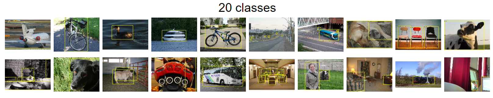

-----

| Title     | Datasets Image2D PascalVOC                           |
| --------- | ---------------------------------------------------- |
| Created @ | `2018-12-03T15:42:02Z`                               |
| Updated @ | `2026-11-11T09:36:44Z`                               |
| Labels    | \`\`                                                 |
| Edit @    | [here](https://github.com/junxnone/aiwiki/issues/92) |

-----

# PascalVOC

PASCAL VOC（Pattern Analysis, Statistical Modelling and Computational
Learning - Visual Object Classes）是 2005-2012 年每年举办的视觉目标识别挑战赛及其数据集，由
Oxford 的 Mark Everingham 等人组织（官网托管于 host.robots.ox.ac.uk）。2007 年确定了 **20
个类别**并沿用至 2012 年，是目标检测和语义分割最经典的基准之一，现在常用 VOC2007 / VOC2012
做检测、分割入门与论文对比实验。更大规模的检测/分割数据集见 [MS
COCO](0247_Datasets_Image2D_COCO)。

## 任务与标注

| 任务                      | 说明                                    | 标注                                         |
| ----------------------- | ------------------------------------- | ------------------------------------------ |
| Classification          | 图像中是否含某类物体                            | 图像级标签                                      |
| Detection               | 定位并分类                                 | 边界框（含 truncated / occluded / difficult 标志） |
| Person Layout           | 检测人及头、手、脚                             | 部位框（2007 引入）                               |
| Segmentation            | 语义分割（含 `Object` 实例图和 `Class` 类别图）     | 像素级 PNG（调色板索引，255 为 void/边界）               |
| Action Classification   | 识别人的动作（2010 引入，2011 扩展到 10 类 + other） | 人框 + 动作标签；Boxless 变体不给框                    |
| Large Scale Recognition | 基于 ImageNet 的大规模分类（2010 引入）           | \-                                         |

20 个类别：

  - Person: person
  - Animal: bird, cat, cow, dog, horse, sheep
  - Vehicle: aeroplane, bicycle, boat, bus, car, motorbike, train
  - Indoor: bottle, chair, dining table, potted plant, sofa, tv/monitor

## 规模统计

| 常用版本                             | 内容                                                                                    | 大小                              |
| -------------------------------- | ------------------------------------------------------------------------------------- | ------------------------------- |
| VOC2007 trainval + test          | 共 9,963 张图、24,640 个标注目标；test 带标注（最后一年公开测试标注），test 约 4,952 张                           | trainval 约 439 MB，test 约 431 MB |
| VOC2012 trainval                 | 检测 11,540 张图、27,450 个 ROI 标注目标；分割 2,913 张图（train 1,464 / val 1,449），分割标注 6,929 个目标    | 约 1.9 GB                        |
| VOC2012 test                     | 测试集无公开标注，需提交到官方评测服务器                                                                  | 约 1.8 GB                        |
| SBD（Semantic Boundaries Dataset） | Hariharan 等基于 VOC 图像补充的 11,355 张图的边界/分割标注；与 VOC12 train 合并得到常说的 `train_aug`（10,582 张） | \-                              |

图像分辨率不固定，多数长边约 500 像素（如 500x375）。

## 历年统计（2005-2012）



| Year | Statistics                                                                                                                                                                                                                                                                 | New developments                                                                                                                                                                                                                                                                                                                                                                                                    | Notes                                                                                                                                                  |
| ---- | -------------------------------------------------------------------------------------------------------------------------------------------------------------------------------------------------------------------------------------------------------------------------- | ------------------------------------------------------------------------------------------------------------------------------------------------------------------------------------------------------------------------------------------------------------------------------------------------------------------------------------------------------------------------------------------------------------------- | ------------------------------------------------------------------------------------------------------------------------------------------------------ |
| 2005 | Only 4 classes: bicycles, cars, motorbikes, people. Train/validation/test: 1578 images containing 2209 annotated objects.                                                                                                                                                  | Two competitions: classification and detection                                                                                                                                                                                                                                                                                                                                                                      | Images were largely taken from exising public datasets, and were not as challenging as the flickr images subsequently used. This dataset is obsolete.  |
| 2006 | 10 classes: bicycle, bus, car, cat, cow, dog, horse, motorbike, person, sheep. Train/validation/test: 2618 images containing 4754 annotated objects.                                                                                                                       | Images from flickr and from Microsoft Research Cambridge (MSRC) dataset                                                                                                                                                                                                                                                                                                                                             | The MSRC images were easier than flickr as the photos often concentrated on the object of interest. This dataset is obsolete.                          |
| 2007 | 20 classes:Person: personAnimal: bird, cat, cow, dog, horse, sheepVehicle: aeroplane, bicycle, boat, bus, car, motorbike, trainIndoor: bottle, chair, dining table, potted plant, sofa, tv/monitorTrain/validation/test: 9,963 images containing 24,640 annotated objects. | Number of classes increased from 10 to 20Segmentation taster introducedPerson layout taster introducedTruncation flag added to annotationsEvaluation measure for the classification challenge changed to Average Precision. Previously it had been ROC-AUC.                                                                                                                                                         | This year established the 20 classes, and these have been fixed since then. This was the final year that annotation was released for the testing data. |
| 2008 | 20 classes. The data is split (as usual) around 50% train/val and 50% test. The train/val data has 4,340 images containing 10,363 annotated objects.                                                                                                                       | Occlusion flag added to annotationsTest data annotation no longer made public.The segmentation and person layout data sets include images from the corresponding VOC2007 sets.                                                                                                                                                                                                                                      |                                                                                                                                                        |
| 2009 | 20 classes. The train/val data has 7,054 images containing 17,218 ROI annotated objects and 3,211 segmentations.                                                                                                                                                           | From now on the data for all tasks consists of the previous years' images augmented with new images. In earlier years an entirely new data set was released each year for the classification/detection tasks.Augmenting allows the number of images to grow each year, and means that test results can be compared on the previous years' images.Segmentation becomes a standard challenge (promoted from a taster) | No difficult flags were provided for the additional images (an omission).Test data annotation not made public.                                         |
| 2010 | 20 classes. The train/val data has 10,103 images containing 23,374 ROI annotated objects and 4,203 segmentations.                                                                                                                                                          | Action Classification taster introduced.Associated challenge on large scale classification introduced based on ImageNet.Amazon Mechanical Turk used for early stages of the annotation.                                                                                                                                                                                                                             | Method of computing AP changed. Now uses all data points rather than TREC style sampling.Test data annotation not made public.                         |
| 2011 | 20 classes. The train/val data has 11,540 images containing 27,450 ROI annotated objects and 5,034 segmentations.                                                                                                                                                          | Action Classification taster extended to 10 classes + "other".                                                                                                                                                                                                                                                                                                                                                      | Layout annotation is now not "complete": only people are annotated and some people may be unannotated.                                                 |
| 2012 | 20 classes. The train/val data has 11,540 images containing 27,450 ROI annotated objects and 6,929 segmentations.                                                                                                                                                          | Size of segmentation dataset substantially increased.People in action classification dataset are additionally annotated with a reference point on the body.                                                                                                                                                                                                                                                         | Datasets for classification, detection and person layout are the same as VOC2011.                                                                      |

> 注：原表 2011/2012 的 train/val 图像数写作 11,530，官方统计为 11,540 张（27,450
> 个目标），此处已改正。

## 目录结构与标注格式

解压 `VOCtrainval_11-May-2012.tar` 后：

    VOCdevkit/VOC2012/
      Annotations/        # XML，每图一个（检测框）
      ImageSets/
        Main/             # 分类/检测划分：train.txt val.txt trainval.txt、<class>_train.txt ...
        Segmentation/     # 分割划分：train.txt val.txt trainval.txt
        Action/ Layout/
      JPEGImages/         # 原图
      SegmentationClass/  # 语义分割 PNG（类别索引）
      SegmentationObject/ # 实例分割 PNG

检测标注 XML 示例（节选）：

``` xml
<annotation>
  <filename>2007_000027.jpg</filename>
  <size><width>486</width><height>500</height><depth>3</depth></size>
  <object>
    <name>person</name>
    <truncated>0</truncated>
    <difficult>0</difficult>
    <bndbox><xmin>174</xmin><ymin>101</ymin><xmax>349</xmax><ymax>351</ymax></bndbox>
  </object>
</annotation>
```

注意：框坐标是 **1-based 像素坐标**，`xmin,ymin,xmax,ymax`，转 0-based 或 COCO
格式（x,y,w,h）时要处理。

解析并用 torchvision 加载：

``` python
import xml.etree.ElementTree as ET
from torchvision.datasets import VOCDetection, VOCSegmentation

# 手动解析
def parse_voc(xml_path):
    root = ET.parse(xml_path).getroot()
    objs = []
    for o in root.findall("object"):
        b = o.find("bndbox")
        objs.append(dict(
            name=o.find("name").text,
            difficult=int(o.find("difficult").text),
            box=[int(float(b.find(k).text)) for k in ("xmin", "ymin", "xmax", "ymax")]))
    return objs

# torchvision 加载（download=True 会下载 tar，约 2GB）
det = VOCDetection("data", year="2012", image_set="trainval", download=True)
img, target = det[0]          # target["annotation"]["object"] 为 list[dict]
seg = VOCSegmentation("data", year="2012", image_set="train", download=False)
img, mask = seg[0]            # mask 为 PIL 调色板图，像素值=类别索引(0 背景, 1-20 类, 255 void)
```

## 下载与许可

    wget http://host.robots.ox.ac.uk/pascal/VOC/voc2012/VOCtrainval_11-May-2012.tar
    tar -xvf VOCtrainval_11-May-2012.tar

  - 官方站点偶尔不稳定，可用 [pjreddie
    镜像](https://pjreddie.com/projects/pascal-voc-dataset-mirror/)。
  - 图像来自 Flickr，版权属原作者；标注供研究使用，具体条款见官网说明（待核实商用条款）。

## 评测指标与常见基线

  - 检测：AP / mAP，IoU 阈值 0.5。VOC2007 用 11 点插值 AP，2010 起改为使用所有数据点（见上表）。
  - 分割：mIoU（21 类含背景）。
  - 常见结果（来自原论文，数字依训练数据而异）：Faster R-CNN（VGG16, 07+12 训练）在 VOC07 test 约
    73.2 mAP；SSD300（07+12）约 77.2 mAP；分割方面 DeepLabv3+ 在 VOC2012 test 约 89
    mIoU（COCO 预训练）。（待核实具体数字）

## 常见坑

  - **VOC2012 test 标注不公开**，本地评测只能用 val；VOC2007 test 有标注。
  - `difficult=1` 的目标评测时忽略，训练时是否保留需明确。
  - 框坐标 1-based。
  - 分割 mask 中 `255` 是边界/void，计算 loss 时需 `ignore_index=255`；mask 是调色板
    PNG，不要转 RGB 再读。
  - 分割标准训练集仅 1,464 张，社区习惯用 SBD 增强的 10,582 张 `train_aug`，需使用正确的划分列表。
  - "07+12"指 VOC2007 trainval 与 VOC2012 trainval 合并训练（16,551 张）。

## 相关数据集与站内链接

  - [Datasets Image2D](0018_Datasets_Image2D) 总入口
  - [Detection 检测数据集](0237_Datasets_Image2D_Detection)
  - [Segmentation 分割数据集](0097_Datasets_Image2D_Segmentation)
  - [MS
    COCO](0247_Datasets_Image2D_COCO)、[LVIS](0094_Datasets_Image2D_Segmentation_LVIS)、[Cityscapes](0093_Datasets_Image2D_Segmentation_Cityscapes)

## Reference

  - [Pascal VOC Homepage](http://host.robots.ox.ac.uk/pascal/VOC/)
  - [Pascal VOC Dataset
    - 2012](http://host.robots.ox.ac.uk/pascal/VOC/index.html)
  - [Pascal VOC Development Kit
    - 2012](http://host.robots.ox.ac.uk/pascal/VOC/voc2012/htmldoc/devkit_doc.html)
  - [Pascal VOC Dataset Mirror -
    pjreddie.com](https://pjreddie.com/projects/pascal-voc-dataset-mirror/)
  - [PascalVOC 数据集
    介绍](https://blog.csdn.net/weixin_39679367/article/details/80932532)
  - [paper - 2014 - The PASCAL Visual Object Classes Challenge: A
    Retrospective](http://host.robots.ox.ac.uk/pascal/VOC/pubs/everingham15.pdf)
  - [Leadereboards](http://host.robots.ox.ac.uk:8080/leaderboard/main_bootstrap.php)
  - [Distribution -
    Statistics](http://host.robots.ox.ac.uk/pascal/VOC/voc2012/dbstats.html)
  - [Pascal SBD - Semantic Boundaries Dataset and
    Benchmark](http://home.bharathh.info/pubs/codes/SBD/download.html) -
    [\<Google
    Drive\>](https://drive.google.com/file/d/1EQSKo5n2obj7tW8RytYTJ-eEYbXqtUXE/view)
    [\<BaiduPan jgx7\>](https://pan.baidu.com/s/1-kYEZtOo99VJGHrKlOK5dQ)
  - [SBD数据集
    简介](https://blog.csdn.net/zz2230633069/article/details/89335205)
