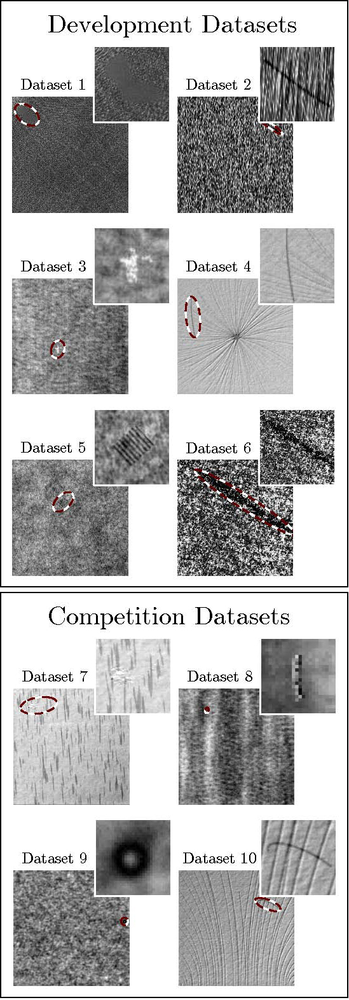

-----

| Title     | Datasets Image2D Segmentation DAGM                   |
| --------- | ---------------------------------------------------- |
| Created @ | `2020-02-26T05:13:20Z`                               |
| Updated @ | `2026-11-11T09:36:51Z`                               |
| Labels    | \`\`                                                 |
| Edit @    | [here](https://github.com/junxnone/aiwiki/issues/95) |

-----

# DAGM

DAGM 2007 是德国模式识别协会（DAGM）联合 GNSS 举办的**纹理表面缺陷检测**竞赛数据集（Weakly Supervised
Learning for Industrial Optical
Inspection）。数据为人工合成的灰度纹理背景加随机缺陷，模拟工业光学检测，常用作弱监督缺陷检测/分割的入门基准。



## 任务与标注

  - 任务：缺陷检测/分类（图像是否含缺陷）与缺陷分割（弱标注）。
  - 标注：缺陷区域用**椭圆形粗略标注**（weak label，位置不精确），以 `Label` 目录下的 mask 图和
    `Labels.txt` 给出。

## 规模统计

| 项目          | 数值                                           |
| ----------- | -------------------------------------------- |
| 类别（纹理/缺陷类型） | 10 类（Class1-Class6 为开发集，Class7-Class10 为竞赛集） |
| 每类训练集       | 1000 张无缺陷 + 150 张有缺陷                         |
| 每类测试集       | 1000 张无缺陷 + 150 张有缺陷                         |
| 图像大小        | 512 x 512，8-bit 灰度                           |

（以上数字凭记忆，待核实；与下方 ROI 统计中每类约 150 个缺陷基本吻合。）

## 目录结构与标注格式

    Class1/
      Train/  0001.PNG ...
        Label/ Labels.txt  0002_label.PNG ...
      Test/   同上

`Labels.txt` 每行描述一个缺陷图的椭圆参数（序号、长短轴、中心、旋转角、文件名，具体字段以官方 readme
为准，待核实）。多数社区版本已转成二值 mask。

读取示例：

``` python
import cv2
img = cv2.imread("Class1/Train/0001.PNG", cv2.IMREAD_GRAYSCALE)   # 512x512
mask = cv2.imread("Class1/Train/Label/0002_label.PNG", cv2.IMREAD_GRAYSCALE)
area = cv2.countNonZero(mask)
```

## 缺陷 ROI 面积分布

| Data\\Areas | Max   | Min   | Mean     | Median  | Large | Medium | Small |
| ----------- | ----- | ----- | -------- | ------- | ----- | ------ | ----- |
| All         | 32072 | 2     | 5804.54  | 3616.5  | 391   | 1322   | 384   |
| Class1      | 24972 | 3886  | 9595.72  | 8045.5  | 63    | 87     | 0     |
| Class2      | 16421 | 607   | 2797.79  | 2209.0  | 5     | 126    | 19    |
| Class3      | 12377 | 1103  | 3667.43  | 3117.0  | 1     | 149    | 0     |
| Class4      | 13721 | 2260  | 7243.84  | 7021.5  | 29    | 121    | 0     |
| Class5      | 9107  | 1447  | 5082.99  | 4694.5  | 0     | 150    | 0     |
| Class6      | 24523 | 12426 | 21598.93 | 22315.5 | 150   | 0      | 0     |
| Class7      | 32072 | 3845  | 9954.49  | 8434.5  | 135   | 165    | 0     |
| Class8      | 18743 | 2     | 1410.09  | 924.5   | 1     | 139    | 160   |
| Class9      | 1250  | 724   | 968.65   | 954.5   | 0     | 93     | 204   |
| Class10     | 12669 | 959   | 3305.22  | 2719.0  | 7     | 292    | 1     |

> Area is pixel level, calculate by cv2.countNonZero()
> Large/Medium/Small as COCO defined Small \< 32\*32 \< Medium \< 96\*96
> \< Large

该统计为本站自行计算；Class7-10 的 ROI 数多于 150，可能是同图含多个缺陷或合并了 train/test（待核实）。

## 下载与许可

  - 官方页面：[DAGM 2007](http://resources.mpi-inf.mpg.de/conference/dagm/2007/prizes.html)（官方站点可能已迁移或失效，必要时在
    Kaggle 等镜像查找，待核实）。
  - 许可：竞赛数据，用于研究，具体条款见官方说明（待核实）。

## 评测指标与常见基线

  - 图像级：准确率、漏检率、误检率；分割：IoU/Dice，或以 ROI 为基础的 AP。
  - 该数据集较简单，现代 CNN 在图像级分类上可接近满分，更多用于验证算法流程或弱监督分割方法。

## 常见坑

  - 标注是粗糙的椭圆而非精确边界，不宜用于评价精细边缘。
  - 10 类背景纹理各不相同，混合训练时注意分布差异。
  - 缺陷样本占比低（约 13%），需处理类别不平衡。
  - 不同社区版本的目录结构、标注格式不一致，使用前先确认。

## 相关数据集与站内链接

  - [Defect 缺陷/异常检测数据集](0245_Datasets_Image2D_Defect)（MVTec
    AD、NEU-DET、KolektorSDD 等）
  - [Segmentation 分割数据集](0097_Datasets_Image2D_Segmentation)、[Datasets
    Image2D](0018_Datasets_Image2D)

## Reference

  - [DAGM 2007](http://resources.mpi-inf.mpg.de/conference/dagm/2007/prizes.html)
