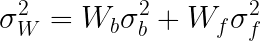
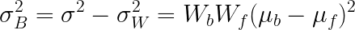
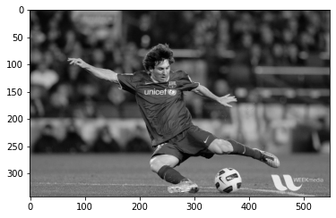
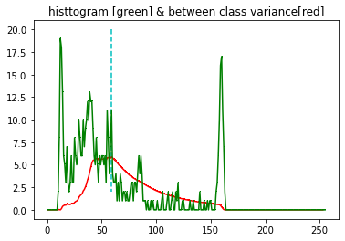
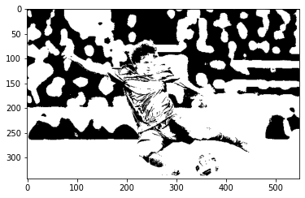
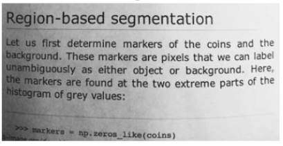
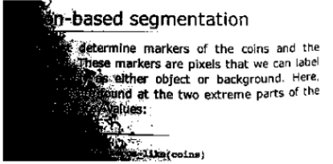
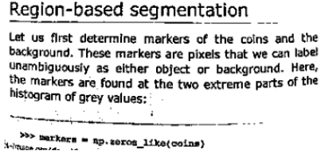
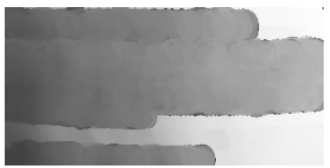
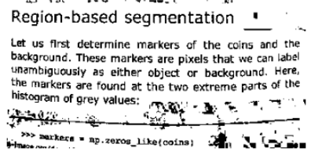

-----

| Title     | CV BIN                                               |
| --------- | ---------------------------------------------------- |
| Created @ | `2020-11-11T04:02:36Z`                               |
| Updated @ | `2026-10-19T06:32:09Z`                               |
| Labels    | \`\`                                                 |
| Edit @    | [here](https://github.com/junxnone/aiwiki/issues/99) |

-----

# Thresholding 二值化

  - Image Thresholding - 图像二值化(非黑即白的简化问题)
  - Global thresholding - 使用同一阈值二值化
  - Local(dynamic ) thresholding - 动态阈值二值化
  - Multilevel thresholding -
    类似于分割图像，不是只分两类（前景/背景），而是用多个阈值把图像分成多个灰度区间，每个区间当作一类，见
    [Multi-Otsu
    Thresholding](https://scikit-image.org/docs/dev/auto_examples/segmentation/plot_multiotsu.html#multi-otsu-thresholding)（Otsu
    方法的多阈值推广版，同样是最大化类间方差，只是类别数从 2 变成 N）
  - 其他分类方法：下面表格里的各个算法按"怎么从直方图里找阈值"这个思路可以归到这几类，和"阈值取自同一张图的全局统计量"这个大前提并不矛盾——分类方式是从不同角度看同一组算法
      - **Histogram shape-based**（直方图形状）：假设直方图是双峰的，通过分析波峰波谷的几何形状找阈值，如
        Intermodes、Minimum、Triangle
      - **Clustering-based**（聚类）：把像素灰度值看成两类（或多类）样本做聚类，如
        Otsu、ISODATA、Moments
      - **Entropy-based**（信息熵）：从信息论角度最大化前景/背景分开后保留的信息量，如
        MaxEntropy、RenyiEntropy、Yen、Li（最小交叉熵）、Shanbhag
      - **Object-attribute-based**（目标属性）：让二值化前后某个目标属性（如边缘数量、形状相似度）保持不变，如
        Moments（矩保持）
      - **Spatial**（空间信息）：不只看直方图这种全局统计量，还考虑像素的空间位置关系，是 Local
        thresholding 这条线的理论基础

| Global thresholding | Description                                                                                                                                                     | 适用场景                                                                                        |
| ------------------- | --------------------------------------------------------------------------------------------------------------------------------------------------------------- | ------------------------------------------------------------------------------------------- |
| **Otsu**            | 取 `前景/背景` 最大类间方差作为阈值                                                                                                                                            | **最常用、最经典的方法，几乎是二值化的默认首选**；前景/背景比例接近、直方图双峰明显时效果最好                                           |
| ISODATA             | `threshold = (average background + average objects)/2`，用当前阈值把像素分两类、算两类均值、取均值的均值作为新阈值，反复迭代到收敛；是 Ridler & Calvard（1978）迭代选择法的实现，和 Otsu 关系很近（IS 方法可以看作 Otsu 的迭代版本） | 效果和 Otsu 接近，一般直接用 Otsu 即可，知道两者是近亲关系就够了                                                      |
| Mean                | mean(image)，直接用全图灰度均值当阈值                                                                                                                                        | 最简单粗暴，只适合快速原型/粗筛，对光照不均的图效果差，正式场景不建议用                                                        |
| **Triangle**        | 在直方图上把峰值点和远端零值点连一条直线，找直方图曲线上离这条直线垂直距离最大的点作为阈值                                                                                                                   | **直方图单峰且明显偏向一侧**（前景像素远少于背景，如荧光显微图像、暗场下的小亮点）时效果好，Otsu 在这种场景反而容易失准；对图像缩放敏感，8 位和 16 位缩放后结果可能不同 |
| Minimum             | 和 Intermodes 思路一样先反复平滑直方图到只剩两个峰，但取两峰之间的\*\*谷底（最小值点）\*\*而不是中点作为阈值                                                                                                | 和 Intermodes 同样要求明显双峰直方图，二者选一即可，不常同时使用                                                      |
| InterModes          | 反复用滑动平均平滑直方图，直到只剩两个局部峰值 j 和 k，阈值取两峰中点 `(j+k)/2`                                                                                                                 | 要求直方图明显双峰，否则不适用；比较小众，一般先试 Otsu 不行再考虑                                                        |
| Yen                 | 基于最大相关性准则的熵方法，和 MaxEntropy 思路类似但用的熵定义不同                                                                                                                         | 学术研究/算法对比里常见，工程里不如 Otsu/MaxEntropy 常用                                                       |
| Li                  | 最小交叉熵（Minimum Cross Entropy）阈值法的迭代实现，最小化原图和二值化结果之间的信息损失                                                                                                         | 和原图信息保留程度相关的场景（如医学图像分割对比实验）里会被提及                                                            |
| Huang               | 基于模糊集合论的模糊阈值法，最小化二值化带来的"模糊度"（用香农熵或 Yager 熵衡量）                                                                                                                   | 小众，多见于算法横向评测，工程里较少单独选用                                                                      |
| **MaxEntropy**      | Kapur-Sahoo-Wong 最大熵方法：找一个阈值让前景、背景两部分各自的信息熵之和最大                                                                                                                 | 和 Otsu 并列的**第二常用备选**，Otsu 效果不理想时值得一试，尤其是前景背景灰度分布不对称的场景                                      |
| MinError            | Kittler & Illingworth（1986）最小误差阈值法，在假设前景/背景灰度分别服从高斯分布的前提下，找让分类错误概率最小的阈值                                                                                         | 前景/背景灰度分布接近高斯、且确实只有两类时理论上最优，现实图像往往不够"高斯"，效果不一定稳定                                            |
| Moments             | Tsai 矩保持法：让二值化后的图像和原图保持相同的灰度矩（均值、方差等统计矩），反推出阈值                                                                                                                  | 小众，边缘保持要求高的特定场景里会用到                                                                         |
| Percentile          | 假设前景像素占全图的固定比例（默认 50%），直接按这个百分位数定阈值                                                                                                                             | **已知前景大致占比**时很好用（比如先验知道缺陷面积占比），不知道占比时不要用                                                    |
| RenyiEntropy        | 和 MaxEntropy 思路相同，但用 Rényi 熵代替香农熵，多一个可调参数控制对分布尾部的敏感度                                                                                                            | MaxEntropy 的调参变体，一般不作为首选，MaxEntropy 不够用时再试                                                  |
| Shanbhag            | 基于模糊集合的信息测度方法，是 Kapur 最大熵思路的另一种变体                                                                                                                               | 小众，同上一类熵方法效果不理想时的备选之一                                                                       |

| Local thresholding | Description                                                                                                                    | 适用场景                                                         |
| ------------------ | ------------------------------------------------------------------------------------------------------------------------------ | ------------------------------------------------------------ |
| Niblack            | 阈值按局部窗口统计量动态计算：`T(x,y) = mean + k × std`，`mean`/`std` 是以 (x,y) 为中心的局部窗口内的均值/标准差，`k` 通常取负值（如 -0.2）                              | 光照不均场景的基础方法；背景平坦区域（如大片纯色墙面）容易因为 std 很小而引入噪声，是 Sauvola 要解决的问题 |
| **Sauvola**        | 在 Niblack 基础上改进，专门针对文档/文字图像优化：`T(x,y) = mean × (1 + k × (std/R - 1))`，`R` 是标准差的动态范围（常取 128），多了这个归一化项后在背景平坦区域不容易产生 Niblack 那种噪声 | **局部阈值法里最常用的**，尤其是**文档扫描件/拍照文字**（背景有阴影、折痕、污渍）场景的首选           |

## OTSU

  - 把图像 `pixel` 分为两类 `前景/背景`
  - 计算最小类内方差作为最佳阈值
  - 对于二分类，最小化类内方差等价于最大化类间方差

| 类内方差 |  |
| ---- | ------------------------------------------------------------ |
| 类间方差 |  |

| source image           |  |
| ---------------------- | ------------------------------------------------------------ |
| between class variance |  |
| target image           |  |

## Local thresholding

| Original                                                     | Global thresholding                                          | Local thresholding                                           |
| ------------------------------------------------------------ | ------------------------------------------------------------ | ------------------------------------------------------------ |
|  |  |  |

### Local + OTSU

| Original                                                     | Local OTSU                                                   | Original \>= Local OTSU                                      |
| ------------------------------------------------------------ | ------------------------------------------------------------ | ------------------------------------------------------------ |
|  |  |  |

## 怎么选

  - 光照均匀、前景背景对比度明显 → **Global thresholding**，优先试
    **Otsu**（几乎是默认首选，无脑试一下通常就够用）；
  - 图片里不同区域亮度差异大（比如拍摄角度导致一边暗一边亮）→ **Local thresholding**（Niblack/Sauvola
    或 Local Otsu），代价是计算量比全局阈值大，窗口大小这个超参数需要根据前景目标尺寸调；
  - 不是简单的前景/背景二分类，而是想把图像按灰度粗分成好几类 → **Multilevel/Multi-Otsu**；
  - 文字/文档类图像、背景有污渍或阴影 → 优先试 **Sauvola**，专门为此场景设计；
  - 直方图明显双峰 → Intermodes/Minimum
    这类基于直方图形状的方法效果会不错，但遇到单峰或双峰差异悬殊的直方图就不适用了，这时
    Otsu/Li/MaxEntropy 这类不强依赖"必须双峰"假设的方法更稳妥。

## 代码示例（OpenCV）

``` cpp
// 全局阈值，固定值
cv::threshold(src, dst, 127, 255, cv::THRESH_BINARY);

// 全局阈值，让 OpenCV 自动用 Otsu 算法算出最佳阈值（阈值参数会被忽略）
cv::threshold(src, dst, 0, 255, cv::THRESH_BINARY | cv::THRESH_OTSU);

// 局部（自适应）阈值：均值法 / 高斯加权法，blockSize 即局部窗口大小，C 是从均值里再减去的常数
cv::adaptiveThreshold(src, dst, 255, cv::ADAPTIVE_THRESH_MEAN_C,
                       cv::THRESH_BINARY, 11, 2);
cv::adaptiveThreshold(src, dst, 255, cv::ADAPTIVE_THRESH_GAUSSIAN_C,
                       cv::THRESH_BINARY, 11, 2);
```

更完整的 OpenCV/scikit-image 二值化 API 用法见下方"Some API"小节链接的两篇文档。

## Some API

  - [scikit-image
    Thresholding](0331_CV_BIN_ScikitImage)：`skimage.filters` 里
    Otsu/Local/Multi-Otsu 等方法的 Python 调用示例
  - [OpenCV
    Threshold](0330_OpenCV_IP_misc_BIN)：`cv2.threshold`/`cv2.adaptiveThreshold`
    的具体参数和用法

## Reference

  - [Thresholding (image
    processing)](https://en.wikipedia.org/wiki/Thresholding_%28image_processing%29)
  - [auto threshold](https://imagej.net/Auto_Threshold.html)（上面
    Global/Local thresholding 两张表里绝大多数算法名称和描述的出处，ImageJ 的
    Auto\_Threshold/Auto\_Local\_Threshold 插件）
  - [十三种基于直方图的图像全局二值化算法原理、实现、代码及效果](https://www.cnblogs.com/adas/p/5430793.html)
  - [Survey over image thresholding techniques and quantitative
    performance
    evaluation](https://fei.edu.br/~psergio/VisaoComputacional/Artigos%20para%20Estudo/Threshold_survey.pdf)
  - Ridler, T.W. & Calvard, S. (1978). Picture thresholding using an
    iterative selection method. *IEEE Trans. SMC*, 8: 630-632.（原文无开放获取
    PDF，相关方法关系讨论见
    [ResearchGate](https://www.researchgate.net/publication/257014880_Ridler_and_Calvard's_Kittler_and_Illingworth's_and_Otsu's_methods_for_image_thresholding)）
  - Kittler, J. & Illingworth, J. (1986). Minimum error thresholding.
    *Pattern Recognition*, 19: 41-47.（原文无开放获取 PDF，[Semantic Scholar
    摘要](https://www.semanticscholar.org/paper/Minimum-error-thresholding-Kittler-Illingworth/00f2938d9f10e4bd37336f01b18a41d518f749ba)，可运行的
    Python 复现见 [GitHub
    Gist](https://gist.github.com/al42and/c2d66f6704e024266108)）
  - [Otsu's method -
    Wikipedia](https://en.wikipedia.org/wiki/Otsu%27s_method)
      - [A Threshold Selection Method from Gray-Level
        Histograms](http://raw.githubusercontent.com/jinglou/p2016-rss-small-target/master/refs/Otsu.pdf)
  - [Otsu
    Thresholding](http://www.labbookpages.co.uk/software/imgProc/otsuThreshold.html)
    -- [CN](https://blog.csdn.net/felix86/article/details/38684465)
  - [图像二值化方法介绍](https://blog.csdn.net/JJBOOM425/article/details/100645594)
