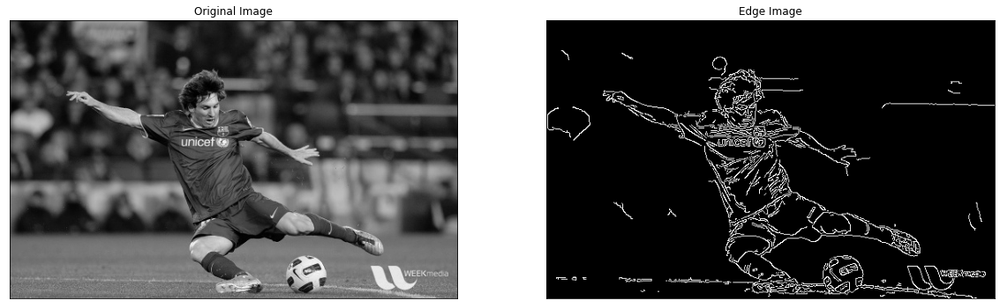

-----

| Title     | CV Edge Canny                                         |
| --------- | ----------------------------------------------------- |
| Created @ | `2020-10-19T05:14:34Z`                                |
| Updated @ | `2026-10-19T07:38:50Z`                                |
| Labels    | \`\`                                                  |
| Edit @    | [here](https://github.com/junxnone/aiwiki/issues/101) |

-----

# Canny 边缘检测

  - 边缘检测算法 - 由 John F. Canny 在 1986 年提出
  - Canny 在论文里提出了判断"好的边缘检测器"应满足的三个准则，整套算法的每一步都是为了逼近这三个目标设计的：
      - **好的检测（Good Detection）**：尽量检测出所有真实边缘，同时尽量不产生虚假响应（低漏检、低误检）
      - **好的定位（Good Localization）**：检测出的边缘位置要尽量贴近真实边缘的实际位置，不能有明显偏移
      - **单一响应（Single
        Response）**：一条真实边缘只应该产生一条检测结果，不能对着同一条边缘重复响应出好几条粗细不一的线
  - **缺点**
      - **手动设置阈值** - 将下限和上限值设置为滞后阈值是一个手动过程，需要实验和视觉验证。
      - **鲁棒性** - 对一个图像有效的滞后阈值可能不适用于另一个图像（对于在不同光照条件下捕获的图像，这几乎总是如此）。
      - **预处理** - Canny边缘检测器通常需要许多预处理步骤（即转换为灰度，模糊/平滑等）以获得良好的边缘图。

| Steps                                   | Description                                                                                                                                                                                                              |
| --------------------------------------- | ------------------------------------------------------------------------------------------------------------------------------------------------------------------------------------------------------------------------ |
| Noise Reduction                         | `降噪` - 使用 5x5 高斯滤波器去除图像中的噪声（求导运算本身会放大高频噪声，不先平滑的话后面每一步都会被噪声干扰，这一步是为了逼近"好的检测"）                                                                                                                                             |
| Finding Intensity Gradient of the Image | `寻找图像的强度梯度` - 在水平和垂直方向上用 Sobel 内核对平滑后的图像进行滤波，以获得水平方向（G\_x）和垂直方向（G\_y）的一阶导数（这一步直接复用了 [边缘](0065_CV_Edge) 里介绍的 Sobel 算子，Canny 并没有发明新的梯度计算方式）                                                                                |
| Non-maximum Suppression                 | `非最大抑制` - 检查像素是否是其在梯度方向上的邻域中的局部最大值以去除可能不构成边缘的任何不需要的像素（具体做法：沿着梯度方向，比较当前像素和它前后两个相邻像素的梯度幅值，只有当前像素是三者中最大的才保留，否则置零——这一步直接把 Sobel 算出来的"粗边缘带"收窄成单像素宽的细线，正是为了满足"单一响应"这条准则）                                                       |
| Hysteresis Thresholding                 | `滞后阈值` - 两个阈值 (minVal, maxVal) , 强度梯度大于 maxVal 的任何边缘肯定是边缘，小于 minVal 的边缘肯定是非边缘，位于这两个阈值之间则基于其连通性分类边缘或非边缘（只要一条边缘上有任意一点的梯度超过 maxVal，这条边缘上所有梯度超过 minVal 的相连像素都会被保留——这样设计是为了避免单一阈值下"一条边缘因为局部梯度稍弱就被切断成好几段"的问题，是逼近"好的检测"准则的最后一步） |



## 怎么定阈值（缓解"缺点"里提到的手动调参问题）

  - 经验法则：`maxVal` 通常设为 `minVal` 的 2-3 倍（OpenCV 官方教程给的建议比例）；
  - **自动阈值的常见技巧**：先用 [Otsu 方法](0099_CV_BIN) 对图像求出一个全局阈值
    `T`（本来是用来做二值化的，这里借用它来估计图像整体的对比度水平），再令
    `maxVal = T`、`minVal = 0.5 *
    T`，可以在不同光照条件的图像之间获得相对更一致的检测效果，缓解"对一张图有效的阈值换一张图就失效"这个问题——但仍然不是万能的，复杂场景建议针对实际数据集跑一遍再微调。
  - **另一种自动阈值思路——梯度直方图百分位数法**：不依赖 Otsu（Otsu
    是对灰度直方图找双峰分割点，假设前景/背景对比明显），而是直接统计
    Sobel 梯度幅值的直方图，取某个百分位数（比如第 70%\~90% 分位）作为 `maxVal`，`minVal` 仍按 `0.5
    * maxVal` 左右取——这种方法不依赖"图像可以被分成两类"的假设，在边缘本身稀疏、背景纹理复杂（不满足 Otsu
    双峰假设）的图像上往往比 Otsu
    更稳定，代价是分位数本身也是一个需要根据场景调的超参数，不是真正意义上的"全自动"。

## 多尺度 Canny（高斯核尺寸的影响）

Canny 第一步的高斯模糊核尺寸（`cv::GaussianBlur` 的 `Size`）直接决定了最终检测到的是"粗边缘"还是"细边缘"：

  - **核越小（如 3×3）**：平滑程度低，对噪声更敏感，但能保留细节纹理和微小边缘，适合需要精细结构的场景（如小目标检测、细纹理分析）；
  - **核越大（如 9×9
    甚至更大）**：平滑程度高，能抑制噪声和琐碎纹理，只留下尺度较大、对比明显的主干边缘，适合只关心物体轮廓、不关心内部细节的场景（如粗粒度的物体分割预处理）。

**多尺度 Canny**的思路是用多组不同的高斯核尺寸分别跑一遍完整的 Canny
流程，再把多个尺度的结果融合（比如取并集，或要求同一位置在多个尺度上都被检测为边缘才保留，以提高可信度）——本质上是用多次单尺度
Canny 换取对"粗细边缘取舍"这个超参数的鲁棒性，计算量是单次的数倍，一般只在对准确率要求高、计算资源不紧张的离线场景使用。

## 代码示例（OpenCV）

``` cpp
cv::Mat gray, blurred, edges;
cv::cvtColor(src, gray, cv::COLOR_BGR2GRAY);
cv::GaussianBlur(gray, blurred, cv::Size(5, 5), 0);   // 对应 Noise Reduction 这一步
cv::Canny(blurred, edges, 50, 150);                    // minVal=50, maxVal=150，内部自动完成梯度/非极大值抑制/滞后阈值
```

> `cv::Canny` 内部本身也会做一次简单的降噪（Sobel 核尺寸够大时自带一定平滑效果），这里额外加一步
> `GaussianBlur` 是为了在噪声明显的图像上获得更干净的结果，不是必须的，具体要不要加取决于输入图像的噪声水平。

## Reference

  - [opencv实现图像的边缘提取](https://blog.csdn.net/weixin_43900597/article/details/104793553)
  - Canny, J. (1986). A Computational Approach to Edge Detection. *IEEE
    Transactions on Pattern Analysis and Machine Intelligence*, 8(6):
    679-698.
  - [OpenCV Canny Edge Detection
    官方教程](https://docs.opencv.org/4.x/da/d22/tutorial_py_canny.html)
  - [边缘](0065_CV_Edge)
