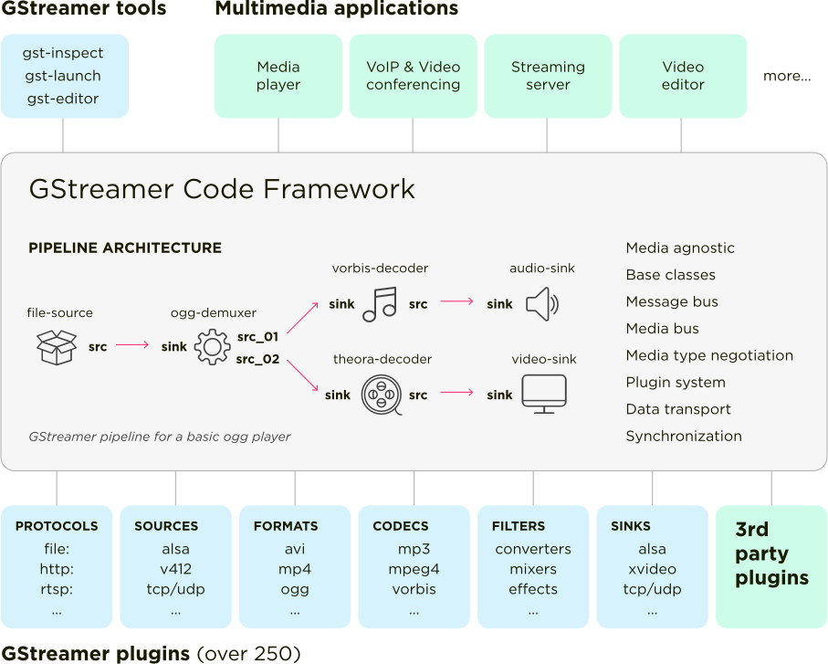
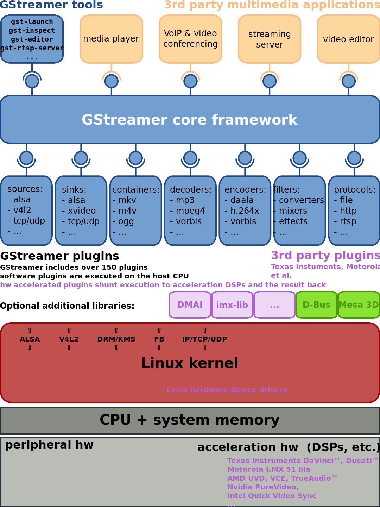
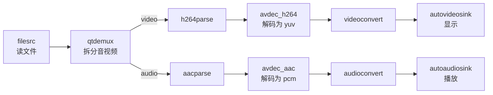
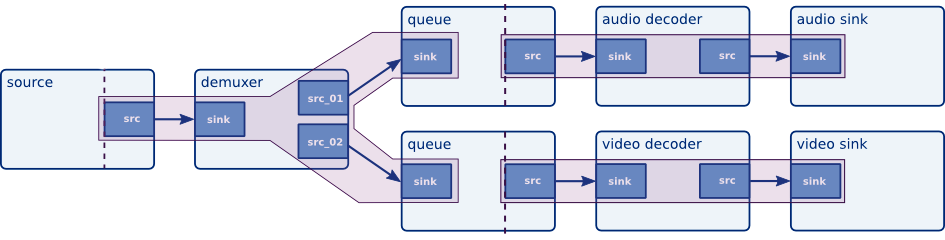
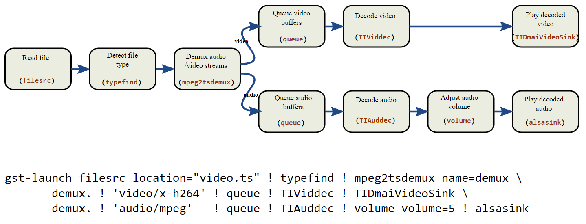

-----

| Title     | Media Tools GStreamer                                 |
| --------- | ----------------------------------------------------- |
| Created @ | `2018-11-27T15:44:49Z`                                |
| Updated @ | `2026-11-25T16:21:50Z`                                |
| Labels    | \`\`                                                  |
| Edit @    | [here](https://github.com/junxnone/aiwiki/issues/109) |

-----

# GStreamer 流媒体应用框架

  - Gstreamer 是一个通用跨平台的流媒体应用框架, 可以处理 Audio/Video/其他数据流
  - [Gstreamer Install](/0117_Media_Tools_GStreamer_Install)
  - [Command Line Tools](#Command-Line-Tools)
  - [Gstreamer Concepts](/0144_Media_Tools_GStreamer_Concepts)
  - [Gstreamer Plugins](/0143_Media_Tools_GStreamer_Plugins)

## Command Line Tools

| Tools                                                           | Description                                            |
| --------------------------------------------------------------- | ------------------------------------------------------ |
| [gst-inspect-1.0](/0112_Media_Tools_GStreamer_gstinspect)       | 查看 elements 信息 - src/sink/pad/Capabilities/...         |
| [gst-launch-1.0](/0110_Media_Tools_GStreamer_gstlaunch)         | 创建 pipeline                                            |
| \[gst-device-monitor-1.0\]                                      | 查看当前设备上的 `Device`                                      |
| [gst-discoverer-1.0](/0111_Media_Tools_GStreamer_gstdiscoverer) | 查看 media 相关信息 - codec/Channels/Sample rate/Bitrate/... |
| ges-launch-1.0                                                  | 控制 timeline 开始时间/间隔/...                                |

## Arch

-----

## Pipeline

  - 数据流通的定义(定义组件的顺序)
  - source - file/http/rtp/...
  - demux - 分离数据 audio/video/...
  - decoder - `xxx format -> yuv/pcm`
  - sink - 数据输出

下图以「播放本地 mp4」为例, 展示一条典型 pipeline 里数据如何依次流过各类 element:

图中：

  - `filesrc` 是 source element, 只产生数据; `autovideosink`/`autoaudiosink` 是
    sink element, 只消费数据; 中间都是 filter element
  - `qtdemux` 是 demux, 把容器 (mp4) 拆成视频流和音频流两条分支, 分支标签 `video`/`audio`
    对应它的两个 src pad
  - `avdec_h264`/`avdec_aac` 是 decoder, 分别输出原始 yuv 画面和 pcm 采样
  - `videoconvert`/`audioconvert` 负责在相邻 element 的格式不一致时做格式转换 (caps 协商)
  - 每个箭头是一条 pad 连接; 命令行里用 <kbd>\!</kbd> 表示, 见
    [gst-launch](/0110_Media_Tools_GStreamer_gstlaunch)

## Reference

  - [gstreamer
    blog](https://blog.csdn.net/knowledgebao/article/category/8053683)
  - [Gstreamer的安装](https://blog.csdn.net/knowledgebao/article/details/83993255)
  - [Docs](https://thiblahute.github.io/GStreamer-doc/index.html?gi-language=c)
  - [wiki -
    wdv4758h](https://wdv4758h.github.io/notes/multimedia/gstreamer.html#)
