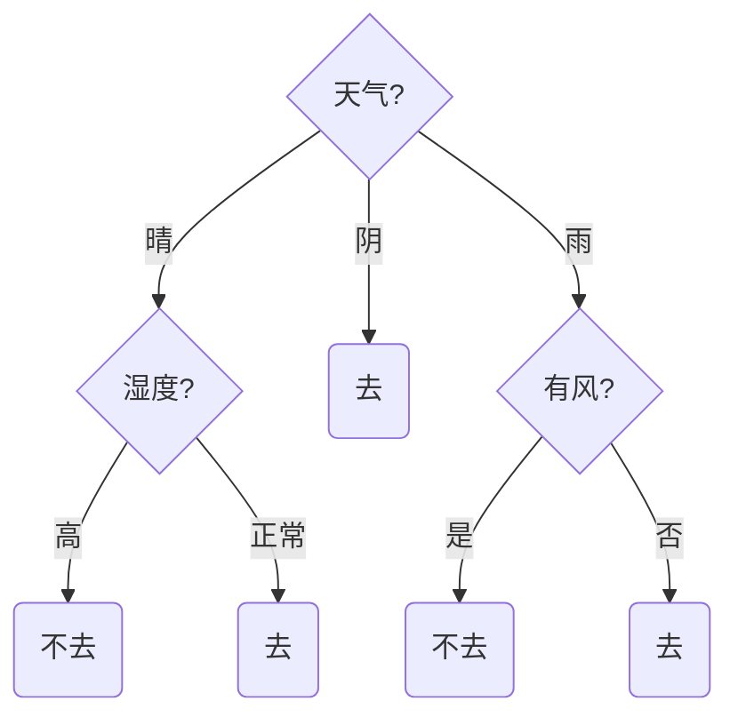
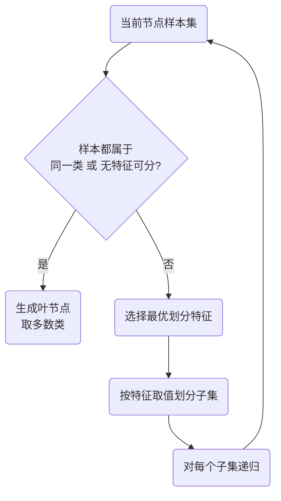
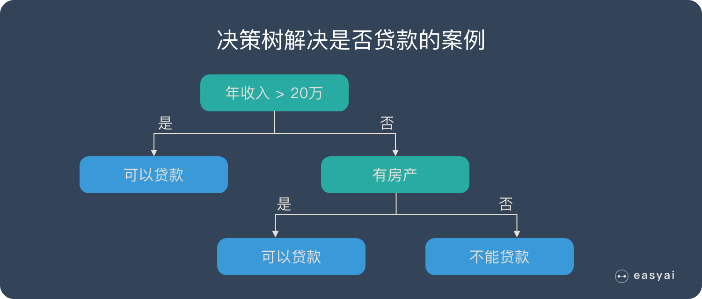

-----

| Title     | ML OML DecisionTree                                   |
| --------- | ----------------------------------------------------- |
| Created @ | `2021-03-30T07:53:56Z`                                |
| Updated @ | `2026-11-24T05:37:11Z`                                |
| Labels    | \`\`                                                  |
| Edit @    | [here](https://github.com/junxnone/aiwiki/issues/113) |

-----

# Decision Tree 决策树

  - Decision Tree - 决策树
  - 基于 if-then-else 规则的有监督学习算法，既可以做**分类**也可以做**回归**
  - 决策树组成
      - **根节点**：包含样本的全集
      - **内部节点**：对应特征属性测试
      - **叶节点**：代表决策的结果
  - 属于 [传统机器学习](/0367_ML_OML)，是随机森林、GBDT 等集成算法的基础，见 [Random
    Forest](/0114_ML_OML_RandomForest)

下图是一棵判断「是否出门打球」的决策树示意：



图中：

  - 菱形节点是内部节点，每个对应一个特征的测试（天气、湿度、有风）；圆角节点是叶节点，给出最终决策
  - 边上的文字是特征取值，沿着边从根走到叶就对应一条 if-then 规则，如「天气=晴 且 湿度=正常 → 去」
  - 每个样本只会落到一个叶节点，所以决策树的规则**互斥且完备**

## Pipeline

  - 特征选择
  - 决策树生成
  - 决策树剪枝 - 主动去掉部分分支 `对抗过拟合`

下图说明了决策树的生成过程（递归划分）：



图中：

  - 每个节点先判断是否可以停止：样本全部同类、没有可用特征或样本过少时，生成叶节点并取多数类（回归取均值）
  - 否则按划分准则选择一个最优特征，把样本划分到若干子节点，再对每个子节点重复同样的过程
  - 不同算法的区别主要在「如何选择最优划分特征」和「如何剪枝」

## 划分准则

### 信息熵与信息增益 (ID3)

$$ H(D) = -\\sum\_{k=1}^{K} p\_k \\log\_2 p\_k, \\qquad Gain(D, a) =
H(D) - \\sum\_{v=1}^{V}\\frac{\\lvert D^v \\rvert}{\\lvert D \\rvert}
H(D^v) $$

其中：

  - $D$：当前节点的样本集合；$K$：类别数；$p\_k$：集合 $D$ 中第 $k$ 类样本所占比例
  - $H(D)$：信息熵，衡量集合的**不纯度**；所有样本同类时 $H=0$，各类均匀分布时最大
  - $a$：候选划分特征；$V$：特征 $a$ 的取值个数；$D^v$：$D$ 中特征 $a$ 取第 $v$ 个值的子集
  - $Gain(D, a)$：信息增益，划分后不纯度的下降量；选择增益最大的特征
  - 缺点：偏向取值多的特征（如「编号」这种每个样本取值都不同的特征增益最大，但无意义）

### 增益率 (C4.5)

$$ GainRatio(D, a) = \\frac{Gain(D, a)}{IV(a)}, \\qquad IV(a) =
-\\sum\_{v=1}^{V}\\frac{\\lvert D^v \\rvert}{\\lvert D
\\rvert}\\log\_2\\frac{\\lvert D^v \\rvert}{\\lvert D \\rvert} $$

其中：

  - $IV(a)$：特征 $a$ 的固有值 (Intrinsic Value)，特征取值越多，$IV$ 越大，用它做分母来惩罚取值多的特征
  - 增益率偏向取值少的特征，因此 C4.5 先选出信息增益高于平均的特征，再从中选增益率最大的

### 基尼系数 (CART)

$$ Gini(D) = 1 - \\sum\_{k=1}^{K} p\_k^2, \\qquad Gini\_index(D, a) =
\\sum\_{v=1}^{V}\\frac{\\lvert D^v \\rvert}{\\lvert D \\rvert}Gini(D^v)
$$

其中：

  - $Gini(D)$：从 $D$ 中随机抽取两个样本，它们类别不一致的概率；越小越纯
  - $Gini\_index(D, a)$：按特征 $a$ 划分后的加权基尼系数，选择使其最小的特征和划分点
  - 不含对数，计算比熵更快；CART 每次只做**二叉划分**

### 回归树

$$ \\min\_{j, s}\\left\[\\min\_{c\_1}\\sum\_{x\_i \\in R\_1(j, s)}(y\_i
- c\_1)^2 + \\min\_{c\_2}\\sum\_{x\_i \\in R\_2(j, s)}(y\_i -
c\_2)^2\\right\] $$

其中：

  - $j$：划分特征，$s$：划分点；$R\_1(j,s) = {x \\mid x\_j \\le s}$、$R\_2(j,s) = {x
    \\mid x\_j \> s}$：划分得到的两个区域
  - $c\_1$、$c\_2$：两个区域的预测值，最优解为区域内 $y\_i$ 的均值
  - 回归树遍历所有特征和划分点，选使两个区域平方误差之和最小的划分；叶节点输出区域内样本的均值

### 示例

  - 某节点有 10 个样本，6 个正例 4 个负例：$H(D) = -0.6\\log\_2 0.6 - 0.4\\log\_2 0.4
    \\approx 0.971$，$Gini(D) = 1 - 0.36 - 0.16 = 0.48$
  - 按某特征划分为两组：A 组 4 个（全为正例），B 组 6 个（2 个正例 4 个负例）
  - $H(D^A) = 0$，$H(D^B) = -\\frac{1}{3}\\log\_2\\frac{1}{3} -
    \\frac{2}{3}\\log\_2\\frac{2}{3} \\approx 0.918$
  - $Gain = 0.971 - \\left(0.4 \\times 0 + 0.6 \\times 0.918\\right)
    \\approx 0.420$，该划分使不纯度明显下降

## Algos

| Name | 任务      | 划分准则        | 特点                             |
| ---- | ------- | ----------- | ------------------------------ |
| ID3  | 分类      | 信息增益        | 只能处理离散特征，无剪枝，偏向取值多的特征          |
| C4.5 | 分类      | 信息增益比       | 可处理连续特征（二分）和缺失值，带后剪枝           |
| CART | 分类 + 回归 | 基尼系数 / 平方误差 | 二叉树，代价复杂度剪枝，scikit-learn 采用此算法 |

表中三个算法依次改进：ID3 是最早的算法；C4.5 解决了 ID3 偏向多值特征、不能处理连续值的问题；CART
统一了分类和回归，是后续集成算法使用的基础树模型。

  - ID3 - 利用信息增益来选择特征
  - C4.5 - 引入“信息增益比” 选择特征
  - CART - Classification and Regression Tree - 使用基尼系数取代信息熵模型

## 剪枝

  - 不加限制的决策树会一直生长到每个叶节点都纯净，完美拟合训练集（包括噪声），导致过拟合
  - **预剪枝 (Pre-pruning)**：生成过程中提前停止，限制
    `max_depth`、`min_samples_split`、`min_samples_leaf`、`min_impurity_decrease`；简单，但可能欠拟合
  - **后剪枝 (Post-pruning)**：先生成完整的树，再自底向上用验证集判断，剪掉不能提升泛化的子树；效果通常更好，开销更大

$$ C\_\\alpha(T) = \\sum\_{t=1}^{\\lvert T \\rvert} N\_t H\_t(T) +
\\alpha \\lvert T \\rvert $$

其中：

  - $T$：一棵子树；$\\lvert T \\rvert$：子树的叶节点数，代表模型复杂度
  - $N\_t$：叶节点 $t$ 的样本数；$H\_t(T)$：叶节点 $t$ 的不纯度（熵或基尼）；第一项 $\\sum N\_t
    H\_t(T)$ 是在训练集上的拟合误差
  - $\\alpha \\ge 0$：复杂度惩罚系数；这就是 CART 的**代价复杂度剪枝**（Cost-Complexity
    Pruning）；$\\alpha$ 越大，剪得越狠，$\\alpha=0$ 不剪枝；scikit-learn 中对应
    `ccp_alpha`，用交叉验证选择

## 优缺点

  - **优点**
      - 易于理解和解释，可以可视化，规则可以直接提取
      - 标称型和数值型数据
      - 不需要特征缩放和归一化，对特征的单调变换不敏感
      - 能自动做特征选择，并给出特征重要性
  - **缺点**
      - 过拟合
      - 忽略数据相关性
      - 对数据微小变化敏感，方差大（样本稍有变化树结构可能完全不同），所以常用 Bagging 集成来降低方差
      - 划分是轴平行的，对斜线边界需要很多层才能近似
      - 类别不均衡时偏向多数类，需要设置 `class_weight`

## UseCase



上图是决策树的应用示例。

典型用途：

  - 需要**可解释**的分类/回归（信贷审批、医疗辅助决策）
  - 作为 [Random Forest](/0114_ML_OML_RandomForest)、GBDT 的基学习器
  - 特征重要性分析与规则提取

## Code

``` python
from sklearn.datasets import load_iris
from sklearn.tree import DecisionTreeClassifier, export_text

X, y = load_iris(return_X_y=True)
clf = DecisionTreeClassifier(criterion='gini', max_depth=3, ccp_alpha=0.0, random_state=0).fit(X, y)
print(export_text(clf))                  # 以 if-then 规则的形式打印树
print(clf.feature_importances_)          # 特征重要性
```

## Reference

  - [决策树 – Decision
    tree](https://easyai.tech/ai-definition/decision-tree/)
  - [scikit-learn - Decision
    Trees](https://scikit-learn.org/stable/modules/tree.html)
  - [Induction of Decision Trees -
    Quinlan](https://link.springer.com/article/10.1007/BF00116251)
