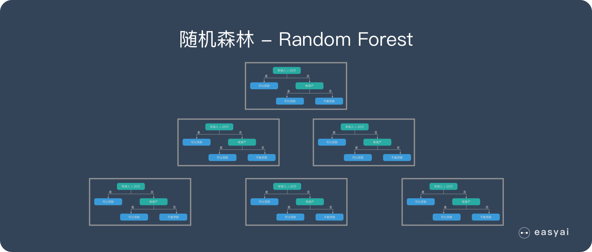
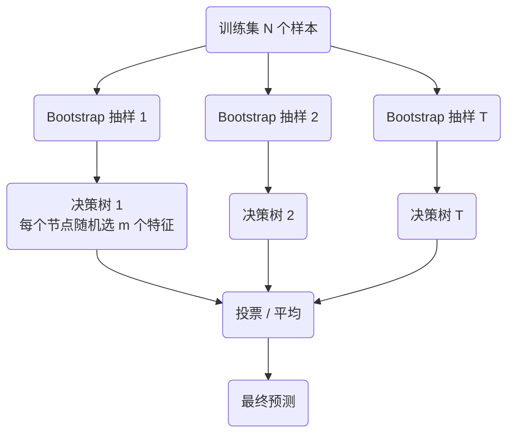

-----

| Title     | ML OML RandomForest                                   |
| --------- | ----------------------------------------------------- |
| Created @ | `2021-03-30T07:49:58Z`                                |
| Updated @ | `2026-11-24T03:34:25Z`                                |
| Labels    | \`\`                                                  |
| Edit @    | [here](https://github.com/junxnone/aiwiki/issues/114) |

-----

# Random Forest 随机森林

  - Random Forest - 随机森林
  - 由很多决策树构成，不同决策树之间没有关联
      - 属于 集成学习 中的 Bagging
  - 基学习器是 [Decision Tree](/0113_ML_OML_DecisionTree)，通过「**样本随机 +
    特征随机**」让每棵树彼此不同，再投票/平均得到结果
  - **优点**
      - 不容易过拟合
      - 训练速度比较快, 可并行
  - **缺点**
      - 对含噪音数据会过拟合



上图是随机森林的示意：多棵决策树分别对同一个输入给出预测，最终结果由所有树投票（分类）或平均（回归）得到。

## 算法流程

下图是训练和预测的完整流程：



图中：

  - 从训练集中**有放回**地抽取 $N$ 个样本，得到 $T$ 份不同的 Bootstrap 样本，每份训练一棵树
  - 每棵树在**每个节点**划分时，只从全部 $p$ 个特征中随机选出 $m$ 个作为候选，再选最优划分，这是与普通 Bagging 的区别
  - 各棵树互相独立，可以并行训练；预测时分类用多数投票，回归用平均

预测规则：

$$ \\hat{y}*{cls} = \\underset{c}{\\arg\\max}\\sum*{t=1}^{T}
1\\big(h\_t(x) = c\\big), \\qquad \\hat{y}*{reg} =
\\frac{1}{T}\\sum*{t=1}^{T} h\_t(x) $$

其中：

  - $T$：树的数量；$h\_t(x)$：第 $t$ 棵树对输入 $x$ 的预测
  - $c$：类别；$1(\\cdot)$：指示函数，条件成立为 1，否则为 0
  - 分类取得票最多的类别，回归取所有树预测的平均值；也可以对每棵树输出的类别概率取平均，得到概率估计

## 为什么有效

  - 单棵决策树方差大、容易过拟合；对多个**低相关**的模型取平均可以降低方差而基本不增加偏差
  - 假设每棵树的预测方差为 $\\sigma^2$，两两相关系数为 $\\rho$，则 $T$ 棵树平均后的方差为：

$$ Var = \\rho,\\sigma^2 + \\frac{1-\\rho}{T},\\sigma^2 $$

其中：

  - $\\sigma^2$：单棵树预测的方差；$\\rho \\in \[0, 1\]$：任意两棵树预测之间的相关系数；$T$：树的数量
  - 第二项随 $T$ 增大趋于 0，所以增加树的数量总是有益的（不会过拟合，只会趋于稳定）；第一项 $\\rho\\sigma^2$
    无法通过增加树来降低
  - 要降低 $\\rho$ 就需要让树彼此更不一样，这正是 Bootstrap
    抽样和**每个节点随机选特征**的作用：特征随机让相关性降低，是随机森林比普通
    Bagging 更好的原因

## Bootstrap 与 OOB

  - 每份 Bootstrap 样本有放回抽取 $N$ 次，某个样本**没被抽到**的概率为 $\\left(1 -
    \\frac{1}{N}\\right)^N \\to e^{-1} \\approx 0.368$，即每棵树大约只用到 63.2%
    的不同样本
  - 剩下约 36.8% 的样本称为该树的 **OOB** (Out-Of-Bag) 样本，没有参与这棵树的训练
  - **OOB
    误差**：对每个样本，只用「没有用它训练过的树」进行预测，再与真值比较；相当于免费的交叉验证，不需要单独划分验证集，scikit-learn
    中 `oob_score=True`

## 特征重要性

| Name                         | 做法                    | 特点                     |
| ---------------------------- | --------------------- | ---------------------- |
| MDI (Mean Decrease Impurity) | 统计每个特征在所有树中带来的不纯度下降之和 | 计算快；偏向取值多/连续的特征，训练集上计算 |
| Permutation Importance       | 打乱某个特征的取值，观察验证集指标下降多少 | 更可靠，可在验证集上算；特征强相关时会低估  |

表中是两种常用的特征重要性：MDI 是模型内置的、训练时顺便得到的；Permutation
与模型无关，更接近「这个特征对预测有多重要」。强相关的特征会分摊重要性，解读时要注意。

## 主要超参数

| Parameter                   | 含义            | 建议                                         |
| --------------------------- | ------------- | ------------------------------------------ |
| `n_estimators`              | 树的数量 $T$      | 越多越稳定，收益递减，通常 100\~500                     |
| `max_features`              | 每个节点候选特征数 $m$ | 分类默认 $\\sqrt{p}$，回归常用 $p/3$；越小树越不相关，但单棵树越弱 |
| `max_depth`                 | 树的最大深度        | 不限制则每棵树完全生长，可适当限制以减小模型                     |
| `min_samples_leaf`          | 叶节点最少样本数      | 增大可平滑预测、抑制噪声                               |
| `bootstrap` / `max_samples` | 是否有放回抽样及抽样比例  | 默认开启                                       |
| `class_weight`              | 类别权重          | 类别不均衡时使用 `balanced`                        |

表中列出了最常调的参数和建议值，其中 $p$ 为特征总数，$m$ 为每个节点候选特征数。

## 对比

| Name | Decision Tree | Random Forest | GBDT        |
| ---- | ------------- | ------------- | ----------- |
| 集成方式 | 无             | Bagging，并行    | Boosting，串行 |
| 主要降低 | \-            | 方差            | 偏差          |
| 基学习器 | \-            | 深而完整的树        | 浅树          |
| 对噪声  | 敏感            | 较稳健           | 敏感          |
| 调参   | 少             | 少，默认值通常就很好    | 多           |
| 精度   | 较低            | 较高            | 表格数据通常最高    |

表中从集成方式、关注的误差类型和使用难度对比三种树模型：随机森林是「开箱即用」的强基线，GBDT 调好后精度更高但更容易过拟合。

## UseCase

  - 对离散值的**分类**
  - 对连续值的**回归**
  - 无监督学习**聚类**（用随机森林计算样本相似度后聚类）
  - **异常**点检测（Isolation Forest 是基于随机树的异常检测方法）
  - 表格数据的通用基线，特征重要性分析

## 优缺点

  - **优点**
      - 精度高，不容易过拟合，对超参数不敏感
      - 能处理高维数据，不需要特征选择和缩放
      - 可并行训练，有 OOB 估计，能给出特征重要性
      - 能处理缺失值和类别特征（取决于实现）
  - **缺点**
      - 模型大、预测慢，不如单棵树可解释
      - 对含噪音数据会过拟合
      - 回归时不能外推：预测值不会超出训练集标签的范围
      - 对高维稀疏数据（如文本）效果不如线性模型

## Code

``` python
from sklearn.ensemble import RandomForestClassifier
from sklearn.inspection import permutation_importance

rf = RandomForestClassifier(n_estimators=300, max_features='sqrt', oob_score=True,
                            n_jobs=-1, random_state=0).fit(X_train, y_train)
print(rf.oob_score_)                                      # OOB 准确率
print(rf.feature_importances_)                            # MDI 特征重要性
pi = permutation_importance(rf, X_val, y_val, n_repeats=10, random_state=0)   # Permutation 重要性
```

## Reference

  - [随机森林 – Random
    forest](https://easyai.tech/ai-definition/random-forest/)
  - [Random Forests -
    Breiman 2001](https://link.springer.com/article/10.1023/A:1010933404324)
  - [scikit-learn - Random
    forests](https://scikit-learn.org/stable/modules/ensemble.html#forest)
