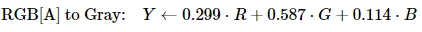
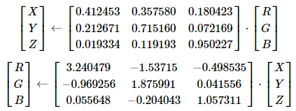
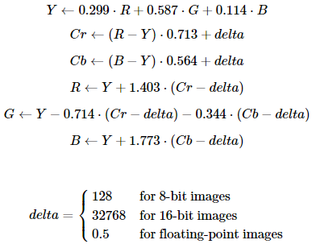
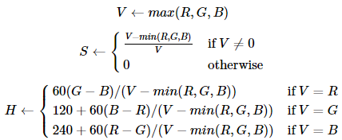
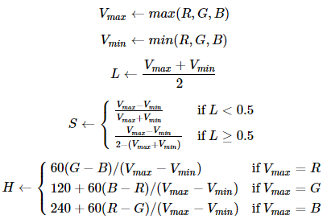
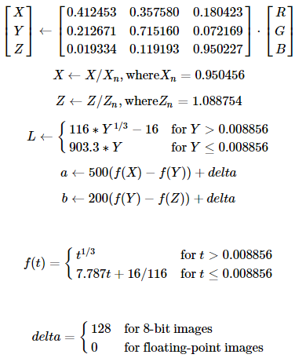
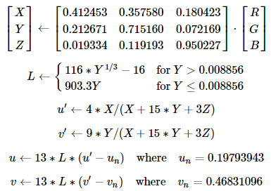
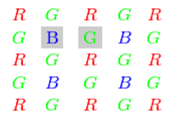

-----

| Title     | Media Image Color Space Transform                     |
| --------- | ----------------------------------------------------- |
| Created @ | `2021-10-21T18:40:38Z`                                |
| Updated @ | `2026-11-26T09:13:33Z`                                |
| Labels    | \`\`                                                  |
| Edit @    | [here](https://github.com/junxnone/aiwiki/issues/120) |

-----

# Color Space 转换

不同颜色空间各有用途：RGB 适合显示，HSV 适合按颜色筛选，YCrCb 适合压缩和肤色检测，Lab 适合衡量颜色差异。OpenCV 用
`cvtColor` 在它们之间转换。

``` python
import cv2
hsv = cv2.cvtColor(bgr, cv2.COLOR_BGR2HSV)   # 注意 OpenCV 默认通道顺序是 BGR
```

## Transforms

| Modes                                            | Description                                                  |
| ------------------------------------------------ | ------------------------------------------------------------ |
| RGB<br>- Red/Green/Blue                          |                                                              |
| Gray                                             |  |
| CIE XYZ.Rec 709 with D65 white point             |  |
| YCC/YCrCb                                        |  |
| HSV <br>- Hue/Saturation/Value<br>- 色相/饱和度/明度    |  |
| HSL<br>- Hue/Saturation/Lightness<br>- 色相/饱和度/亮度 |  |
| CIE Lab                                          |  |
| CIE Luv                                          |  |
| Bayer                                            |  |

表中：

  - **Modes**：目标颜色空间；**Description**：该空间对应的转换结果图
  - 对比结论：不同空间把图像的「亮度」和「色彩」分开表示的方式不同，选择合适的空间可以让任务（分割、检测、压缩）更简单

## 常用转换公式

### RGB → Gray

$$ Y = 0.299,R + 0.587,G + 0.114,B $$

其中：$R,G,B$ 为红、绿、蓝分量；$Y$ 为灰度值；权重反映人眼对绿色最敏感、对蓝色最不敏感（BT.601）。

### RGB → YCrCb

$$ Y=0.299R+0.587G+0.114B,\\quad Cr=(R-Y)\\cdot0.713+\\delta,\\quad
Cb=(B-Y)\\cdot0.564+\\delta $$

其中：

  - $Y$：亮度；$Cr$、$Cb$：红色、蓝色色差分量
  - $\\delta$：偏移量，8 位图像为 128，使色差分量落在非负范围

### RGB → HSV

$$ V=\\max(R,G,B),\\qquad S=\\begin{cases}\\dfrac{V-\\min(R,G,B)}{V} &
V\\ne0\[2mm\]0 & V=0\\end{cases} $$

其中：

  - $V$：明度，取三个分量中最大的；$S$：饱和度，衡量颜色距离灰色的远近，$\\min$ 为三个分量中最小的
  - 色相 $H$ 由最大分量所在的通道决定，范围为 $0\\sim360^\\circ$；OpenCV 的 8 位图像中把 $H$ 除以 2
    存为 $0\\sim179$，$S,V$ 缩放为 $0\\sim255$

### 选择建议

| 需求      | 推荐空间       | 原因               |
| ------- | ---------- | ---------------- |
| 按颜色筛选物体 | HSV        | 色相与亮度分离，对光照变化更稳健 |
| 肤色检测、压缩 | YCrCb      | 亮度与色差分离          |
| 颜色差异度量  | Lab        | 欧氏距离近似人眼感知差异     |
| 显示、存储   | RGB / sRGB | 与设备直接对应          |

表中：对比结论：把光照（亮度）从颜色信息里分离出来，是选择 HSV、YCrCb、Lab 的主要原因。

## Reference

  - [Pixel Format Naming Convention -
    GenICam](https://www.emva.org/wp-content/uploads/GenICam_PFNC_2_1.pdf)
  - [Color
    conversions](https://docs.opencv.org/master/de/d25/imgproc_color_conversions.html)
  - [cv.cvtColor() -
    OpenCV](https://github.com/junxnone/examples/issues/26)
