-----

| Title     | Media Image Color Model YUV                           |
| --------- | ----------------------------------------------------- |
| Created @ | `2021-02-07T03:28:00Z`                                |
| Updated @ | `2026-11-26T01:25:59Z`                                |
| Labels    | \`\`                                                  |
| Edit @    | [here](https://github.com/junxnone/aiwiki/issues/121) |

-----

# YUV Color Model

## Brief

  - YUV Color Space - 用于模拟信号彩色电视广播
      - Y - Luminance/Luma - 明亮度/灰度 - `[0,1] [0,255]`
      - UV - Chrominance/Chroma - 色度 - `[-0.5, 0.5] [-128, 127]`
      - Y 与 UV 分开 解决 彩色电视 和 黑白电视 兼容问题
  - YCbCr 来源于 YUV, 用于处理数字视频(一些编码标准中提到的 `YUV` 其实是指 `YCbCr`)
      - Cb - 蓝色分量
      - Cr - 红色分量
  - 采样格式 - 444/422/411/420
  - 存储格式
      - Packed - YUV 打包在一起
      - Planar - YUV 分离

## 采样格式 - Downsampling

  - `4:4:4` / `4:2:2` / `4:2:0` /`4:1:1`
  - 几个 Y 共享 UV - 节约带宽

| Pattern | 码流                                         | 像素点                                                                                           |
| ------- | ------------------------------------------ | --------------------------------------------------------------------------------------------- |
| 444     | `Y0 U0 V0 Y1 U1 V1 Y2 U2 V2 Y3 U3 V3`      | `[Y0 U0 V0] [Y1 U1 V1] [Y2 U2 V2] [Y3 U3 V3]`                                                 |
| 422     | `Y0 U0 Y1 V1 Y2 U2 Y3 V3`                  | `[Y0 U0 V1] [Y1 U0 V1] [Y2 U2 V3] [Y3 U2 V3]`                                                 |
| 411     | `Y0 U0 Y1 Y2 V2 Y3`                        | `[Y0 U0 V2] [Y1 U0 V2] [Y2 U0 V2] [Y3 U0 V2]`                                                 |
| 420     | `Y0 U0 Y1 Y2 U2 Y3` `Y5 V5 Y6 Y7 V7 Y8` | `[Y0 U0 V5] [Y1 U0 V5] [Y2 U2 V7] [Y3 U2 V7]` `[Y5 U0 V5] [Y6 U0 V5] [Y7U2 V7] [Y8 U2 V7]` |

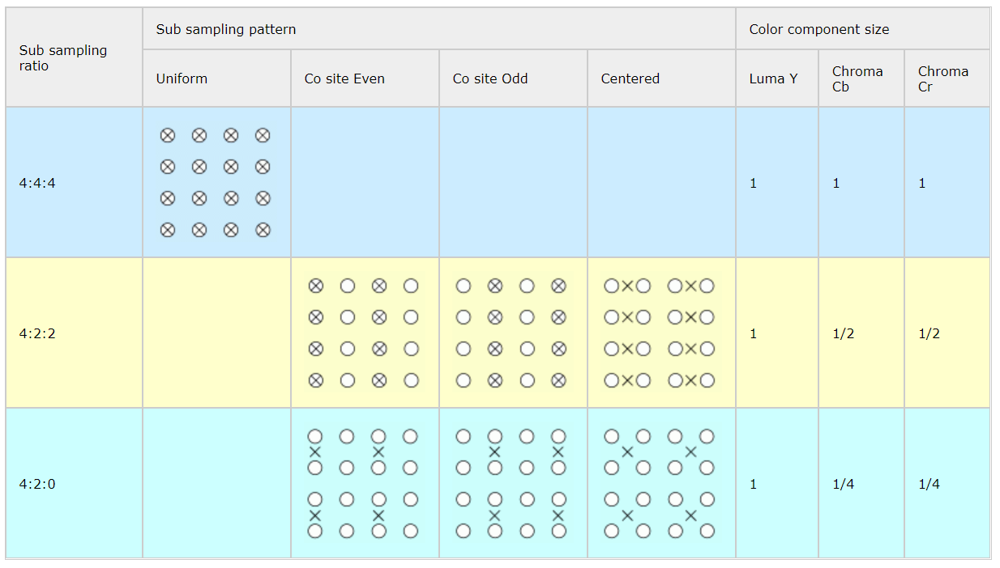

| Sub Sampling ratio | Format                   |
| ------------------ | ------------------------ |
| 444                | AYUV                     |
| 422                | I422/J422/UYVY/YUYV      |
| 420                | I420/YU12/YV12/NV12/NV21 |

| Format    | Description                                                                                   |
| --------- | --------------------------------------------------------------------------------------------- |
| I420      | 又名 YU12/IYUV, 属于 YUV420P - `4:2:0` 12 Bit/Pixel 3 Planars (Y/U/V), 平面顺序 Y→U→V                 |
| YV12      | 同 I420, 仅 U/V 平面顺序互换 (Y→V→U)                                                                  |
| NV12      | 属于 YUV420SP (Semi-Planar) - `4:2:0` 12 Bit/Pixel 2 Planars (Y 平面 + UV 交织平面 `U0 V0 U1 V1 ...`) |
| NV21      | 同 NV12, 仅 UV 交织顺序互换 (`V0 U0 V1 U1 ...`), Android 相机预览常用                                       |
| YUY2/YUYV | `4:2:2` 16 Bit/Pixel Packed, 排列 `Y0 U0 Y1 V0`, 两个像素共享一对 UV                                    |
| UYVY      | 同 YUY2, 仅字节顺序不同 (`U0 Y0 V0 Y1`)                                                               |

表中：`Format` 是格式名称；`Description` 给出别名、子采样比、每像素位数和平面排布。每像素位数的计算：以 `4:2:0`
为例, 每 4 个像素有 4 个 Y 和 1 对 UV, 共 `(4×8 + 2×8) / 4 = 12` bit/pixel;
`4:2:2` 每 2 个像素有 2 个 Y 和 1 对 UV, 即 `(2×8 + 2×8) / 2 = 16` bit/pixel;
`4:4:4` 为 24 bit/pixel。Planar 与 Semi-Planar 的区别只在于 U、V 是各占一个平面还是交织在同一平面。

## Pixel Format

| Format | Figure                                                       |
| ------ | ------------------------------------------------------------ |
| AYUV   | 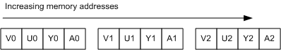 |
| YUY2   | 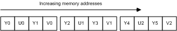 |
| UYVY   | 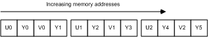 |
| IMC1   | 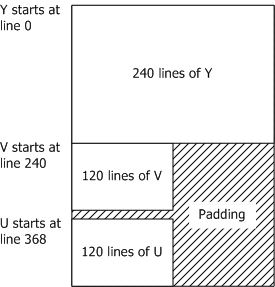 |
| IMC2   | 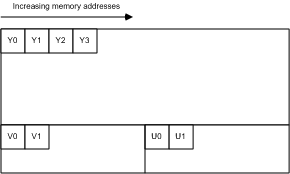 |
| IMC3   | 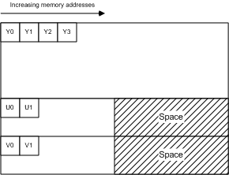 |
| IMC4   |  |
| YV12   | 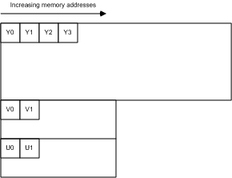 |
| NV12   | 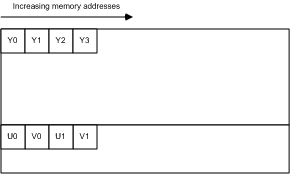 |

## YUV \<--\> RGB

下面是模拟 YUV (BT.601 系数) 与 RGB 的互转, 输入 $R',G',B'\\in\[0,1\]$:

$$ \\begin{aligned} Y' &= 0.299R' + 0.587G' + 0.114B' \\ U &=
0.492,(B'-Y') \\approx -0.147R' - 0.289G' + 0.436B' \\ V &=
0.877,(R'-Y') \\approx 0.615R' - 0.515G' - 0.100B' \\end{aligned} $$

$$ \\begin{aligned} R' &= Y' + 1.140V \\ G' &= Y' - 0.394U - 0.581V \\
B' &= Y' + 2.032U \\end{aligned} $$

其中：

  - $R',G',B'$：经过 gamma 校正的红、绿、蓝分量 (带撇表示非线性值), 取值 $\[0,1\]$
  - $Y'$：亮度 (Luma), 为 RGB 的加权和, 权重 $0.299/0.587/0.114$
    反映人眼对绿光最敏感、蓝光最不敏感; 取值 $\[0,1\]$
  - $U,V$：色度分量, 分别正比于蓝色差 $B'-Y'$ 和红色差 $R'-Y'$; 系数 $0.492$ 和 $0.877$
    用来把色差压缩到 $U\\in\[-0.436,0.436\]$、$V\\in\[-0.615,0.615\]$
  - 灰色像素满足 $R'=G'=B'$, 此时 $U=V=0$, 只剩亮度, 这就是黑白电视能兼容彩色信号的原因

### 数字视频的 YCbCr

数字视频使用的 YCbCr 是 YUV 的缩放和平移版本, 以便用 8 bit 整数存储。BT.601 的 limited range (也叫
TV range, 视频常用) 为:

$$ \\begin{aligned} Y &= 16 + 219,Y' \\ C\_b &= 128 +
224,\\frac{B'-Y'}{2(1-0.114)} \\ C\_r &= 128 +
224,\\frac{R'-Y'}{2(1-0.299)} \\end{aligned} $$

其中：

  - $Y\\in\[16,235\]$：亮度, 留出 $0\\sim15$ 和 $236\\sim255$ 作为信号余量
    (footroom/headroom)
  - $C\_b,C\_r\\in\[16,240\]$：蓝/红色差, $128$ 对应无色差, 即灰色
  - $219$ 和 $224$：Y 与 Cb/Cr 分别占用的量化级数 ($235-16$ 与 $240-16$)
  - $0.114$、$0.299$：BT.601 中 B、R 的亮度权重, 分母 $2(1-w)$ 把色差归一化到
    $\[-0.5,0.5\]$

JPEG 使用的是 full range: $Y,C\_b,C\_r\\in\[0,255\]$, 公式相同但去掉 $16$ 偏移和
$219/224$ 缩放。

注意：

  - 亮度权重取决于标准: BT.601 (标清) 为 $0.299/0.587/0.114$, BT.709 (高清) 为
    $0.2126/0.7152/0.0722$。用错标准转换会造成偏色, 这也是播放器里常见「颜色发灰/偏绿」的原因之一。
  - limited range 与 full range 搞混会造成对比度异常 (黑色发灰或高光、暗部被截断)。

| YUV                                                                       | YCbCr                                                        |
| ------------------------------------------------------------------------- | ------------------------------------------------------------ |
| 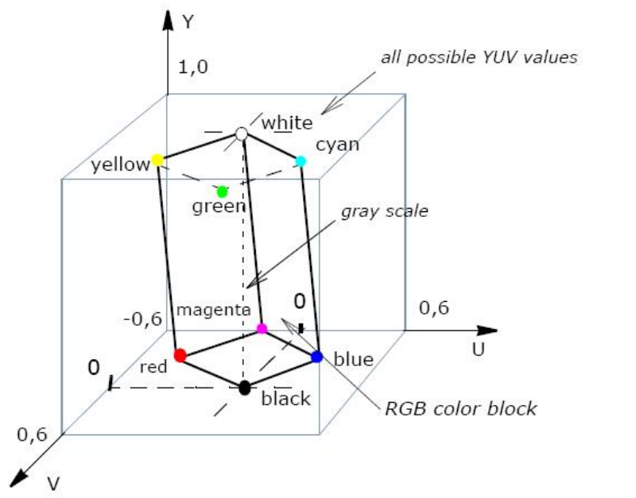 | 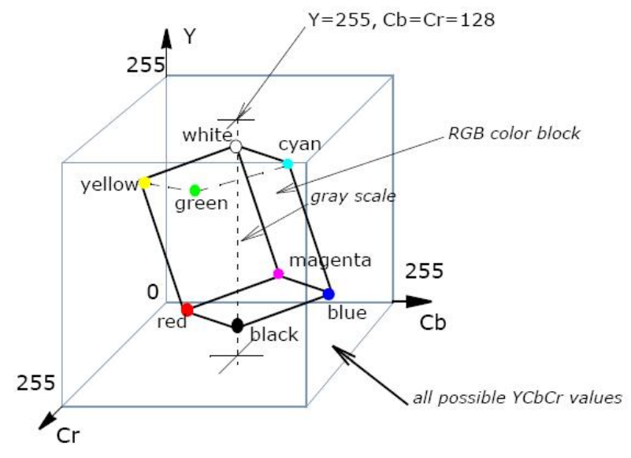 |

## Reference

  - [详解 YUV
    格式（I420/YUV420/NV12/NV12/YUV422）](https://www.jianshu.com/p/358bf8b7eacc)
  - [YUV pixel formats](https://www.fourcc.org/yuv.php)
  - [YUV - videolan-wiki](https://wiki.videolan.org/YUV#Semi-planar)
  - [Recommended 8-Bit YUV Formats for Video
    Rendering](https://docs.microsoft.com/en-us/windows/win32/medfound/recommended-8-bit-yuv-formats-for-video-rendering)
  - [一文理解 YUV](https://zhuanlan.zhihu.com/p/75735751)
