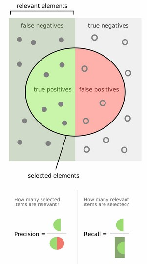
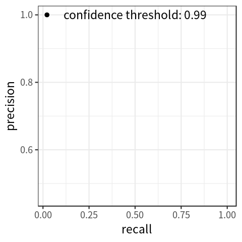
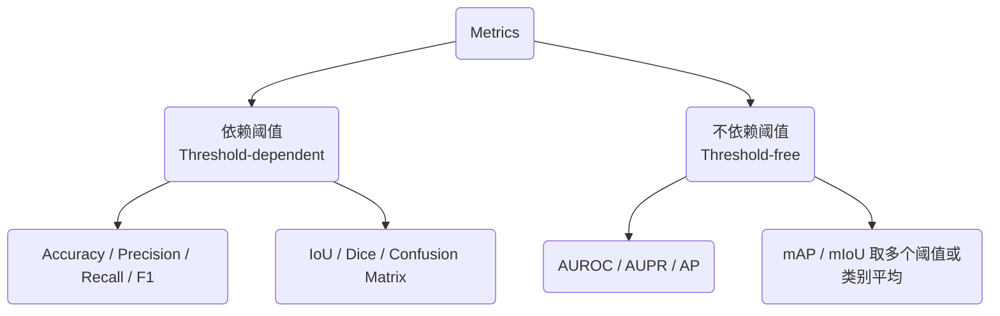

-----

| Title     | ML Metrics                                            |
| --------- | ----------------------------------------------------- |
| Created @ | `2021-11-21T06:01:17Z`                                |
| Updated @ | `2026-11-24T01:04:56Z`                                |
| Labels    | \`\`                                                  |
| Edit @    | [here](https://github.com/junxnone/aiwiki/issues/138) |

-----

# Metrics 评价指标

  - 每种 Task/Challenger 都会定义各自的 Metrics 用来评估模型的性能
  - 每种 Metrics 想要衡量的东西不同, 通过不同 Metrics 的比较可以评价一个模型不同方面的特性
  - 选择 Metrics 的出发点是**业务代价**：漏检和误检哪个更贵？数据是否均衡？输出是类别、框、掩码还是连续值？

## 基本概念

### TP/TN/FP/FN

| Name                   | Description                           |
| ---------------------- | ------------------------------------- |
| **T**(True)            | 模型识别正确                                |
| **F**(False)           | 模型识别错误                                |
| **P**(Positive)        | 对象本来为正例                               |
| **N**(Negative)        | 对象本来为负例                               |
| **TP**(True Positive)  | 对象本来为正例，网络识别为正例                       |
| **TN**(True Negative)  | 对象本来为负例，网络识别为负例                       |
| **FP**(False Positive) | 对象本来为负例，网络识别为正例 (`误检`, Type I Error)  |
| **FN**(False Negative) | 对象本来为正例，网络识别为负例 (`漏检`, Type II Error) |

上表给出四个基本计数的含义：第一个字母 T/F 表示模型判断是否正确，第二个字母 P/N
表示模型**预测**的结果；所有分类、检测、分割指标都由这四个计数组合而来。

### Accuracy/Precision/Recall/Fβ

| Name          | Formula                                                                                                                                                                             | Description                                                                |
| ------------- | ----------------------------------------------------------------------------------------------------------------------------------------------------------------------------------- | -------------------------------------------------------------------------- |
| Accuracy      | Accuracy = Ncorrect / NTotal   $\\texttt{accuracy}(y, \\hat{y}) = \\frac{1}{n\_\\text{samples}} \\sum\_{i=0}^{n\_\\text{samples}-1} 1(\\hat{y}\_i = y\_i)$ | 预测正确的占总数的比例                                                                |
| Precision     | $\\text{precision} = \\frac{tp}{tp + fp}$                                                                                                                                           | 识别为正例的样例中，识别正确的比例 (`查准率`)                                                  |
| Recall        | $\\text{recall} = \\frac{tp}{tp + fn}$                                                                                                                                              | 样本所有正例中，识别正确的比例 (`查全率`, 也叫 `Sensitivity` / `TPR`)                          |
| Specificity   | $\\text{specificity} = \\frac{tn}{tn + fp}$                                                                                                                                         | 样本所有负例中，识别正确的比例 (`TNR`)，$FPR = 1 - \\text{specificity}$                    |
| Fβ | $F\_\\beta = (1 + \\beta^2) \\frac{\\text{precision} \\times \\text{recall}}{\\beta^2 \\text{precision} + \\text{recall}}$                                                          | 综合 Precision 和 Recall，$\\beta \> 1$ 更看重 Recall，$\\beta \< 1$ 更看重 Precision |
| F1 | 当 β = 1 时的 Fβ                                                                                                                                                            | Precision 和 Recall 的调和平均                                                   |

其中：

  - $tp, tn, fp, fn$：上一节四个计数，取值为非负整数
  - $n\_\\text{samples}$：样本总数；$y\_i$ 是第 $i$ 个样本的真值，$\\hat{y}\_i$
    是预测值；$1(\\cdot)$ 为指示函数，括号内条件成立取 1，否则取 0
  - $\\beta$：正实数，Recall 相对 Precision 的重要程度；$\\beta=1$ 即 F1，$\\beta=2$
    偏重召回，$\\beta=0.5$ 偏重精度

> Precision 与 Recall 往往此消彼长：提高 `confidence 阈值` 会减少 FP（Precision 升）但增加
> FN（Recall 降）。单看其中一个指标没有意义。

### PR Curve

  - 以precision和recall作为纵、横轴坐标的二维曲线，通过选取不同`confidence 阈值` 时对应的精度和召回率画出
  - 总体趋势，精度越高，召回越低，当召回达到1时，对应概率分数最低的正样本，这个时候正样本数量除以所有大于等于该阈值的样本数量就是最低的精度值
  - P-R曲线围起来的面积就是AP值，通常来说一个越好的分类器，AP值越高。

下图是 PR 曲线随阈值变化的动画：

图中：

  - 横轴为 Recall，纵轴为 Precision，曲线上每个点对应一个 `confidence 阈值`
  - 曲线越靠近右上角，模型越好；曲线下的面积即 AP
  - 阈值由高到低移动时，Recall 单调上升，Precision 通常呈锯齿状下降

### ROC Curve

  - 横轴 `FPR`，纵轴 `TPR`，通过选取不同阈值画出，曲线下面积为 `AUROC`
  - 不受正负样本比例影响；样本极不均衡（如异常检测）时 ROC 会偏乐观，此时更适合看 PR Curve
  - 详见 [Metrics for Classification](/0137_ML_Metrics_Classification)

## 指标分类

下图把指标按「是否依赖阈值」和「评估对象」做了归类，帮助选择：

图中：

  - 左支是需要先确定一个 `confidence/score 阈值` 才能计算的指标，数值会随阈值改变，部署时要固定阈值再报告
  - 右支是对所有阈值积分或平均得到的指标，反映模型整体的排序/区分能力，不能直接代表上线后的表现
  - 实际评估通常两类并用：先用阈值无关指标比较模型，再用阈值相关指标评估上线效果

## Image Task Metrics

| Name         | Classification | Object Detection | Segmentation       | KeyPoint | Anomaly Detection     |
| ------------ | -------------- | ---------------- | ------------------ | -------- | --------------------- |
| Accuracy     | √              |                  | √ (Pixel Accuracy) |          |                       |
| Precision    | √              | √                | √                  |          | √                     |
| Recall       | √              | √                | √                  |          | √                     |
| F1           | √              | √                | √                  |          | √                     |
| AUROC / AUPR | √              |                  |                    |          | √ (Image/Pixel Level) |
| IoU          |                | √                | √                  |          |                       |
| AP / mAP     |                | √                |                    | √ (OKS)  |                       |
| Dice         |                |                  | √                  |          |                       |
| OKS / PCK    |                |                  |                    | √        |                       |
| AUPRO        |                |                  |                    |          | √ (Pixel Level)       |

表中每行是一个指标，每列是一个任务，`√` 表示该任务常用此指标，括号内为该任务下的变体或使用方式（如 KeyPoint 的 AP 基于 OKS
相似度，而不是 IoU）。

## 其他 Task 的 Metrics

| Task       | 常用 Metrics                            | 说明                                                                                                |
| ---------- | ------------------------------------- | ------------------------------------------------------------------------------------------------- |
| Regression | MAE / MSE / RMSE / R² / MAPE          | 输出为连续值，衡量预测值与真值的误差，见 [Regression](/0710_ML_Metrics_Regression)                                    |
| Retrieval  | Recall@K / mAP / MRR / NDCG           | 衡量检索结果排序质量，见 [Retrieval](/0712_ML_Metrics_Retrieval)，相似度度量见 [Pairwise](/0139_ML_Metrics_Pairwise) |
| Clustering | ARI / NMI / Silhouette                | 无标签时用内部指标，有标签时用外部指标，见 [Clustering](/0719_ML_Metrics_Clustering)                                   |
| Generation | FID / IS / PSNR / SSIM / LPIPS        | 衡量生成/重建图像的质量与多样性，见 [Generation](/0718_ML_Metrics_Generation)                                      |
| OCR        | CER / WER / Edit Distance             | 见 [OCR Metrics](/0190_ML_Tasks_Image_OCR_Metrics)                                                 |
| LLM        | Perplexity / BLEU / ROUGE / Benchmark | 见 [LLMs Metrics](/0503_LM_LLMs_Metrics)                                                           |
| NAS / 部署   | Latency / Throughput / FLOPs / Params | 见 [Efficiency](/0721_ML_Metrics_Efficiency) 和 [NAS Metrics](/0394_ML_AutoML_NAS_Metrics)          |

## 本分类文章索引

  - [Metrics for Classification](/0137_ML_Metrics_Classification) -
    Accuracy / Precision / Recall / F1 / ROC / AUC / Confusion Matrix
  - [Metrics for Detection](/0230_ML_Metrics_Detection) - 检测指标总览
      - [IoU](/0383_ML_Metrics_Detection_IoU)
      - [TPR & FPR](/0381_ML_Metrics_Detection_TPRFPR)
      - [AP & mAP & AR](/0382_ML_Metrics_Detection_APmAPAR)
      - [COCO Detection Metrics](/0384_ML_Metrics_Detection_COCO)
      - [GIoU](/0232_ML_Metrics_Detection_GIoU)
      - [DIoU / CIoU](/0716_ML_Metrics_Detection_DIoUCIoU)
      - [Center Distance](/0525_ML_Metrics_Detection_CD)
  - [Metrics for Segmentation](/0231_ML_Metrics_Segmentation)
      - [Dice](/0714_ML_Metrics_Segmentation_Dice)
      - [PQ](/0713_ML_Metrics_Segmentation_PQ) - Panoptic Quality
      - [Boundary F1-Score](/0526_ML_Metrics_Segmentation_BF1S)
      - [Hausdorff](/0715_ML_Metrics_Segmentation_Hausdorff)
  - [Anomaly](/0711_ML_Metrics_Anomaly) - Image/Pixel AUROC / AUPRO
  - [Keypoint](/0717_ML_Metrics_Keypoint) - OKS / PCK / NME
  - [Regression](/0710_ML_Metrics_Regression) - MAE / RMSE / R²
  - [Retrieval](/0712_ML_Metrics_Retrieval) - Recall@K / mAP / NDCG
  - [Clustering](/0719_ML_Metrics_Clustering) - ARI / NMI / Silhouette
  - [Generation](/0718_ML_Metrics_Generation) - PSNR / SSIM / LPIPS /
    FID
  - [Pairwise Metrics](/0139_ML_Metrics_Pairwise) - 相似度/距离/核函数
  - [Cross Validation](/0249_ML_Metrics_CrossValidation) - 评估方法而非指标
  - [Statistics](/0720_ML_Metrics_Statistics) - 置信区间与显著性检验
  - [Efficiency](/0721_ML_Metrics_Efficiency) - Params / FLOPs / Latency
    / Throughput

## 选择指南与常见误区

1.  **样本不均衡**：Accuracy 会被多数类主导（99% 负例时全预测负例也有 99% Accuracy），改用 Balanced
    Accuracy / F1 / PR Curve / AUPR
2.  **只报一个指标**：Precision/Recall、AP/AR 要成对报告；漏检和误检哪个更贵决定侧重点
3.  **平均方式**：多类别时 `micro / macro / weighted` 结果差别很大，报告时必须注明
4.  **阈值**：阈值相关指标要说明阈值如何选定（验证集上选，测试集上只评估一次），避免在测试集上调阈值
5.  **数据泄漏**：训练/验证/测试划分要避免同源样本跨集合，评估方法见 [Cross
    Validation](/0249_ML_Metrics_CrossValidation)
6.  **评估粒度**：Image Level / Object Level / Pixel Level 的结果不可直接比较
7.  **统计显著性**：小测试集上指标差 1% 可能只是噪声，建议多次随机种子取均值±标准差，或给出置信区间

## Tools

  - [scikit-learn
    metrics](https://scikit-learn.org/stable/modules/model_evaluation.html)
  - keras metrics
  - torch metrics
  - [TorchMetrics](https://lightning.ai/docs/torchmetrics/stable/) -
    分类/检测/分割/检索等指标，支持 GPU 与分布式
  - [pycocotools](https://github.com/cocodataset/cocoapi) - COCO
    检测/分割官方评估
  - [All metrics on the Hugging Face
    Hub](https://huggingface.co/metrics)

## Reference

  - [机器学模型评价与优化（学习笔记）](https://blog.csdn.net/xx19901314/article/details/52168260)
  - [深入理解AUC](https://tracholar.github.io/machine-learning/2018/01/26/auc.html)
  - [精确率、召回率、F1 值、ROC、AUC
    各自的优缺点是什么？](https://www.zhihu.com/question/30643044/answer/562062736)
  - [【机器学习笔记】：一文让你彻底理解准确率，精准率，召回率，真正率，假正率，ROC/AUC](https://zhuanlan.zhihu.com/p/46714763)
  - [Tensorflow Models Supported object detection evaluation
    protocols](https://github.com/tensorflow/models/blob/master/research/object_detection/g3doc/evaluation_protocols.md)
  - [VOC2010 DEVKIT
    doc](http://host.robots.ox.ac.uk/pascal/VOC/voc2010/devkit_doc_08-May-2010.pdf)
