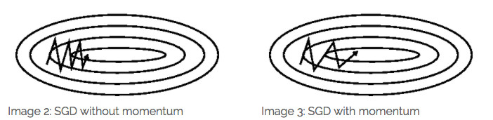
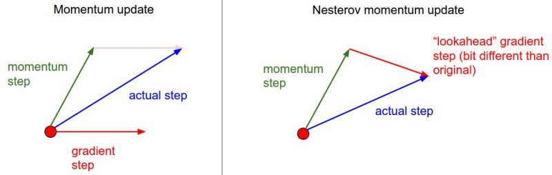

-----

| Title     | ML Arch GD Momentum                                   |
| --------- | ----------------------------------------------------- |
| Created @ | `2019-03-12T01:50:50Z`                                |
| Updated @ | `2026-11-26T08:17:07Z`                                |
| Labels    | \`\`                                                  |
| Edit @    | [here](https://github.com/junxnone/aiwiki/issues/150) |

-----

# Momentum

## Reference

  - [神经网络优化算法：梯度下降法、Momentum、RMSprop和Adam](https://www.cnblogs.com/jiaxblog/p/9695042.html)

## Brief

  - SGD --\> Momentum
  - **Momentum** - 对 SGD 进行指数加权平均平滑
  - **Nesterov’s Accelerated Momentum** - 比 标准 Momentum 收敛更好

| Name              | 更新策略                                                         |
| ----------------- | ------------------------------------------------------------ |
| GD                |  |
| SGD               |  |
| MBGD              |  |
| Momentum          |  |
| Nesterov Momentum |  |

> η - 学习率 γ - 原来梯度的比例

## 代码实现

| Name              | Code                                                                                              |
| ----------------- | ------------------------------------------------------------------------------------------------- |
| SGD               | $x \\leftarrow x - \\eta, dx$                                                                     |
| Momentum          | $v \\leftarrow \\mu v - \\eta, dx$ $x \\leftarrow x + v$                                       |
| Nesterov Momentum | $x\_{ahead} = x + \\mu v$ $v \\leftarrow \\mu v - \\eta, dx\_{ahead}$ $x \\leftarrow x + v$ |

其中：

  - $x$：待优化参数；$dx$：当前参数处的梯度；$dx\_{ahead}$：在前瞻位置 $x\_{ahead}$ 处计算的梯度
  - $\\eta$：学习率（learning\_rate）
  - $v$：速度（动量项），初始为 0
  - $\\mu$：动量系数（mu），常取 0.9
  - $\\leftarrow$：赋值更新

## 指数加权平均

  - 缓和拟合曲线

> β - 典型值 0.9 (即当前值的0.1，前一个值的0.9)

## Momentum vs ...

