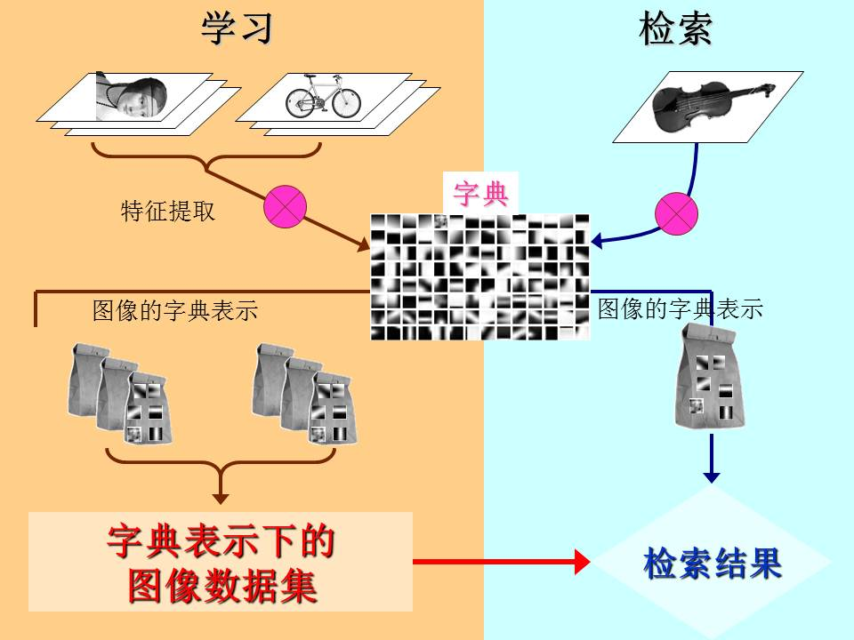

-----

| Title     | ML Tasks Image Retrieval CBIR VLAD                    |
| --------- | ----------------------------------------------------- |
| Created @ | `2019-02-19T15:23:32Z`                                |
| Updated @ | `2026-11-26T01:27:25Z`                                |
| Labels    | \`\`                                                  |
| Edit @    | [here](https://github.com/junxnone/aiwiki/issues/154) |

-----

## Brief

> Vector of Locally Aggregated Descriptors , 由Jegou et
> al.在2010年提出，其核心思想是aggregated(积聚)，主要应用于图像检索领域

在深度学习时代之前，图像检索领域以及分类主要使用的常规算法有BoW、Fisher Vector及VLAD等。

  - **BoW**:
    核心思想是提取出关键点描述子后利用聚类的方法训练一个码本，随后每幅图片中各描述子向量在码本中各中心向量出现的次数来表示该图片，该方法的缺点是需要码本较大
  - **FV**:
    核心思想是利用高斯混合模型(GMM)，通过计算高斯混合模型中的均值、协方差等参数来表示每张图像。该方法的优点是准确度高，但缺点是计算量较大
  - **VLAD**:
    可以看做是一种简化的FV，其主要方法是通过聚类方法训练一个小的码本，对于每幅图像中的特征找到最近的码本聚类中心，随后所有特征与聚类中心的差值做累加，得到一个k*d的vlad矩阵，其中k是聚类中心个数，d是特征维数(如sift是128维),随后将该矩阵扩展为一个(k*d)维的向量，并对其L2归一化，所得到的向量即为VLAD。
  - **NetVLAD**: 在VLAD算法的基础上Arandjelovic et al.在 All about VLAD
    一文中提出了一种改进方法。随后，其又结合深度卷积神经网络的相关内容，提出了NetVLAD。

## VLAD

VLAD的优点：

  - 提出一种图像表示方法，在拥有合理的向量维度下，具有很好的搜索准确率。
  - 联合优化降维和索引效率。

### Steps

1.  读取图片文件路径及特征提取
2.  使用聚类方法训练码本
3.  将每张图片的特征与最近的聚类中心进行累加
4.  对累加后的VLAD进行PCA降维并对其归一化
5.  得到VLAD后，使用ADC方法继续降低储存空间和提高搜索速度

> 其中步骤4、5可选，在步骤3得到残差累加向量后进行L2归一化即可用欧氏距离等计算两张图片的相似性从而实现图片检索 **VLAD 实现**

  - [C++](https://github.com/Lithogenous/VLAD-ORB-Cpp)
  - [Python](https://github.com/Lithogenous/VLAD-SIFT-python)

## NetVLAD

> 带有VLAD层的卷积神经网络结构

  - NetVLAD层，是一种受VLAD灵感激发的可泛化的VLAD层。
  - 基于弱监督排序损失，提出了一种可训练的方法用于学习这种端到端框架的参数。

## NetRVLAD

## NetFV

## Soft-DBoW

## BOW

1.  特征提取。在训练阶段，将图像用很多“块”（patch）表示，以SIFT特征为例，图像中每个关键点就是一个patch，每一个patch特征向量的维数128。
2.  字典构建。假设共有M幅训练图像，字典的大小为100，即有100个词，用K-均值算法对所有的patch进行聚类，等k-均值收敛时，将得到每一个聚类最后的质心，这100个质心（维数128）就是词典里的100个词，词典构建完毕。
3.  字典表示。在测试阶段，对每幅图像初始化一个维数100、值全为0的直方图，计算测试图像每个patch与字典中单词的距离，距离patch最近的单词对应的直方图计数加1，将所有patch计算完毕后的直方图即为图像的字典表示。
4.  图像检索。训练图与测试图都以100维向量表示，对每个待检索图像，只需在字典中计算所有训练图与其距离，并返回最近的若干幅即可。

## FV - Fisher Vector

> 一种类似于BOVW词袋模型的一种编码方式，如提取图像的SIFT特征，通过矢量量化（KMeans聚类），构建视觉词典（码本），FV采用混合高斯模型（GMM）构建码本，但是FV不只是存储视觉词典的在一幅图像中出现的频率，并且FV还统计视觉词典与局部特征（如SIFT）的差异。

## 公式

### BoW

把每个局部描述子分配到最近的视觉单词 (聚类中心)，统计直方图：

$$ h\_k=\\sum\_{i=1}^{N}\\mathbb 1\\bigl\[\\mathrm{NN}(\\mathbf
x\_i)=k\\bigr\],\\qquad k=1,\\dots,K $$

其中：

  - $\\mathbf x\_i$：图像的第 $i$ 个局部描述子 (如 SIFT，$128$ 维)；$N$：该图的描述子个数
  - $\\mathrm{NN}(\\mathbf x\_i)$：与 $\\mathbf x\_i$ 最近的聚类中心的编号；$K$：词典大小
    (聚类中心数)
  - $h\_k$：第 $k$ 个视觉单词出现的次数；整幅图用 $K$ 维直方图表示，为了让常见单词的权重小，常再乘 tf-idf 权重

### VLAD

不是只计数，而是累加残差：

$$ \\mathbf v\_k=\\sum\_{\\mathbf x\_i:\\ \\mathrm{NN}(\\mathbf
x\_i)=\\mathbf c\_k}(\\mathbf x\_i-\\mathbf c\_k),\\qquad \\mathbf
V=\[\\mathbf v\_1^\\top,\\dots,\\mathbf v\_K^\\top\]^\\top\\in\\mathbb
R^{K\\cdot D} $$

其中：

  - $\\mathbf c\_k$：第 $k$ 个聚类中心；$\\mathbf x\_i-\\mathbf
    c\_k$：描述子相对其中心的残差，保留了描述子在该单词周围的分布信息，比只计数的
    BoW 信息更多
  - $\\mathbf v\_k\\in\\mathbb R^D$：第 $k$ 个簇的残差之和；$D$：描述子维数
  - $\\mathbf V$：把 $K$ 个残差向量拼起来，维数为 $K\\times D$；例：$K=64$、$D=128$ 时为
    $8192$ 维
  - 之后通常做幂归一化 ($\\mathrm{sign}(v)\\sqrt{|v|}$，抑制「突发」的大值) 和 $L\_2$ 归一化，再用
    PCA 降维，即上面步骤 4

### NetVLAD

硬分配 (最近中心) 不可导，NetVLAD 用 softmax 软分配，使整个 VLAD 层可以端到端训练：

$$ V(j,k)=\\sum\_{i=1}^{N}\\frac{e^{\\mathbf w\_k^\\top\\mathbf
x\_i+b\_k}}{\\sum\_{k'}e^{\\mathbf w\_{k'}^\\top\\mathbf
x\_i+b\_{k'}}},\\bigl(x\_i(j)-c\_k(j)\\bigr) $$

其中：

  - $x\_i(j)$：第 $i$ 个描述子的第 $j$ 维；$c\_k(j)$：第 $k$ 个聚类中心的第 $j$ 维
  - $\\mathbf w\_k,b\_k$：第 $k$ 个簇的可学习参数；softmax 项 $a\_k(\\mathbf x\_i)$
    表示 $\\mathbf x\_i$ 属于第 $k$ 个簇的软权重，取代 VLAD 的 $0/1$ 指示
  - 聚类中心 $\\mathbf c\_k$ 也是可学习的参数；分配 (softmax) 的参数与残差用的中心可以不同，参数更灵活
  - 这一层接在 CNN 的最后一个卷积层之后，把卷积特征图上每个位置的特征当作一个描述子，用弱监督的 triplet
    排序损失训练，用于地点识别

### Fisher Vector

$$ \\mathbf
g\_{\\mu\_k}=\\frac1{N\\sqrt{\\pi\_k}}\\sum\_{i=1}^{N}\\gamma\_i(k)\\frac{\\mathbf
x\_i-\\boldsymbol\\mu\_k}{\\boldsymbol\\sigma\_k},\\qquad \\text{维数}=2KD
$$

其中：

  - $\\pi\_k,\\boldsymbol\\mu\_k,\\boldsymbol\\sigma\_k$：GMM 第 $k$
    个高斯分量的权重、均值和标准差；$\\gamma\_i(k)$：描述子 $\\mathbf x\_i$ 属于第
    $k$ 个分量的后验概率 (软分配)
  - 上式是对数似然关于均值的梯度；还有对方差的梯度 $\\mathbf g\_{\\sigma\_k}$，二者都取，所以维数是 $2KD$
  - 相比 VLAD，FV 同时编码了一阶 (均值) 和二阶 (方差) 统计量，精度更高，但计算量更大；VLAD 可以看作 FV 的简化版

## 方法对比

| 方法            | 码本      | 编码内容       | 维数          | 特点                   |
| ------------- | ------- | ---------- | ----------- | -------------------- |
| BoW           | K-means | 单词计数       | $K$         | 最简单，需要很大的词典 ($K$ 很大) |
| VLAD          | K-means | 残差之和       | $K\\cdot D$ | 小词典即可，精度高，常用         |
| Fisher Vector | GMM     | 梯度 (均值与方差) | $2KD$       | 精度高，计算量大             |
| NetVLAD       | 可学习的软分配 | 软分配的残差和    | $K\\cdot D$ | 端到端训练，深度特征           |

表中：编码内容越丰富，向量越长、精度越高，后续用 PCA 或 [量化](/0312_MO_Quantization) 压缩；BoW 到 VLAD
再到 NetVLAD 的趋势是「用更少的词典、更多的信息」，并最终变为可学习的。检索整体流程见
[Retrieval](/0278_ML_Tasks_Image_Retrieval)。

## Reference

  - [VLAD算法简介](https://blog.csdn.net/o3279/article/details/81221881)
  - [论文笔记 - NetVLAD: CNN architecture for weakly supervised place
    recognition](https://blog.csdn.net/qq_32417287/article/details/80102466#netvlad-a-generalized-vlad-layer-fvlad)
  - [NetVLAD: CNN architecture for weakly supervised place
    recognition](https://arxiv.org/abs/1511.07247)
  - [图像检索与降维（一）：VLAD](https://blog.csdn.net/LiGuang923/article/details/85416407)
  - [图像检索与降维（二）：NetVLAD](https://blog.csdn.net/LiGuang923/article/details/85470289)
  - [图像检索——VLAD](http://www.cnblogs.com/mafuqiang/p/6909556.html)
  - [BoW用于图像检索的一般化流程](https://blog.csdn.net/polly_yang/article/details/8241471)
  - [Bow模型](https://www.cnblogs.com/scnucs/p/3161961.html)
  - [视觉词典BOW小结](https://blog.csdn.net/darlingqiang/article/details/81358531)
  - [Fisher
    Vector（FV）原理](https://blog.csdn.net/u011501388/article/details/78410705)
  - [Fisher Vector](https://zhuanlan.zhihu.com/p/23002901)
