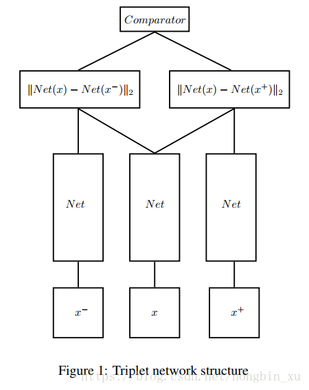
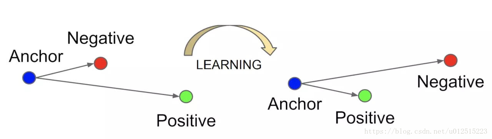
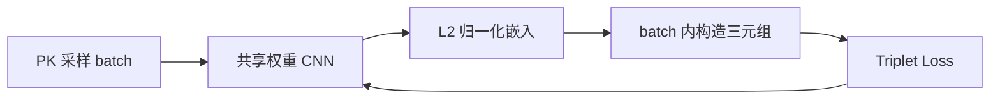

-----

| Title     | ML Tasks Image Retrieval CBIR TripletNetwork          |
| --------- | ----------------------------------------------------- |
| Created @ | `2019-02-20T09:43:34Z`                                |
| Updated @ | `2026-11-26T01:27:30Z`                                |
| Labels    | \`\`                                                  |
| Edit @    | [here](https://github.com/junxnone/aiwiki/issues/156) |

-----

# Triplet Network

## Brief

  - Triplet Network是Siamese Network的一种延伸，要解决的问题与Siamese Network的基本一致。
  - 将图像映射到某个特征空间中，其中两幅图像输入CNN得到的特征向量之间的欧式距离即为相似度。
  - 与Siamese Network不同的是，Triplet Network采用三个样本为一组：一个参考样本，一个同类样本，一个异类样本。
  - 在contrastive loss的基础之上构建了一个新的loss函数，就是保持类内和类间距离有一个距离限制（margin）。

|  | \- Tripelet Network由3个相同的前馈神经网络（彼此共享参数）组成 - 每次输入三个样本, 网络会输出两个值: 候选样本与同类样本，候选样本与异类样本，在embedding层的特征向量的L2距离  - 假设输入为: x, 候选样本: x− 异类样本: x+ - 这个网络对x− 和x+ 相对于x 的距离进行了编码 |
| ------------------------------------------------------------ | :---------------------------------------------------------------------------------------------------------------------------------------------------------------------------- |

## Triplet loss

> Triplet
> Loss，即三元组损失，用于训练差异性较小的数据集，数据集中标签较多，标签的样本较少。输入数据包括锚（Anchor）示例⚓️、正（Positive）示例和负（Negative）示例，通过优化模型，使得锚示例与正示例的距离小于锚示例与负示例的距离，实现样本的相似性计算。其中锚示例是样本集中随机选取的一个样本，正示例与锚示例属于同一类的样本，而负示例与锚示例属于不同类的样本。

triplet loss的优势在于细节区分，即当两个输入相似时，triplet
loss能够更好地对细节进行建模，相当于加入了两个输入差异性差异的度量，学习到输入的更好表示，从而在上述两个任务中有出色的表现。当然，triplet
loss的缺点在于其收敛速度慢，有时不收敛。

  - an anchor(基准正例)
  - a positive of the same class as the anchor （正例）
  - a negative of a different class （负例）
  - 两个具有同样标签的样本，他们在新的编码空间里距离很近。
  - 两个具有不同标签的样本，他们在新的编码空间里距离很远。

`L=max(d(a,p)−d(a,n)+margin,0)`

  - 最终的优化目标是拉近 a, p 的距离， 拉远 a, n 的距离
  - easy triplets: L=0 即 d(a,p)+margin\<d(a,n)，这种情况不需要优化，天然a, p的距离很近， a,
    n的距离远
  - hard triplets: d(a,n)\<d(a,p), 即a, p的距离远
  - semi-hard triplets: d(a,p)\<d(a,n)\<d(a,p)+margin, 即a,
    n的距离靠的很近，但是有一个margin

## 公式

$$
L=\\sum\_{(a,p,n)}\\max\!\\Bigl(|f(a)-f(p)|\_2^2-|f(a)-f(n)|\_2^2+\\alpha,\\
0\\Bigr) $$

其中：

  - $f(\\cdot)$：把图像映射为嵌入向量的网络，三个分支共享权重；常对输出做 $L\_2$ 归一化，使嵌入落在单位超球面上
  - $a$：锚点 (anchor)；$p$：与锚点同类的正样本；$n$：与锚点不同类的负样本
  - $\\alpha\>0$：间隔 (margin)，FaceNet 取 $0.2$；要求负样本比正样本远出至少 $\\alpha$
  - $\\max(\\cdot,0)$：满足约束 ($|f(a)-f(p)|^2+\\alpha\<|f(a)-f(n)|^2$)
    的三元组损失为 $0$，不再产生梯度，只有违反约束的三元组才起作用
  - 与 [Siamese](/0153_ML_Tasks_Image_Retrieval_CBIR_SiameseNetwork)
    的区别：对比损失约束绝对距离，三元组损失约束相对距离，更直接对应检索时的排序

## 三元组类型

| 类型        | 条件                               | 损失    | 作用                            |
| --------- | -------------------------------- | ----- | ----------------------------- |
| easy      | $d(a,p)+\\alpha\<d(a,n)$         | $=0$  | 已满足，无梯度，没有训练价值                |
| semi-hard | $d(a,p)\<d(a,n)\<d(a,p)+\\alpha$ | $\>0$ | 负样本稍远于正样本但在间隔内，最适合训练          |
| hard      | $d(a,n)\<d(a,p)$                 | $\>0$ | 负样本比正样本还近，梯度大，但过早使用会使训练不稳定、坍缩 |

表中：随着训练，easy 三元组越来越多，真正有用的只是 semi-hard 和 hard
的那部分，所以需要「挖掘」(mining)，否则大部分计算都是浪费；这也是
triplet loss 收敛慢的主要原因。

## 难例挖掘

  - 离线挖掘：每隔一段时间用当前模型在整个数据集上找 hard/semi-hard 三元组，开销大
  - 在线挖掘 (batch 内)：每个 batch 随机采 $P$ 个类、每类 $K$ 张图 (PK 采样)，在 batch 内部组三元组
      - batch all：使用 batch 内所有有效的三元组，取平均
      - batch hard：对每个锚点，取 batch 内最远的正样本和最近的负样本：

$$
L\_{BH}=\\sum\_{a}\\max\\Bigl(\\max\_{p}d(a,p)-\\min\_{n}d(a,n)+\\alpha,\\
0\\Bigr) $$

其中：$\\max\_pd(a,p)$ 是同类样本里离锚点最远的距离，$\\min\_nd(a,n)$
是异类样本里离锚点最近的距离；它要求「最难的正样本也要比最难的负样本近
$\\alpha$」，收敛更快、效果更好，但对噪声标签更敏感。

## 训练流程

图中：

  - 一个 batch 由 $P$ 个类、每类 $K$ 张图组成，保证每个锚点在 batch 内一定有正样本和负样本
  - 所有图像经过同一个 CNN 得到嵌入，在 batch 内用距离矩阵挖掘三元组，计算损失后反向传播
  - 推理时只需要嵌入网络：把图库图像都编码成向量，查询时用最近邻搜索，见
    [Retrieval](/0278_ML_Tasks_Image_Retrieval)

## 优缺点

  - 优点：直接优化「正比负近」的相对关系，对细粒度区分 (如人脸、同款商品) 很有效；FaceNet 用 $128$ 维嵌入在 LFW
    上达到约 $99.63%$ 准确率 `[待核实]`
  - 缺点：收敛慢；对采样和难例挖掘敏感，有时不收敛或坍缩 (所有样本映射到同一点)；每个 batch 的有效三元组很少
  - 改进：分类型损失 (ArcFace、CosFace)、Circle Loss、Proxy 方法，训练更稳定，已成为主流

## Reference

  - [论文笔记：Triplet
    Network](https://blog.csdn.net/hongbin_xu/article/details/83064290)
  - [Triplet-Loss原理及其实现、应用](https://blog.csdn.net/u013082989/article/details/83537370)
  - [How to Train Triplet Networks with 100K
    Identities?](https://arxiv.org/abs/1709.02940)
  - [论文水记|How to Train Triplet Networks with 100K
    Identities?](https://blog.csdn.net/bea_tree/article/details/78106497)
