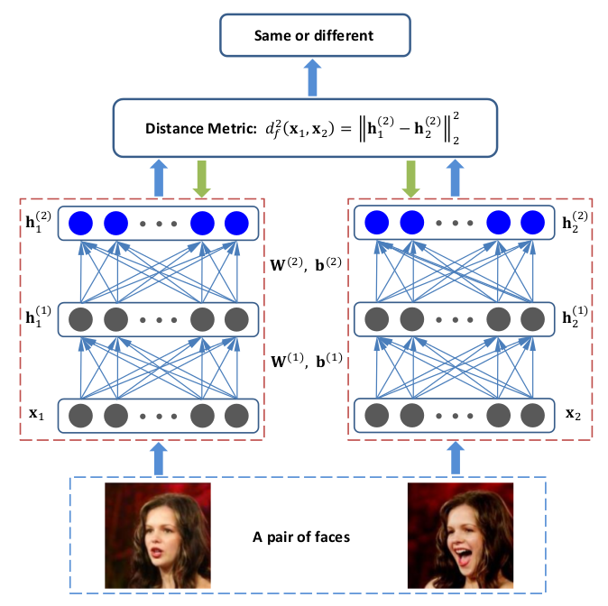

-----

| Title     | ML Tasks MetricLearning                               |
| --------- | ----------------------------------------------------- |
| Created @ | `2019-12-10T10:10:12Z`                                |
| Updated @ | `2026-11-26T09:28:26Z`                                |
| Labels    | \`\`                                                  |
| Edit @    | [here](https://github.com/junxnone/aiwiki/issues/157) |

-----

# Metric Learning

  - 度量学习 - Metric Learning - 距离度量学习 - Distance Metric Learning
  - 即相似度的学习，在一定条件下，相似度和距离可以相互转换
      - Encoder编码模型
      - 相似度判别算法
  - Algos
      - Siamese
      - Triplet

图中：该图为原文档附带的度量学习示意图，对应上面的「编码模型 + 相似度判别」。

## 目标

学一个编码器 $f\_\\theta$，把样本映射到嵌入空间，使**同类样本距离近、不同类样本距离远**：

$$ d(x\_i,x\_j)=\\big\\lVert
f\_\\theta(x\_i)-f\_\\theta(x\_j)\\big\\rVert\_2 $$

其中：

  - $x\_i,x\_j$：两个样本；$f\_\\theta$：参数为 $\\theta$ 的编码网络，输出嵌入向量
  - $d(x\_i,x\_j)$：嵌入空间里的欧氏距离，作为样本间的相似度度量（越小越相似）
  - 余弦相似度也常用；相似度与距离在一定条件下可以互相转换

## 常见损失

| 方法            | 输入       | 损失                                                                                       |
| ------------- | -------- | ---------------------------------------------------------------------------------------- |
| Siamese（对比损失） | 一对样本     | 同类拉近，不同类拉开到间隔 $m$ 以上                                                                     |
| Triplet       | 锚点、正、负样本 | 要求 $d(a,p)+m\<d(a,n)$，见 [Triplet Network](https://github.com/junxnone/aiwiki/issues/156) |

表中：

  - $m$：间隔（margin），超参数

Siamese 的对比损失：

$$ L=\\frac{1}{2}\\Big\[y,d^{2}+(1-y)\\max(0,\\ m-d)^{2}\\Big\] $$

其中：

  - $y$：标签，两个样本同类为 1，不同类为 0；$d$：两个样本嵌入之间的距离；$m$：间隔
  - $y=1$ 时损失为 $\\tfrac12 d^2$，把同类拉近；$y=0$ 时只有距离小于 $m$ 才有损失，把不同类推开到至少
    $m$

## 应用

  - 人脸识别 / 验证、图像检索、重识别（ReID）
  - 小样本分类：只需少量样本，用嵌入距离判断类别
  - 检索得到的嵌入可用近似最近邻加速，见 [ML NNS
    ANN](https://github.com/junxnone/aiwiki/issues/103)

## Reference

  - [『深度概念』度量学习中损失函数的学习与深入理解](https://blog.csdn.net/xiaosongshine/article/details/93004534?utm_source=app)
