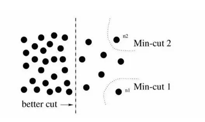

-----

| Title     | CV TIS                                                |
| --------- | ----------------------------------------------------- |
| Created @ | `2021-04-13T06:40:04Z`                                |
| Updated @ | `2026-11-26T10:21:05Z`                                |
| Labels    | \`\`                                                  |
| Edit @    | [here](https://github.com/junxnone/aiwiki/issues/158) |

-----

# Traditional Image Segmentation 传统图像分割

图像分割：把图像划分成若干有意义的区域（如前景与背景）。深度学习之前的分割主要靠图论和能量最小化方法。

## DL 之前的 Segmentation 技术

  - Normalized cut
  - Grab Cut

### N-cut - Normalized cut

  - 通过像素和像素之间的关系权重来综合考虑 ，根据给出的阈值，将图像一分为二。
  - 每运行一次N-cut，只能切割一次图片，若yao要分割图像上的多个物体，需要多次运行
  - 分割效果比较差



图中：该图为原文档附带的 N-cut 分割示意图。

把图像看作一个图：像素是节点，像素之间的相似度是边的权重。把节点分成 $A$、$B$ 两部分，使下式最小：

$$
\\mathrm{Ncut}(A,B)=\\frac{\\mathrm{cut}(A,B)}{\\mathrm{assoc}(A,V)}+\\frac{\\mathrm{cut}(A,B)}{\\mathrm{assoc}(B,V)}
$$

其中：

  - $V$：所有像素（节点）的集合；$A,B$：把 $V$ 分成的两部分
  - $\\mathrm{cut}(A,B)=\\sum\_{u\\in A,,v\\in
    B}w(u,v)$：被切断的边的权重之和；$w(u,v)$ 为像素 $u,v$
    之间的相似度
  - $\\mathrm{assoc}(A,V)=\\sum\_{u\\in A,,v\\in V}w(u,v)$：$A$
    中节点与全图所有节点的连接强度之和
  - 除以 $\\mathrm{assoc}$ 做归一化，避免只切出一个孤立小点的退化解

### Grab Cut - 交互分割

  - 给定一张图片，然后人工在想要分割的区域画一个框，然后机器会对这个框的内容进行分割
  - 保留的部分叫`前景`，删除的部分叫`背景`
  - 当前景背景颜色相近时，会出现分割错误


图中：该图为原文档附带的 GrabCut 分割示意图。

GrabCut 用高斯混合模型（GMM）分别描述前景和背景的颜色分布，通过图割最小化能量：

$$
E(\\alpha,\\theta)=\\sum\_{n}U(\\alpha\_n,\\theta)+\\sum\_{(m,n)}V(\\alpha\_m,\\alpha\_n)
$$

其中：

  - $\\alpha\_n\\in{0,1}$：像素 $n$ 属于背景（0）或前景（1）的标签；$\\theta$：前景、背景 GMM
    的参数
  - $U$：数据项，像素颜色在对应 GMM 下越合理，$U$ 越小
  - $V$：平滑项，相邻像素颜色相近时倾向于取相同标签，使分割边界平滑
  - 迭代：先估计 GMM，再用图割求最优标签，重复到收敛

<!-- end list -->

``` python
mask = np.zeros(img.shape[:2], np.uint8)
bgd = np.zeros((1, 65), np.float64); fgd = np.zeros((1, 65), np.float64)
rect = (x, y, w, h)                       # 用户给出的框
cv2.grabCut(img, mask, rect, bgd, fgd, 5, cv2.GC_INIT_WITH_RECT)
```

其中：`rect` 是用户框住的前景范围；`5` 是迭代次数；`mask` 输出每个像素是前景还是背景（含「可能前景 / 可能背景」）。

## 对比

| 方法      | 是否交互  | 特点                    |
| ------- | ----- | --------------------- |
| N-cut   | 否     | 基于图论，一次只能二分，效果较差      |
| GrabCut | 是（给框） | 对颜色差异明显的目标效果好，颜色相近会出错 |

表中：对比结论：深度学习的语义分割（见 [ML Tasks Image
Segmentation](https://github.com/junxnone/aiwiki/issues/159)）已大幅超过这类传统方法，但它们不需要训练数据，仍适合交互式抠图。
