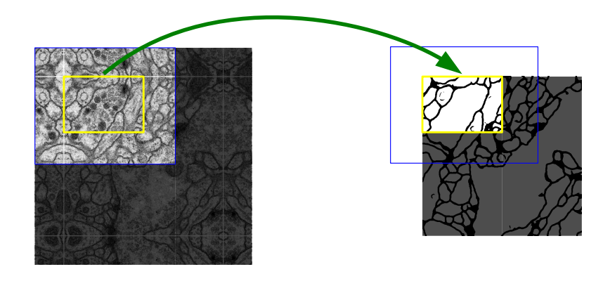
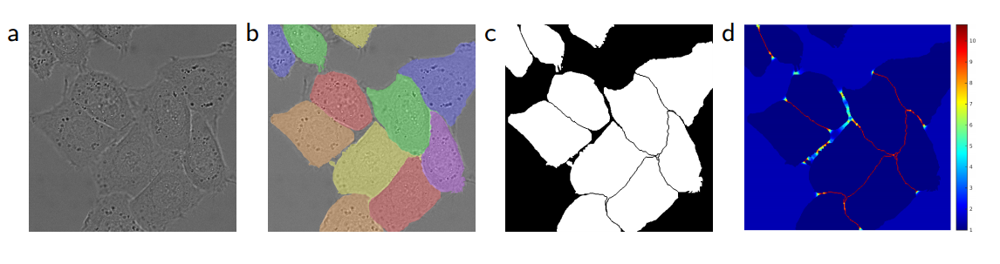
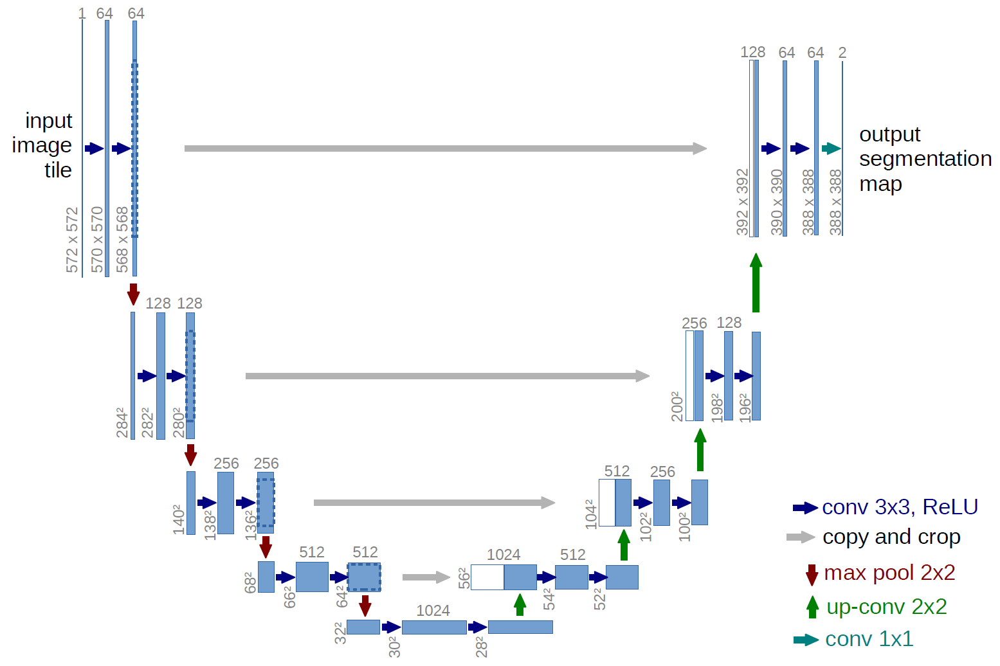
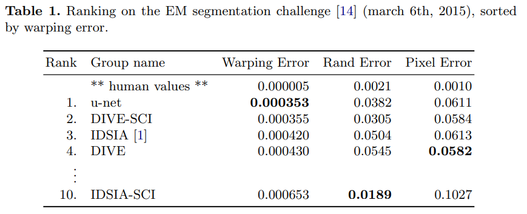
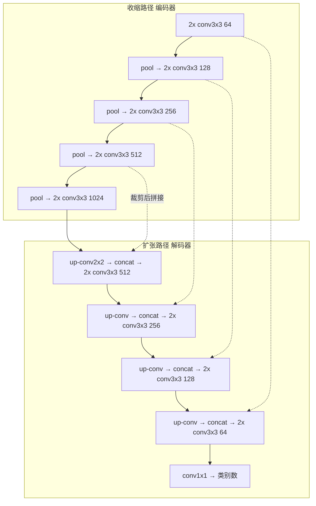

-----

| Title     | ML Tasks Image Segmentation UNet                      |
| --------- | ----------------------------------------------------- |
| Created @ | `2018-12-26T18:37:24Z`                                |
| Updated @ | `2026-11-26T01:27:10Z`                                |
| Labels    | \`\`                                                  |
| Edit @    | [here](https://github.com/junxnone/aiwiki/issues/161) |

-----

## Brief

  - unet 网络用于图像分割任务
  - 基于 FCN , 扩大了网络框架，使其能够使用很少的训练图像就得到很 精确的分割结果。

-----

  - 上采样部分有大量的特征通道，允许网络将上下文信息传播到具有更高分辨率的层
  - 网络没有任何全连接层，仅使用每个卷积的有效部分，即分割映射仅包含在输入图像中可获得完整上下文的像素。该策略允许通过重叠图像区策略无缝分割任意大小的图像
  - 使用弹性变形( elastic deformations)来进行数据增强
  - 使用加权损失，其中接触单元之间的分离背景标签在损失函数中获得较大的权重。

## 网络结构

  - part1 - 下采样，池化, 不同的卷积，学习深层次的特征
  - part2 - 上采样, 反卷积, 恢复原图大小
  - 最后会使用 `sigmoid` 或 `softmax` 来实现二分类或多分类
  - 输出为一张像素级的概率图或者概率矩阵

## MobileNet-UNet

  - MobileNet 最为backbone产生feature map
  - UNet UpSampling 部分 + `sigmoid` 或 `softmax` 来实现二分类或多分类

## Vanilla-Unet - 即 原版Unet

> 看到
> [divamgupta/image-segmentation-keras](https://github.com/divamgupta/image-segmentation-keras/blob/master/keras_segmentation/models/basic_models.py)
> 中使用了vanilla\_encoder, 然后查到一个英文梗：
> 
>   - vanilla 的原意是香草，而香草口味的冰淇淋被吐槽和原味没什么区别，所以香草就有了原汁原味的意思

## UNet vs FCN

  - U-Net采用了与FCN不同的特征融合方式
      - FCN 中 Pool4/Pool3 中的feature map 是通过逐点相加(Add)的方式进行特征融合的
      - U-Net使用Concat Layer将特征在channel维度拼接在一起，形成更“厚”的特征

## Image Augmentation

  - 3 x 3 grid smooth deformations
      - random displacement vectors
      - Gaussian distribution
      - bicubic interpolation 方法计算位移

## Test Result

## 结构细节

下图是 U-Net 的整体结构 (原论文输入 $572\\times572$，使用无填充卷积)：

图中：

  - 左边收缩路径：每级两个 $3\\times3$ 卷积后做 $2\\times2$ 最大池化，分辨率减半、通道数翻倍
    ($64\\to128\\to256\\to512\\to1024$)，学习越来越抽象的特征
  - 右边扩张路径：每级先用 $2\\times2$ 转置卷积把分辨率放大一倍、通道减半，再与左边对应层的特征拼接 (虚线)，然后两个
    $3\\times3$ 卷积；最后用 $1\\times1$ 卷积映射到类别数
  - 虚线是跳连：把编码器里分辨率高、细节丰富的特征直接送给解码器，弥补池化丢失的定位信息；因为无填充卷积使编码器特征比解码器大，所以拼接前要裁剪到相同尺寸
  - 整个网络有 $23$ 个卷积层，因形状像字母 U 而得名；与
    [FCN](/0160_ML_Tasks_Image_Segmentation_FCN) 的区别是解码器对称、通道数多，且融合用
    Concat 而不是 Add

## 无填充卷积与 Overlap-tile

  - 每个 $3\\times3$ 无填充卷积使特征图边长减 $2$，所以输入 $572\\times572$ 对应输出只有
    $388\\times388$
  - 对大图的处理：把图像分成互相重叠的块 (tile)，每块预测中间的有效区域，边界处的缺失上下文用镜像填充 (overlap-tile
    策略)，因此可以无缝分割任意大小的图像
  - 现在多数实现改用 `padding=1` 的 same 卷积，输入输出等大，不再需要裁剪

## 加权损失

$$ E=\\sum\_{x\\in\\Omega}w(x)\\log p\_{\\ell(x)}(x),\\qquad
w(x)=w\_c(x)+w\_0\\exp\!\\left(-\\frac{(d\_1(x)+d\_2(x))^2}{2\\sigma^2}\\right)
$$

其中：

  - $\\Omega$：所有像素；$\\ell(x)$：像素 $x$ 的真实类别；$p\_{\\ell(x)}(x)$：网络在该类别上的
    softmax 概率 ($E$ 取负后作为损失最小化)
  - $w\_c(x)$：类别平衡权重，用来补偿不同类别像素数量的不平衡
  - $d\_1(x),d\_2(x)$：像素 $x$ 到最近和次近的细胞边界的距离；两个相邻细胞之间的狭窄背景处距离很小，指数项很大
  - $w\_0$、$\\sigma$：超参数，论文取 $w\_0=10$，$\\sigma\\approx5$
    像素；效果是迫使网络学会把接触的细胞分开

## 数据增强

  - 医学图像训练数据极少 (原论文只有 30 张)，所以强数据增强是关键
  - 弹性形变：在 $3\\times3$ 的粗网格上采样位移向量 (高斯分布，标准差为 $10$
    像素)，再用双三次插值得到逐像素位移，模拟组织的自然形变
  - 同时使用平移、旋转、灰度变化；在收缩路径末尾使用 Dropout 做隐式增强

## UNet 与 FCN 的对比

| 维度    | [FCN](/0160_ML_Tasks_Image_Segmentation_FCN) | UNet          |
| ----- | -------------------------------------------- | ------------- |
| 解码器   | 单次大倍数上采样，浅层仅少量融合                             | 与编码器对称，逐级放大   |
| 特征融合  | 逐点相加 (Add)                                   | 通道拼接 (Concat) |
| 通道数   | 融合处为类别数                                      | 解码器每级保留大量通道   |
| 小数据表现 | 一般                                           | 好，尤其配合弹性形变    |

表中：Concat 保留了浅层和深层的全部信息，让后续卷积自己学习怎样融合，而 Add 要求二者逐元素对齐且信息混在一起；这是 UNet
在小数据集上更好的原因之一。

## 变体

  - MobileNet-UNet：用
    [MobileNet](/0045_ML_Tasks_Image_Classification_MobileNet)
    作编码器，减少计算量，适合边缘设备
  - UNet++、Attention U-Net、3D
    U-Net、nnU-Net：增加嵌套跳连、注意力、三维卷积，以及自动配置训练流程，后者是医学图像分割的强基线

## Reference

  - [官方实现Github -
    caffe](https://github.com/lmb-freiburg/Unet-Segmentation)
  - [Github repo - keras - zhixuhao](https://github.com/zhixuhao/unet)
  - [image-segmentation-keras](https://github.com/divamgupta/image-segmentation-keras)
  - [U-Net: Convolutional Networks for Biomedical Image
    Segmentation](https://lmb.informatik.uni-freiburg.de/people/ronneber/u-net/)
  - [isbi\_challenge](http://brainiac2.mit.edu/isbi_challenge/)
  - [Intel
    unet](https://github.com/IntelAI/unet/tree/master/single-node)
  - [paper -U-Net: Convolutional Networks for Biomedical Image
    Segmentation ](https://arxiv.org/pdf/1505.04597.pdf) - -
    [**Download**](https://github.com/junxnone/tech-io/files/3895234/U-Net.Convolutional.Networks.for.Biomedical.Image.Segmentation.pdf)
  - [unet网络结构说明及keras实现详解](https://blog.csdn.net/weixin_38193906/article/details/83787569)
  - [unet - keras - intelAI](https://github.com/IntelAI/unet)
  - [U-Net - Convolutional Networks for Biomedical Image
    Segmentation论文翻译——中英文对照](http://noahsnail.com/2019/05/13/2019-05-13-U-Net-Convolutional%20Networks%20for%20Biomedical%20Image%20Segmentation%E8%AE%BA%E6%96%87%E7%BF%BB%E8%AF%91%E2%80%94%E2%80%94%E4%B8%AD%E8%8B%B1%E6%96%87%E5%AF%B9%E7%85%A7/)
  - [Implementation of U-Net architecture using
    Pytorch.](https://github.com/jakeoung/Unet_pytorch)
  - [用U-Net做Auto-Encoder图像重建](https://zhuanlan.zhihu.com/p/47125912)
  - [UNet-family](https://github.com/ShawnBIT/UNet-family)
