-----

| Title     | ML Tasks Image Segmentation Deeplab                   |
| --------- | ----------------------------------------------------- |
| Created @ | `2019-11-29T08:03:58Z`                                |
| Updated @ | `2026-11-26T01:27:12Z`                                |
| Labels    | \`\`                                                  |
| Edit @    | [here](https://github.com/junxnone/aiwiki/issues/162) |

-----

## Brief

  - DeepLab是Google团队一系列semantic image segmentation的paper

| \--             | DeepLabv1 | DeepLabv2 | DeepLabv3 | DeepLabv3+ |
| --------------- | --------- | --------- | --------- | ---------- |
| Backbone        | VGG-16    | ResNet    | ResNet+   | Xception   |
| Atrous Conv     | √         | √         | √         | √          |
| CRF             | √         | √         | ×         | ×          |
| ASPP            | ×         | ASPP      | ASPP+     | ASPP+      |
| Encoder-decoder | ×         | ×         | ×         | √          |

## DeepLab V1

  - 基于VGG16
      - 全连接层转为卷积
      - 最后两个池化去掉下采样
      - Conv5 的三个卷积层使用 hole 为2 的卷积
      - fc6 中hole为 4
  - **使用 `Hole Algorithm` - `atrous convolution` , 提高特征分辨率**
      - 标准卷积的平移不变性(高层次特征映射) 导致了分割时精准度不高
  - **使用 `bi-linear interpolation` 上采样**
  - **使用 CRF，提高分割边缘精度**

### Model

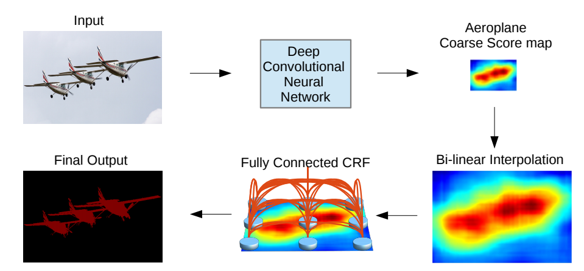

### Hole Algorithm

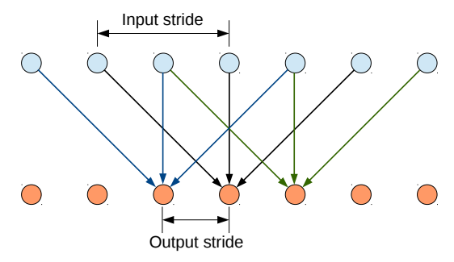

### 条件随机场 - CRF - Conditional Random Field

  - 一个位置的像素值(label), 和周围邻居像素值(label) 相关
  - 使用 fully connected CRF , 而不是 short range CRF
  - CRF是后处理，是不参与训练的
  - CRF 导致的结果是锐化？

**Energy Function:**
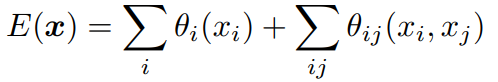

  - x 是像素的label
    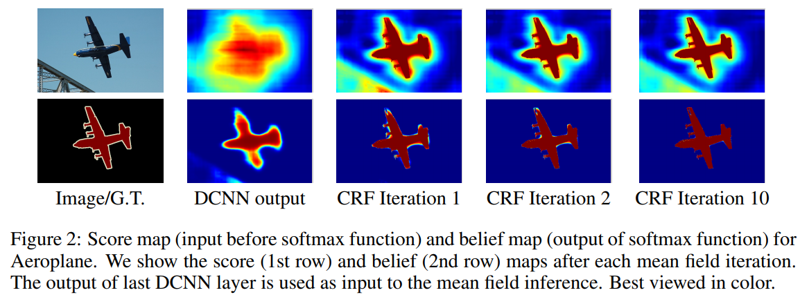

### Result

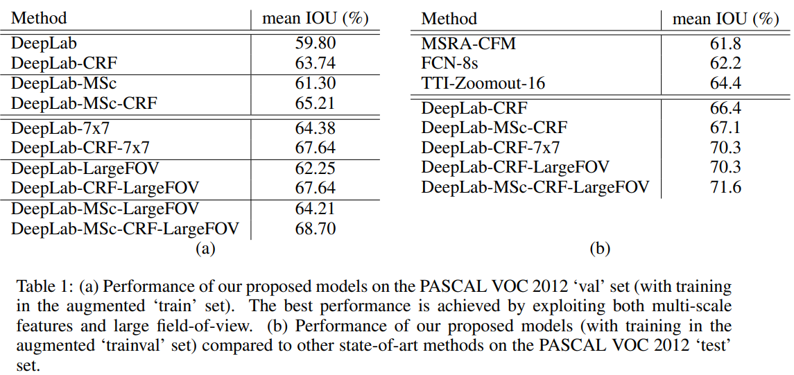

  - MSc : multi-scale
  - LargeFOV: large field-of-view

## DeepLab V2

  - 使用 Atrous Convolution 提高特征图分辨率，减少信息丢失
  - **引入 ASPP，提高多尺度能力**
  - 使用 Full Connected CRF 提高边缘精度

### Atrous Convolution

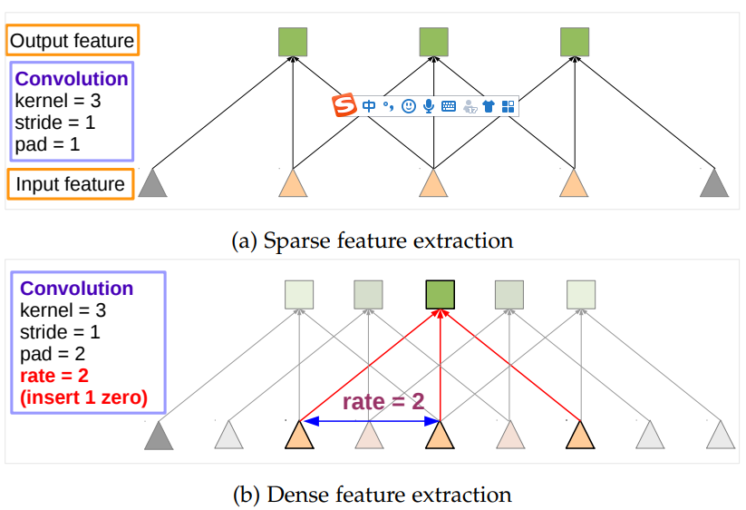
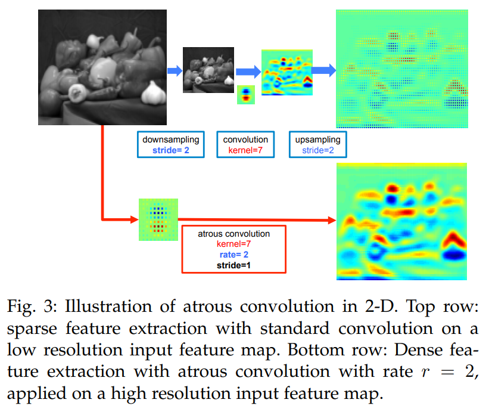

### ASPP - Atrous Spatial Pyramid Pooling - 空洞空间卷积池化金字塔

  - 多尺度空洞卷积并行
  - 在给定的 Input Feature Map上以r=(6,12,18,24)的3×3空洞卷积并行采样
  - 各分支采样后结果最后融合到一起(通道相同，做像素加)，得到最终预测结果

-----

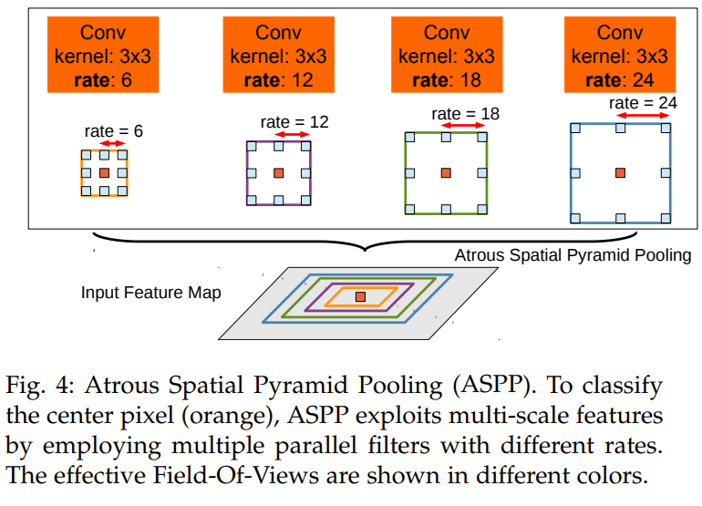
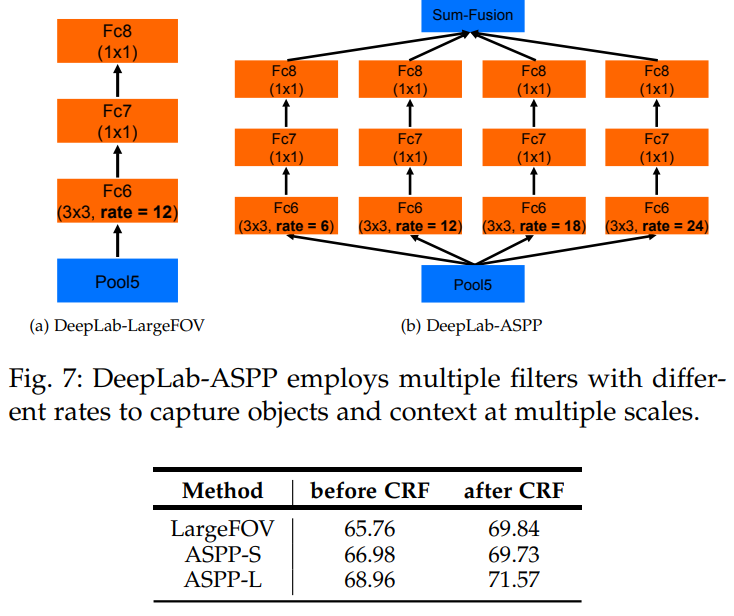

## DeepLab V3

  - 抽象化，提出 framework，可以在其他网络中使用
  - 改进了 ASPP 模块
      - 使用 BN Layer
      - 使用GAP，克服远距离下有效权重减少的问题
      - 1 个 1x1， 3 个 3x3, rate: (6, 12, 18)
  - 引入 Resnet Block
      - 复制 ResNet最后一个 block 多个副本，级联到一起
      - 每个 block 包含3个卷积
      - 除了最后一个 block，其他 block 最后一个卷积 stride 为 2
      - 使用不同的 rate 的空洞卷积替换卷积，以维持原图大小
  - 丢弃CRF

### New ASPP

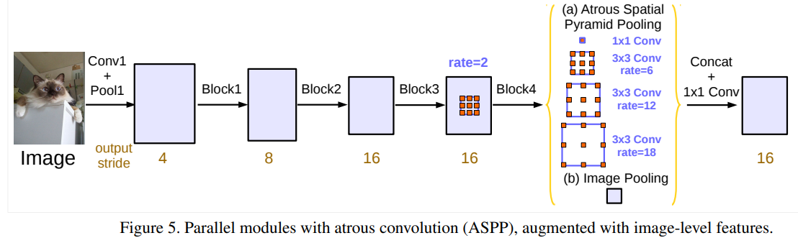

### Resnet Block

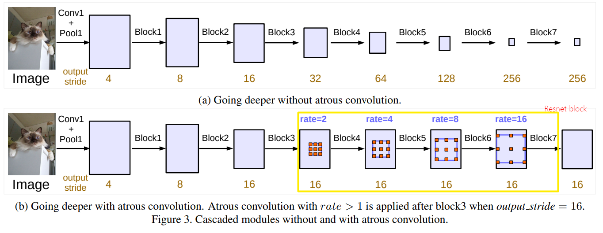

## DeepLab V3+

  - 在encoder部分加入了Xception的结构减少了参数量，提高运行速度

### model 结构

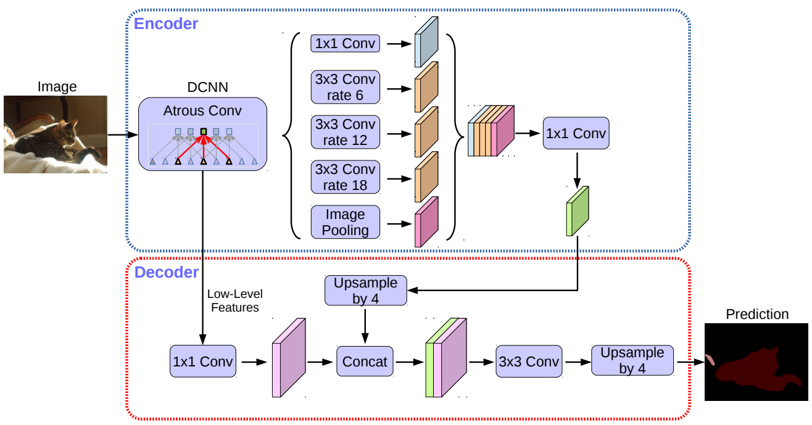

### Encoder-Decoder with Atrous Conv

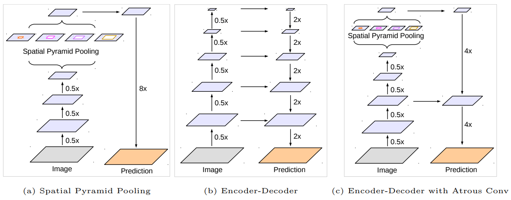

### Depthwise separable convolution

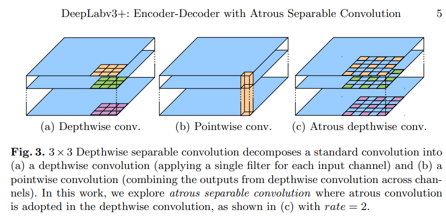

## 公式

### 空洞卷积

$$ y\[i\]=\\sum\_{k=1}^{K}x\[i+r\\cdot k\],w\[k\],\\qquad
K\_{eff}=K+(K-1)(r-1) $$

其中：

  - $x$：输入特征，$w$：长度为 $K$ 的卷积核 (二维时对两个方向分别如此)，$y$：输出；$i$ 为位置
  - $r$：空洞率 (dilation rate)，卷积核相邻两个权重之间插入 $r-1$ 个空洞；$r=1$ 即普通卷积
  - $K\_{eff}$：等效卷积核大小；例：$K=3$，$r=2$ 时等效 $5\\times5$，$r=4$ 时等效
    $9\\times9$
  - 好处：不增加参数和计算量，就能扩大感受野，并且可以去掉池化的下采样而不损失感受野，因此输出特征图可以保持较高分辨率 (输出步长
    `output stride` 为 $8$ 或 $16$，而不是 $32$)

### ASPP

$$
\\mathrm{ASPP}(F)=\\mathrm{Fuse}\\Bigl({\\mathrm{Conv}*{3\\times3}^{(r)}(F)}*{r\\in{6,12,18,24}}\\Bigr)
$$

其中：

  - $F$：backbone 输出的特征图；$r$：各分支的空洞率，V2 使用 ${6,12,18,24}$，V3 使用
    ${6,12,18}$ 并增加 $1\\times1$ 卷积和全局平均池化 (GAP) 分支，所有分支都加 BN
  - `Fuse`：V2 把各分支的输出逐点相加，V3/V3+ 在通道上拼接再用 $1\\times1$ 卷积融合
  - 并行的多个空洞率相当于用多个不同大小的视野同时观察同一特征图，捕获不同尺度的目标和上下文

### 全连接 CRF (V1/V2)

$$ E(\\mathbf
x)=\\sum\_i\\theta\_i(x\_i)+\\sum\_{i\<j}\\theta\_{ij}(x\_i,x\_j),\\qquad
\\theta\_i(x\_i)=-\\log P(x\_i) $$

$$
\\theta\_{ij}(x\_i,x\_j)=\\mu(x\_i,x\_j)\\Bigl\[w\_1e^{-\\frac{|p\_i-p\_j|^2}{2\\sigma\_\\alpha^2}-\\frac{|I\_i-I\_j|^2}{2\\sigma\_\\beta^2}}+w\_2e^{-\\frac{|p\_i-p\_j|^2}{2\\sigma\_\\gamma^2}}\\Bigr\]
$$

其中：

  - $\\mathbf x$：所有像素的标签；$E(\\mathbf x)$：能量，CRF 推断就是找使能量最小的标签
  - $\\theta\_i$：一元势，等于 CNN 预测概率的负对数；$\\theta\_{ij}$：二元势，约束任意两个像素 $i,j$
    (全连接，不只相邻像素) 的标签关系
  - $\\mu(x\_i,x\_j)=\[x\_i\\ne
    x\_j\]$：标签不同时才有惩罚；$p\_i$：像素位置，$I\_i$：像素颜色
  - 第一项高斯核：位置近且颜色相似的像素倾向于同标签 (外观核，权重 $w\_1$，尺度
    $\\sigma\_\\alpha,\\sigma\_\\beta$)；第二项：位置近的像素倾向于同标签 (平滑核，权重
    $w\_2$，尺度 $\\sigma\_\\gamma$)
  - 作用：作为后处理，用图像的边缘信息把 CNN 输出的模糊边界锐化；CRF 不参与端到端训练，推理较慢，V3 起不再使用

## 版本对比

| 版本  | 主要改进                                    | VOC 2012 test mIoU `[待核实]` |
| --- | --------------------------------------- | -------------------------- |
| V1  | 空洞卷积 + 全连接 CRF                          | 71.6                       |
| V2  | ASPP + ResNet 骨干                        | 79.7                       |
| V3  | 改进 ASPP (BN + GAP)、级联空洞 ResNet 块、去掉 CRF | 85.7                       |
| V3+ | 加解码器、Xception + 深度可分离空洞卷积               | 89.0 (预训练数据更多)             |

表中：mIoU 随版本逐步提高；V3 去掉 CRF 后依然更好，说明空洞卷积与 ASPP 已能提供足够的细节；V3+ 的数字使用了
COCO/JFT 预训练，与前几行的训练数据不完全一致。

## V3+ 的结构

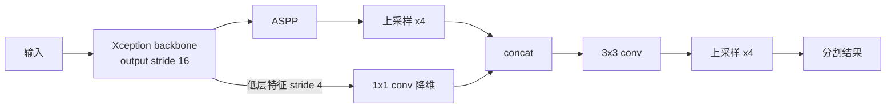

图中：

  - 左边是编码器：backbone 以 $1/16$ 分辨率输出，ASPP 在其上聚合多尺度上下文
  - 解码器很简单：把 ASPP 的输出上采样 $4$ 倍，与 backbone 的低层 ($1/4$) 特征拼接，再用
    $3\\times3$ 卷积精化，最后上采样 $4$ 倍回到原图；低层特征先用 $1\\times1$
    卷积降到少量通道，避免压过高层语义
  - 与 V3 相比，解码器让物体边界更清晰；其中的 Xception 和深度可分离卷积见
    [Xception](/0050_ML_Tasks_Image_Classification_Xception)

## 与其他方法的对比

  - 与
    [FCN](/0160_ML_Tasks_Image_Segmentation_FCN)/[UNet](/0161_ML_Tasks_Image_Segmentation_UNet)
    相比：DeepLab 主要靠空洞卷积保持高分辨率特征 (不是靠跳连恢复)，所以不需要很深的解码器
  - 计算量：保持 $1/8$ 或 $1/16$ 分辨率的特征图，比标准 $1/32$ 的网络计算量大很多，部署时 output stride
    取 $16$ 是常见折中

## Reference

  - [Github
    repo](https://github.com/tensorflow/models/tree/master/research/deeplab)
  - [Project - DeepLab](http://liangchiehchen.com/projects/DeepLab.html)
  - [DeepLab:
    Models](http://liangchiehchen.com/projects/DeepLab_Models.html)
  - [Blog - 一作 - Liang-Chieh (Jay) Chen](http://liangchiehchen.com/)
  - [Semantic Segmentation
    --DeepLab(1,2,3)系列总结](https://blog.csdn.net/u011974639/article/details/79148719)
  - **DeepLab V1**
      - [paper - semantic image segmentation with deep convolutional
        nets and fully connected
        CRFs](https://arxiv.org/pdf/1412.7062v3.pdf)
      - [【论文阅读】semantic image segmentation with deep convolutional nets
        and fully connected
        CRFs](https://blog.csdn.net/u011582187/article/details/80345431)
      - [Rethinking-Atrous-Convolution-for-Semantic-Image-Segmentation-1.pdf](http://web.eng.tau.ac.il/deep_learn/wp-content/uploads/2017/12/Rethinking-Atrous-Convolution-for-Semantic-Image-Segmentation-1.pdf)
      - [Code](https://bitbucket.org/deeplab/deeplab-public/src/master/)
      - [netscope - deeplab
        v1](http://ethereon.github.io/netscope/#/gist/7c54e9d23a2e84d094496bb190592fc5)
      - [netscope - Deeplab v1
        MSc](http://ethereon.github.io/netscope/#/gist/3f1050c1f12575b768ac7633986dbc8e)
      - [netscope - DeepLab v1
        LargeFOV](http://ethereon.github.io/netscope/#/gist/51dca179ed7c2b5045d45a89ce4e00f5)
  - **DeepLab V2**
      - [paper - 2017 - DeepLab: Semantic Image Segmentation with Deep
        Convolutional Nets, Atrous Convolution, and Fully Connected CRFs
        ](https://arxiv.org/pdf/1606.00915.pdf)
      - [论文阅读：《DeepLab-v2: Semantic Image Segmentation
        》](https://blog.csdn.net/qq_36165459/article/details/78340094)
      - [Code](https://bitbucket.org/aquariusjay/deeplab-public-ver2/src/master/)
      - [netscope - Deeplab v2
        VGG16](http://ethereon.github.io/netscope/#/gist/d1f1c884572ae15d7394dc37232c6216)
      - [netscope - Deeplab v2
        resnet101](http://ethereon.github.io/netscope/#/gist/231825df213d3af8c668c2870b394f4d)
  - **DeepLab V3**
      - [Rethinking Atrous Convolution for Semantic Image
        Segmentation](https://arxiv.org/pdf/1706.05587.pdf)
  - **DeepLab V3+**
      - [Encoder-Decoder with Atrous Separable Convolution for Semantic
        Image Segmentation](https://arxiv.org/pdf/1802.02611.pdf)
