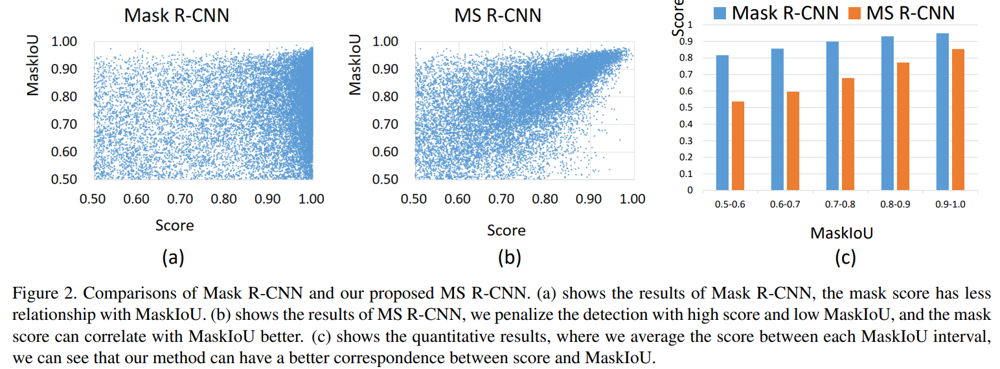
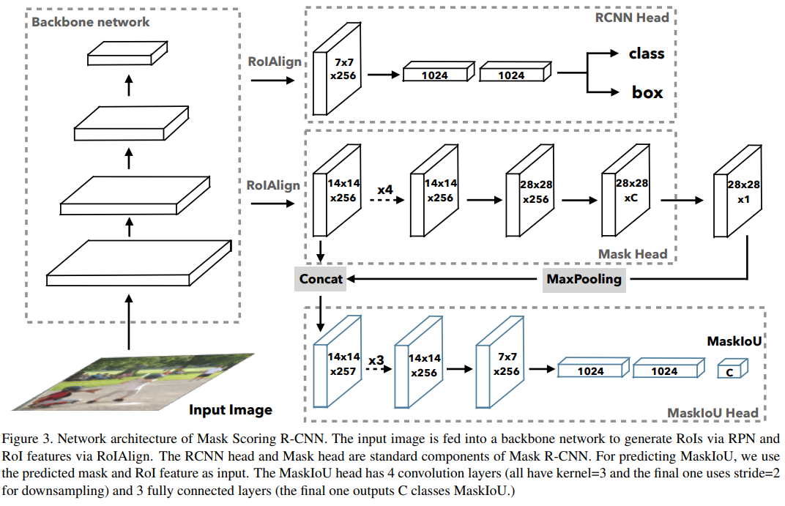
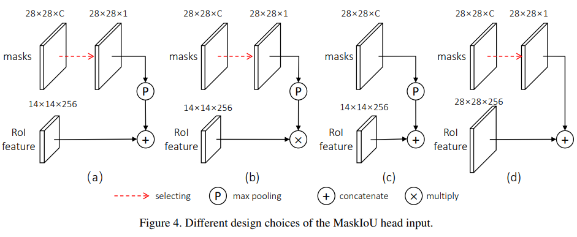
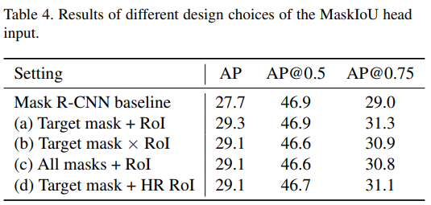
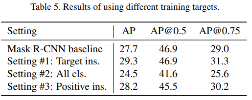
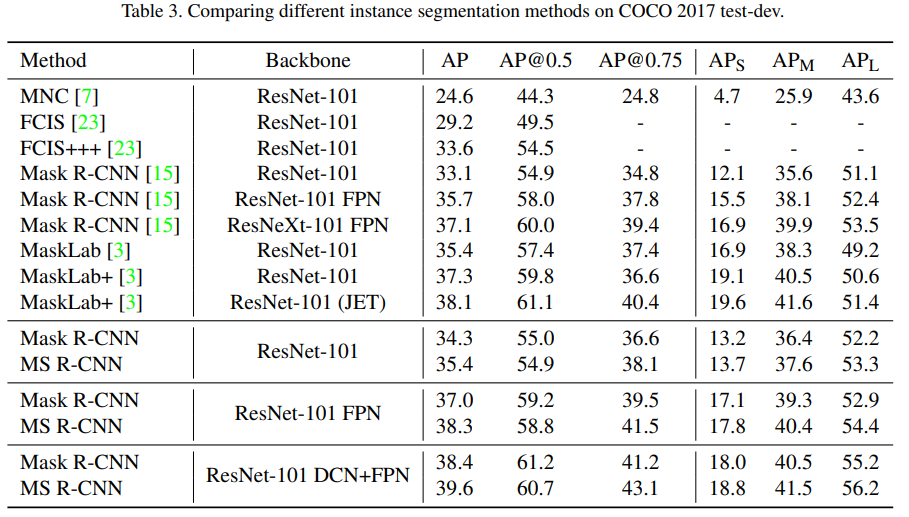
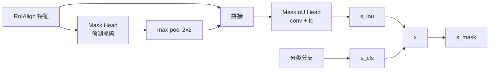

-----

| Title     | ML Tasks Image Segmentation MSRCNN                    |
| --------- | ----------------------------------------------------- |
| Created @ | `2019-06-22T08:30:59Z`                                |
| Updated @ | `2026-11-25T16:51:59Z`                                |
| Labels    | \`\`                                                  |
| Edit @    | [here](https://github.com/junxnone/aiwiki/issues/164) |

-----

# Mask Scoring RCNN

## Reference

  - [paper - 2019 - Mask Scoring
    R-CNN](https://arxiv.org/pdf/1903.00241.pdf)
  - [Code - Mask Scoring
    R-CNN](https://github.com/zjhuang22/maskscoring_rcnn)
  - [2019CVPR《Mask Scoring
    R-CNN》](https://www.cnblogs.com/wemo/p/10505970.html)
  - [性能超越何恺明Mask
    R-CNN！华科大开源图像分割新方法](https://www.jiqizhixin.com/articles/2019-05-15-4)
  - [CVPR2019 | Mask Scoring R-CNN
    论文解读](https://www.cnblogs.com/ManWingloeng/p/10717578.html)

## Brief

### Mask RCNN vs MS RCNN

  - Mask R-CNN的MaskIoU与分类置信度没有太强的关联
  - MS R-CNN 在 Mask R-CNN 框架上添加一个分支 MaskIoU Head 模块，用来学习MaskIoU

### MaskIoU Head

  - Input = `Predicted mask` + `Max Pooling (2,2)` + `ROIAlign layer`
  - Training
      - 使用 `threshold=0.5` 处理 mask
  - Inference
      - final mask confidence = MaskIoU x `classification score`

  - 不同的 `MaskIoU Head Input`

  - 不同的 `Training Targets`

## mAP 对比

  - 相比 Mask R-CNN
      - AP-S/M/L 上都有所提升
      - AP 0.5 有下降，0.75 有上升，整体 AP 提升一个点多

## 公式

$$ s\_{mask}=s\_{cls}\\cdot s\_{iou},\\qquad
\\mathrm{MaskIoU}=\\frac{|M\_{pred}\\cap M\_{gt}|}{|M\_{pred}\\cup
M\_{gt}|} $$

$$ L\_{MaskIoU}=\\bigl(s\_{iou}-\\mathrm{MaskIoU}\\bigr)^2 $$

其中：

  - $s\_{cls}$：Mask R-CNN 的分类置信度；$s\_{iou}$：新增的 MaskIoU Head
    对该实例掩码质量的预测值，范围 $\[0,1\]$
  - $s\_{mask}$：最终的掩码得分，用于对实例排序和计算 AP；原来只用 $s\_{cls}$，而分类得分高并不代表掩码精确
  - $M\_{pred}$：预测掩码经阈值 $0.5$
    二值化后的结果；$M\_{gt}$：对应的真实掩码；$\\mathrm{MaskIoU}$：二者的交并比，是预测掩码质量的真实度量
  - $L\_{MaskIoU}$：对 $s\_{iou}$ 做 $L\_2$ 回归，使其逼近真实的 MaskIoU

## 动机与结构

图中：

  - MaskIoU Head 的输入是 RoIAlign 的特征与预测掩码的拼接 (掩码先经 $2\\times2$
    最大池化，使尺寸与特征匹配)
  - 输出的 $s\_{iou}$ 与分类分支的 $s\_{cls}$ 相乘得到最终的掩码得分
  - 训练时只对有前景的实例，用真实 MaskIoU 作回归目标；推理时的额外计算很小

问题所在：Mask R-CNN 里分类得分和掩码质量的相关性弱，例如一个类别判断很准但掩码很差的实例，仍会得到高分，排在前面，使 AP
偏低。校正得分后，高质量掩码排在前面，AP 在严格的 IoU 阈值下提高。

## 结果

| 模型         | AP         | $\\mathrm{AP}\_{50}$ | $\\mathrm{AP}\_{75}$ |
| ---------- | ---------- | -------------------- | -------------------- |
| Mask R-CNN | 基线         | 基线                   | 基线                   |
| MS R-CNN   | 约提高 1.5 个点 | 略降                   | 明显提高                 |

表中：与上文结论一致，MS R-CNN 在 $\\mathrm{AP}*{75}$ (严格的 IoU) 上提高而在
$\\mathrm{AP}*{50}$ 上略降，因为它主要改善的是高质量掩码的排序，对粗略的检出没有帮助；具体数值请查阅论文，不同
backbone 的数值不同 `[待核实]`。

## 与 Mask R-CNN 的关系

  - 基于 [Mask R-CNN](/0163_ML_Tasks_Image_Segmentation_MaskRCNN)，只增加一个
    MaskIoU Head，其余不变，因此可以插入到其他两阶段实例分割方法中
  - 思想与检测里的 IoU-aware 分类 (如 IoU-Net) 类似：让置信度反映定位或掩码的质量，而不仅是分类的把握
