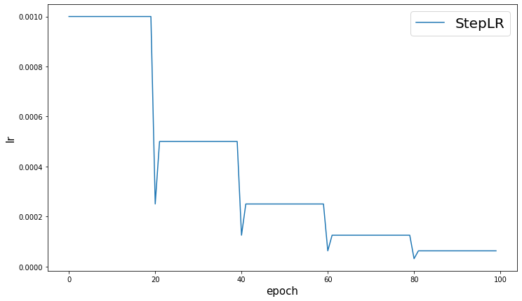
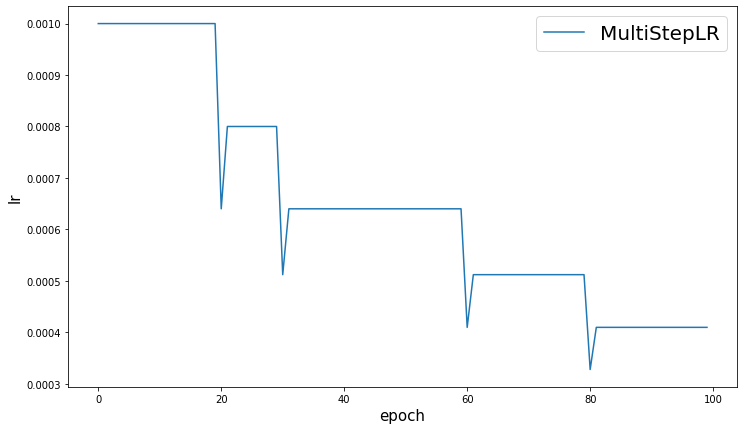
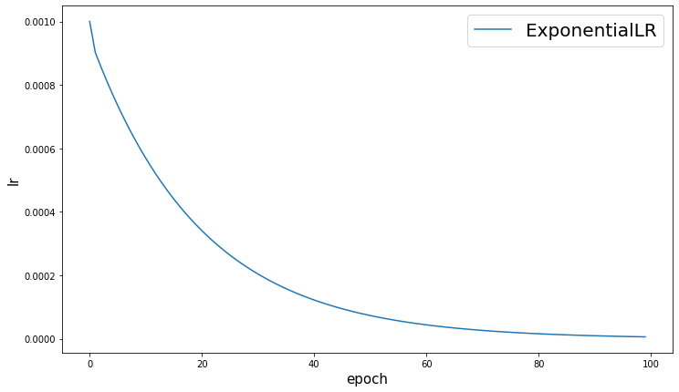
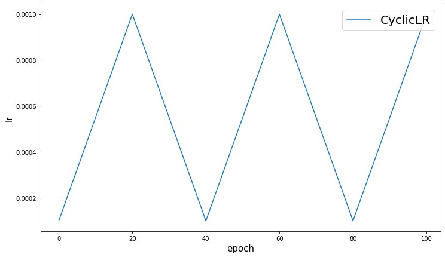
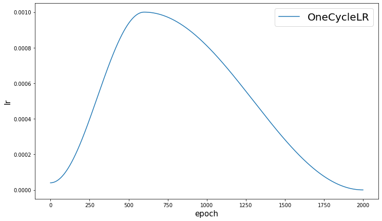
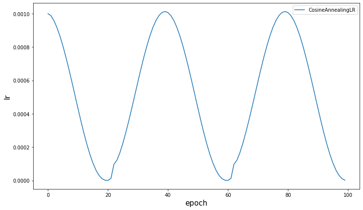
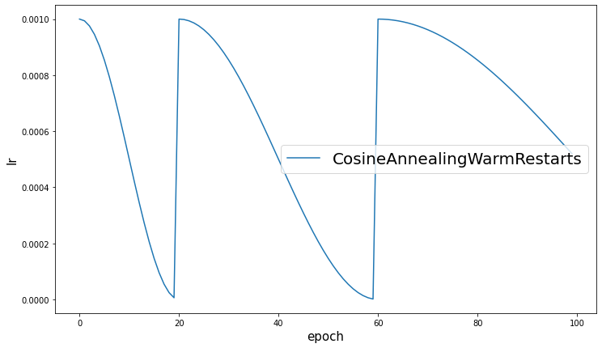

-----

| Title     | Tools Pytorch Optimizer                               |
| --------- | ----------------------------------------------------- |
| Created @ | `2020-01-06T09:22:23Z`                                |
| Updated @ | `2026-10-21T08:03:19Z`                                |
| Labels    | \`\`                                                  |
| Edit @    | [here](https://github.com/junxnone/aiwiki/issues/174) |

-----

# Pytorch Optimizer

  - Optimezer - `torch.optim`
  - Learning Rate Scheduler

## Optimizer

| Optimizer  | Description                                                                 |
| ---------- | --------------------------------------------------------------------------- |
| Adadelta   | 自适应学习率方法，不需要手动设置全局学习率，对历史梯度用滑动窗口而不是全部累积                                     |
| Adagrad    | 自适应学习率，按参数历史梯度平方和的倒数缩放，训练后期学习率会单调衰减到很小                                      |
| Adam       | 一阶矩+二阶矩的自适应学习率方法，深度学习里最常用的默认优化器之一                                           |
| AdamW      | Adam 的改进版，把权重衰减（Weight Decay）从梯度更新里解耦出来，正则化效果更正确，是目前 Transformer 类模型训练的事实标准 |
| SparseAdam | Adam 的稀疏梯度版本，适合词嵌入这类大部分参数每步只有少量更新的场景                                        |
| Adamax     | Adam 的变种，用无穷范数替代二阶矩估计，对某些场景数值更稳定                                            |
| ASGD       | 平均随机梯度下降，对参数做滑动平均                                                           |
| LBFGS      | 拟牛顿法，适合小数据集/全批量优化，深度学习里较少使用                                                 |
| RMSprop    | 自适应学习率，用梯度平方的指数滑动平均缩放学习率，早期 RNN 训练中常用                                       |
| Rprop      | 弹性反向传播，只用梯度符号而非大小调整步长，不适合 mini-batch（小批量噪声会扰乱符号）                            |
| SGD        | 最基础的随机梯度下降，通常配合 momentum 使用                                                 |

## 性能相关参数：`fused=True`

PyTorch 2.0 起，部分优化器（如 `AdamW`/`SGD`）支持 `fused=True` 参数，把参数更新涉及的多个算子融合成一个
CUDA kernel 执行，减少 kernel launch 开销，在 GPU 上通常比默认实现更快：

``` python
optimizer = torch.optim.AdamW(model.parameters(), lr=1e-3, fused=True)
```

## Learning Rate Scheduler

| Learning Rate Scheduler     | Description                                                  |
| --------------------------- | ------------------------------------------------------------ |
| StepLR                      |  |
| MultiStepLR                 |  |
| ExponentialLR               |  |
| CyclicLR                    |  |
| OneCycleLR                  |  |
| CosineAnnealingLR           |  |
| CosineAnnealingWarmRestarts |  |
| MultiplicativeLR            |  |
| LambdaLR                    | 用用户自定义函数计算每个 epoch 的学习率缩放因子，是最灵活的调度器形式                       |
| ReduceLROnPlateau           | 当 metrics 不再提升时减少学习率                                         |

> 调用顺序：每个 iteration 里应先 `optimizer.step()` 再
> `scheduler.step()`，顺序反了会导致第一个 epoch 的学习率被跳过。

## Tips

CIFAR10 example 用 GPU 的话需要在 `net.to(device)` 后重新定义一次 `optimizer`

    net = net.to(device)
    optimizer = optim.SGD(net.parameters(), lr=0.0001, momentum=0.9)
    for epoch in range(2):  # loop over the dataset multiple times
    
        running_loss = 0.0
        for i, data in enumerate(trainloader, 0):
            # get the inputs
            inputs, labels = data[0].to(device), data[1].to(device)
    
            # zero the parameter gradients
            optimizer.zero_grad()
    
            # forward + backward + optimize
            outputs = net(inputs)
            loss = criterion(outputs, labels)
            loss.backward()
            optimizer.step()
    
            # print statistics
            running_loss += loss.item()
            if i % 2000 == 1999:    # print every 2000 mini-batches
                print('[%d, %5d] loss: %.3f' %
                      (epoch + 1, i + 1, running_loss / 2000))
                running_loss = 0.0

  - [torch.optim](https://pytorch.org/docs/stable/optim.html) 也提到了需要把
    optimizer 定义放在 `.cuda()` 之后

## Reference

  - [module-torch.optim](https://pytorch.org/docs/stable/optim.html#module-torch.optim)
  - [torch\_optim\_lr\_scheduler.ipynb](https://github.com/junxnone/examples/blob/master/pytorch/torch_optim_lr_scheduler.ipynb)
  - [Parameter optimization in neural
    networks](https://www.deeplearning.ai/ai-notes/optimization/)
  - [Tools Pytorch Pipeline](0173_Tools_Pytorch_Pipeline)
