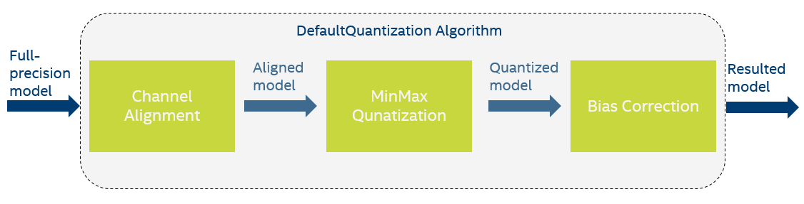
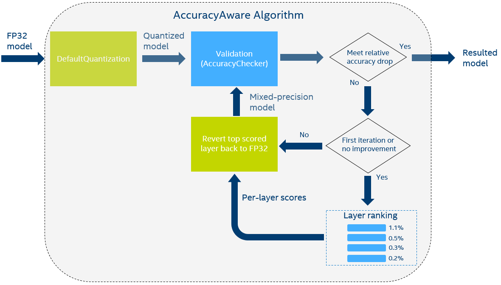

-----

| Title     | Tools OV POT                                          |
| --------- | ----------------------------------------------------- |
| Created @ | `2021-02-02T03:09:49Z`                                |
| Updated @ | `2026-11-26T09:54:39Z`                                |
| Labels    | \`\`                                                  |
| Edit @    | [here](https://github.com/junxnone/aiwiki/issues/177) |

-----

# ~~POT~~

> 已经被 [NNCF](0451_Tools_OV_NNCF) 替代

  - POT - `Post-Training Optimization Toolkit`
  - POT Command Line
  - POT API
  - OpenVINO Deep Learning Workbench

POT 是 OpenVINO 的训练后量化工具：不重新训练，用少量校准数据把 FP32 模型量化成 INT8。

## 量化的基本公式

$$ q=\\mathrm{clip}\\Big(\\mathrm{round}\\big(\\tfrac{x}{s}\\big)+z,\\
q\_{min},\\ q\_{max}\\Big),\\qquad \\hat{x}=s,(q-z) $$

其中：

  - $x$：浮点值；$q$：量化后的整数（INT8 时 $q\_{min},q\_{max}$ 为 $-128,127$ 或
    $0,255$）
  - $s$：scale（缩放系数），由校准数据统计得到；$z$：zero point（零点）
  - $\\hat{x}$：反量化后的近似值；量化误差来自取整和截断
  - 校准数据用来估计激活的取值范围，从而确定 $s$ 和 $z$

## Pipeline

| Num | Steps                                              | Description                         |
| --- | -------------------------------------------------- | ----------------------------------- |
| 1   | Install `requirments` & `accuracy_checker` & `POT` |                                     |
| 2   | MO ==\> FP32 Model                                 |                                     |
| 3   | Prepare Dataset                                    |                                     |
| 4   | Prepare `accuracy checker` config file             | yaml format                         |
| 5   | Prepare `POT` config file                          | json format                         |
| 6   | Run `POT`                                          | Gen INT8 Model                      |
| 7   | `Optional` Convert Blob                            | compile\_tool junxnone/tech-io\#911 |

表中：

  - **MO**：Model Optimizer；**IR**：OpenVINO 中间表示
  - 对比结论：流程是「FP32 的 IR → 校准量化 → INT8 的 IR」，配置分别写在 accuracy checker 的
    yaml 和 POT 的 json 里

POT 配置（json）的典型结构：

``` json
{
  "model": { "model_name": "m", "model": "m.xml", "weights": "m.bin" },
  "engine": { "config": "accuracy_checker.yml" },
  "compression": {
    "algorithms": [
      { "name": "DefaultQuantization",
        "params": { "preset": "performance", "stat_subset_size": 300 } }
    ]
  }
}
```

其中：

  - `model`：FP32 模型文件；`engine.config`：Accuracy Checker 的配置，描述数据集与预处理、指标
  - `algorithms`：使用的量化算法；`preset`：`performance`（速度优先）或 `mixed`（精度优先）
  - `stat_subset_size`：用多少张校准样本统计激活范围

## Algos

  - [DefaultQuantization
    Algorithm](https://docs.openvinotoolkit.org/latest/pot_compression_algorithms_quantization_default_README.html)
  - [AccuracyAwareQuantization
    Algorithm](https://docs.openvinotoolkit.org/latest/pot_compression_algorithms_quantization_accuracy_aware_README.html)
  - [Tree-Structured Parzen Estimator
    (TPE)](https://docs.openvinotoolkit.org/latest/pot_compression_optimization_tpe_README.html)

| 算法                        | 说明                                                 |
| ------------------------- | -------------------------------------------------- |
| DefaultQuantization       | 默认的快速量化，只需少量未标注的校准数据                               |
| AccuracyAwareQuantization | 量化后如果精度下降超过阈值，把对精度影响大的层恢复为浮点                       |
| TPE                       | 用 Tree-Structured Parzen Estimator 搜索量化参数，贝叶斯优化的一种 |

表中：对比结论：先用 DefaultQuantization，精度不达标再用 AccuracyAwareQuantization；TPE
用于进一步搜索参数。




图中：以上两图为原文档附带的 POT 相关示意图，对应上面的流程与算法。

## Reference

  - [Post-Training Optimization
    Toolkit](https://docs.openvinotoolkit.org/latest/pot_README.html)
  - [Post-Training Optimization Toolkit Installation
    Guide](https://docs.openvinotoolkit.org/latest/pot_InstallationGuide.html)
