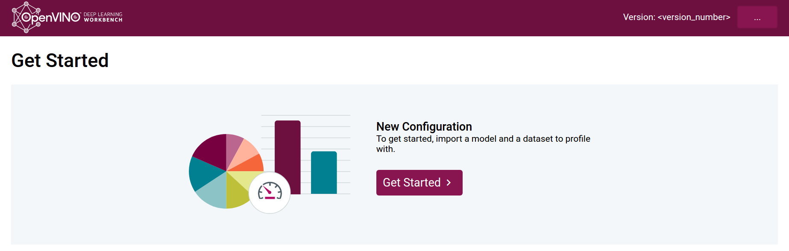
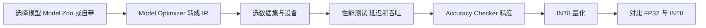

-----

| Title     | Tools OV Workbench                                    |
| --------- | ----------------------------------------------------- |
| Created @ | `2020-02-03T03:42:45Z`                                |
| Updated @ | `2026-11-26T09:54:37Z`                                |
| Labels    | \`\`                                                  |
| Edit @    | [here](https://github.com/junxnone/aiwiki/issues/178) |

-----

# Workbench

Deep Learning Workbench（DL Workbench）是 OpenVINO 提供的基于 Web 的图形界面工具，把「下载模型
→ 转换 → 量化 → 精度检查 → 性能对比」整条流程放在一个界面里完成，不需要手写命令行。

> 该工具在较新的 OpenVINO 版本中已被官方弃用，请以官方文档为准；命令行替代方案是 Model Optimizer /
> `ovc`、`benchmark_app`、NNCF（见
> [NNCF](https://github.com/junxnone/aiwiki/issues/451)）。

  - 基于web的图形界面
  - Download Intel OpenVINO model zoo
  - Model Optimizer
  - INT8 model
  - Accuracy Checker
  - Visualize Model
  - Compare Performance
  - Remote Machine

图中：该图为原文档附带的 Workbench 界面截图，对应上面的功能列表。

## 工作流

图中：

  - 从左到右是 Workbench 引导的典型流程：先得到可用的 IR 模型，再测性能、测精度，再量化，最后把不同版本的结果放在一起比较
  - Remote Machine：可以让测试在远程设备上执行，而界面在本地

## 功能对应

| 功能      | 对应的命令行工具                                                               |
| ------- | ---------------------------------------------------------------------- |
| 模型转换    | Model Optimizer（`mo`）/ `ovc`                                           |
| 性能测试    | `benchmark_app`                                                        |
| 精度检查    | Accuracy Checker                                                       |
| INT8 量化 | POT（已被 NNCF 替代，见 [POT](https://github.com/junxnone/aiwiki/issues/177)） |

表中：对比结论：Workbench 是这些命令行工具的图形化封装，适合入门和快速对比。

## Reference

  - [Deep Learning
    Workbench](https://docs.openvinotoolkit.org/latest/_docs_Workbench_DG_Introduction.html)
