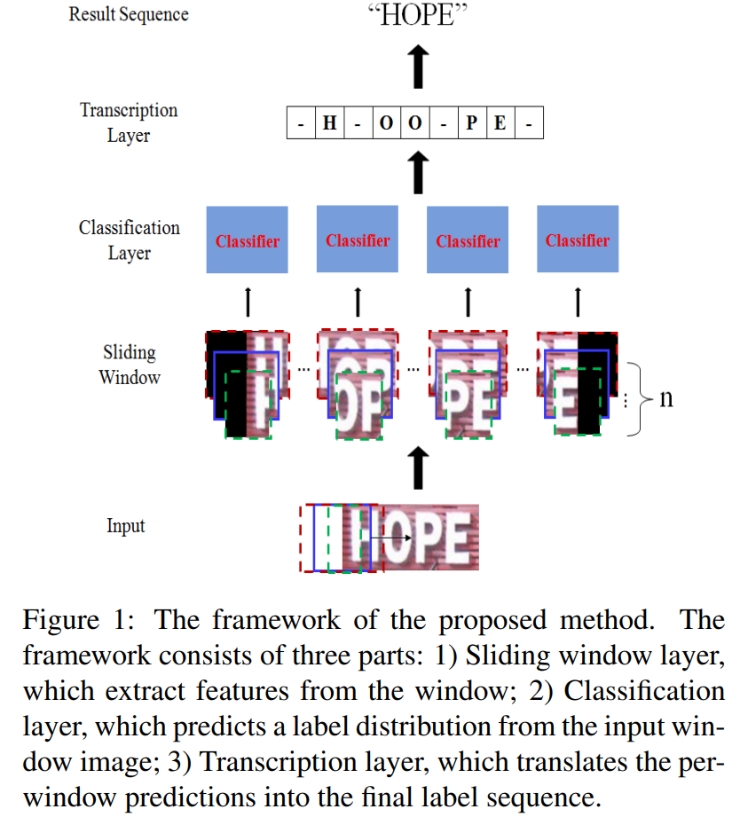
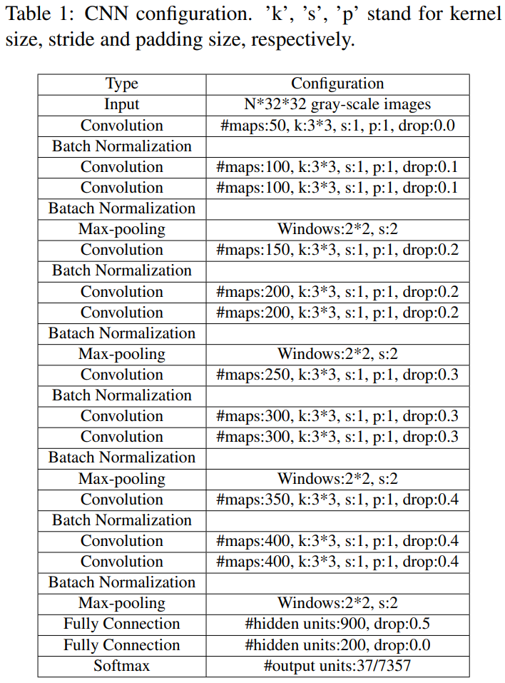
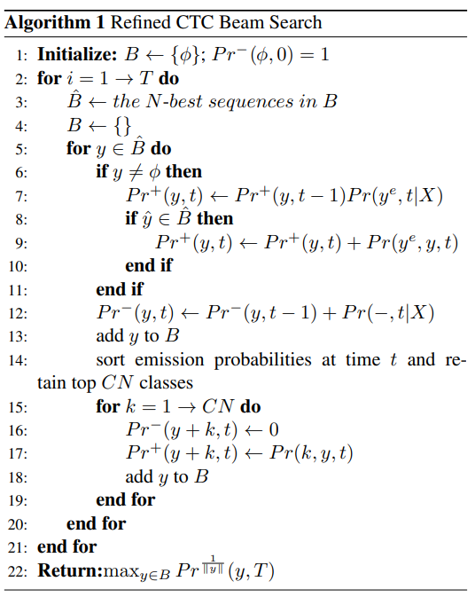
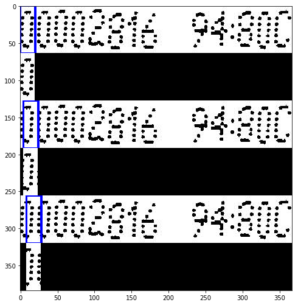

-----

| Title     | ML Tasks Image OCR SW                                 |
| --------- | ----------------------------------------------------- |
| Created @ | `2020-05-08T06:06:40Z`                                |
| Updated @ | `2026-11-25T16:56:11Z`                                |
| Labels    | \`\`                                                  |
| Edit @    | [here](https://github.com/junxnone/aiwiki/issues/188) |

-----

# Sliding Windows CNN CTC

## Reference

  - [paper - 2017 - Scene Text Recognition with Sliding Convolutional
    Character Models](https://arxiv.org/pdf/1709.01727.pdf)
  - [场景文字识别Sliding
    Convolution笔记](https://blog.csdn.net/qq_14845119/article/details/79312860)
  - [Sequence Modeling With CTC](https://distill.pub/2017/ctc/)

## Brief

  - Sliding windows + CNN + [CTC](/0189_ML_Tasks_Image_OCR_CTC)
  - English & Chinese
      - Softmax Layer - 37/7357 English/Chinese

## Arch

| Name                    | Description                     |
| ----------------------- | ------------------------------- |
| Sliding window          | crop `bbox x N`                 |
| Classification Layer    | feature --\> label              |
| CTC Transcription layer | label --\> final predict result |

**Preprocess & Sliding Windows**

| Preprocess                                              | Training                                                                                                             | Testing |
| ------------------------------------------------------- | -------------------------------------------------------------------------------------------------------------------- | ------- |
| Input scale to `Height = 32`, Width 按比例缩放 (Pad -\> 256) | ✅                                                                                                                    | ✅       |
| Window size                                             | \- Single-scale `WxH = 32x32`  - Multi-scale `WxH = 32x24` - `WxH = 32x32` - `WxH = 32x40` - \> resize to `32x32` | `32x32` |
| Step Size `= 4`                                         | ✅                                                                                                                    | ✅       |

| Pipeline                                                     | CNN Layers                                                   | CTC Algo                                                     |
| ------------------------------------------------------------ | ------------------------------------------------------------ | ------------------------------------------------------------ |
|  |  |  |

| sliding windows examples |  |
| ------------------------ | ------------------------------------------------------------ |

## decoding

  - naive - `None` - `lexicon -free`
  - lexicon based
  - language model based

## 窗口数与计算量

$$ N\_{win}=\\left\\lfloor\\frac{W-w}{s}\\right\\rfloor+1 $$

其中：

  - $W$：缩放后图像的宽度 (这里为 $256$)；$w$：窗口宽度 ($32$)；$s$：滑动步长 ($4$)
  - $N\_{win}$：一行文字被切成的窗口数；例：$\\lfloor(256-32)/4\\rfloor+1=57$
  - 每个窗口都要独立过一遍 CNN 分类器，所以一张文字图要做 $57$ 次 CNN
    前向，而且相邻窗口大面积重叠，存在大量重复计算；这正是后来
    [CRNN](/0196_ML_Tasks_Image_OCR_CRNN) 的改进点：整图只做一次卷积，用特征图上的列作为序列

## 整体流程

图中：

  - 窗口序列相当于把二维图像变成一维序列，每个窗口输出一个类别分布 (英文 $37$ 类 = 字母 + 数字 + 空白 (blank)，中文
    $7357$ 类)
  - 窗口数 $N\_{win}$ 远大于文字字符数，同一个字符会被多个窗口覆盖，所以需要 CTC 把「逐窗口的预测」合并成文本，见
    [CTC](/0189_ML_Tasks_Image_OCR_CTC)

$$ P(\\mathbf y\\mid\\mathbf x)=\\sum\_{\\pi\\in\\mathcal
B^{-1}(\\mathbf y)}\\prod\_{t=1}^{N\_{win}}p(\\pi\_t\\mid\\mathbf
x),\\qquad L\_{CTC}=-\\log P(\\mathbf y\\mid\\mathbf x) $$

其中：

  - $\\mathbf x$：窗口序列的 CNN 输出；$\\mathbf y$：真实的文本标签；$\\pi$：长度为 $N\_{win}$
    的对齐路径 (每个窗口一个类别，可含 blank)
  - $\\mathcal B$：去除重复字符和 blank 的映射；$\\mathcal B^{-1}(\\mathbf
    y)$：所有能得到标签 $\\mathbf y$ 的路径的集合
  - $p(\\pi\_t\\mid\\mathbf x)$：第 $t$ 个窗口预测为 $\\pi\_t$ 的概率；$P(\\mathbf
    y\\mid\\mathbf x)$：标签的总概率，无需事先知道每个字符对应哪几个窗口，这就是 CTC 能免去字符级对齐标注的原因

## 训练与测试设置的说明

| 设置   | 训练                                                                                | 测试            |
| ---- | --------------------------------------------------------------------------------- | ------------- |
| 输入高度 | 缩放到 $32$                                                                          | 缩放到 $32$      |
| 窗口大小 | 单尺度 $32\\times32$；或多尺度 $32\\times24/32\\times32/32\\times40$ 再统一缩放到 $32\\times32$ | $32\\times32$ |
| 步长   | $4$                                                                               | $4$           |

表中：训练时多尺度窗口可以看作一种数据增强，提高对字符宽度变化的适应；测试用单尺度保持速度。解码方式见上文 decoding：naive
(最佳路径，不用词典)、基于词典、基于语言模型。

## 优缺点

  - 优点：不需要字符级切分标注，用 CTC 解决了对齐，结构简单
  - 缺点：滑动窗口重复计算多，速度慢；窗口大小固定，难以适应宽度差异大的字符；没有利用序列上下文，需要靠 CTC 和语言模型补偿
  - 改进：卷积特征共享 + 循环网络的 [CRNN](/0196_ML_Tasks_Image_OCR_CRNN)；总览见
    [OCR](/0200_ML_Tasks_Image_OCR)
